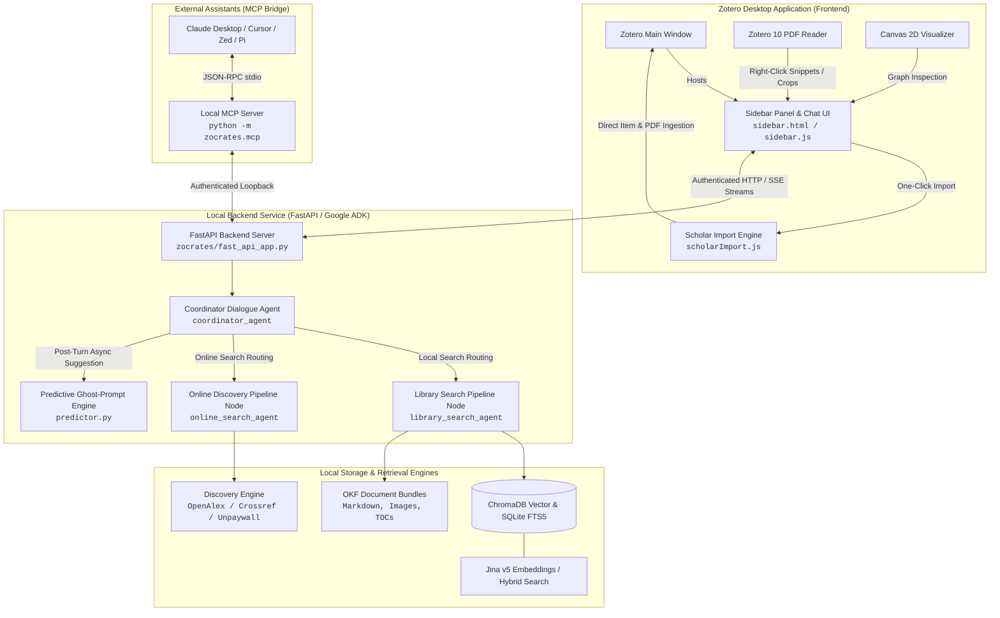

# Zocrates

> **An LLM-Powered Research Assistant Copilot for Zotero**

<p align="center">
  <a href="https://www.python.org/"></a>
  <a href="https://www.zotero.org/"></a>
  <a href="https://alexplaka.github.io/Zocrates/"></a>
  <a href="https://github.com/alexplaka/Zocrates/actions/workflows/test.yml"></a>
  <a href="LICENSE"></a>
</p>

---

## Overview

For researchers, an academic library represents years of careful curation: hundreds or thousands of papers, annotations, snapshots, and personal notes. Interacting with this repository has traditionally been manual—scrolling through folder trees, keyword searching metadata, and manually cross-referencing passages across PDFs.

> **Why "Zocrates"?**  
> The name **Zocrates** is a portmanteau of **Zotero** and **Socrates**, honoring the classical philosopher renowned for dialectical inquiry and intellectual honesty. Rather than acting as an ungrounded oracle, Zocrates embodies the Socratic method by actively questioning literature, probing research gaps, and demanding verifiable evidence for every claim. It transforms your personal Zotero collection from a passive repository into an inquisitive, rigorous dialogue partner.

**Zocrates transforms your personal Zotero library into an active, verifiable, and deeply integrated research partner.** Operating on your local machine, Zocrates pairs state-of-the-art agentic AI with academic rigor—providing grounded synthesis, instant PDF excerpts, visual chart understanding, literature relationship visualizers, and online discovery.

```
       Personal Zotero Library
    (PDFs, Notes, Metadata, Tags)
                  │
                  ▼
         ┌─────────────────┐
         │    Zocrates     │
         └────────┬────────┘
                  │
   ┌──────────────┼──────────────┐
   ▼              ▼              ▼
 Mode 1         Mode 2         Mode 3
 Native      Open Markdown   Local MCP
 Zotero        Knowledge      Server for
Companion       Bundles     Coding Agents
```

### Core Pillars

* **🔒 Local-First Privacy & Defense-in-Depth Security**: Your search indices, converted documents, strictly local deterministic relation graphs, and chat history remain 100% on your machine. Fortified with 256-bit cryptographic loopback token authentication, strict CORS isolation, DOM allowlist sanitization protecting Gecko `SystemPrincipal` privileges, path traversal containment, and encrypted credential storage via Mozilla's Login Manager (`Services.passwords`).
* **⚖️ Epistemic Honesty & Verifiable Attribution**: Automated per-occurrence claim verification using fast AI decision models, strict Two-Tier Source reporting (`# Cited Sources` and `## Other Considered Sources` so no evaluated literature is silently dropped), and interactive Evidence Peek popovers showing verbatim quotes and section breadcrumbs.
* **🤖 Autonomous Multi-Agent Dynamic Orchestration**: Powered by Google ADK dynamic workflows (`@node`), featuring a conversational Coordinator agent, an autonomous ReAct retrieval agent with tool budget enforcement, pre-rerank substantive chunk filtering, cross-encoder rerankers, and specialized academic synthesizers.
* **🖥️ Deep Native Desktop Integration**: In-Zotero split-pane sidebar, two-way Zotero PDF reader text and bounding-box area cropping, offline Canvas 2D paper relations visualizer with physics clustering, user-curated long-term memory via native Zotero notes, predictive ghost text input, and one-click online paper discovery and import.
* **💾 100% Copy-Paste Cross-Device Portability**: Move your entire research setup between machines (Linux, macOS, Windows) by simply copying the `zocrates-data` directory into your Zotero data folder. Engineered with fully portable relative paths (never hardcoding machine-specific file paths) and stable Zotero item keys, guaranteeing zero re-indexing, zero re-conversion, and full chat session continuity across devices.

---

## Architecture Overview

Zocrates operates as a coordinated desktop ecosystem: a native frontend extension running inside Zotero's Gecko runtime, a high-performance local FastAPI backend running Google ADK multi-agent dynamic workflows, local vector/keyword hybrid search indices, and a standard Model Context Protocol (MCP) bridge for external coding assistants.



---

## Three Flexible Ways to Work

Researchers have different technical setups and workflows. Zocrates adapts to you by offering three primary modes of operation:

| Dimension | Mode 1: Native Zotero Companion | Mode 2: Open Markdown Bundles | Mode 3: Local MCP Server Bridge |
| :--- | :--- | :--- | :--- |
| **Interface** | Embedded split-pane sidebar inside Zotero | Direct file tree in IDE or terminal | External agent (Claude Desktop, Cursor, Zed, Pi) |
| **Best For** | Daily reading, annotation, synthesis, discovery | Direct agent exploration (as-is), custom scripts, small libraries (hundreds of papers) | Full-library search & reading during programming |
| **PDF Reader Integration** | Right-click text & area box crops into chat | Extracted figures & tables in bundle folders | Resource URI resolution (`zotero://items/...`) |
| **Scalability** | Thousands of papers (Hybrid RAG + ToC caching) | Focused collections (hundreds of papers) | Scales to entire library with zero duplicate memory |
| **Literature Discovery** | Online search & 1-click import with PDF staging | N/A (Local converted Markdown files) | Extensible through client agent tools |

---

### Mode 1: Native Zotero Companion
For researchers who want an integrated desktop experience directly inside Zotero:
* **Embedded Workspace**: Operates inside Zotero's main window as a split-pane sidebar that automatically matches your chosen theme (Zotero Auto/Light/Dark, Slate, AMOLED, Sepia).
* **PDF Reader Context Excerpts & Area Crops**: Right-click highlighted text or draw an area box around a figure or table in Zotero's PDF Reader to add it instantly to your chat context. Visual crops are passed directly to multimodal vision models.
* **Predictive Ghost Text Engine**: Anticipates your next research question following literature search turns and renders translucent ghost text in the textarea with instant `[Tab ⇥]` acceptance.
* **Two-Tier Sources & Evidence Peeks**: Every claim is verified with occurrence-level probabilities. Clickable citation pills (`Watson & Crick, 1953`, `Vaswani *et al.*, 2017`) open popovers displaying verbatim quotes, section breadcrumbs, and direct reader jump links.
* **Online Discovery & One-Click Import**: When your queries extend beyond your library, Zocrates searches OpenAlex, Unpaywall, and Crossref, filters out duplicates, and stages Open Access PDFs for 1-click import into your collections.
* **Human-In-The-Loop Deep Research**: Pauses complex literature surveys with structured checkpoint cards summarizing findings and gaps, allowing you to guide the next search phase.

---

### Mode 2: Open Markdown Knowledge Bundles
For researchers who prefer plain files, Unix philosophy, or local scripting:
* **Open Knowledge Format (OKF v0.2)**: Automatically converts academic PDFs, HTML snapshots, and rich-text Zotero notes into standardized, human-readable document bundles.
* **Rich Self-Contained Bundles**:
  ```
  corpus/
  ├── index.md               # Root Knowledge Base Catalog (all documents)
  ├── AGENTS.md              # LLM navigation guide & structural protocol for coding agents
  └── <item_key>/            # Item-centric bundle directory (Zotero attachment key)
      ├── document.md        # Clean Markdown with rich YAML bibliographic frontmatter
      ├── toc.json / toc.md  # Pre-generated hierarchical Table of Contents & asset index
      ├── item_relations.md  # Verified local citation/similarity neighborhood
      ├── images/            # High-resolution extracted figures & diagrams
      └── tables/            # Clean structured data tables
  ```
* **Copy-Paste Portability**: Built entirely with self-contained relative paths (`storage/<key>/<file>`), ensuring document bundles remain fully portable across folders, operating systems, and machines without breaking links.
* **Direct Agent Exploration (As-Is)**: The root of the `corpus/` directory contains an auto-generated `AGENTS.md` navigation guide and a root `index.md` catalog, allowing coding agents (Cursor, Claude Code, Pi, Aider) to explore the converted library **as is**, right out of the box without requiring external bridges or services.
* **Optimal for Small Libraries**: Mode 2 is ideal for small to mid-sized libraries containing **hundreds of papers**, where direct file-system exploration and agent context windows are optimal. For larger libraries with **thousands of papers**, use [Mode 3 (Local MCP Server Bridge)](#mode-3-local-model-context-protocol-mcp-server) for scalable hybrid vector and full-text retrieval.

---

### Mode 3: Local Model Context Protocol (MCP) Server
For researchers who want external coding assistants and desktop agents to access their entire Zotero library:
* **Standards-Compliant MCP Bridge**: Implements Anthropic's open [Model Context Protocol (MCP)](https://modelcontextprotocol.io) over `stdio` (`python -m zocrates.mcp`).
* **Thin Bridge Architecture**: Communicates with the running Zocrates backend over authenticated loopback HTTP (`127.0.0.1:<port>`, default `8765`, with deterministic per-profile offsets or `ZOCRATES_BACKEND_URL`), sharing warm Jina v5 embeddings and ChromaDB singletons with **zero duplicate ML memory** and **zero SQLite lock collisions**.
* **4 Academic Retrieval Tools**:
  1. `search_corpus`: Semantic vector + SQLite FTS5 hybrid search across the whole library or active items.
  2. `get_document_toc`: Structural Table of Contents inspection with line offsets and asset captions.
  3. `read_document`: Reads full bundles or targeted sections.
  4. `get_related_items`: Traverses verified 1-hop literature connections.
* **3 URI Resources**: `zotero://library/index`, `zotero://items/{key}/document.md`, `zotero://items/{key}/relations`.
* **Literature Review Prompt Template**: Built-in 4-step guided review workflow (`literature_review`).

---

## Key Capabilities & Highlights

### 1. Autonomous ReAct Search & Grounded Synthesis
Unlike generic search plugins, Zocrates uses a specialized multi-agent retrieval pipeline:
* **Tool Budget & Safety Circuit Breakers**: Bounded 10-call tool budget with soft warnings on call 9 and a tool-level 7,500 cumulative word ceiling.
* **Substantive Chunk Filtering**: Filters out Chunk 0 frontmatter, metadata slices, and in-document tables of contents before scoring, ensuring top-k cross-encoder slots are reserved for substantive claims.
* **Shared Cross-Encoder Reranking**: Dynamically scores retrieved passages using local cross-encoders with empty-evidence fallback guards.
* **Three-Pillar Table of Contents Continuity**: Dual-key ToC caching (`cached_tocs`), section level-folding for dense monographs (>15 sections), and complete-range asset summarization (>8 figures / >6 tables).

### 2. Interactive In-Text Citations & Evidence Peeks
Zocrates treats academic attribution as an absolute priority:
* **Clean Single-ID Citations**: Numbered references (`[1]`, `[2]`, `[1, 2]`) follow relevance order without leaking internal database IDs.
* **AI Decision-Model Verification Pre-Pass**: Evaluates claims on a **per-occurrence** basis using fast probabilistic decision models (cloud `inception/mercury-decide:free` or local `laya`).
* **Compound Bracket Pruning**: If one citation in `[1, 2]` is unsupported, the failing citation is pruned while the valid one is preserved.
* **Two-Tier Sources (100% Recall)**:
  - `# Cited Sources`: Documents providing direct claim support.
  - `## Other Considered Sources`: Documents evaluated during retrieval but not cited, guaranteeing zero silently dropped literature.
* **Interactive Evidence Popovers**: Clicking any citation displays exact section breadcrumbs (`§ Methodology`), verbatim source quotes, and empirical confidence badges (`high`, `moderate`, `low`), with one-click buttons to open the PDF passage in Zotero's reader or select the item in your library.

```
┌─────────────────────────────────────────────────────────────┐
│  Evidence Peek: Vaswani et al. (2017)                       │
│  Section: § 3.2 Multi-Head Attention                        │
│  Support: [ High Confidence: 0.94 ]                         │
├─────────────────────────────────────────────────────────────┤
│  "Multi-head attention allows the model to jointly attend    │
│   to information from different representation subspaces..."│
├─────────────────────────────────────────────────────────────┤
│  [ Open in Reader ]                   [ Select in Library ] │
└─────────────────────────────────────────────────────────────┘
```

### 3. PDF Reader Integration (Excerpts & Area Crops)
* **Direct Context Ingestion**: Right-click highlighted text or draw bounding-box annotations in Zotero's PDF Reader → **"Zocrates: Add to Context"**.
* **Automatic Scope Anchoring**: Adding an excerpt resolves the parent paper and automatically switches the chat scope to `"papers"` mode.
* **Multimodal Vision Routing**: Visual area crops (<150KB JPEG) are routed to vision-capable models (Gemini, GPT, Claude, Qwen-VL, etc.) as binary image bytes. For text-only models, clean `<image_snippet>` tags and SSE notices are emitted with <0.1 ms overhead.
* **Live Resize Tracking**: Adjusting an area annotation in the reader dynamically updates the thumbnail preview and payload.
* **Turn Rewind Restoration**: Excerpts persist in SQLite session state; editing or rewinding prior turns restores the active excerpts and context chips.

### 4. Multimodal Figure Enrichment (VLM Captioning)
* **Dense Visual Descriptions**: Automatically extracts charts, plots, and diagrams from converted papers and enriches uncaptioned figures using Vision-Language Models.
* **Dual Indexing**: Descriptions are injected into `<figure data-type="image">` blocks as `<synthetic_caption>` sections and indexed in both ChromaDB dense vectors and SQLite FTS5 full-text search.
* **Zero Redundant Calls**: Captions are cached in `image_captions.json` to prevent unnecessary inference calls.

### 5. Paper Relations Graph Visualizer
* **Strictly Local & Deterministic**: Generated 100% locally on your machine using deterministic algorithms (statistical keyphrase extraction and reciprocal rank fusion hybrid scoring) requiring **zero LLM calls and zero cloud requests**.
* **Evidence-Gated Connections**: Edges are formed only when semantic vector similarity and academic keyphrase co-occurrence corroborate each other.
* **Unconnected Papers**: Papers with no strong relationships remain honestly unconnected—Zocrates never invents spurious links to fill a graph.
* **Native In-Zotero Canvas 2D Tab**: Runs completely offline inside Zotero with Weighted Label Propagation Algorithm (LPA) clustering, physics-based collision repulsion, degree-based semantic zoom, and 5-theme synchronization.

### 6. User-Curated Long-Term Memory (Native Zotero Notes)
* **Native Rich-Text Notes**: Save individual assistant responses, syntheses, or entire research sessions directly into Zotero as rich-text notes with a single click.
* **Automatic Local Re-indexing**: Because Zocrates converts and indexes Zotero notes alongside PDFs, saved notes immediately become part of your local vector and full-text databases.
* **Searchable Across Future Sessions**: Past conclusions, literature summaries, and custom notes automatically inform future research conversations across your library.

### 7. Predictive Ghost Text Engine
* **Decoupled Background Execution**: Triggers asynchronously upon SSE chat finalization (`POST /sessions/{id}/suggest_next_prompt`) with **zero latency** on assistant responses or citation popovers.
* **Invocation Gatekeeper**: Validates the active turn invocation ID, preventing stale suggestions on conversational or greeting turns.
* **Intuitive Overlay UX**: Renders translucent suggestion text in the chat input with two-line clamping. Press `[Tab ⇥]` or `→` (at caret start) to accept, or `Esc` to dismiss.

### 8. Online Literature Discovery & One-Click Import
* **Autonomous Scholarly Search**: Queries OpenAlex, Unpaywall, and Crossref with automatic inverted-index abstract reconstruction.
* **Local Deduplication**: Checks DOIs, arXiv IDs, and normalized title Levenshtein distance against the local Zotero database to ensure only novel papers are presented.
* **Zero-Friction Polite Pools**: Uses user sync credentials or manual email configuration to route requests through high-reliability academic polite pools.
* **One-Click Library Write-Back**: Discovered candidates render as interactive cards with checkboxes; selecting candidates downloads staged Open Access PDFs (`%PDF-` magic byte validated) and atomically creates items in your target Zotero collection.

---

## Getting Started & Developer Guide

### System Requirements & Prerequisites

Zocrates operates as an extension inside Zotero and inherits the platform baseline of the **Mozilla Gecko 140 engine** powering Zotero 10, while adding requirements for its local AI agent and hybrid retrieval architecture:

#### 1. Inherited Baseline (Zotero 10 / Mozilla Gecko 140 Engine)
* **Operating System**:
  * **Windows**: Windows 10 (version 1809+) or Windows 11 (64-bit). *(Windows 7, 8, and 8.1 are strictly unsupported by Mozilla and Python 3.12+)*. Requires the [Microsoft Visual C++ 2015–2022 Redistributable (x64)](https://aka.ms/vs/17/release/vc_redist.x64.exe) for native document conversion and ONNX runtime dependencies (setup automatically detects and installs it if missing).
  * **macOS**: macOS 10.15 (Catalina) or later *(macOS 12.0+ Monterey recommended)*. Apple Silicon (native M-series) or Intel 64-bit.
  * **Linux**: Modern 64-bit distribution with **glibc $\ge$ 2.28** (e.g., Ubuntu 20.04+, Debian 10+, Fedora 29+, Arch Linux, etc.). Standard archiving utilities (`tar`) must be present in `$PATH`.
* **Hardware Baseline**:
  * **Processor**: 64-bit CPU with SSE2 support (x86_64 or aarch64/ARM64).
  * **RAM**: Minimum 2 GB RAM (4 GB recommended for standalone Zotero).
  * **Disk**: ~500 MB for the base Zotero desktop application.

#### 2. Additional Requirements for Zocrates AI Copilot
* **Python Runtime**: Python `3.12+` compatible (the extension automatically provisions an isolated, hermetic Python `3.13` runtime and `.venv` via [Astral `uv`](https://github.com/astral-sh/uv) under `<zotero-data>/zocrates-data/` without modifying your system Python).
* **Windows Runtime**: [Microsoft Visual C++ 2015–2022 Redistributable (x64)](https://aka.ms/vs/17/release/vc_redist.x64.exe) is required on Windows for local document conversion engines (MarkItDown, Docling) and ONNX runtime dependencies. Zocrates setup automatically verifies this runtime at startup and prompts for installation if absent.
* **Hardware & Memory**:
  * **RAM**: Minimum **8 GB RAM** (16 GB+ recommended if running local Ollama / vLLM inference).
  * **Disk**: **~2 GB free disk space** for the hermetic Python 3.13 virtual environment, Jina v5 embedding weights, OKF document bundles, and local ChromaDB / SQLite FTS5 hybrid search indices.
* **Developer Tooling**: Git installed and available in your `$PATH` (for developer source deployments).

### Setup & Local Deployment

You can test or deploy Zocrates using either pre-built CI artifacts or a local developer build:

#### Option A: Download Pre-Built CI Add-on (`.xpi`) Artifact
If you want to test a Pull Request or the latest commit on `main` without setting up a local Python build toolchain:
1. Navigate to the [Build Add-on Actions tab](https://github.com/alexplaka/Zocrates/actions/workflows/build-addon.yml) on GitHub.
2. Select the latest **Build Add-on** workflow run (or click **Details** next to the `Build Add-on` check on any Pull Request).
3. Scroll down to the **Artifacts** section at the bottom and download **`zocrates-xpi`**.
4. Unzip `zocrates-xpi.zip` to extract the `zocrates.xpi` file.
5. In Zotero, open **Tools** → **Add-ons**, click the gear icon (⚙️) in the top-right corner, select **Install Add-on From File...**, and choose `zocrates.xpi`.

#### Option B: Local Source Deployment (`./local_deploy.sh`)
For active development on the frontend extension and Python backend:

```bash
# 1. Clone the repository
git clone https://github.com/alexplaka/Zocrates.git
cd Zocrates

# 2. Install dependencies (including documentation tools) and sync lockfile
uv sync --group docs

# 3. Build wheel, compile XPI, and deploy extension into your target Zotero profile
# (--profile <name> is required; specify the name of your local profile, e.g. 'dev', 'main', 'prod-test')
./local_deploy.sh --profile <your-profile-name> --restart
```

> **Note on `./local_deploy.sh`**: The deployment script requires the target Zotero profile name via `--profile <profile-name>` (or `-P <profile-name>`, or positional `<profile-name>`). It supports **Linux (Native, Flatpak, and Snap)**, **macOS**, and **Windows**, automatically discovering profiles across candidate app directories (`profiles.ini` or directory naming). Running `./local_deploy.sh` without arguments lists all discovered profiles across your platform's candidate installations. The script compiles the backend wheel via `uv build --wheel`, stages constraints and payloads into `zotero-plugin/addon/backend/`, builds `zocrates.xpi`, copies the add-on directly into your target profile's `extensions/` directory, clears startup and chrome caches, and optionally stops and restarts the Zotero client matching your platform and installation flavor (when `--restart` is passed).

---

### Multi-Device Portability & Library Sync

If you work across multiple workstations (e.g. Linux desktop and macOS laptop):
1. Let Zotero sync your library and attachments to your second computer as usual (via Zotero Sync or by copying your Zotero storage folder).
2. Copy the `zocrates-data` directory from your primary computer into the Zotero data directory of your second computer.
3. Launch Zotero with Zocrates installed.

> 💡 **Cross-OS Migration Tip (`.venv`)**: If you are migrating between **different operating systems** (e.g. Linux $\leftrightarrow$ macOS $\leftrightarrow$ Windows), copy `zocrates-data` **excluding** the `.venv/` directory (or delete `.venv/` on the new machine). Zotero will automatically provision a fresh, native Python virtual environment for the target platform on first launch, while preserving all your databases, Markdown bundles, and configuration 100% intact.

Because Zocrates is engineered with **fully portable relative paths** (never storing hardcoded computer paths like `/home/...` or `C:\...`) and **SHA-256 content verification**, the second machine recognizes all papers as up to date. All vector embeddings, full-text search indices, OKF document bundles, literature relation graphs, and past chat sessions are instantly available with **zero re-conversion and zero re-indexing**.

---

### LLM & API Configuration

Zocrates provides transparent, file-locked configuration via `zocrates_config.json` with secure credential storage:

1. Open Zotero → **Preferences** (or **Settings** on macOS) → **Zocrates** tab.
2. Configure your desired LLM providers:
   * **OpenRouter (Recommended)**: Enter your OpenRouter API key. Gives access to frontier reasoning models (Gemini 2.5 Flash, Claude 3.7 Sonnet, GPT-4o, DeepSeek R1, Qwen 2.5) with endpoints supporting Zero Data Retention (ZDR) where offered.
   * **Local Models (Ollama / vLLM)**: Enter your local inference endpoint (e.g., `http://localhost:11434`) and local model identifiers for fully offline, air-gapped workflows.
   * **Google Gemini**: Direct Google AI Studio Gemini API key.
   * **Scholar Polite Email**: Enter your academic email to access polite rate-limit tiers on OpenAlex and Unpaywall.
3. **Encrypted Storage**: Sensitive API keys are never stored in plaintext configuration files; they are encrypted inside Mozilla's Login Manager (`Services.passwords`).

### Mix-and-Match Multi-Model Flexibility & Provider Hybridization

Zocrates does not force you into an all-cloud or all-local trade-off. You can mix and match models and providers across different layers of the system to optimize for privacy, speed, and cost:

* **Per-Agent Multi-Model Pinning (`override_agent_models`)**: In `zocrates_config.json`, you can assign different models and providers to individual subagent roles:
  - **Coordinator (`coordinator`)**: Fast local model (e.g. `ollama/lfm2.5-thinking:1.2b`, `llama3.1:8b`) for snappy conversational turns.
  - **Retrieval Subagent (`search`)**: Fast local model (Ollama or vLLM) executing the autonomous ReAct retrieval loop, querying local vector and keyword indices without sending raw library search queries over the network.
  - **Synthesizer Subagent (`synthesizer`)**: Frontier cloud reasoning model (e.g. `anthropic/claude-3.7-sonnet`, `deepseek/deepseek-r1`, `google/gemini-2.5-pro` via OpenRouter) for deep inductive synthesis, cross-paper comparison, and rigorous attribution.
  - **Discovery Subagents (`online_search` & `online_synthesizer`)**: Local or remote models for autonomous external literature discovery and candidate staging.
* **Component-Level Decoupling**:
  - **Embeddings**: Keep dense vectors 100% offline via hardware-accelerated Jina v5 (`jina-embeddings-v5-text-nano`, running in-process via PyTorch on CPU/GPU with zero cloud costs and zero VRAM clash) while freely using cloud reasoning models for conversation.
  - **Citation Verification**: Run fast per-occurrence attribution checks via local Laya (`http://127.0.0.1:8005`) or remote Mercury Decide independently of your main chat LLM.
* **Dynamic Inheritance by Default**: All 5 agent roles default to `model: null`, naturally inheriting the globally configured model (whether OpenRouter, Ollama, or vLLM) with zero manual configuration, while allowing power users to surgically pin any individual subagent.

---

## Documentation

Comprehensive architecture guides, API specifications, and design documents are available:

* **Online Documentation**: [https://alexplaka.github.io/Zocrates/](https://alexplaka.github.io/Zocrates/)
* **Local Documentation Server**:
  ```bash
  uv run --group docs mkdocs serve
  ```
  Open `http://127.0.0.1:8000` to browse interactive documentation with Material for MkDocs.

* **Build Static Documentation**:
  ```bash
  uv run --group docs mkdocs build
  ```

---

## Testing

Zocrates includes an extensive test suite covering multi-agent pipelines, document conversion, hybrid vector search, citation verification, and security bounds:

```bash
# Run unit test suite
uv run pytest tests/unit

# Run end-to-end multi-agent integration tests (coordinator, HITL, search, online discovery)
uv run pytest tests/integration

# Run the entire Python test suite
uv run pytest

# Run frontend Zotero plugin JavaScript test suite
node tests/run_js_tests.js
```

### Integration Testing Scope
Integration tests (`tests/integration`) exercise complete multi-agent workflows and backend subsystems:
* **End-to-End Coordinator Streaming Turns**: Multi-turn coordinator dialogue, SSE stream formatting, and prompt composition.
* **Multi-Turn History Persistence**: SQLite turn persistence, session rehydration, rewind restoration, and compaction bounds.
* **Tool Dispatching**: Autonomous subagent delegation, ReAct search loop execution, and event isolation scopes.
* **Human-In-The-Loop (HITL) Search Budget Extension and Resumption**: Budget exhaustion checkpoints, proactive extension triggers, snapshot recovery, and session continuation.
* **Autonomous Online Literature Search Pipelines**: Discovery agent query generation, external academic API coordination, local library deduplication, and candidate staging.

### Subsystem Verification Highlights
* **Agent & Tool Tests**: Tool budgets, circuit breakers, coordinator state deltas, and ReAct isolation scopes.
* **RAG & Chunking**: Substantive chunk filtering, cross-encoder rerankers, hybrid Jina embeddings, and SQLite FTS5 BM25 search.
* **Document Converters**: MarkItDown, Docling, and Datalab layout parsing, OKF bundle layout invariants, and ToC generation.
* **Security & Auth**: 256-bit loopback token authentication, strict CORS isolation, Gecko `SystemPrincipal` XSS sanitization, and path traversal containment.
* **MCP Server Bridge**: Wire hygiene over `stdio`, resource templates, literature review prompts, and concurrency locks.

---

## License

This project is licensed under the [AGPLv3 License](LICENSE).
