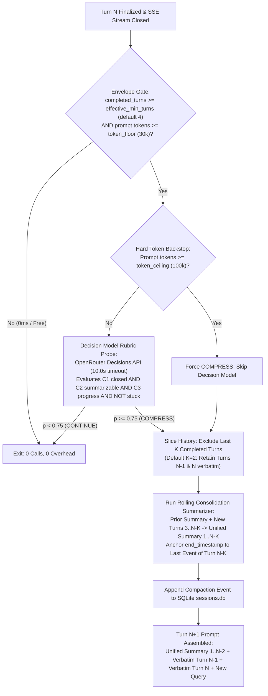
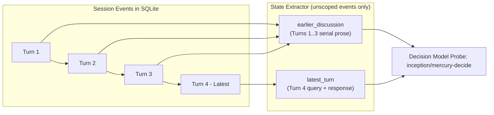
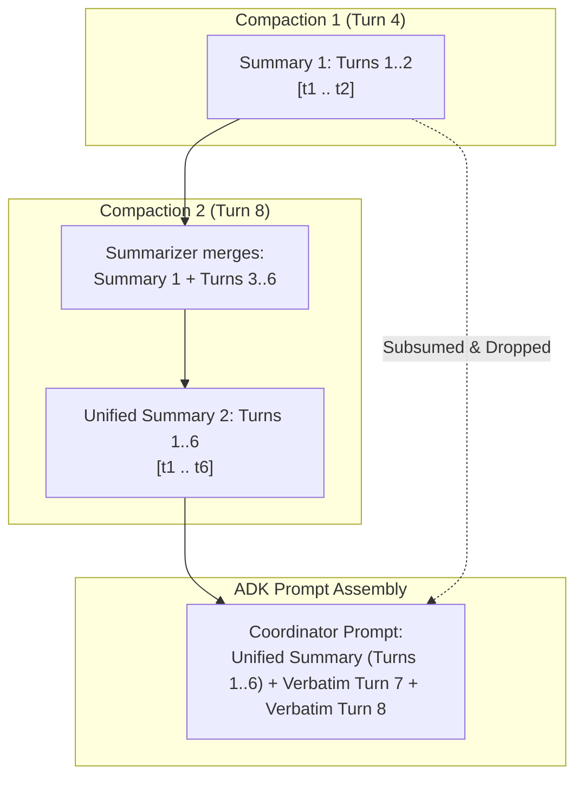
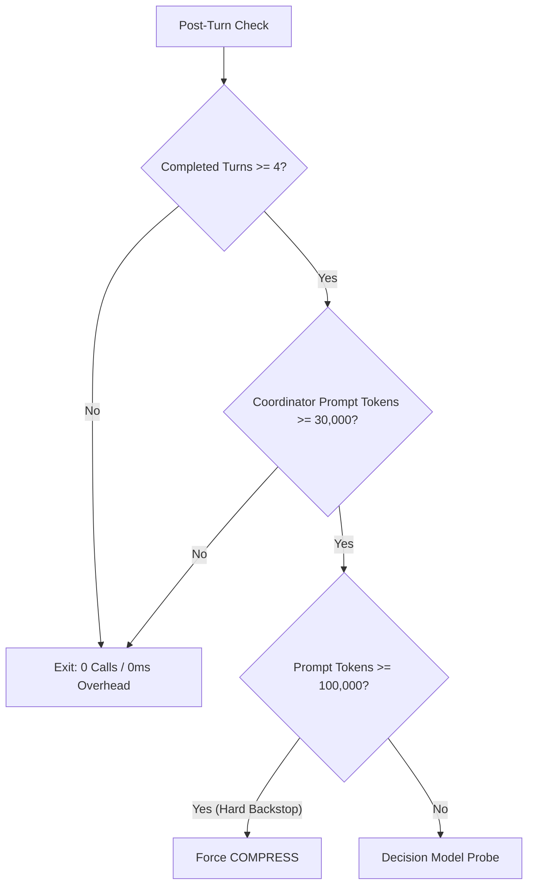
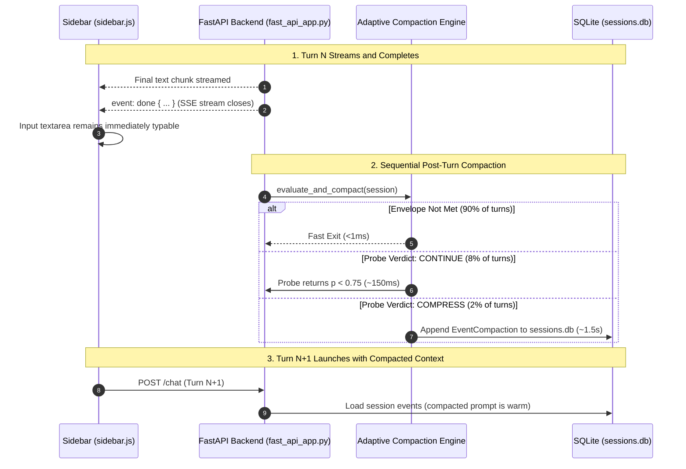

# Post-Turn Decision-Model Adaptive Context Compaction

Scientific research conversations against literature libraries frequently span dozens of turns involving multi-paper comparisons, methodological critiques, and exploratory follow-ups. In long sessions, uncompacted conversational histories inevitably exhaust LLM context windows, bloat inference costs, and degrade reasoning quality. 

Traditional context management approaches rely on static token thresholds or blunt sliding windows that either truncate critical early context or introduce substantial pre-invocation latency stalls before the first token streams. Zocrates solves this through an autonomous, rubric-governed **Post-Turn Decision-Model Adaptive Compaction Engine** inspired by [*Self-Compacting Language Model Agents* (SelfCompact, Li et al., 2026)](https://arxiv.org/abs/2606.23525).

---

## 1. Core Architectural Invariants

The adaptive context compaction engine enforces eight design invariants:

1. **Strictly Post-Invocation (0ms TTFT Impact)**:
   * Native pre-invocation compaction checks introduce latency before tokens can stream. Zocrates deactivates native Google ADK pre-invocation triggers by explicitly setting `app.events_compaction_config = None`.
   * Compaction evaluation and execution occur **exclusively after turn completion**, eliminating pre-invocation stalls before the first token appears.
2. **Zero Coordinator Tool Bloat**:
   * The coordinator agent is not burdened with a self-compaction tool. It maintains its primary research tools (`search_library`, `search_online_literature`) with zero prompt overhead, zero JSON schema expansion, and zero tool-selection confusion.
3. **Probabilistic Decision Model (Not a Chat LLM)**:
   * Evaluation is performed by a specialized **Decision Model** (e.g. `inception/mercury-decide` via OpenRouter Decisions API, or local Laya).
   * The model returns calibrated support probabilities ($p \in [0.0, 1.0]$ via `"noul"` queries) in **~50ms–250ms with zero generation tokens**.
4. **Recent Context Retention ($K=2$ Verbatim)**:
   * When compaction triggers at the end of Turn $N$, it does not compress recent dialogue.
   * It preserves the **last $K$ completed turns** ($K=2$ by default: Turn $N-1$ and Turn $N$) **100% verbatim**.
   * Only earlier turns ($1 \dots N-K$) are summarized.
5. **Strict Envelope Invariant ($min\_turns > K$)**:
   * The envelope gate requires $\text{completed\_turns} \ge \text{adaptive\_compaction\_min\_turns}$ (default: 4 turns).
   * To guarantee the candidate slice contains at least one turn, $min\_turns > K$ is strictly enforced. If misconfigured ($min\_turns \le K$), automatic disambiguation safely clamps `effective_min_turns = max(configured_min_turns, K + 1)` with a system warning.
6. **Rolling Consolidation Slicing**:
   * When previous compactions exist, the summarizer incorporates the prior summary with newly completed turns into a unified consolidated summary ($[t_1, t_{N-K}]$). Google ADK's `_is_compaction_subsumed` naturally drops older summaries, keeping context clean without fracturing into multiple summary headers.
7. **Pipeline Isolation Scope Filtering**:
   * Summarization strictly filters out events with `isolation_scope` (`search_pipeline:{fc_id}`), ensuring compaction prompts never leak raw ReAct retrieval loops or raw chunk payloads while shrinking the summarizer prompt by 80% to 95%.
8. **Single Source of Truth (SSOT)**:
   * Configured transparently in `<zotero-data-dir>/zocrates-data/zocrates_config.json` with automatic file-lock disk backfills and preferences UI synchronization.

---

## 2. End-to-End Architectural Flow



---

## 3. Turn Numbering and Context Slicing ($K=2$)

When post-invocation execution evaluates at the end of a chat turn, **Turn $N$ has just concluded**:

```
[Turn 1] [Turn 2] ... [Turn N-2] | [Turn N-1]  [Turn N]
└───────────────┬───────────────┘ └──────────┬──────────┘
      Summarized Slice              Retained Verbatim Slice
     (Turns 1 .. N-K)                     (K = 2 turns)
```

### 3.1 The Envelope Invariant and Disambiguation Policy

The candidate slice to be summarized spans Turns $1 \dots N-K$. For this slice to contain at least 1 completed turn, $N$ must be strictly greater than $K$ ($N \ge K + 1$).

If a user or script enters conflicting configuration values (e.g. `adaptive_compaction_min_turns: 1` and `adaptive_compaction_retention_turns: 2`), the runtime automatically disambiguates:

```python
effective_k = max(0, int(cfg.get("adaptive_compaction_retention_turns", 2)))
raw_min_turns = int(cfg.get("adaptive_compaction_min_turns", 4))
if raw_min_turns <= effective_k:
    effective_min_turns = effective_k + 1
    logger.warning(
        "adaptive_compaction_min_turns (%d) must be strictly greater than "
        "retention_turns (%d). Disambiguating by clamping effective_min_turns to %d.",
        raw_min_turns, effective_k, effective_min_turns
    )
else:
    effective_min_turns = raw_min_turns
```

With default settings (`effective_min_turns = 4`), the gate opens once 4 completed turns have elapsed ($N \ge 4$). Short sessions with fewer than 4 turns exit immediately with 0ms delay and zero network calls.

### 3.2 Exact Timestamp Anchoring

* `start_timestamp = slice[0].timestamp` (or `first_event.timestamp` of the session during rolling consolidation).
* `end_timestamp = slice[-1].timestamp` (the final event of Turn $N-K$).

Because events in Turn $N-1$ and Turn $N$ have timestamps $> end\_timestamp$, Google ADK's `_process_compaction_events` leaves recent dialogue intact in the coordinator prompt. **Turns $N-1$ and $N$ remain 100% verbatim**.

---

## 4. State Extraction: Clean Serial Markdown Dialogue

The decision model evaluates whether a topic transition, sub-question closure, or progressive shift has occurred between:

* **`earlier_discussion`**: Turns $1 \dots N-1$ (the body of conversation leading up to the current turn).
* **`latest_turn`**: Turn $N$ (the query and response that just completed).



### State Extraction Rules

1. **Unscoped Event Slicing**: Events are read via `_apply_rewinds(session.events)` and filtered strictly to unscoped events (`isolation_scope is None`). Intermediate ReAct retrieval loops, subagent tool arguments, and raw chunks are completely excluded.
2. **Serial Dialogue Format**:
   Turns are serialized into clean Markdown query-response pairs without header noise:
   ```markdown
   **User**: {user_query}
   **Assistant**: {assistant_response}
   ```
3. **Turn Content Extraction**:
   * **User Query**: Extracted directly from the `user` event's text content.
   * **Assistant Response (Research Turns)**: Extracts the concise findings summary (<150 words) from the `conclude_output` payload in `RESEARCH_TURN_HISTORY` (matched by `invocation_id`). Full academic syntheses, tool parameters, raw chunk IDs, and bibliographies are excluded.
   * **Assistant Response (Conversational Turns)**: Extracts the coordinator's direct response text untruncated, preserving conversational nuance.
4. **Compactness Guarantee**:
   The entire serialized payload fits cleanly within 500 tokens, enabling sub-second decision evaluation.

---

## 5. The Decision Model Rubric Probe

The probe queries the OpenRouter Decisions API (`/api/alpha/decisions`):

```json
{
  "model": "inception/mercury-decide",
  "state": {
    "earlier_discussion": "**User**: What causes capacity fade in lithium-ion battery anodes during fast charging?\n**Assistant**: Fast charging accelerates lithium plating on graphite anodes, thickening the solid electrolyte interphase (SEI) layer and consuming active lithium.\n\n**User**: Do silicon-graphite composite anodes suffer from the same plating issues?\n**Assistant**: Silicon composites suffer less from plating due to slightly higher working potentials, but face massive particle pulverization from 300% volume expansion.",
    "latest_turn": "**User**: What are the current levelized cost of storage (LCOS) estimates for vanadium redox flow batteries in grid peaking applications?\n**Assistant**: Stack materials and vanadium electrolyte prices dominate capex, resulting in an estimated LCOS between $0.20 and $0.35/kWh."
  },
  "questions": {
    "compaction_warranted": {
      "type": "noul",
      "instructions": "Task: Decide whether `earlier_discussion` should be compacted into a concise summary to preserve context space for upcoming turns.\n\nRubric:\n- CLOSED-UNIT: Did `earlier_discussion` conclude a complete sub-topic or sub-analysis?\n- PROGRESS/PIVOT: In the latter part of `earlier_discussion` or in `latest_turn`, has the user pivoted to a different research topic or advanced to a new phase?\n- NOT STUCK: Is the conversation free from an unresolved clarification or correction loop?\n\nDecision Rule:\n- Compaction is WARRANTED if and only if ALL criteria are satisfied: earlier turns form a resolved unit, the conversation is advancing to new ground, and there is no active confusion or clarification loop.\n- Compaction is NOT WARRANTED if the user is still actively drilling down, clarifying, or troubleshooting the exact same point, or if the conversation is mid-thought.\n\nDetermine if compacting `earlier_discussion` is warranted."
    }
  }
}
```

### 5.1 Rubric Calibration and Thresholding

The decision model evaluates four simultaneous criteria:

1. `CLOSED-UNIT`: Earlier turns conclude a complete, coherent sub-analysis.
2. `PROGRESS/PIVOT`: The conversation has pivoted to a new topic or progressed to an advanced phase.
3. `NOT STUCK`: The dialogue is not trapped in an unresolved clarification, correction, or error loop.
4. `SUMMARIZABLE`: Earlier turns contain substantive information suitable for compaction.

The probe returns probability $p = \text{answers}[\text{"compaction\_warranted"}][\text{"noul"}]$.

| Condition | Evaluated Action | Rationale |
| :--- | :--- | :--- |
| **$p \ge \tau$ (default $\tau = 0.75$)** | **`COMPRESS`** | Clear topic shift or concluded analytical phase; safe to summarize. |
| **$p < \tau$** | **`CONTINUE`** | Active drill-down, follow-up clarification, or mid-thought; preserve raw context. |
| **Timeout (10.0s) / Error** | **`CONTINUE`** *(Fail-Open)* | Subsystem issues never interrupt the user or corrupt conversation state. |

---

## 6. Slicing Mechanics and Rolling History Consolidation

When multiple compactions occur over an extended research session (e.g. Turn 4, then Turn 8, then Turn 13):



### 6.1 Rolling Slicing Architecture

1. When evaluating Turn $N$, the engine checks `session.events` for prior compaction events.
2. If an earlier compaction exists:
   * It extracts the existing summary text (`previous_compaction.compacted_content`).
   * It slices only the **new completed turns** that occurred between `previous_compaction.end_timestamp` and Turn $N-K$.
   * The summarizer combines both into a single consolidated prompt:
     ```markdown
     Existing Conversation Summary:
     {previous_compacted_content}

     New Completed Turns to Integrate:
     {new_completed_turns}
     ```
   * Sets `start_timestamp = previous_compaction.start_timestamp` ($t_1$).
   * Sets `end_timestamp = new_slice[-1].timestamp` ($t_{N-K}$).
3. **Subsumption in ADK 2.8+**:
   Because the new compaction event spans $[t_1, t_{N-K}]$, its range completely subsumes the older compaction $[t_1, t_{\text{old}}]$. Google ADK marks the older compaction event as subsumed and renders **only the new consolidated summary**, preventing prompt fragmentation.

### 6.2 Tool Truncation Expansion (`_MAX_TOOL_CONTENT_CHARS = 30000`)

Google ADK defaults to truncating tool content at 2,000 characters during event summarization. In academic research, a comprehensive synthesis and its `# Cited Sources` bibliography typically range from 4,000 to 12,000 characters. Truncating at 2,000 characters strips the citations and key findings from the compaction summary.

Zocrates overrides this limit:
```python
_MAX_TOOL_CONTENT_CHARS = 30000
```
This guarantees complete academic findings and source bibliographies reach the compaction prompt intact.

---

## 7. Envelope Gating and Token Measurement Source

To prevent unnecessary LLM invocations and guarantee 0ms latency during standard conversational turns, the engine applies an **Envelope Gate**:

$$\text{completed\_turns\_since\_last\_compaction} \ge \text{effective\_min\_turns} \quad \text{and} \quad \text{coordinator\_prompt\_tokens} \ge \text{token\_floor}$$



### 7.1 Coordinator Scope Isolation

In Zocrates, literature search subagents execute inside isolated task scopes (`isolation_scope = "search_pipeline:<fc_id>"`). Subagents report their own prompt token counts for internal ReAct loops.

The adaptive compaction engine strictly isolates prompt tokens to the coordinator agent's events:
```python
def get_coordinator_prompt_tokens(events: list[Event]) -> int | None:
    """Extract prompt token count strictly from the coordinator agent's latest event."""
    for event in reversed(events):
        if (
            event.isolation_scope is None
            and event.usage_metadata
            and event.usage_metadata.prompt_token_count is not None
        ):
            return event.usage_metadata.prompt_token_count
    return None
```
This prevents subagent tool token spikes from prematurely opening the compaction envelope.

### 7.2 Hard Token Backstop

If `coordinator_prompt_tokens >= adaptive_compaction_token_ceiling` (default: 100,000 tokens), the system **bypasses the decision model entirely** and forces immediate compaction. This provides an absolute safeguard against context window overflow during exceptionally heavy research sessions.

---

## 8. Sequential Post-Invocation Concurrency Architecture

Zocrates deliberately avoids background/fire-and-forget compaction threads or client-side message queues in favor of an **Authoritative Sequential Post-Invocation Lifecycle**:



### Why Sequential Execution Eliminates Concurrency Pitfalls

1. **Solving the Context Bloat Race**: If Turn $N$ reaches 100k tokens and compaction were run asynchronously in the background, a user submitting Turn $N+1$ two seconds later would launch with the uncompacted 100k prompt, triggering potential rate limits or context overflow. Running sequentially guarantees Turn $N+1$ always launches with warm, compacted context (~5k tokens).
2. **Zero Client State-Machine Brittleness**: Eliminates client-side queues, pending-message states, and retry races if the user types rapidly.
3. **Fluid User Typing Ergonomics**: In `sidebar.js`, the chat textarea is never disabled. The user can begin typing their next question the instant the assistant finishes answering. By the time the user finishes typing (typically 3–10 seconds), compaction has finished.
4. **Defensive API Backstop (`StaleSessionError`)**: If an external script issues a concurrent request over REST, SQLite revision marker changes trigger Google ADK's `StaleSessionError`, which is caught and dropped cleanly without corrupting the session.

---

## 9. Telemetry & OpenTelemetry Observability

The compaction lifecycle emits standardized spans compatible with Arize Phoenix, OpenInference, and OpenTelemetry:

```
Turn N Invocation Trace (Phoenix)
  ├── coordinator_agent [AGENT]
  │     └── ... (tool calls, retrieval pipeline)
  ├── compaction_decision_probe [EVALUATOR]
  │     ├── input: { earlier_discussion, latest_turn, rubric }
  │     ├── output: { probability: 0.82, verdict: "COMPRESS" }
  │     ├── compaction.decision.model: "inception/mercury-decide"
  │     ├── compaction.decision.latency_ms: 185
  │     └── metadata: { completed_turns: 4, prompt_tokens: 38400 }
  └── compact_session_history [LLM]
        ├── input: "Existing Conversation Summary: ... New Completed Turns: ..."
        ├── output: "## Comprehensive Conversation Summary: ..."
        ├── llm.model_name: "openrouter/nvidia/nemotron-3.5-lightning:free"
        ├── llm.token_count.prompt: 4210
        ├── llm.token_count.completion: 320
        └── compaction.summarize.range: [t_1, t_{N-K}]
```

### Spans Emitted

1. **`compaction_decision_probe` (`openinference.span.kind = "EVALUATOR"`)**:
   * Evaluated probability $p \in [0.0, 1.0]$.
   * Threshold $\tau$, decision verdict (`"COMPRESS"` or `"CONTINUE"`), round-trip latency, and model identifier.
2. **`compact_session_history` (`openinference.span.kind = "LLM"`)**:
   * Summarizer model, input/output token counts, summarized timestamp range $[t_1, t_{N-K}]$, and slice turn counts.
3. **Zero Trace Pollution on Fast-Exit**:
   * When the envelope gate is not satisfied, **zero spans are created**, keeping trace overhead at 0ms.

---

## 10. Configuration & Preferences Reference

Adaptive compaction parameters are maintained in `<zotero-data-dir>/zocrates-data/zocrates_config.json` under atomic `FileLock`:

```json
{
  "enable_adaptive_compaction": true,
  "compaction_summarizer_model": "openrouter/nvidia/nemotron-3.5-lightning:free",
  "adaptive_compaction_retention_turns": 2,
  "adaptive_compaction_min_turns": 4,
  "adaptive_compaction_token_floor": 30000,
  "adaptive_compaction_token_ceiling": 100000,
  "adaptive_compaction_threshold": 0.75,
  "adaptive_compaction_decision_model": "inception/mercury-decide"
}
```

### Parameter Reference

| Parameter Key | Type | Default | Description |
| :--- | :--- | :--- | :--- |
| `enable_adaptive_compaction` | `bool` | `true` | Master toggle enabling post-turn decision-model compaction. |
| `compaction_summarizer_model` | `str` | `nemotron-3.5-lightning:free` | Model slug used for rolling consolidation summarization. |
| `adaptive_compaction_retention_turns` | `int` | `2` | Number of recent completed turns ($K$) retained 100% verbatim. |
| `adaptive_compaction_min_turns` | `int` | `4` | Minimum completed turns required before compaction envelope opens. Clamped to $\ge K + 1$. |
| `adaptive_compaction_token_floor` | `int` | `30000` | Minimum coordinator prompt tokens required before evaluating decision probe. |
| `adaptive_compaction_token_ceiling` | `int` | `100000` | Hard token backstop forcing compaction without decision model probing. |
| `adaptive_compaction_threshold` | `float` | `0.75` | Probability threshold ($\tau$) above which the probe triggers `COMPRESS`. |
| `adaptive_compaction_decision_model` | `str` | `inception/mercury-decide` | Model used for probabilistic rubric decision evaluation. |

---

## 11. Architectural Invariant Verifications

The implementation is verified by automated unit tests in `tests/unit/test_adaptive_compaction.py`:

* **`test_envelope_gate_skips_when_few_turns`**: Confirms 0 network calls when completed turns $< min\_turns$.
* **`test_envelope_gate_disambiguation_clamping`**: Confirms $min\_turns \le K$ safely clamps to $K + 1$ with a warning.
* **`test_envelope_gate_skips_when_tokens_below_floor`**: Confirms 0 network calls when prompt tokens $< 30\text{k}$.
* **`test_hard_backstop_forces_compress`**: Confirms decision model is bypassed and compression forces at $\ge 100\text{k}$ tokens.
* **`test_decision_model_compress_verdict`**: Confirms compaction triggers when $p \ge 0.75$.
* **`test_retention_turns_preserves_latest_k_turns_verbatim`**: Confirms Turns $N-1$ and $N$ remain verbatim in the next prompt.
* **`test_rolling_consolidation_subsumes_earlier_compaction`**: Confirms successive compactions consolidate prior summaries into a single event and mark earlier compactions as subsumed.
* **`test_coordinator_prompt_tokens_ignores_subagent_events`**: Confirms subagent retrieval events are excluded from token calculations.
* **`test_stale_session_concurrency_fail_open`**: Confirms concurrent modification is handled safely without session corruption.
