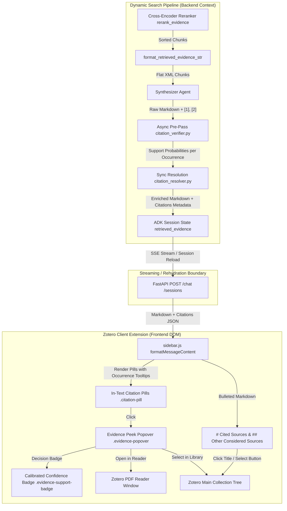
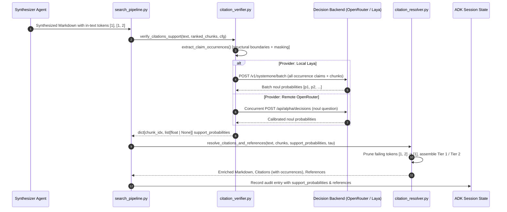

# In-Text Citations, Verification & Two-Tier Sources Architecture

Scientific conversational assistants must balance readability with epistemic rigor. Traditional conversational retrieval-augmented generation (RAG) systems often suffer from three critical failure modes: internal database hash exposure, attribution loss through silent omission of analyzed literature, and inaccurate post-hoc Natural Language Inference (NLI) evaluations. Zocrates resolves these challenges through an end-to-end, deterministic **Flat Single-ID Citation, AI Decision-Model Verification, and Two-Tier Sources Architecture**. The system guarantees **100% evidence recall ($U = C \cup R$)**, exact extractive quote grounding, per-occurrence claim verification via fast probabilistic decision models, zero database hash exposure, and interactive in-Zotero reader navigation.

---

## 1. Architectural Overview & Design Invariants



### Core System Invariants

1. **Flat Single-ID Scheme (`[1]`, `[2]`, `[1, 2]`)**: Candidate chunks are presented in descending cross-encoder relevance order. Synthesizers only track one number per chunk, matching frontier LLM pretraining priors with zero dual-ID cognitive arithmetic.
2. **Two-Tier Sources (100% Evidence Recall)**: All retrieved candidate chunks across the turn are deterministically partitioned into Tier 1 (`# Cited Sources`) and Tier 2 (`## Other Considered Sources`). No analyzed evidence is ever dropped ($U = C \cup R$).
3. **APA Author Formatting Uniformity**: Standardized author representation across citations, references, evidence XML, popovers, and graph visualizer labels (1 author → `Author`, 2 authors → `Author1 & Author2`, 3+ authors → `Author et al.`).
4. **Zero Internal Key Exposure**: 8-character Zotero database item keys (e.g. `HCZLU22L`) are strictly barred from prompt outputs and rendered as human-readable author-year labels or academic badges in the UI.
5. **No Out-of-Band SQL Mutations**: Citation resolution executes synchronously inside `search_pipeline.py` within the native ADK runner context, preventing desynchronization of `session._storage_update_marker` and eliminating `StaleSessionError`.
6. **Strict Turn Scoping**: Citations are coupled to the current turn's retrieval `invocation_id`. Purely conversational follow-ups without search execution never inherit stale prior-turn reference lists.
7. **Full Supporting Passage Preservation**: Supporting quote/passage text from retrieved chunks is preserved in full (`MAX_EXTRACTIVE_QUOTE_CHARS = None`) without artificial character truncation, allowing researchers to inspect unbroken proofs, complete paragraphs, and experimental tables in the scrollable, resizable Evidence Peek popover.
8. **Per-Occurrence Claim Evaluation**: Each citation token occurrence in synthesized prose is evaluated individually against its cited chunk ($p_{\text{occ}}$). Citation tokens are never evaluated via aggregated $\max()$ across disparate sentences.
9. **Two-Tier Source Partitioning Under Verification**: A document moves to Tier 1 (`# Cited Sources`) if ≥ 1 cited occurrence survives verification threshold $\tau$. If 0 occurrences survive anywhere in the text, the document moves to Tier 2 (`## Other Considered Sources`), preserving $U = C \cup R$.
10. **Empty Tier 1 Safeguard (No False Promotion on Verification Failure)**: When the synthesizer emits citations but all citations fail verification thresholds, zero-citation fallback is explicitly disabled. Tier 1 remains empty and all candidate documents are placed in Tier 2 (`## Other Considered Sources`), preventing unverified literature from being falsely promoted as cited sources.
11. **Dual Call-Site Parity & Synchronous Purity**: `search_pipeline.py` runs the asynchronous verification pre-pass (`verify_citations_support`) and stores probabilities in session audit state. `resolve_citations_and_references` remains a pure, synchronous function. Fallback in-process resolution at the API boundary reuses stored audit probabilities without invoking duplicate network calls.
12. **Fail-Open Resilience**: Network timeouts, missing API keys, or offline verification backends log warnings and fail open ($p = \text{None}$, treated as surviving), guaranteeing synthesis text is never corrupted or stalled by verification subsystem failures.

### Key Implementation Modules

| Component | Source Path | Description |
| :--- | :--- | :--- |
| **Citation & Source Resolver** | `zocrates/agents/library_search/citation_resolver.py` | Pure synchronous citation parser, bracket pruner, and two-tier source partitioner |
| **AI Decision Model Verifier** | `zocrates/agents/library_search/citation_verifier.py` | Asynchronous pre-pass evaluating per-occurrence claim support probabilities |
| **Decision Model Service** | `zocrates/rag/decision_service.py` | Manages local Laya daemon lifecycles, health probes, and device detection |
| **Pipeline Integration** | `zocrates/agents/library_search/search_pipeline.py` | Executes verification pre-pass, records audit state, and builds clean coordinator view |
| **Evidence XML Prompts** | `zocrates/agents/common/prompts.py` | Formats candidate chunks into clean `<retrieved_evidence>` XML with clean authors |
| **Synthesizer Instructions** | `zocrates/agents/library_search/prompts.py` | Defines citation syntax rules and negative prohibitions for the synthesizer agent |
| **Session Rehydration** | `zocrates/utils/session_formatting.py` | Formats citations and references for REST and SSE endpoints |
| **Configuration Engine** | `zocrates/config.py` | Manages verification thresholds, provider selection, and config file persistence |
| **Frontend UI Logic** | `zotero-plugin/addon/sidebar.js` & `sidebar.css` | Renders citation pills, Evidence Peek Popovers, and visibility toggle controls |

---

## 2. Synthesizer Prompt Contract & Flat Single-ID Scheme

### 2.1 Chunk Evidence Representation

Candidate evidence from `rerank_evidence` is formatted into a flat XML container in `zocrates/agents/common/prompts.py`:

```xml
<retrieved_evidence>
  <chunk index="1" title="Somatic mutation rates in monozygotic twins" authors="Jonsson & Stefansson" year="2021" section="Methods" type="text">
    The somatic mutation rate was estimated using whole-genome sequencing of 387 pairs of monozygotic twins...
  </chunk>
  <chunk index="2" title="Attention Is All You Need" authors="Vaswani et al." year="2017" section="3.2 Attention" type="text">
    An attention function can be described as mapping a query and a set of key-value pairs to an output...
  </chunk>
</retrieved_evidence>
```

Chunks are indexed $1, 2, \dots, N$ in exact order of descending relevance. Chunk 1 is guaranteed to be the most relevant candidate identified by the cross-encoder.

### 2.2 Synthesizer Attribution Rules

In `zocrates/agents/library_search/prompts.py`, `SYNTHESIZER_INSTRUCTION` mandates bracketed index citations alongside natural prose:

* **Bracketed Tokens**: Append chunk indices (`[1]`, `[2]`, or multi-citations like `[1, 2]`) directly following claims.
* **Prose Attribution**: Mention natural authors or section titles (e.g. *"Jonsson & Stefansson (2021) demonstrated that... [1]"*).
* **Negative Prohibitions**: Never emit database hashes or invent fake hyperlink URLs.

---

## 3. Deterministic Citation Resolution Engine (`citation_resolver.py`)

The resolution engine runs synchronously at the pipeline boundary:
`resolve_citations_and_references(text, ranked_chunks, zotero_dir=None, references_enabled=True, considered_disclosure=True, citations_enabled=True, support_probabilities=None, verification_threshold=0.60)`

### 3.1 Processing Lifecycle

1. **Fenced Code Block Masking**:
   Replaces fenced code blocks (```` ```...``` ````) and inline code spans (`` `...` ``) with sentinel tokens (`@@ZOCRATES_CODE_MASK_0@@`) to prevent syntax numbers or array indexing from triggering false-positive citations.
2. **Regex Parsing**:
   Matches standard brackets (`\[(?:E\s?|Chunk\s?)?(\d{1,2}(?:\s*[,;]\s*\d{1,2})*)\]`) and fullwidth alternatives (`【(\d{1,2}(?:\s*[,;]\s*\d{1,2})*)】`). Splits multi-citations (`[1, 2]`) and normalizes whitespace.
3. **Bounds Checking & Hallucination Suppression**:
   Validates indices against 1 ≤ idx ≤ len(ranked_chunks). Any hallucinated out-of-bounds index (e.g. `[99]`) is safely stripped from the text rather than left dangling.
4. **Metadata Extraction & Attachment Parent Resolution**:
   Extracts `chunk_id`, `item_key`, `attachment_key`, `title`, `authors`, `year`, `section`, `publication`, and the complete supporting quote text without artificial character truncation (or bounded by `MAX_EXTRACTIVE_QUOTE_CHARS` if explicitly configured). If an item is an attachment (e.g. HTML Snapshot, PDF) where direct `creators` or `year` are empty in Zotero's schema, it automatically traverses to the parent bibliographic item and falls back to `document.md` YAML frontmatter.
5. **Two-Tier Source Partitioning**:
   - **Tier 1 (Cited Sources)**: Unique papers whose chunks were explicitly cited in text.
   - **Tier 2 (Other Considered Sources)**: Papers retrieved by the search agent but not cited in text.
   - **Zero-Citation Fallback**: If the model discusses retrieved literature without emitting bracketed tokens, all retrieved documents are automatically promoted to Tier 1 under `# Cited Sources`, preventing accidental omission.

### 3.2 Markdown Assembly

Tier 1 and Tier 2 lists are generated as clean bulleted Markdown:
```markdown
# Cited Sources
- <span class="zotero-source-link" data-item-key="99R6SJ7T">**Jonsson & Stefansson (2021)**. *Somatic mutation rates in monozygotic twins*. Nature Genetics.</span>

## Other Considered Sources
<details class="considered-sources">
  <summary>1 additional source analyzed by search agent</summary>
  <ul>
    <li><span class="zotero-source-link" data-item-key="VDKHGW8P"><strong>Smith (2023)</strong>. <em>Deep RAG Systems</em>.</span></li>
  </ul>
</details>
```

---

## 4. AI Decision Models & Per-Occurrence Citation Verification

To resolve subtle attribution discrepancies, numerical hallucinations, and extrapolative over-claiming without relying on inaccurate NLI models or slow conversational evaluators, Zocrates integrates fast, calibrated **AI Decision Models** into the citation pipeline via `zocrates/agents/library_search/citation_verifier.py` and `zocrates/rag/decision_service.py`.



### 4.1 Multi-Backend Architecture

The verification system supports both cloud-based execution and local, privacy-first inference:

1. **Remote OpenRouter Decision Models**:
   - Queries OpenRouter's decisions endpoint (`POST https://openrouter.ai/api/alpha/decisions`) using structured dictionary states `{"source_text": ..., "claim": ...}` and `noul` question primitives.
   - **`~typesafe/jev-latest` (Default)**: TypeSafe Jev Latest auto-updating checkpoint ($p \in [0.0, 1.0]$, $\tau = 0.60$), 32k context window, sub-second latency (~250–320ms). Recommended for its high calibration accuracy, smooth monotonic handling of partial/hedged claims, and zero-parameter setup. In an independent double-blind benchmark on 18 audited rejected claims from *Ordyan et al. (2020)*, TypeSafe Jev demonstrated statistically significant rank correlation with human ground truth ($\rho = 0.541, p = 0.020$) and successfully recovered over 80% of false rejections caused by strict binary thresholding.
   - **`typesafe/jev-1.14` & `typesafe/jev-1.13`**: Pinned releases of TypeSafe Jev for reproducibility.
   - **`inception/mercury-decide`**: Zero monetary cost (also available via free endpoint tier), high precision, 32k context window, sub-second latency.
   - **`upstage/solar-decide`**: 524k context window, handling lengthy methodological sections.
   - **Fallback & Resilience**: Automatic single-retry with 250ms backoff on HTTP 429 rate limits, and seamless fallback to OpenRouter chat completions (`POST /api/v1/chat/completions`) with JSON schema extraction on HTTP 404 from the alpha endpoint. Timeouts, HTTP 5xx, or network failures fail open cleanly (`support_probability = None`), preserving citation tokens.
2. **Local Laya Engine (`zocrates/rag/decision_service.py`)**:
   - Executes locally as an isolated tool environment managed via `uv`:  
     `uv tool install --with uvicorn --with fastapi laya`
   - Spawns background daemon `laya-serve` listening on loopback (`127.0.0.1:8005`).
   - **Backend Port Collision Guard**: `start_laya_daemon` queries `get_backend_port()` and rejects launch if the daemon port collides with the active Zocrates backend server.
   - **Strict Signature Health Probes (`check_laya_running`)**: Verifies `GET /health` returns HTTP 200 with JSON confirming `"status": "ok"` and genuine Laya runtime descriptors (`"device"`, `"loaded"`, `"checkpoint_devices"`, or `"cpu_fallbacks"`), with fallback verification on `GET /openapi.json`.
   - **Non-Invasive Daemon Management (`stop_laya_daemon`)**: Tracks spawned processes via `_managed_process` and `<zotero-data-dir>/zocrates-data/laya.pid`. Eliminates blind port kills, verifying target processes via `psutil` using strict token matching (`_is_laya_process`) and listening socket state (`_process_is_on_port`) to protect unrelated developer processes.
   - **Automated Hardware & Device Resolution (`resolve_laya_device`)**: Executes an isolated Python subprocess probe with a concrete tensor operation (`(torch.zeros(1).cuda() + 1).item()`). This actively catches CUDA capability mismatches or driver memory exhaustion before spawning the server, gracefully selecting `cuda` → `mps` (Apple Silicon) → `xpu` (Intel GPU) → `cpu`.
   - **Native Tensor Batching (`_check_support_local_laya_batch`)**: Queries Laya's native `/v1/systemone/batch` endpoint, evaluating all claims across all cited chunks simultaneously in a single HTTP round-trip instead of serial requests.

### 4.2 Per-Occurrence Claim Evaluation vs Pre-Aggregation

Standard citation systems frequently evaluate evidence at the chunk level by aggregating claim probabilities using $\max(p_1, p_2, \dots)$. In academic writing, this introduces a dangerous vulnerability:

- If Chunk [1] is cited in Sentence A with an accurate claim ($p = 0.98$) and also cited in Sentence B with a hallucinated numerical claim ($p = 0.12$), a chunk-level $\max()$ evaluates Chunk [1] at $0.98$, keeping **both** citation tokens intact.

Zocrates enforces **Per-Occurrence Claim Evaluation**:

- `extract_claim_occurrences()` parses each citation token occurrence in document order, returning discrete evaluation targets:  
  `{"chunk_index": int, "occurrence": int, "claim": str}`.
- `verify_citations_support()` returns a per-occurrence dictionary:  
  `dict[int, list[float | None]]` (e.g. `{1: [0.98, 0.12], 2: [0.85]}`).
- In `citation_resolver.py`, Occurrence 1 of Chunk [1] survives and remains in the text, while Occurrence 2 fails threshold $\tau$ and is pruned from Sentence B.
- Metadata records the full occurrence trajectory in `citations[].occurrences` for frontend telemetry.

### 4.3 Paragraph/Block-Scoped Claim Extraction & Normalization

Accurate verification requires extracting the exact semantic assertion corresponding to a citation token without bleeding into neighboring citations or cutting mid-sentence.

1. **Backward Boundary Resolution (`_find_backward_claim_boundary`)**:
   - **Preceding Citation Barrier**: Finds the end index of the last preceding citation token in `prefix`. The search region is strictly bounded after this index, preventing claims from bleeding across adjacent citations in the same sentence or paragraph.
   - **Structural Boundary Detection**: Scans the search region for the latest structural boundary:
     - Paragraph break: `\n\s*\n`
     - Bullet list item: `\n\s*[-*+]\s+`
     - Numbered list item: `\n\s*\d+\.\s+`
     - Markdown header line: `(?:^|\n)\s*#{1,6}\s+[^\n]*\n+` (consumes the full heading line, guaranteeing that section titles like `### 4. Holoenzyme is a better noise filter` never contaminate the extracted claim sentence).
   - **Window Clamping**: Caps backward claim length to `MAX_CLAIM_CHARS = 800`. If exceeded, advances past the first forward sentence boundary to avoid chopping sentences in half.
   - **Leading Syntax Stripping**: Regex `^(?:[\.\,\;\:\!\?\*\-\#\>\s]|\d+\.\s*)+` strips bullet dashes, list numbers, blockquotes, and punctuation while retaining lead-in text.
   - **Bold Lead-in Retention**: Headings like `- **Lead-in.** Claim text [1]` preserve the lead-in heading as clean, readable text (`Lead-in. Claim text.`) without Markdown syntax markers.
2. **Conditional Compound-Citation Prompt Dispatch**:
   - In scholarly writing, compound citations like `[1, 2]` frequently attribute composite statements where each cited work supports distinct, complementary clauses.
   - Single citation (`len(bracket) == 1`): Dispatches the canonical prompt:
     ```text
     Does the `source_text` support the `claim`?
     ```
   - Multi-citation bracket (`len(bracket) > 1`): Automatically dispatches the conditional compound prompt:
     ```text
     This claim cites multiple sources. Does the `source_text` support a substantive part of the `claim`?
     ```
   - This conditional prompt eliminates spurious demotions on compound brackets without requiring complex multi-threshold or sibling-aggregation configuration bloat.
3. **Abbreviation Guard (`_ABBREVIATION_RE`)**:
   Prevents candidate periods from splitting sentences when preceded by academic abbreviations or initials: `et al.`, `e.g.`, `i.e.`, `etc.`, `vs.`, `cf.`, `fig.`, `eq.`, `no.`, `sec.`, `approx.`, `ca.`, `dr.`, `prof.`, `mr.`, `mrs.`, `jr.`, `sr.`, or single capital initials.
4. **Forward Scan Check (`_find_forward_sentence_boundary`)**:
   If the backward span is shorter than `MIN_CLAIM_CHARS = 30` or matches `_AUTHOR_ONLY_RE` (e.g. *"According to Smith et al. [1]..."*), the extractor performs a forward scan through the suffix to capture the complete predicated claim until the next sentence termination or citation.
5. **Clean Markdown & Symbol Normalization (`_clean_and_join_spans`)**:
   - Strips Markdown formatting syntax (`**`, `__`, backticks `` ` ``).
   - Normalizes mathematical and punctuation symbols into plain text:  
     `≈` → `"about"`, `≥` → `"at least"`, `≤` → `"at most"`, `→` → `"to"`, `—` (em-dash) → `" - "`.
   - Collapses irregular whitespace, strips remaining citation tokens, and ensures proper terminal punctuation (`.`, `!`, `?`).
6. **Masking Shields (`mask_text_for_extraction`)**:
   Masks fenced code blocks (```` ```...``` ````), inline code spans (`` `...` ``), Markdown images (``), and Markdown link reference definitions (`[1]: http...`) using sentinel tokens (`@@ZOCRATES_VERIFY_MASK_N@@`) before boundary detection.

### 4.4 Partial Compound Bracket Pruning & Two-Tier Invariants

1. **Partial Compound Bracket Pruning**:
   - When a synthesizer produces compound citation brackets such as `[1, 2]`, each index is evaluated independently against threshold $\tau$ (default $0.60$).
   - If Chunk 1 satisfies $p_1 \ge \tau$ and Chunk 2 fails $p_2 < \tau$, the bracket is rewritten in-place to `[1]`.
   - If all indices in a bracket fail, the bracket token is removed completely, and surrounding punctuation whitespace is collapsed (`[ \t]+([.,;!?])` → `\1`).
2. **Two-Tier Source Invariant Under Verification**:
   - A document moves to Tier 1 (`# Cited Sources`) if ≥ 1 cited occurrence survives verification anywhere in the response text.
   - A document moves to Tier 2 (`## Other Considered Sources`) if 0 of its cited occurrences survive.
   - All retrieved evidence remains accessible, guaranteeing $U = C \cup R$.
3. **Empty Tier 1 Safeguard (No False Promotion on Verification Failure)**:
   - When citations are globally disabled or when a model generates conversational text without citations, the zero-citation fallback promotes all retrieved documents to Tier 1 under `# Cited Sources`.
   - **Critical Guard**: When the synthesizer *did* emit citations but *all* of them failed verification thresholds, zero-citation fallback must not fire. Promoting unverified literature to Tier 1 would misrepresent hallucinated claims as verified citations.
   - When all emitted citations fail: `tier1_keys = []` (Tier 1 is empty) and all candidate documents are placed into Tier 2 (`## Other Considered Sources`).
4. **Dual Call-Site Parity & Synchronous Purity**:
   - `search_pipeline.py` executes the asynchronous pre-pass `await verify_citations_support()` directly after synthesis and stores the resulting probabilities in persistent session state under `audit_entry["support_probabilities"]`.
   - `resolve_citations_and_references()` remains 100% pure, synchronous, and decoupled from network I/O.
   - If `fast_api_app.py` or a session rehydration handler resolves citations at the API boundary, it re-uses the pre-calculated `last_audit.get("support_probabilities")`. No duplicate API calls are performed, and parity across SSE streaming and REST rehydration is guaranteed.
5. **Fail-Open Policy**:
   - If an API request times out (`DEFAULT_TIMEOUT_SEC = 10.0`), the turn budget expires (`DEFAULT_TURN_BUDGET_SEC = 20.0`), the local Laya server is offline, or an OpenRouter key is missing, verification logs a warning and returns `None` for affected citations.
   - Any citation with $p = \text{None}$ is treated as surviving ($p \ge \tau$). This ensures temporary verification service issues never drop valid citations or corrupt the assistant's prose.

### 4.5 Attribution Confidence Badges & Popover Telemetry

Surviving citations carry calibrated probabilities into the Zotero desktop UI:

1. **Evidence Peek Popover Badges (`.evidence-support-badge`)**:
   Embedded directly in the popover header alongside section breadcrumbs (`§ Section`):
   - **High Support (≥ 0.80)**: Rendered with soft green styling (`var(--success, #10b981)`):  
     `✓ Support Probability: 0.98`
   - **Moderate Support (0.50 ≤ p < 0.80)**: Rendered with warm amber styling (`var(--warning, #f59e0b)`):  
     `ⓘ Support Probability: 0.65`
   - **Low Support (< 0.50)**: Rendered with soft red styling (`var(--danger, #ef4444)`):  
     `Support Probability: 0.42`
2. **Occurrence-Specific Pill Tooltips**:
   In-text citation pills (`.citation-pill`) display a multiline hover tooltip indicating document title, exact section, and the occurrence's specific probability:
   ```text
   Title: Attention Is All You Need
   Section: 3.2 Attention
   Support probability: 0.98
   ```
   For compound citations, each pill within `.citation-pill-group` maintains its own distinct tooltip and occurrence tracking.
3. **Claim Verification Inspector Window (`claims.html`, `claims.js`)**:
   Accessed via the `.claims-inspector-btn` (`"🛡️ Claim Verification Inspector"`) button in `.message-actions-left` directly adjacent to the Citations toggle button. It opens a dedicated, interactive standalone window providing an exhaustive tabular audit of every citation claim evaluated during the turn:
   - **Tabular Architecture**:
     - *Claim Number*: Sequential `#1`, `#2`, ..., `#N` claim identifier.
     - *Claim Text*: Complete extracted claim sentence with rendered KaTeX formulas and Markdown formatting. Quotation marks surrounding math formulas are stripped to prevent syntax escaping traps.
     - *Source & Section*: Unified source paper title, author/year metadata, and clickable section breadcrumb.
     - *Supporting Evidence*: Exact passage evaluated by the decision model, with rendered KaTeX math, Markdown styling, and syntax highlighting.
     - *Probability & Verdict*: Exact calibrated support probability formatted to 3 decimal places ($p = 0.852$) alongside distinct `VERIFIED` (green) or `REJECTED` (red) status badges.
   - **Custom Dropdown Filter (`#claims-source-dropdown-wrap`)**: High-contrast, Gecko/GTK-immune custom DOM dropdown menu (`#claims-source-btn` + `#claims-source-menu`) allowing researchers to filter claims by specific cited paper without theme rendering glitches.
   - **Reader & Library Navigation**: Direct action buttons on each claim row enabling "Jump to Section in Reader" and "Select in Library".
4. **Message Information Modal Telemetry (`openMessageInfoModal`)**:
   In the Message Information modal (`⋯` → `Message Information`), the Citation Support section provides aggregated statistical diagnostics:
   - **Probability Diagnostics**: Computes the mean support probability and sample standard deviation formatted to 3 decimal places:  
     `Mean p: 0.852 ± 0.041 (std)`
   - **Single-Line Evaluated Breakdown**: Presents a streamlined, single-line evaluation summary with uniform 500 typography and theme colors:  
     `${total} claims evaluated: ${kept} verified (p ≥ ${threshFmt}), ${demoted} rejected (p < ${threshFmt})${failOpen > 0 ? `, ${failOpen} unverified` : ""}`
   - Eliminates cramped, nested drawers and saturated red/green accent badges to maintain clean academic typography.

### 4.6 Configuration Persistence & Preferences UI

All verification parameters follow Zocrates' Single Source of Truth architecture:

1. **Configuration Schema (`zocrates_config.json`)**:
   - `citation_verification_enabled`: `false` (default)
   - `citation_verification_provider`: `"openrouter"` | `"local_laya"`
   - `citation_verification_model`: `"~typesafe/jev-latest"` (default)
   - `citation_verification_threshold`: `0.60` (range $0.50$–$0.95$)
   - `citation_verification_local_url`: `"http://127.0.0.1:8005/v1/systemone"`
   - `citation_verification_local_port`: `8005`
   - `citation_verification_auto_start_local`: `true`
   - `citation_verification_timeout_sec`: `10.0`
   - `citation_verification_turn_budget_sec`: `20.0`
   - Config parameters are seeded on initial creation and backfilled atomically under file lock in `zocrates/config.py`.
2. **Zotero Preferences UI (`preferences.xhtml` & `preferences.js`)**:
   - Includes a dedicated expandable card drawer: **"Citation Verification (Decision Models)"**.
   - **Controls**: Master toggle checkbox, provider select dropdown, remote model selector (with privacy advisory), Laya local server URL and port configuration, probability threshold numerical stepper ($0.50$ to $0.95$ in $0.05$ increments), and local daemon start/stop controls.
   - **Connection Testing**: `⚡ Test Decision Connection` button invokes `POST /llm/test_decision_model`, validating end-to-end connectivity with live latency and sample probability reporting.

### 4.7 Decision Model Telemetry & Observability

To monitor verification behavior, latency, and attribution accuracy, Zocrates instruments decision model execution across OpenTelemetry, persistent session storage, and structured logging:

1. **OpenTelemetry / Arize Phoenix Trace Spans (`citation_verification`)**:
   - Wrapped via a safe context manager (`_verification_span`) with `openinference.span.kind = "GUARDRAIL"`.
   - **Inputs (`input.value`)**: Serialized JSON array of assessment targets (`chunk_index`, `occurrence`, `claim`, `source_text`, `title`, `section`, `authors`, `year`).
   - **Outputs (`output.value`)**: Serialized JSON containing `summary` (`batch_size`, `kept`, `demoted`, `fail_open`, `latency_ms`, `budget_exceeded`) and full assessment results.
   - **Scalar Attributes**: Filterable metrics in Phoenix (`citation_verification.provider`, `citation_verification.model`, `citation_verification.threshold`, `citation_verification.batch_size`, `citation_verification.kept`, `citation_verification.demoted`, `citation_verification.fail_open`, `citation_verification.latency_ms`).
   - **Exception-Safe Fallback**: If OpenTelemetry is not installed or the tracer is a no-op, `_safe_set` and `_verification_span` silently no-op without impacting synthesis.
2. **Persistent Session Audit Record (`sessions.db`)**:
   - `search_pipeline_node` passes `telemetry_out` into `verify_citations_support()`, populating `citation_verification_telemetry` directly in `new_audit_entry` within `state[RETRIEVED_EVIDENCE]`.
   - Schema version 1 includes full per-occurrence inputs, 3-state verdicts (`"KEPT"`, `"DEMOTED"`, `"FAIL_OPEN"`), and wall-clock execution latency.
3. **Structured File & Console Logging (`zocrates.log`)**:
   - Emits per-occurrence verdicts:  
     `Citation verification [1] occ#1: p=0.7403 (threshold=0.60, status=KEPT)`
   - Emits a unified batch completion summary line:  
     `Citation verification complete: 6 assessments in 812.4ms (provider=local_laya, model=laya, mode=batch, threshold=0.60, kept=5, demoted=1, fail_open=0)`

---

## 5. Pipeline Integration & Anti-Stale Session Concurrency

### 5.1 Native In-Pipeline Resolution (`search_pipeline.py`)

To prevent `google.adk.errors._stale_session_error.StaleSessionError`, citation resolution is executed natively within `search_pipeline_node`:

1. The dynamic workflow completes `synthesizer_agent` and captures the synthesis text.
2. `search_pipeline_node` executes the asynchronous pre-pass `verify_citations_support()`, collecting calibrated support probabilities.
3. `resolve_citations_and_references()` processes the text against `ranked_chunks` and `support_probabilities`.
4. The resulting `citations`, `references`, `cited_chunk_ids`, and `support_probabilities` are recorded directly in `new_audit_entry` within `state[RETRIEVED_EVIDENCE]`.
5. Zero external SQLite commits are executed outside ADK's `Runner` lifecycle.

### 5.2 Turn Scoping & Audit History

The backend validates `audit_inv_id == target_inv_id` before attaching citation metadata to final events. Conversational turns (banter, greetings, follow-ups) that do not execute a search pipeline run will not leak citations from prior turns.

### 5.3 Coordinator Memory Decoupling & Query Sanitization

To prevent numeric bracket tokens from cluttering the coordinator agent's multi-turn conversational history or polluting subsequent search queries:

1. **Clean Return Value (`build_coordinator_view`)**: `search_pipeline_node` invokes `build_coordinator_view()` to transform the synthesis output before returning it as the `search_library` function response. It:
   - Strips existing UI-targeted HTML sections (`<span class="zotero-source-link">`, `<details class="considered-sources">`) and internal item keys.
   - Protects fenced and inline code blocks (`arr[1]`, `val[1, 2]`) using sentinel masks.
   - Substitutes in-text numeric chunk citation tokens (`[1]`, `[1, 2]`, `【1】`) with clean parenthetical author-year citations (e.g. `(Watson & Crick, 1953)` or `(Watson & Crick, 1953; Franklin, 1952)`), gracefully falling back to author, year, or title when fields are missing, and stripping hallucinated indices while normalizing trailing punctuation whitespace.
   - Reconstructs a pure, clean Markdown two-tier bibliography (`# Cited Sources` and `## Other Considered Sources`) formatted as `- **{authors} ({year})**. *{title}*. {publication}.` with zero HTML tags and zero internal item keys.
   This guarantees the coordinator's conversational memory retains fully attributed, natural academic prose and a clean bibliography suitable for follow-up query formulation without polluting LLM context with frontend-specific keys or ephemeral chunk indices.
2. **Search Query Sanitizer**: `search_pipeline_node` automatically sanitizes incoming queries via regex, stripping accidental numeric bracket tokens (`\[\d+\]`) if emitted during query reformulation.
3. **Prompt Guidance**: `COORDINATOR_INSTRUCTION` instructs the coordinator to refer directly to author names, concepts, and paper titles rather than numeric citation brackets when formulating queries.

---

## 6. Frontend Client Implementation (`sidebar.js` & `sidebar.css`)

### 6.1 Inline Academic Citation Pills & Telemetry Tooltips

In `formatMessageContent()`, citation tokens are converted into interactive DOM spans:
```html
<span class="citation-pill" data-citation-idx="1" data-citation-occ="1" title="Title: Somatic mutation rates...&#10;Section: Methods&#10;Support probability: 0.98">Jonsson & Stefansson (2021)</span>
```

- Hovering displays a border highlight (`--primary`) and displays the multiline tooltip with title, section, and occurrence-specific support probability.
- For compound brackets (e.g. `[1, 2]`), surviving citations are wrapped within `.citation-pill-group`.
- Clicking opens the Evidence Peek Popover directly anchored to the pill.

### 6.2 Evidence Peek Popover Architecture

The popover is constructed using native DOM APIs (`document.createElementNS("http://www.w3.org/1999/xhtml", ...)`), avoiding XML serialization corruption in Gecko:

- **Header**: Document Title in bold, followed by `Authors (Year) • Publication Venue`.
- **Badges Row (`.evidence-popover-badges-row`)**:
  - Section Badge: `§ Section Title` breadcrumb indicating the exact section containing the passage. Long section titles wrap cleanly (`white-space: normal`), with KaTeX mathematical formulas rendered inside section badges.
  - Decision Support Badge (`.evidence-support-badge`): Calibrated attribution confidence badge (`high`, `moderate`, `low`) displaying `✓ Support Probability: 0.XX` or `ⓘ Support Probability: 0.XX`.
- **Quote Box**: Extractive quote rendered via `formatMarkdown(quote)` without quotes, supporting full markdown formatting (bolding, lists, code blocks).
- **Action Buttons (`flex-shrink: 0`)**:
  - `Open in Reader`: Resolves attachment IDs, opens or focuses the reader tab via `window.top.Zotero.Reader.open(attachmentID)`, and executes a **best-effort section navigation** (`openItemInReader(attachmentKey, section)`):
    - **PDF Documents**: Traverses the embedded PDF Document Outline (`PDFViewerApplication.pdfDocument.getOutline2()` / `getOutline()` or Zotero's internal cached outline `internalReader._state.outline`, supporting both native `{ dest }` and synthesized `location.position` schemas) via scored pre-order DFS matching, jumping directly to the section heading destination (`internalReader.navigate(targetLocation)` or `pdfLinkService.goToDestination(dest)`), with hierarchical parent breadcrumb fallback if a sub-section is missing in a shallow outline.
    - **HTML Web Snapshots**: Traverses the snapshot document DOM (`internalReader._primaryView._iframeWindow.document`), locating the matching semantic heading element (`<h1>`–`<h6>`, `[role="heading"]`) and smoothly scrolling it into view via `headingEl.scrollIntoView({ behavior: 'smooth', block: 'start' })`.
    - **Highlight-Free Invariant**: Operates completely highlight-free with zero persistent database annotations in `zotero.sqlite`, zero yellow canvas highlights, and zero find-bar clutter.
    - **Best-Effort & Fail-Open Resilience**: If an outline or heading element is absent or unindexed, it cleanly leaves the document open at its standard/last-viewed position without throwing errors or stalling reader interactions.
  - `Select in Library`: Resolves items (including traversing parent items for attachments) and calls `ZoteroPane.selectItem(itemID, false, true)`.
- **Dynamic Viewport Clamping & Smart Narrow Placement**: Evaluates `spaceBelow` vs `spaceAbove` relative to `window.innerHeight`, automatically anchoring above or below the pill and capping `maxHeight` so footer buttons are never cut off. In narrow sidebars ($< 420\text{px}$), the popover automatically pins to `left: 8px` and spans `calc(100vw - 16px)`, preventing horizontal clipping.
- **8-Directional Resizing**: Features 8 edge and corner drag resizers (`nw`, `n`, `ne`, `e`, `se`, `s`, `sw`, `w`) allowing researchers to smoothly expand both width and height in any direction while dynamically lifting initial viewport max-height clamps.
- **1-Click Maximize / Restore Toggle**: A dedicated button (`.evidence-popover-maximize-btn`) in the header toggles the popover between compact docked state and expanded state ($92\text{vw} \times 88\text{vh}$).
- **Scroll Isolation**: The `window.scroll` listener ignores scroll events originating inside `activeEvidencePopover`, allowing researchers to scroll through long quotes smoothly.

### 6.3 Clickable Source Entries

In the `# Cited Sources` and `## Other Considered Sources` sections:

- **Title & Authors Link (`.zotero-source-link`)**: Formatted with `color: var(--primary); font-weight: 500; cursor: pointer;` and underlined on hover. Clicking anywhere on the title/author line triggers `selectItemInZotero(itemKey)` directly.

### 6.4 Citation Visibility Toggle & Clean Text Copy

To allow researchers to seamlessly toggle between deep scholarly verification and distraction-free prose reading or clean text export:

- **Toggle Button Placement (`.message-actions-left`)**: Positioned in the lower-left corner of the assistant response message bubble within `.message-actions`, cleanly partitioned from right-aligned utility actions in `.message-actions-right`.
- **Presence Gating (`hasMessageCitations`)**: Only displayed on assistant messages that actively contain citations or references (checking `metadata.citations`, `metadata.references`, the `# Cited Sources` header, or bracketed citation tokens, with code blocks masked).
- **Interactive Toggle States**:
  - **Visible (Default / ON)**: Displayed as an active subtle pill button with an eye icon, `'Citations: Visible'` label, and `'Hide citations'` tooltip. In-text pills (`.citation-pill`, `.citation-pill-group`) and bibliographic sources (`.zocrates-sources-section`) remain visible. Clicking 'Copy' formats the text with parenthetical author-year citations (e.g. `(Watson & Crick, 1953)`) and appends the full bibliography.
  - **Hidden (OFF)**: Adds `.citations-hidden` to `.message-wrapper`, updating the button to a muted dashed style with a slashed-eye icon, `'Citations: Hidden'` label, and `'Show citations'` tooltip. In-text citation pills and the entire sources section are hidden via CSS (`display: none !important;`). Clicking 'Copy' automatically invokes `stripCitationsFromText()`, copying clean academic prose with bracket tokens and bibliographic sections removed while preserving code blocks and punctuation.
- **Claim Verification Inspector Action (`.claims-inspector-btn`)**: Positioned directly adjacent to the Citations toggle button in `.message-actions-left`. Labeled `'🛡️ Claim Verification Inspector'` with hover counts (`Inspect claim verification table (x verified, y rejected of z total)`), launching the standalone Claim Verification Inspector window.
- **Dynamic Stream & Rehydration Lifecycle**: Evaluated and attached during initial message rendering (`appendMessageDOM`), continuously maintained during streaming updates (`scheduleRender`), and dynamically injected upon final response stream completion (`finalizeChatStream`) as well as historical session reloads.

### 6.5 Sidebar Font Size Adjustment

To accommodate diverse display resolutions and reading preferences, the sidebar features a dedicated text size adjustment control:

- **Submenu Placement**: Located in the header More Options (`⋯`) flyout menu under `Text Size`.
- **Three Discrete Presets**:
  - `Small`: `13px` base font size.
  - `Medium (Default)`: `14px` base font size.
  - `Large`: `15.5px` base font size.
- **Scope of Impact**: Sets `--base-font-size` on the document root, proportionally scaling message bubbles, the chat input textarea, code blocks, and Evidence Peek popovers.
- **Docked & Detached Parity**: Selected font size is persisted to Zotero preferences (`extensions.zocrates.fontSize`) and synchronized across docked iframes and detached standalone windows.

---

## 7. Verification & Testing Matrix

The citation, sources, and verification architecture is validated by dedicated automated test suites:

### Unit Tests
* **`tests/unit/test_citation_resolver.py`**:
  - `test_regex_matching`: Validates single, multi-citation, and fullwidth bracket parsing.
  - `test_code_block_protection`: Verifies array indexing in code blocks is ignored.
  - `test_out_of_bounds_index`: Confirms hallucinated tokens (e.g. `[99]`) are stripped.
  - `test_extractive_quote_preserves_full_supporting_text`: Confirms untruncated chunk preservation without artificial character caps.
  - `test_two_tier_partitioning_100_percent_recall`: Verifies $U = C \cup R$ and disjointness ($C \cap R = \emptyset$).
  - `test_zero_citations_fallback`: Validates promotion of all evidence to Tier 1 when citations are omitted.
* **`tests/unit/test_citation_verifier.py`**:
  - Paragraph, list item, and header structural boundary tests for claim extraction.
  - Boundary clamping preventing claims from bleeding across adjacent citations in the same paragraph.
  - `MAX_CLAIM_CHARS = 800` clamping advancing to the first sentence boundary.
  - Leading punctuation stripping and bold lead-in heading retention.
  - Abbreviation guards preventing false sentence splits on academic abbreviations (`et al.`, `e.g.`, `i.e.`, `fig.`, `eq.`) and initials.
  - Mid-sentence forward scan clause capture (`_AUTHOR_ONLY_RE`).
  - Markdown syntax stripping and mathematical symbol normalization (`≈`, `≥`, `≤`, `→`, `—`).
  - Sentinel masking for code blocks, images, and reference definitions.
  - Per-occurrence extraction and verification without pre-aggregation.
  - Partial compound bracket pruning (e.g. `[1, 2]` → `[1]`).
  - Empty Tier 1 safeguard when all citations fail verification.
  - Dual call-site parity between pipeline pre-pass and API fallback.
  - Fail-open resilience on network errors, timeouts, and offline Laya server.
  - Native tensor batching via `/v1/systemone/batch`.
* **`tests/unit/test_decision_service.py`**:
  - Runtime detection of `uv` package manager and `laya` tool binaries.
  - Health signature probing on local Laya daemon.
  - Environment inspection and active hardware device detection.
  - Automated `uv tool install` execution.
  - Background daemon spawning, socket binding, and clean process termination.
* **`tests/unit/test_api_endpoints.py`**:
  - Turn scoping via `invocation_id` and session rehydration over SSE and `/sessions`.

---

## 8. Related Architecture Documentation

* **[Dialogue Agent & Dynamic Search Pipeline](dialogue-agent.md)**: Specifications for the dynamic search pipeline, ReAct subagent, and cross-encoder reranking.
* **[Human-In-The-Loop Deep Research Architecture](hitl-deep-research.md)**: Specifications for dynamic workflow interruption, proportional ceiling progression, and checkpoint cards.
* **[System Overview](../index.md)**: High-level architectural map of the frontend plugin, backend multi-agent pipeline, and deployment configurations.
