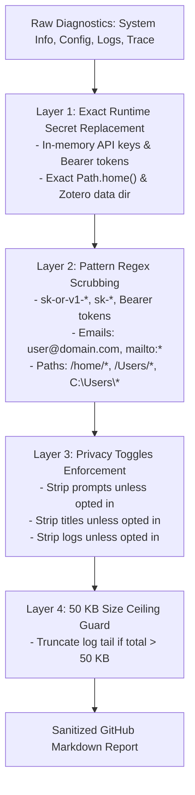

# Opt-In Error & Diagnostic Reporting System

When encountering complex issues—such as upstream API rejections, token limits, driver mismatches, or document conversion failures—troubleshooting requires detailed context about system state, hardware capabilities, and error logs. However, diagnostic logs frequently contain sensitive user data: API keys, authentication tokens, file paths with local usernames, and private research queries.

Zocrates implements an **Explicitly Opt-In, Zero-Regression Error & Diagnostic Reporting System** that allows scholars to generate a complete, multi-layer sanitized, GitHub-ready diagnostic report on demand without automatic popups or privacy leaks.

---

## 1. Core Architectural Invariants

The diagnostic reporting system enforces six core invariants:

1. **Strictly Opt-In (Zero Automatic Modals or Popups)**:
   * The diagnostic report modal **never** opens automatically on error or under any runtime condition.
   * When an error occurs, existing error banners and notifications display normally.
   * An optional, discreet action button (`[🛠️ Report Issue...]`) appears in the error bubble's action row. The modal opens **only if explicitly clicked by the user**.
2. **Zero Workflow Regressions**:
   * All existing chat streaming, error handling, SSE parsing, and retry workflows remain 100% untouched.
   * The reporting system is purely read-only: it does not mutate databases, does not alter configuration files, and acquires no exclusive SQLite locks.
   * All file operations and hardware queries execute inside worker thread pools (`anyio.to_thread.run_sync`), guaranteeing zero event loop blocking.
3. **Multi-Layer Privacy & Redaction Engine**:
   * **Config Allowlist**: Configuration is reported strictly via an explicit allowlist of technical parameters. Personal data keys (`scholar_polite_email`, `user_research_profile`, `llm_base_url` credentials) are completely excluded.
   * **Layer 1 (Exact Secret Replacement)**: Active runtime secrets (`get_auth_token()`, API keys) and exact filesystem paths (`Path.home()`, Zotero data dir) are scrubbed first.
   * **Layer 2 (Pattern Regex Scrubbing)**: General pattern matching redacts Bearer tokens, API keys, email addresses, and multi-OS home directory paths.
   * **Layer 3 (Client Input Sanitization)**: All client-supplied payloads (`error_message`, notifications) are treated as untrusted and passed through sanitizers on the backend.
4. **Privacy-First Defaults (All Toggles Unchecked)**:
   * Since reports are intended for public GitHub issues or forums, all content-bearing options default to **false**:
     * `[ ] Include research prompts and message text` (Default: false)
     * `[ ] Include research paper titles` (Default: false)
     * `[ ] Include backend log tail` (Default: false)
5. **Transparent, In-Place Preview**:
   * The user sees **every single character** that will be copied or saved before taking action inside a read-only `<textarea>`.
   * Toggling any privacy checkbox recalculates and re-renders the preview in-place without closing or rebuilding the modal.
6. **Hard Size Ceiling (<50 KB)**:
   * GitHub issue bodies hard-cap at ~65 KB. The final report is strictly capped at 50 KB, truncating log tails first with explicit truncation markers.

---

## 2. End-to-End Diagnostic Sequence

```mermaid
sequenceDiagram
    autonumber
    participant User as Scholar
    participant UI as Sidebar Modal (sidebar.js)
    participant API as FastAPI Backend (fast_api_app.py)
    participant Engine as Diagnostic Engine (diagnostics.py)
    participant FS as File System (logs & config)

    User->>UI: Clicks [🛠️ Report Issue...] on error bubble
    UI->>UI: Gather client specs (Zotero version, platform, error text)
    UI->>API: POST /diagnostics/report (Bearer authenticated)
    API->>Engine: build_diagnostic_report(request)
    Engine->>FS: Read cached hardware profile (hardware.py)
    Engine->>FS: Seek binary EOF log tail (<zocrates-data>/logs/zocrates.log)
    Engine->>Engine: Filter config to strict technical allowlist
    Engine->>Engine: Run multi-layer redaction (secrets, emails, home paths)
    Engine-->>API: Return sanitized report JSON & Markdown
    API-->>UI: Return report payload
    UI->>UI: Render transparent read-only preview (<textarea>)
    User->>UI: Clicks [📋 Copy] or [💾 Save .md] or [🐙 Open GitHub]
```



---

## 3. Multi-Layer Privacy Redaction Engine

Privacy scrubbing occurs on the backend before any diagnostic string is transmitted to the client:



### 3.1 Exact-Value Replacement (Layer 1)
The engine queries active in-memory configurations directly and performs exact string replacements with standardized placeholders:

* `cfg.get("openrouter_api_key")` → `"[REDACTED_API_KEY]"`
* `get_auth_token()` → `"[REDACTED_AUTH_TOKEN]"`
* `str(Path.home())` → `"/home/[USER]"`
* `str(zotero_data_dir)` → `"<zotero-data-dir>"`

### 3.2 Pattern Regex Scrubbing (Layer 2)
Catches transient keys and external credentials that may appear in stack traces or HTTP error messages:

* **API Keys**: `sk-or-v1-[a-f0-9]+` and `sk-[a-zA-Z0-9_\-]{20,}` → `"[REDACTED_API_KEY]"`
* **Authorization Headers**: `Bearer\s+\S+` → `"Bearer [REDACTED]"`
* **Emails**: `[A-Za-z0-9._%+-]+@[A-Za-z0-9.-]+\.[A-Z|a-z]{2,}` → `"[REDACTED_EMAIL]"`
* **Multi-OS User Paths**:
  * Linux: `/(?:var/)?home/[a-zA-Z0-9_\-\.]+` → `"/home/[USER]"`
  * macOS: `/Users/[a-zA-Z0-9_\-\.]+` → `"/Users/[USER]"`
  * Windows: `[A-Z]:\\Users\\[a-zA-Z0-9_\-\.]+` → `"C:\\Users\\[USER]"`

---

## 4. Strict Technical Configuration Allowlist

To eliminate the danger of serializing sensitive personal settings, the diagnostic engine uses an explicit allowlist:

```python
ALLOWED_CONFIG_KEYS = {
    "llm_provider",
    "llm_model",
    "coordinator_thinking",
    "subagent_thinking",
    "embedding_mode",
    "embedding_model",
    "embedding_dimension",
    "docling_mode",
    "reranker_mode",
    "reranker_model",
    "enable_adaptive_compaction",
    "adaptive_compaction_retention_turns",
    "adaptive_compaction_min_turns",
    "adaptive_compaction_threshold",
    "enable_citation_verification",
    "citation_verification_provider",
    "citation_verification_threshold",
    "enable_predictive_ghost_input",
    "enable_mcp_server",
    "auto_render_mermaid_diagrams",
    "max_session_retention_days",
    "max_session_count",
    "backend_port",
}
```

Personal data fields (`user_research_profile`, `scholar_polite_email`, custom base URLs containing basic auth credentials) are never dumped.

---

## 5. Binary-Seek Log Extraction (`zocrates.log`)

Diagnostic logs can grow to several megabytes. Reading entire log files into memory to extract recent errors wastes CPU and introduces latency:

1. **Binary Reverse Seeking**: The engine opens `<zotero-data-dir>/zocrates-data/logs/zocrates.log` in binary mode (`rb`), seeks directly to `max(0, file_size - 256_000)` bytes from the end, decodes UTF-8 with `errors="replace"`, and discards the first partial line.
2. **Rotation Fallback**: If `zocrates.log` contains fewer than 50 lines (indicating a log rotation just occurred), the engine seeks the remaining lines from the rotated archive `zocrates.log.1`.
3. **Execution Safety**: Performed inside worker threads using `anyio.to_thread.run_sync`.

---

## 6. Shallow Turn State & Trace Extraction

To explain pipeline crashes without leaking literature content:

* **Tool Metadata Only**: Emits tool names (`search_library`, `read_document`) and argument parameter keys (`item_key`, `asset_id`).
* **Zero Chunk Leakage**: Retrieved chunk texts, synthesized paragraphs, and user query thoughts are strictly excluded from the trace.
* **Prompt Privacy Gate**: User prompt text is included only if the user explicitly checks `[x] Include research prompts and message text`.

---

## 7. Preview Modal & Export Channels

The frontend provides three export channels:

1. **`[📋 Copy to Clipboard]`**: Copies the sanitized Markdown report directly to the OS clipboard via `navigator.clipboard.writeText()` with fallback to textarea selection.
2. **`[💾 Save Report (.md)]`**: Opens a native Gecko file picker (`nsIFilePicker`) and writes the file locally using `IOUtils.writeUTF8()`.
3. **`[🐙 Open GitHub Issues]`**: Opens Zocrates' GitHub Issues page in the default system browser via `Zotero.launchURL()`.

### Offline Fallback Resilience
If the backend service has crashed completely and `POST /diagnostics/report` fails to respond, the frontend automatically switches to a **Client-Side Fallback Report**. This captures Zotero versions, extension metadata, and frontend console errors, guaranteeing the user can always file an issue even if the Python daemon is down.
