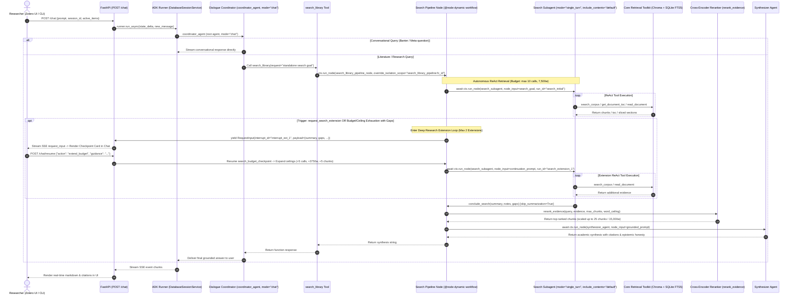

# Dialogue Agent & Dynamic Search Pipeline

Zocrates Dialogue Mode provides the primary conversational and literature retrieval interface for researchers. Built on Google Agent Development Kit (ADK 2.8+) dynamic workflows and a local FastAPI backend, the system decouples natural language conversational interaction from autonomous, multi-step literature retrieval. Researchers interact across three operational scopes (active paper selections, collection scopes, and library-wide queries), with automatic cross-encoder reranking, human-in-the-loop deep research checkpoints, and grounded academic synthesis.

---

## 1. Architectural Overview

Dialogue Mode operates across three distinct contextual scopes within Zotero:

1. **Active Paper Selection**: The researcher selects 1 to 5 papers in the Zotero desktop UI. The agent focuses deeply on analyzing methodology, extracting equations, interpreting figure descriptions, comparing experimental findings, and citing specific sections.
2. **Collection Scope**: The researcher selects one or more Zotero collections. The agent scopes semantic and keyword searches strictly to member papers within those collections.
3. **Entire Library Scope**: The researcher asks an exploratory or broad research question without selecting specific items. The agent conducts hybrid search and synthesis across all indexed documents in the user's library.

### Core Design Philosophy: Decoupled Conversation & Autonomous Retrieval

The architecture decouples conversational interaction from autonomous retrieval through a two-tier hierarchy:

* **Outer Conversational Loop (`coordinator_agent`, `mode="chat"`)**: Maintained as an ADK conversational agent that preserves multi-turn history across dialogue turns in SQLite (`sessions.db`). It handles conversational banter, clarifications, meta-questions, and follow-ups directly with zero retrieval overhead.
* **Inner Autonomous Search Pipeline (`search_library_pipeline_node`, `@node(rerun_on_resume=True)`)**: When a research question requires literature grounding, the coordinator delegates execution to the `search_library` tool. This invokes an on-demand dynamic workflow with an isolated autonomous ReAct search subagent, shared cross-encoder reranking, and grounded academic synthesis.
* **Human-In-The-Loop (HITL) Deep Research Extensions**: When literature queries require deeper or broader investigation, the dynamic workflow suspends execution deterministically, presenting an interactive checkpoint card directly inside the chat turn. The researcher can grant up to 2 extensions (simultaneously scaling calls by +5, words by +3,750, and rerank chunks by +5, up to a hard cap of 20 calls, 15,000 words, and 25 chunks) with optional steering guidance, or synthesize immediately with existing evidence.

### 1.2 The Dual-Channel Retrieval Paradigm: Global Semantic RAG & Structural (Vectorless) Reading

A central innovation of Zocrates is rejecting naive chunk-only RAG in favor of a flexible **Dual-Channel Retrieval Paradigm**:

1. **Broad Discovery via Global Semantic RAG (`search_corpus`)**:
   When exploring an entire library or surveying multiple collections, the ReAct search agent executes hybrid dense vector (Jina v5) and sparse lexical BM25 (SQLite FTS5) searches with Reciprocal Rank Fusion (RRF). This enables rapid identification of candidate papers and topical passages across thousands of items without prior knowledge of document structure.
2. **Targeted Precision via Structural (Vectorless) Reading (`get_document_toc`, `read_document`)**:
   Retrieving sections from an academic paper is still retrieval-augmented generation—what changes is the retrieval mechanism. Rather than slicing a paper into arbitrary 500-token chunks (which breaks mathematical derivations, fragments multi-page methodology arguments, and truncates tables), the agent switches to **vectorless structural navigation**. It inspects the author's Table of Contents (`s0...`, `f1...`, `t1...`) and reads **entire cohesive sections** (`read_document(asset_id="s2")`) as continuous, unclipped prose.
3. **Instant Vectorless Focus on Active Context (Context Chips)**:
   When 1 to 3 papers are selected in Zotero, `search_library_pipeline_node` triggers the **Complete Active Coverage Gate**: it bypasses vector similarity search entirely and pre-injects the dual-key Table of Contents into the search subagent's prompt. The agent reads targeted sections, figures, and tables directly with zero chunk fragmentation and maximum token efficiency (~1.5k–3k tokens vs. 40k+ tokens for raw whole-paper stuffing).

For detailed specifications of checkpoint state machines, replay sequence barriers, SQLite rehydration, scope recovery, and wire protocols, see the [Human-In-The-Loop Deep Research Architecture](hitl-deep-research.md) documentation.



### Key Implementation Modules

| Component | Source Path | Description |
| :--- | :--- | :--- |
| **Composition Root** | `zocrates/agents/app.py` | Assembles the ADK `App`, binds root coordinator, and coordinates agent model overrides |
| **Dialogue Coordinator** | `zocrates/agents/coordinator/agent.py` | Multi-turn conversational agent (`mode="chat"`) managing dialogue and retrieval dispatch |
| **Dynamic Search Pipeline** | `zocrates/agents/library_search/search_pipeline.py` | Dynamic workflow node orchestrating autonomous ReAct search, HITL checkpoints, and synthesis |
| **Shared Evidence Reranker** | `zocrates/agents/common/reranker.py` | Cross-encoder reranking and substantive chunk filtering across all operational modes |
| **Core Retrieval Toolkit** | `zocrates/agents/common/toolkit.py` & `tools.py` | Unified retrieval tools: `search_corpus`, `get_document_toc`, `read_document`, `conclude_search` |
| **State Constants** | `zocrates/agents/common/state_keys.py` | Canonical session-persistent and invocation-scoped state keys |
| **Streaming Endpoints** | `zocrates/fast_api_app.py` | HTTP REST and SSE streaming handlers (`POST /chat` and `POST /chat/resume`) |
| **Frontend Client UI** | `zotero-plugin/addon/sidebar.js` & `sidebar.css` | DOM construction, SSE streaming, interactive checkpoint cards, and citation popovers |

---

## 2. Component Architecture

### 2.1 Root Coordinator Agent (`zocrates/agents/coordinator/agent.py`)

The coordinator embodies the persistent conversational personality of Zocrates:

```python
coordinator_agent = Agent(
    name="coordinator_agent",
    model=base_model,
    static_instruction=COORDINATOR_INSTRUCTION,
    instruction=get_coordinator_instruction,
    tools=tools,  # [search_library, search_online_literature]
    generate_content_config=generate_content_config,
    mode="chat",
)
```

Critical architectural requirements:

* **Root Agent Composition**: Serves as the top-level conversational agent directly bound to `App(name="zocrates", root_agent=coordinator_agent)` without intermediary router nodes.
* **Explicit `mode="chat"`**: In ADK 2.8, agents wrapped in dynamic workflow nodes default to `mode="single_turn"` with `include_contents="none"`. To ensure the coordinator retains conversational memory across turns in multi-turn dialogues, `mode="chat"` is explicitly declared.
* **Instruction Strategy**: Guides the coordinator to answer conversational banter directly, but delegate all factual, literature, and document-specific questions to `search_library` (and external literature discovery to `search_online_literature`).
* **Active Selection Ingestion**: Ingests active context dynamically via `instruction=get_coordinator_instruction` using the `{active_context_items_str?}` template placeholder populated from `ctx.state[ACTIVE_CONTEXT_ITEMS_STR]`.
* **User Research Profile Ingestion**: When configured by the scholar, `user_research_profile_str` is dynamically injected into the coordinator's prompt via `state_delta` (`format_user_research_profile_context`), ensuring conversational tone, assumed background, and methodology focus strictly align with the user's research persona with zero token overhead when empty.

### 2.2 `search_library` Tool & Pipeline Dispatch

The `search_library` function tool connects the conversational coordinator to the dynamic search workflow:

```python
@tool
async def search_library(
    request: str,
    tool_context: ToolContext,
) -> str:
    # Resolve exact function call ID for event isolation scope
    fc_id = ...  # Resolves from invocation context
    override_isolation_scope = f"search_library_pipeline:{fc_id}"

    result = await tool_context.run_node(
        search_library_pipeline_node,
        node_input=request,
        override_isolation_scope=override_isolation_scope,
    )
    return coerce_to_text(result)
```

Key features:

* **Shared Runner Event Queue (`use_sub_branch=False`)**: Executes the pipeline on the main branch so SSE tokens and subagent events stream directly to the client in real time.
* **Exact-Match Event Isolation Scope (`override_isolation_scope=f"search_library_pipeline:{fc_id}"`)**: Completely isolates pipeline tool invocations, subagent reasoning, and chunk data from the outer conversation.

### 2.3 Dynamic Search Pipeline Node (`zocrates/agents/library_search/search_pipeline.py`)

The search pipeline executes as an autonomous dynamic workflow node with human-in-the-loop checkpointing:

```python
@node(name="search_budget_checkpoint", rerun_on_resume=False)
async def search_budget_checkpoint(
    ctx: Context,
    node_input: dict[str, Any] | None = None,
) -> Any:
    """Dynamic workflow checkpoint node yielding RequestInput to pause for human extension."""
    payload = node_input or {}
    ext_num = payload.get("extension_number", 1)
    int_id = f"interrupt_ext_{ext_num}"
    yield RequestInput(
        interrupt_id=int_id,
        message="Deep research limit reached. Extend retrieval or synthesize current findings?",
        payload=payload,
    )

@node(name="search_library_pipeline_node", rerun_on_resume=True)
async def search_library_pipeline_node(
    ctx: Context,
    node_input: str = "",
) -> str:
    completed = False
    interrupted = False
    try:
        response_text = await _run_search_pipeline(ctx, node_input)
        completed = True
        return response_text
    except NodeInterruptedError:
        interrupted = True
        raise
    finally:
        if not interrupted:
            await _enqueue_isolation_scope_closing_event(
                ctx,
                result="Task completed." if completed else "Task failed.",
            )
```

Pipeline execution follows seven distinct phases:

1. **Dynamic Ceilings & State Rehydration**: Loads initial ceilings from configuration: tool call budget (default 10), word ceiling (default 7,500), and max rerank chunks (default 15). If resuming after a backend restart, rehydrates ceilings and evidence from the persistent SQLite key `hitl_snapshot`.
2. **Subagent Resolution**: Dynamically resolves `search_subagent` and `synthesizer_agent` from the parent coordinator's `_subagents` dictionary (or falls back to `_mode_agents["dialogue"]` when resuming directly into `search_pipeline_node`).
3. **Autonomous Initial ReAct Retrieval (`search_initial`)**:
   - Executes `search_subagent` under `run_id="search_initial"`.
   - The subagent invokes `search_corpus`, `get_document_toc`, and `read_document`.
   - Concludes retrieval either via `conclude_search` (when satisfied or out of budget) or proactively via `request_search_extension(justification, covered_summary, missing_aspects)`.
4. **Deep Research Extension Loop (`while True:`, up to 2 extensions max)**:
   - **Dual Triggers**: Evaluates `should_trigger` based on:
     1. *Proactive Trigger*: Subagent explicitly called `request_search_extension` (`req_pass == extension_count + 1`).
     2. *Reactive Trigger*: Tool count reached active budget (`current_calls >= current_budget`) or word volume reached 80% ceiling (`total_words >= 0.8 * current_word_ceiling`) while reported literature `gaps` remain unaddressed.
   - **Smart Skip Invariance**: If evidence has zero gaps or `hitl_enabled: false`, the checkpoint is bypassed and execution proceeds immediately to synthesis.
   - **Interactive Checkpoint (`search_budget_checkpoint`)**:
     - Persists `hitl_snapshot` to SQLite so state survives backend process restarts.
     - Invokes `@node search_budget_checkpoint` with deterministic `run_id=f"checkpoint_{extension_count}"` and `interrupt_id=f"interrupt_ext_{extension_count + 1}"`.
     - Yields `RequestInput` carrying structured payload (`current_calls`, `current_words`, `covered_summary`, `missing_aspects`).
     - Raises `NodeInterruptedError`, pausing runner execution and streaming the checkpoint event via SSE to the frontend.
   - **Stream Resumption (`POST /chat/resume`)**:
     - Resumed with `action="synthesize"`: Breaks out of the loop and synthesizes immediately with existing evidence.
     - Resumed with `action="extend_budget"`: Proportionally expands all three resource ceilings simultaneously:
       - Retrieval Tool Budget: +5 calls (10 → 15 → 20 max).
       - Word Ceiling: +3,750 words (+50%: 7,500 → 11,250 → 15,000 max).
       - Max Rerank Chunks: +5 chunks (15 → 20 → 25 max).
     - Formulates targeted `continuation_prompt` with remaining gaps and optional user steering guidance.
     - Invokes `search_subagent` with `run_id=f"search_extension_{new_extension_count}"`.
     - **Hard Cap**: After 2 extensions (`extension_count >= max_extensions`), the loop breaks deterministically to terminal synthesis.
5. **Shared Dynamic Cross-Encoder Reranking & Substantive Filtering**: Executes `rerank_evidence(search_query, evidence, max_chunks=active_max_chunks, word_ceiling=active_word_ceiling)`. Before sending candidates to the cross-encoder, `filter_substantive_evidence` prunes non-substantive passages (Chunk 0 YAML frontmatter, `:s0` frontmatter chunks, and in-document TOC outlines) to prevent metadata and section lists from stealing top-k slots, with an empty-set fallback guard. Reranking sorts remaining substantive chunks by cross-encoder relevance, scaling up to 25 chunks and 15,000 words.
6. **Academic Synthesis & Epistemic Honesty**: Invokes `synthesizer_agent` with user query, search goal, key-sanitized active selection context, and title-foregrounded reranked evidence.
7. **Session-Persistent Audit Logging & Clean Turn Teardown**: Appends structured audit record to `ctx.state[RETRIEVED_EVIDENCE]`. Clears ephemeral `hitl_snapshot = None` so past turn snapshots never leak into subsequent queries.

### 2.5 Subagent Specifications

| Subagent | Role | Mode & Visibility | Model & Thinking | Tools |
| :--- | :--- | :--- | :--- | :--- |
| **`search_subagent`** | Autonomous retrieval across library chunks & documents | `mode="single_turn"`, `include_contents="default"`, isolated | Dynamic inheritance (or pinned), `thinking_level="low"` default | `search_corpus`, `get_document_toc`, `read_document`, `conclude_search`, `request_search_extension` |
| **`synthesizer_agent`** | Grounded scientific synthesis with epistemic honesty & attribution | Single-turn grounded synthesis (`use_as_output=True`) | Dynamic inheritance (or pinned), `thinking_level="high"` default | None (pure synthesis) |

### 2.6 Per-Agent Model & Thinking Overrides (`override_agent_models`)

Zocrates supports granular per-agent model and reasoning parameter overrides in `zocrates_config.json`:

* **Unified Model Inheritance Across All Roles**: All subagents (`coordinator`, `search`, `synthesizer`, `online_search`, `online_synthesizer`) default to `model: null`. When a user configures a local LLM (such as Ollama or vLLM), every subagent naturally inherits the local model, eliminating the risk of 401 Unauthorized crashes on cloud endpoints.
* **Role-Tailored Defaults**:
  - `coordinator_agent`: `"medium"` thinking (natural multi-turn conversational responses).
  - `search_subagent`: `"low"` thinking (fast ReAct retrieval; avoids burning reasoning tokens on user banter).
  - `synthesizer_agent`: `"high"` thinking (complex inductive synthesis across multi-document citations).
  - `online_search_agent`: `"low"` thinking (fast ReAct web retrieval across scholarly APIs).
  - `online_synthesizer_agent`: `"high"` thinking (structured candidate paper recommendations and staging).
* **Local Thinking & Reasoning Adaptation**:
  - `is_ollama_thinking_supported()` dynamically probes Ollama `/api/show` capabilities, safely suppressing `think: true` on standard non-reasoning models to prevent HTTP 400 errors.
  - On OpenAI-compatible and vLLM servers, `"minimal"` reasoning effort is automatically mapped to `"low"` for schema compliance.
  - Thinking can be explicitly tuned per agent or disabled using `"none"`, `"off"`, `"false"`, or `"disabled"`.
* **Subagent Model Pinning**: Subagents can be individually locked to dedicated models (e.g., pinning `search` to a local Ollama model while keeping `synthesizer` on a remote reasoning model).
* **Silent Pre-Flight Freshness**: Edits in `zocrates_config.json` are detected via microsecond OS `stat()` at the start of `POST /chat`, silently hot-swapping agents before turn execution.

### 2.7 Autonomous ReAct vs. Intermediate Evaluator Architecture

The search architecture uses an autonomous ReAct subagent model rather than an intermediate evaluator loop. This design reflects four core operational realities:

1. **Bounded Corpus**: Zotero libraries are finite, indexed collections rather than the boundless web.
2. **Inherent Self-Evaluation**: ReAct searchers observe retrieval outputs directly to formulate subsequent steps; external evaluations introduce redundant overhead.
3. **Latency & Token Efficiency**: Eliminating intermediate evaluators reduces end-to-end query latency by approximately 4x (from ~270s to ~65s).
4. **Downstream Epistemic Honesty**: Evaluating evidence completeness is assigned downstream to `synthesizer_agent`, which explicitly reports literature gaps.

---

## 3. ADK 2.8 Event Isolation & History Visibility Architecture

A major challenge in multi-agent architectures is preventing intermediate subagent chatter, tool invocations, and raw retrieved chunks from polluting the user's conversational history while still allowing subagents to see their own prior turns.

### 3.1 The Branch Ancestry Failure Mode

In Google ADK, branch ancestry checks (`_is_event_belongs_to_branch`) allow descendant branches to read events from root ancestor branches:

`Child Branch ⊂ Parent Branch ⟹ Ancestor Events Visible`

Consequently, setting `use_sub_branch=True` alone cannot prevent the search subagent from seeing prior user banter, nor does it prevent outer conversation filters from leaking intermediate pipeline tool calls if isolation scopes are not applied.

### 3.2 Exact-Match Isolation Scope

ADK 2.8 event retrieval applies an exact-match equality filter on `isolation_scope`:

`Event Accepted ⟺ (event.isolation_scope == current_isolation_scope)`

By passing `override_isolation_scope=f"search_pipeline:{fc_id}"` during `tool_context.run_node()`, all events produced by `search_pipeline_node` and its subagents are tagged with this unique scope. The outer coordinator runner runs with `isolation_scope=None`, so intermediate pipeline events are completely invisible to the outer conversation.

### 3.3 Intra-Pipeline History Retention

Within the pipeline, the search subagent runs across turns 1 to 4:

* **The Pitfall of `mode="chat"`**: In ADK 2.8, `Agent(mode="chat")` intentionally ignores `isolation_scope` to ensure it can read all conversation history, causing it to pull in outer user banter.
* **The Solution**: `search_subagent` is configured with:
  ```python
  mode="single_turn",
  include_contents="default"
  ```
  This combination respects `isolation_scope=f"search_pipeline:{fc_id}"` while natively maintaining visibility into all events belonging to that scope. Across turns 2, 3, and 4, the subagent natively sees its own prior queries, tool invocations, and returned chunk texts without manual string formatting.

### 3.4 Dynamic Invocation Input Isolation

Because `search_subagent` operates as an autonomous ReAct subagent in a single execution pass, its invocation input is cleanly constructed from:

```markdown
# Context: Active Items Selected in Zotero
- [Key: 7JFT2Z5P] Title: "Self-Improving Coding Agents" (2025)

## Pre-Retrieved Document Outline(s) for Active Items:
### [Key: WNBK68IW, Parent Key: 7JFT2Z5P] "Self-Improving Coding Agents"
- [abstract] Abstract / Summary (~210 words)
- [s0] Frontmatter (~35 words)
- [s1] 1 Introduction (~750 words)
- [s2] 2 Model Architecture (~1850 words)
- Figures:
  - [f1] Architecture
  - [f2] Loss Curves
- Tables:
  - [t1] Benchmark Results

*(Note: Table of Contents is already provided above for these active items. Do NOT call `get_document_toc` for them. You can call `read_document` using your chosen asset IDs with either key.)*

# Target Search Goal
Analyze the self-correcting prompt strategies and empirical benchmarks.
```

This isolates the retrieval subagent from conversational banter while equipping it with the exact bibliographic keys and structural outlines needed for targeted retrieval tools without redundant tool calls.

### 3.5 Subagent Input Isolation & `_SINGLE_TURN_NUDGE` Suppression

When agents run in `mode="single_turn"`, Google ADK's `_ContentLlmRequestProcessor` (`google/adk/flows/llm_flows/contents.py`) inspects `invocation_context.user_content`. By default, this context retains the root user conversation turn (`"What is the framework proposed in this paper?"`). ADK appends `_SINGLE_TURN_NUDGE` ("Important: You will not receive any user replies or clarifications...") and prepends this root prompt as `contents[0]` before the subagent's actual `node_input`.

This caused severe cognitive dissonance: reasoning models in `search_subagent` spent significant thinking tokens trying to answer the user's root question rather than executing their specialized retrieval tasks.

To eliminate this:

* `search_pipeline_node` clears `ctx._invocation_context.user_content = None` upon node entry.
* ADK's `_build_task_input_user_content(..., user_content=None)` cleanly returns `None`.
* Subagents receive **only** their dedicated `node_input` without Turn 0 leakage or `_SINGLE_TURN_NUDGE`.

### 3.6 Terminal Scope Closure & Multi-Turn Session Poisoning Prevention

In Google ADK 2.8, `Runner._find_active_task_scope` scans `session.events` backwards to determine whether any background task agent is currently awaiting user clarification. Any non-empty `isolation_scope` is treated as active **unless** an event with a `finish_task` FunctionResponse (`"Task completed."` or `"Task failed."`) is recorded for that scope.

Because `search_library` stamps pipeline events with `override_isolation_scope=f"search_library_pipeline:{fc_id}"`, returning from `search_library_pipeline_node` without an explicit closing marker leaves the scope active in ADK's task registry. On subsequent conversation turns (Turn 2+), ADK's `Runner._append_user_event` stamps the new user message with `isolation_scope="search_library_pipeline:{fc_id}"`. When `coordinator_agent` (running with `isolation_scope=None`) reconstructs conversation history via `_should_include_event_in_context`, it filters out the mismatched user message, leaving the coordinator stuck replaying Turn 1.

To guarantee scope closure without leaking internal events:

* `search_library_pipeline_node` wraps pipeline execution in a `try...finally` block.
* In the `finally` block, `_enqueue_isolation_scope_closing_event` emits a terminal `Event`:
  ```python
  Event(
      author="search_library_pipeline_node",
      isolation_scope=ctx.isolation_scope,
      invocation_id=getattr(invocation_ctx, "invocation_id", ""),
      branch=getattr(invocation_ctx, "branch", None),
      content=types.Content(
          role="tool",
          parts=[types.Part.from_function_response(name="finish_task", response={"result": "Task completed."})],
      ),
  )
  ```
* The event is enqueued directly to `ctx._invocation_context._enqueue_event`, preserving single-writer FIFO database persistence and preventing concurrent SQLite locking collisions.
* A defensive `try...except` guard ensures any queue failure never masks the synthesized response or propagates out of `finally`.

### 3.7 Wire-Level LLM Roles vs. Observability Traces

A distinction exists between how ADK represents the search pipeline's response in storage, what the LLM receives over the wire, and how observability dashboards (such as Arize Phoenix) render the turn:

1. **In `session.events` (Storage)**:
   - The coordinator's `search_library` invocation generates an event with `role="tool"` and `Part.from_function_response(name="search_library", response={"result": "<synthesized_text>"})`.
   - It sets `event.actions.skip_summarization = True`.
2. **In LLM Prompt Payloads (LiteLLM Wire Protocol)**:
   - In Turn 2, ADK's `_get_contents` passes the history as:
     - `role="user"`: Turn 1 question
     - `role="model"`: Coordinator's `search_library(...)` tool call
     - `role="tool"`: Search pipeline synthesized answer (paired with the tool call ID)
     - `role="user"`: Turn 2 follow-up question
   - The LLM natively processes the pipeline output as a **tool execution result**, allowing it to resolve cross-turn anaphora (*"they"*, *"these mutations"*).
3. **In Telemetry & Trace Observability**:
   - In ADK's telemetry module (`_experimental_semconv.py`), `_to_role` only maps `'user' -> 'user'` and `'model' -> 'assistant'`; any other role returns `""`.
   - In `types.Content`, function response contents have `role=None`, which is dropped during JSON serialization.
   - When observability tracers ingest spans via OpenInference, any input message in `llm.input_messages` lacking an explicit `assistant` role is categorized by viewers under the **`User`** bubble. Thus, the pipeline's tool response appears visually as a "User" message in raw traces even though it is dispatched as `role="tool"` over the wire.

### 3.8 Post-Turn Decision-Model Adaptive Context Compaction

To keep extended literature review sessions responsive and token-efficient without token exhaustion or "lost-in-the-middle" degradation, Zocrates implements **Post-Turn Decision-Model Adaptive Compaction**:

* **Decoupled Post-Invocation Execution (0ms TTFT Impact)**: All pre-invocation token triggers in Google ADK are deactivated (`app.events_compaction_config = None`), ensuring users never experience pre-invocation stalls before the first streaming token. Compaction executes sequentially at the end of `Runner.run_async` via `patched_post_invocation_compaction` before SSE stream closure.
* **Envelope Gate & Invariant Clamping**: Compaction is evaluated only when the session satisfies the Envelope Gate: `completed_turns >= min_turns` (default 4) and `coordinator_prompt_tokens >= token_floor` (default 30,000), with a hard ceiling brake at ≥ 100,000 tokens forcing compaction without probing. If misconfigured (min_turns ≤ K), the system automatically clamps `effective_min_turns = max(configured, K + 1)` with a warning.
* **Subagent Pipeline Isolation Scope Filtering**: Prompt token accounting strictly inspects unscoped coordinator events (`isolation_scope is None`), filtering out subagent ReAct retrieval token counts and preventing premature triggering.
* **Calibrated Decision Model Probe (`compaction_decision_probe`)**: A fast remote decision model probe (`inception/mercury-decide` at threshold $\tau = 0.75$) evaluates topic closure, progression, and anti-stuck criteria (<400ms latency, 10.0s timeout, HTTP 429 backoff retry). Recorded under an OpenTelemetry span with `openinference.span.kind = "EVALUATOR"`.
* **Recent Context Retention ($K=2$ Verbatim)**: Retains the latest $K=2$ completed turns (Turns $N-1$ and $N$) 100% verbatim by setting `end_timestamp` to the final event timestamp of Turn $N-K$.
* **Rolling Consolidation & Subsumption**: Successive compactions extract the prior summary and slice only new completed turns between `prev_comp.end_timestamp` and Turn $N-K$, preserving `start_timestamp = prev.start_timestamp` and extending `end_timestamp = new_slice[-1].timestamp`. Google ADK's `_is_compaction_subsumed` marks the earlier compaction event subsumed, preventing prompt fragmentation.
* **UI & Rewind Resilience**: Compaction events are unconditionally filtered out in `format_session_for_ui`, preventing empty user bubbles (`user: ""`) in `sidebar.js`. Because ADK's SQLite store is append-only, rewinding before a compaction boundary naturally resurrects raw events through `_apply_rewinds`.

---

## 4. Core Retrieval Toolkit & Deduplication Guardrails

All retrieval operations are consolidated into core tools in `zocrates/agents/common/`:

```
┌─────────────────────────────────────────────────────────────┐
│                    Core Retrieval Tools                     │
├─────────────────────────────────────────────────────────────┤
│  search_corpus(query, item_key, chunk_type, limit=10)       │
│    -> Hybrid Dense (Jina v5) + FTS5 BM25 with Pre-Filtering │
├─────────────────────────────────────────────────────────────┤
│  get_document_toc(item_key)                                 │
│    -> Fast Markdown/JSON ToC inspection from toc.md         │
├─────────────────────────────────────────────────────────────┤
│  read_document(item_key, asset_id, page)                    │
│    -> Slices sections/figures/tables with Range-Aware Dedup │
├─────────────────────────────────────────────────────────────┤
│  conclude_search(summary, notes, gaps)                      │
│    -> Concludes retrieval run & sets skip_summarization     │
└─────────────────────────────────────────────────────────────┘
```

### 4.1 Universal Asset Normalization & Range-Aware Pre-Exclusion

When an agent reads sections, figures, or tables via `read_document(item_key, asset_id)`:

1. **Universal Asset Normalization (`normalize_asset_ids`)**:
   Cleans and unwraps outer brackets, quotes, and punctuation deterministically across syntax variations (`"[s3, s4]"`, `'["s1", "s2"]'`, `'"s1", "s2"'`), producing canonical asset ID lists (`["s3", "s4"]`).
2. **Explicit Unresolved Asset ID Reporting**:
   If an asset ID in a list is invalid or cannot be found, `read_document_core` does not silently drop it. Resolved assets are returned under `assets`, while missing IDs are reported in `unresolved_asset_ids` alongside a diagnostic `notice`, allowing subagents to self-correct.
3. **Range-Aware Line Intersection**:
   The line indexer extracts the exact line range (`line_start`, `line_end`) of requested assets from `toc.json`.
4. `vector_store.get_intersecting_chunk_ids(item_key, line_start, line_end)` queries SQLite for all chunk IDs overlapping those lines:
   ```sql
   SELECT chunk_id FROM chunks 
   WHERE item_key = ? 
     AND NOT (line_end < ? OR line_start > ?)
   ```
5. These chunk IDs are automatically added to `ctx.state[TEMP_SEEN_CHUNK_IDS]`.
6. Subsequent calls to `search_corpus` pass `exclude_chunk_ids=seen_chunk_ids` directly to the SQLite FTS5 query (`AND chunk_id NOT IN (...)`) and ChromaDB vector search (`{"chunk_id": {"$nin": [...]}}`), completely eliminating duplicate chunks from vector results.

### 4.2 Intra-Tool Canonical Deduplication

To prevent agents from re-reading the same sections or full documents across multiple loop iterations:

* `read_document` normalizes `asset_id` *before* the deduplication check and operates strictly on canonical keys (`{item_key}:{aid}` or `{item_key}:full`). It never stores raw un-normalized LLM strings.
* If a multi-asset call contains both seen and unseen IDs (e.g. `[s3, s6]` when `s3` was already fetched), only the unseen IDs are retrieved.
* If all requested assets were already seen, `read_document` immediately returns:
  ```json
  {
    "status": "success",
    "item_key": "DOC1",
    "assets": [],
    "notice": "[All requested assets for DOC1 (s1, s2) were already retrieved in this session.]"
  }
  ```
* When appending synthetic chunks to `ctx.state[TEMP_RETRIEVED_EVIDENCE]`, duplicate `chunk_id` entries are filtered out to prevent redundant evidence bloating.

### 4.3 Bounded Retrieval Budget (`MAX_RETRIEVAL_TOOLS_PER_RUN = 10`) & Termination Protocol

To prevent runaway tool calling while providing ample runway for complex multi-paper queries:

1. **Retrieval Tool Budget (`MAX_RETRIEVAL_TOOLS_PER_RUN = 10`)**:
   - The subagent is permitted up to 10 retrieval tool calls (`search_corpus`, `get_document_toc`, `read_document`) per run.
   - Any attempt to execute an 11th retrieval call is rejected with `{"status": "budget_exhausted"}`.
   - Non-retrieval tools (such as `conclude_search`) and HITL deep research extension tools do not count toward this budget.
2. **Penultimate Soft Warning Notice (Call 9/10)**:
   - On the 9th retrieval call (`budget - 1`), the tool return payload includes an explicit budget warning:
     `"[Notice: 9/10 retrieval tool calls used (1 call remaining). Plan your final retrieval, request an extension via \`request_search_extension\`, or prepare to call \`conclude_search\`.]"`
   - On the 10th retrieval call (`budget`):
     `"[Notice: Retrieval tool budget exhausted (10/10). Call \`conclude_search\` to synthesize, or call \`request_search_extension\` to request additional search allowance.]"`
3. **Tool-Level Word Ceiling Circuit Breaker (`HARD_WORD_CEILING = 7500`)**:
   - `_check_and_increment_tool_budget()` tracks cumulative evidence word count across all retrieved chunks.
   - If total words exceed `7500`, subsequent retrieval calls are halted with `{"status": "budget_exhausted"}`, directing the model to conclude search immediately.
4. **Targeted Default `search_corpus` Limit (10 chunks)**:
   - `search_corpus` defaults to `limit=10` to prevent broad keyword/vector queries from flooding the 7,500-word ceiling in a single call.
5. **Frontmatter Batch Discovery Strategy**:
   - In exploratory library searches, `LIBRARY_SEARCH_AGENT_INSTRUCTION` directs the agent to call `search_corpus(query, chunk_type="frontmatter", limit=10)`. This allows the agent to survey titles, authors, and abstracts across 10 candidate papers in one call before drilling down into specific sections.
6. **Negative Evidence Early-Exit Heuristic**:
   - If 1–2 broad queries yield zero relevant chunks, the subagent concludes search immediately rather than burning tools on fruitless query reformulations.
7. **Termination Tool (`conclude_search`)**:
   - Concludes the subagent's retrieval pass cleanly with zero essay/prose generation:
     - `summary`: Concise 1-2 sentence evidence description.
     - `notes`: Optional observations regarding caveats or synthesis guidance.
     - `gaps`: Optional list of missing facets or literature gaps.
   - Sets `tool_context.actions.skip_summarization = True`, marking the tool response event as `is_final_response() == True`. This cuts off execution immediately without triggering post-tool prose.
   - Stores report in `temp:search_report`.
8. **Safeguard Synthesis (`_auto_generate_completion_report`)**:
   - If the subagent exhausts its tool budget or finishes without calling `conclude_search`, the pipeline automatically synthesizes `temp:search_report` from accumulated evidence chunks before proceeding to reranking and synthesis.

### 4.4 Shared Cross-Encoder Reranking (`zocrates/agents/common/reranker.py`)

Retrieved chunks undergo cross-encoder reranking before synthesis:

1. **Consolidated Shared Module**:
   Reranking logic resides in `zocrates/agents/common/reranker.py`, where it is shared across Dialogue, Discovery, and Synthesis modes.
2. **Substantive Chunk Filtering (`filter_substantive_evidence`)**:
   Before candidate passages are transmitted to the cross-encoder API, non-substantive chunks are filtered out via `is_substantive_chunk(chunk)`:
   - Explicit `chunk_type == "frontmatter"` (Chunk 0 emitted during markdown chunking).
   - Chunk IDs ending in `:s0` or `asset_id == "s0"` (frontmatter blocks read via `read_document`).
   - Heading matches for `"frontmatter"`, `"table of contents"`, `"contents"`, or `"toc"`.
   - Raw leading YAML frontmatter blocks (`---\n...---`) containing `title:` or `authors:`.
   - **Rationale**: In cross-encoders, frontmatter and TOC outlines suffer from an acute lexical overlap trap—concentrated query keywords give them artificially high similarity scores, causing them to steal top-k slots from substantive methodology/findings while providing zero prose for the synthesizer to ground claims on.
   - **Empty Fallback Guard**: If all retrieved chunks are frontmatter (e.g. shallow author/title queries), the filter falls back to preserving the original chunks to prevent context starvation.
3. **Relevance Sorting**: Scored with cross-encoder similarity descending against the search goal using OpenRouter's reranker model (with fallback to original retrieval order on API errors).
4. **Chunk Ceiling**: Hard-capped to `MAX_RERANK_CHUNKS = 15` chunks (dynamically expandable to 20 or 25 in deep research extensions).
5. **Word Ceiling**: Trimmed to `HARD_WORD_CEILING = 7500` words (~10,000 tokens) via `_trim_to_budget()` to guarantee context windows remain safe for the synthesizer agent.

### 4.5 User-Facing Cleanliness & Attribution Architecture

To prevent internal Zotero database hashes (e.g. `HCZLU22L`), chunk IDs (`HCZLU22L:s4`), and system plumbing from leaking into user-facing answers:

1. **Title Propagation across Retrieval**:
   `read_document_core` resolves the document title from `toc.json` or Zotero metadata and returns `"title": doc_title`. Synthetic evidence chunks in `temp:retrieved_evidence` inherit this resolved title.
2. **Structured XML Context Representation (`format_retrieved_evidence_str`)**:
   Chunks are enclosed in structured XML (`<retrieved_evidence>` and `<chunk index="..." title="..." authors="..." year="..." section="..." type="...">`) instead of Markdown envelopes, eliminating Markdown-on-Markdown boundary collisions.
   - **Bibliographic Metadata Propagation**: `authors` and `year` are extracted during retrieval (`search_corpus_core` queries SQLite `creators`/`year`; `read_document_core` inspects `toc.json`) and formatted cleanly onto `<chunk>` XML attributes (1 author: `Author`, 2 authors: `Author A & Author B`, >2 authors: `Author A et al.`). This provides the Synthesizer with complete attribution authority without needing bloated frontmatter chunks.
   - Metadata is compactly stored as XML attributes with zero duplicated titles or headings.
   - Internal chunk IDs (e.g. `HCZLU22L:s4`), technical similarity scores, and retrieval methods are completely omitted from the prompt representation.
   - Structured assets and CSV tables are nested cleanly via `<figure_image path="..." />` and `<table_csv>...</table_csv>`.
3. **Selection Context Key Isolation & Hierarchical Multi-Attachment / Note Expansion**:
   `format_active_items` supports `include_keys: bool = True`.
   - **Coordinator** and **Synthesizer** receive clean titles without keys (`include_keys=False`):
     `- Title: "Self-Improving Coding Agents" (2025)`
     This prevents the Coordinator from injecting hashes into conversational replies or reformulated search queries.
   - **Search Subagent** explicitly receives `include_keys=True` in `search_pipeline_node` so it can invoke retrieval tools with the target `item_key`.
   - **Hierarchical Multi-Artifact Expansion**:
     When an item has multiple converted attachments and/or child notes, `active_context_items` exposes a nested hierarchy:
     ```markdown
     - [Key: PARENT_KEY] Title: "Attention Is All You Need" (2017)
       - [Attachment Key: 3A4B5C6D] "Full Text PDF (paper.pdf)" [application/pdf]
       - [Attachment Key: 7E8F9G0H] "Supplementary Material (supp.pdf)" [application/pdf]
       - [Note Key: 9X8Y7Z6W] "Literature Review" (~320 words) [text/note]
       - [Note Key: 1A2B3C4D] "Quick Remark" (18 words) [text/note]:
         > Key takeaway: learning rate warmup is essential for stability.
     ```
   - **Smart Note Inlining**: Notes under 50 plain-text words are inlined as multiline blockquotes (`  > `) capped at 300 characters. Notes ≥ 50 words are referenced by key and word count.
4. **Attribution Contracts & Deterministic Output Sanitization**:
   `SYNTHESIZER_INSTRUCTION` and `COORDINATOR_INSTRUCTION` explicitly prohibit mentioning internal Zotero item keys, raw chunk IDs, or database mechanics in headings or prose. `search_pipeline_node` post-processes final output via `_clean_user_facing_synthesis`, deterministically stripping any leaked key prefixes (e.g. `(HCZLU22L: "Title")` → `("Title")`), chunk references (`Chunk HCZLU22L:s4`), and bracketed key tags (including `[Key: ...]`, `[Attachment Key: ...]`, and `[Note Key: ...]`).

### 4.6 Orthogonal Library-Wide and Scoped Corpus Search (`search_corpus`)

Retrieval scope is decoupled from ambient session state:

1. **Unfiltered Library-Wide Default**:
   When `item_key` is omitted, `None`, `"all"`, `"*"`, or `"library"`, `search_corpus` and `search_corpus_core` execute an unconstrained search across the **entire library**.
2. **Explicit Active Scope (`item_key="active"`)**:
   Passing `item_key="active"` (or `"selected"`) explicitly resolves active context items from `tool_context.state[ACTIVE_CONTEXT_ITEMS]`.
3. **Targeted Item Key(s)**:
   Passing specific item key(s) (e.g. `item_key="HCZLU22L"` or `item_key=["HCZLU22L", "M5Z7SFWM"]`) scopes retrieval strictly to those items.
4. **Framework Portability**:
   Because `item_key=None` defaults to full-library search without requiring `tool_context`, the core tool works identically across Google ADK, FastMCP, and standalone scripts.

### 4.7 Multi-Attachment & Child Note Resolution (`_resolve_bundle_dir`)

To support papers with multiple attachments (main article, supplementary appendix, data tables) as well as child notes without tool bloat:

1. **Direct Note Lookup with Staleness Tracking**:
   When an agent calls `get_document_toc` or `read_document` with a note key, `_resolve_bundle_dir` checks `syncer.db.get_note_by_key(item_key)` first. It computes the `SHA-256` hash of `note_html` and compares it against `conversion_meta.source_hash`. If unchanged, it returns the existing bundle via the fast path (<0.1ms). If edited in Zotero, it atomically re-materializes the bundle with updated Markdown and ToC. Notes < 100 words skip summaries; notes ≥ 100 words use extractive lead paragraphs.
2. **Direct Attachment Check**:
   Matches `cache_dir / item_key` if `document.md` or `toc.md` exists.
3. **Parent Key Fallback with Deterministic Priority**:
   When given a parent item key, it queries child attachments and filters strictly to converted bundles. Sorts by content-type priority: `application/pdf` > `text/html` > `text/markdown` > `text/plain`. If siblings exist (additional converted attachments or notes), attaches an informative disambiguation `notice` informing the agent of other artifact keys. If no converted attachments exist, falls back to the first child note.

### 4.8 Multi-Turn Table of Contents (TOC) Caching & Continuity Architecture

To eliminate redundant `get_document_toc` tool calls on follow-up questions across multi-turn sessions while preserving reranker purity, Zocrates implements a Three-Pillar continuity system:

1. **Pillar 1: Structural Continuity (Lazy Dual-Key TOC Caching & Injection)**:
   - **Lazy Cache Population**: During retrieval, `get_document_toc` extracts a compact navigation outline (~150 words) from `bundle_dir / "toc.json"` and writes it to persistent session state (`state[CACHED_TOCS]`).
   - **Dual-Key Disambiguation**: Stored under both `input_key` (parent item key) and `resolved_key` (attachment document key). The injected outline header explicitly bridges both:
     `### [Key: WNBK68IW, Parent Key: 7JFT2Z5P] "Paper Title"`
     This eliminates cognitive dissonance when an active selection shows the parent key and the bundle uses the attachment key.
   - **Smart Section Level-Folding**: Documents with ≤ 15 sections retain the full outline. Dense documents ($>15$ sections) fold to `level <= 2` (major headings/subheadings), omitting sub-subsections. Because `read_document(asset_id="sX")` reads the full section line span, coverage remains 100% complete and actionable without bloating prompt tokens.
   - **Line-Separated Figures & Tables**: When assets are present, figures (≤ 8) and tables (≤ 6) are rendered as line-separated list items with 2-space indentation under `- Figures:` and `- Tables:` headers (e.g. `  - [f1] Architecture`). For dense documents ($>8$ figures / $>6$ tables), emits a single complete ID range summary (e.g., `- Figures: 14 figures present ([f1] to [f14]). Can be directly read via read_document(asset_id='fX') or discovered via search_corpus.`), giving the agent full authority without triggering re-lookups.
   - **Universal Abstract / Summary Access**: 
     In documents without an explicit `# Abstract` Markdown heading (~87% of corpus), the abstract resides in `toc.json` metadata rather than `document.md` line ranges. `extract_compact_toc_outline` injects `- [abstract] Abstract / Summary (~{words} words)` before sections when metadata abstract exists and no section matches. `read_document_core` natively resolves `asset_id="abstract"` (and `"summary"`): it delegates to an explicit section if present, or falls back to `toc_json["abstract"]` returning an asset with `asset_id="abstract"`, `asset_type="abstract"`, `heading="Abstract"`, and `intersecting_chunk_ids=[]`.
   - **Complete Active Coverage Gate**: `_get_applicable_cached_tocs` injects outlines into `search_node_input` only if **100%** of active context papers are cached (and ≤ 3 items are selected). If even one item is uncached, or during whole-library search, injection returns `[]` to prevent asymmetric attention bias.
   - **LRU Cache Bounding**: Bounded to `MAX_UNIQUE_CACHED_TOCS = 10` unique document bundles by `updated_at` (<4 KB in SQLite session state).
2. **Pillar 2: Upstream Scope Guidance**:
   - `COORDINATOR_INSTRUCTION` directs the coordinator to explicitly note previously established aspects when reformulating follow-up queries.
   - `LIBRARY_SEARCH_AGENT_INSTRUCTION` features a `Pre-Retrieved Outline Bypass` directive instructing the subagent to proceed directly to `read_document` using either key when outlines are provided.
3. **Pillar 3: Downstream Context Continuity & Prior-Turn Synthesis**:
   - `new_audit_entry` records `"active_context_items": list(active_items)` in `state[RETRIEVED_EVIDENCE]`.
   - `_has_context_continuity` verifies active item overlap (or continuous whole-library search) between consecutive turns.
   - When continuous and the prior summary was authored by the subagent (`source not in ("auto_generated", "budget_exhaustion")`), injects `# Prior Turn Context (Read-Only Reference)` into `synth_prompt` before `# User Query`, allowing natural conversational transitions without polluting `rerank_evidence`.

---

## 5. State Management Architecture

State is partitioned into two distinct tiers:

```
┌────────────────────────────────────────────────────────────────────────┐
│                        Zocrates State Hierarchy                        │
├────────────────────────────────────────────────────────────────────────┤
│  Session-Persistent State (stored in sessions.db across turns)         │
│    - active_mode              : "dialogue" | "discovery" | "synthesis" │
│    - active_context_items     : [{"item_key": "...", "title": "...", "children": [...]}] │
│    - active_context_items_str : "# Active Zotero Selection Context..." │
│    - retrieved_evidence       : Turn audit records (capped to 5 turns) │
│    - hitl_snapshot            : Active checkpoint snapshot for resume  │
│    - cached_tocs              : Dual-key compact TOC outlines (bounded)│
├────────────────────────────────────────────────────────────────────────┤
│  Temporary Invocation State (scoped to search_pipeline execution)      │
│    - temp:search_query        : Extracted standalone search goal       │
│    - temp:seen_chunk_ids      : Excluded chunk IDs (Range-Aware Dedup) │
│    - temp:seen_assets         : Read asset keys (Asset Dedup)          │
│    - temp:retrieved_evidence  : Accumulated chunks during search run   │
│    - temp:retrieval_tool_count: Current retrieval tool count           │
│    - temp:retrieval_tool_budget: Dynamic tool budget (10 -> 15 -> 20)  │
│    - temp:word_ceiling        : Dynamic word ceiling (7.5k -> 11.2k -> 15k) │
│    - temp:max_rerank_chunks   : Dynamic rerank chunk cap (15 -> 20 -> 25)   │
│    - temp:extension_count     : Number of granted extensions (0 to 2)  │
│    - temp:extension_requested : Flag set by request_search_extension   │
│    - temp:extension_request_pass: Monotonic pass counter for requests   │
│    - temp:search_report       : Structured completion report           │
└────────────────────────────────────────────────────────────────────────┘
```

### Clean `ctx.state` Management & Public API Compliance

In Google ADK 2.8, `ctx.state` is a delta-aware wrapper (`State(value=session.state, delta=self._event_actions.state_delta)`). Any assignment directly on `ctx.state` inside a node writes to that node's uncommitted `_delta`. When a child tool mutates state, it commits changes to the underlying shared `session.state`. If the parent node previously assigned a value to that same key (e.g. `state[TEMP_EXTENSION_REQUESTED] = False` or `state[TEMP_SEARCH_REPORT] = None`), subsequent reads on the parent `ctx.state.get(...)` read from `_delta` first, shadowing the child tool's updates.

Zocrates resolves this cleanly without accessing private attributes (`_delta`):

1. **Never Assign Tool-Mutated Keys in Parent Node**:
   `search_pipeline_node` never assigns default or empty reset values to keys that retrieval tools mutate (`TEMP_RETRIEVED_EVIDENCE`, `TEMP_SEARCH_REPORT`, `TEMP_RETRIEVAL_TOOL_COUNT`, `TEMP_EXTENSION_REQUESTED`).
2. **Pass Stamping with `TEMP_EXTENSION_REQUEST_PASS`**:
   To track extension requests across multiple passes without resetting `TEMP_EXTENSION_REQUESTED = False`, `request_search_extension` stamps `tool_context.state[TEMP_EXTENSION_REQUEST_PASS] = current_extension_count + 1`. The loop tests `req_pass == extension_count + 1`, cleanly detecting new extension requests for the current pass without shadowing.
3. **Snapshot Rehydration Without State Mutation**:
   On resume from SQLite (where `temp:` keys are stripped by ADK), `search_pipeline_node` falls back to `snapshot.get(...)` in-memory during evaluation without writing transient keys back into `ctx.state`, leaving `_delta` empty and receptive to tool updates.
4. **All Operations via Official Public API**:
   All state reads and writes use `ctx.state` exclusively through official public methods.

### Persistent Checkpoint Snapshot (`hitl_snapshot`)

Because ADK's `BaseSessionService` explicitly strips all `temp:`-prefixed state keys before persisting to SQLite (`sessions.db`), an interrupted session that restarts or reloads from disk would otherwise lose accumulated evidence and ceilings.

* Right before yielding `RequestInput`, `search_pipeline_node` serializes full turn state into `ctx.state[HITL_SNAPSHOT]`:
  ```json
  {
    "evidence": [ ... ],
    "search_report": { ... },
    "extension_count": 1,
    "tool_count": 9,
    "extension_requested": true,
    "ceilings": { "budget": 15, "word_ceiling": 11250, "max_chunks": 20 },
    "seen_chunk_ids": [ ... ],
    "seen_assets": [ ... ]
  }
  ```
* Upon final synthesis, `state[HITL_SNAPSHOT] = None` is set to ensure the ephemeral snapshot never contaminates subsequent user turns.

### Persistent Audit History (`retrieved_evidence`)

The pipeline maintains a chronological audit history of search turns:
```json
{
  "user_query": "Explain somatic mutations",
  "search_query": "somatic mutations in monozygotic twins",
  "active_context_items": [{"item_key": "7JFT2Z5P", "title": "Jonsson et al. (2021)"}],
  "evidence_chunks": [ ... ],
  "cited_chunk_ids": [],
  "search_report": {
    "summary": "Retrieved 4 chunks covering somatic mutations (~1200 words).",
    "notes": "Focused on monozygotic twin pair sequencing.",
    "gaps": [],
    "source": "subagent"
  }
}
```

* **Capped History**: Bounded to `MAX_AUDIT_HISTORY_TURNS = 5` to prevent unbounded growth in `sessions.db`.
* **In-Place Deduplication on Resume**: If a turn is interrupted, resumed, or re-run with the same query, the previous audit record is updated in place rather than duplicated.
* **Context Continuity Tracking**: Storing `active_context_items` allows `_has_context_continuity` to determine whether subsequent turns maintain active item continuity for prior-summary synthesis injection.

---

## 6. FastAPI Streaming & Frontend Integration

### 6.1 Endpoint Specification (`POST /chat`)

The streaming chat endpoint in `zocrates/fast_api_app.py` handles context mapping and real-time SSE streaming:

```
Client (sidebar.js)                     FastAPI (/chat)                        ADK Runner
       │                                       │                                   │
       │─── POST /chat (prompt, items, mode) ──>│                                   │
       │                                       │─── Resolve collections & items ───>│
       │                                       │─── Build state_delta ─────────────>│
       │                                       │─── runner.run_async(...) ─────────>│
       │                                       │<── Stream ADK Event objects ───────│
       │<── SSE data: {"parts": [...]} ────────│                                   │
```

### 6.2 SSE Payload Structure

Every ADK event is transformed into an SSE chunk:
```json
{
  "id": "event-12345",
  "author": "coordinator_agent",
  "is_final": false,
  "parts": [
    { "text": "Based on your selected papers..." },
    { "thought": "Analyzing methodology section..." },
    { "function_call": { "name": "search_library", "args": { "request": "..." } } },
    { "function_response": { "name": "search_library", "response": { "..." } } }
  ]
}
```

### 6.3 Human-In-The-Loop Streaming & Resumption (`POST /chat/resume`)

When a search extension limit is reached with unaddressed literature gaps, the pipeline interrupts:

1. **SSE Interrupt Event**:
   `search_budget_checkpoint` yields `RequestInput`, emitted as a `request_input` SSE payload containing `interrupt_id`, `invocation_id`, `current_calls`, `current_words`, `covered_summary`, and `missing_aspects`. Raw `adk_request_input` tool calls and JSON function bodies are completely suppressed from the user-facing transcript.
2. **Interactive Checkpoint Card in Zotero Sidebar**:
   `sidebar.js` renders `.hitl-checkpoint-card` dynamically using XHTML DOM APIs (`createElementNS`). It displays current extension badge (`Extension 1 of 2`), covered literature summary, unaddressed aspects list, optional steering guidance input, and dual action buttons ("Grant Deep Research Extension" vs. "Synthesize Response with Existing Evidence").
3. **Continuous Bubble Reuse & Multi-Pass Streaming**:
   The resumed SSE stream reconnects directly into the **same** assistant bubble (`assistantBubble`) and existing `liveSteps` array in `sidebar.js`. No duplicate assistant messages or fragmented bubble breaks appear in chat history.
4. **409 Conflict Protection & Safe Session Reload**:
   `POST /chat` guards against starting a new turn while an unresolved interrupt is active (`409 Conflict`). If Zotero restarts during a pause, `format_session_for_ui` detects unresolved `RequestInput` events, returning `pending_hitl` metadata so `sidebar.js` automatically rehydrates the interactive checkpoint card upon reopening.

---

## 7. Verification & Testing Matrix

The dialogue agent and dynamic search pipeline are covered by comprehensive automated tests:

### Unit Tests
* **`tests/unit/test_search_pipeline.py`** (37 tests):
  - Transient state initialization and isolation.
  - Subagent dynamic resolution and fallback construction.
  - Autonomous ReAct retrieval workflow without outer loops.
  - Safeguard completion report generation when uncalled.
  - User-facing synthesis cleanliness and thought-token suppression.
  - Cross-encoder reranking and word count trimming.
* **`tests/unit/test_agents_toolkit.py`** (46 tests):
  - 10-call retrieval tool budget enforcement (`MAX_RETRIEVAL_TOOLS_PER_RUN = 10`).
  - Penultimate soft warning notice on Call 9/10.
  - Tool-level word ceiling circuit breaker (`HARD_WORD_CEILING = 7500`).
  - `conclude_search` with `skip_summarization=True`.
  - Range-Aware chunk exclusion.
  - Intra-tool asset deduplication for full documents and targeted IDs.
  - Compound pre-filtering (`item_key`, `chunk_type`, `limit`).
* **`tests/unit/test_hitl.py`** (8 tests):
  - Dynamic workflow checkpoint interruption yielding `RequestInput`.
  - Resume with `extend_budget` scaling tool budget (+5), word ceiling (+3,750), and rerank chunks (+5).
  - Resume with `synthesize` bypassing additional retrieval.
  - State rehydration across SQLite reload using `hitl_snapshot`.
  - Max 2 extensions hard limit enforcement.
  - Smart skip invariance when evidence has zero gaps.
  - Scope isolation preservation under `NodeInterruptedError`.

### Integration Tests
* **`tests/integration/test_dialogue_agent.py`** (9 tests):
  - End-to-end FastAPI `POST /chat` driving dynamic workflows with mock LLMs.
  - Multi-turn conversation history retention in `DatabaseSessionService`.
  - Active selection context injection.
* **`tests/integration/test_hitl_integration.py`** (9 tests):
  - End-to-end FastAPI `POST /chat` triggering call budget exhaustion and SSE `request_input`.
  - Proactive `request_search_extension` triggering SSE `request_input`.
  - `POST /chat/resume` multi-turn streaming into active session.
  - Multi-extension roundtrip verifying Extension 1, Extension 2, and hard stop on Extension 3.
  - 409 Conflict guard preventing new chat during pending interrupt.
  - Real SQLite `DatabaseSessionService` persistence and restart roundtrip.

### Programmatic CLI Debugger (`scripts/dialogue_agent_proto_evals/run_agent_workflow.py`)

To debug the multi-agent workflow programmatically without running the Zotero desktop application:

```bash
# Interactive terminal chat session (multi-turn debugging)
uv run python scripts/dialogue_agent_proto_evals/run_agent_workflow.py --interactive

# Direct single-turn execution targeting specific Zotero items
uv run python scripts/dialogue_agent_proto_evals/run_agent_workflow.py "Explain the methodology used in these papers" --items ITEMKEY1 ITEMKEY2

# Direct execution targeting an entire Zotero collection
uv run python scripts/dialogue_agent_proto_evals/run_agent_workflow.py "Summarize findings on transformer scaling" --collection "Deep Learning"

# Verbose debugging (inspect subagent thinking, tool calls, and state)
uv run python scripts/dialogue_agent_proto_evals/run_agent_workflow.py "What are the key results?" --items ITEMKEY1 --verbose

# Remote execution against a running FastAPI backend instance
uv run python scripts/dialogue_agent_proto_evals/run_agent_workflow.py "Hello Zocrates" --server http://127.0.0.1:8765
```

---

## 8. In-Text Citations & Two-Tier Sources Integration

To ensure epistemic rigor and prevent hallucinated citations, Zocrates integrates a flat single-ID citation scheme and asynchronous verification pre-pass directly into the dynamic search pipeline:

1. **Flat Single-ID Scheme (`[1]`, `[2]`, `[1, 2]`)**: Candidate chunks are presented to `synthesizer_agent` in descending cross-encoder relevance order inside `<retrieved_evidence>`. Synthesizers cite chunk index numbers in plain brackets.
2. **AI Decision-Model Verification Pre-Pass (`citation_verifier.py`)**: Before citation resolution, `search_pipeline_node` executes an asynchronous pre-pass (`verify_citations_support`) using fast probabilistic decision models (remote `~typesafe/jev-latest` as default, `typesafe/jev-1.14`, `inception/mercury-decide`, or local Laya). Each citation occurrence is evaluated individually against its cited chunk with conditional compound-citation prompts. Failed tokens are pruned in-place (e.g. `[1, 2]` → `[1]`), while fail-open guards protect against network timeouts.
3. **Two-Tier Sources (100% Evidence Recall)**: Partitioned into Tier 1 (`# Cited Sources`) and Tier 2 (`## Other Considered Sources`). A document moves to Tier 1 if ≥ 1 occurrence survives verification; it moves to Tier 2 if 0 occurrences survive. All retrieved chunks are accounted for ($U = C \cup R$). If all emitted citations fail verification, zero-citation fallback is suppressed, keeping Tier 1 empty and moving all candidates to Tier 2 without falsely promoting unverified sources.
4. **Native In-Pipeline Resolution**: Citations are resolved inside `search_pipeline.py` within the native ADK runner context, recording metadata and `support_probabilities` in `state[RETRIEVED_EVIDENCE]`.

For complete specifications of claim extraction boundaries, decision model backends, popover telemetry, and verification invariants, see the [In-Text Citations, Verification & Two-Tier Sources Architecture](citations-and-verification.md) documentation.

---

## 9. Related Architecture Documentation

* **[Human-In-The-Loop Deep Research Architecture](hitl-deep-research.md)**: Deep dive into checkpoint state machines, proportional ceiling progression, replay sequence barriers, and scope recovery.
* **[In-Text Citations, Verification & Two-Tier Sources Architecture](citations-and-verification.md)**: Deep dive into the regex parsing engine, AI decision models, local Laya runtime, and interactive evidence peeks.
* **[Online Literature Discovery & One-Click Import](online-literature-discovery.md)**: Discovery pipeline across OpenAlex, Unpaywall, and Crossref with local deduplication and in-process Zotero write-back.
* **[Predictive Next-Prompt Engine & Ghost Input UX](predictive-next-prompt.md)**: Post-turn decoupled suggestion architecture and Gecko ghost text overlay.
* **[Adaptive Context Compaction Architecture](adaptive-context-compaction.md)**: Autonomous post-turn decision-model compaction with $K=2$ verbatim retention.
* **[Long-Term Memory & User-Curated Knowledge](user-curated-memory.md)**: Native Zotero rich-text note memory, OKF note bundles, and user research profile integration.
* **[System Overview](../index.md)**: High-level overview of the Zotero plugin and local multi-agent backend architecture.
