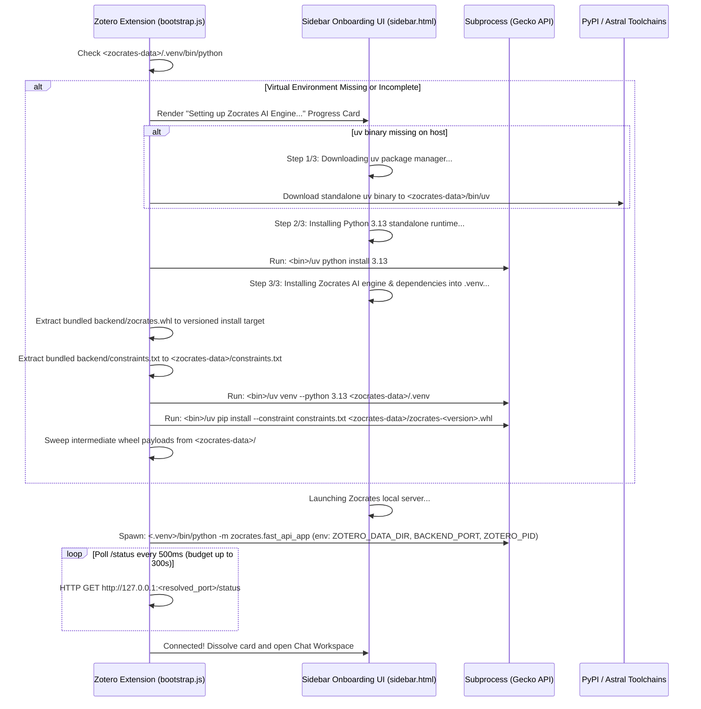
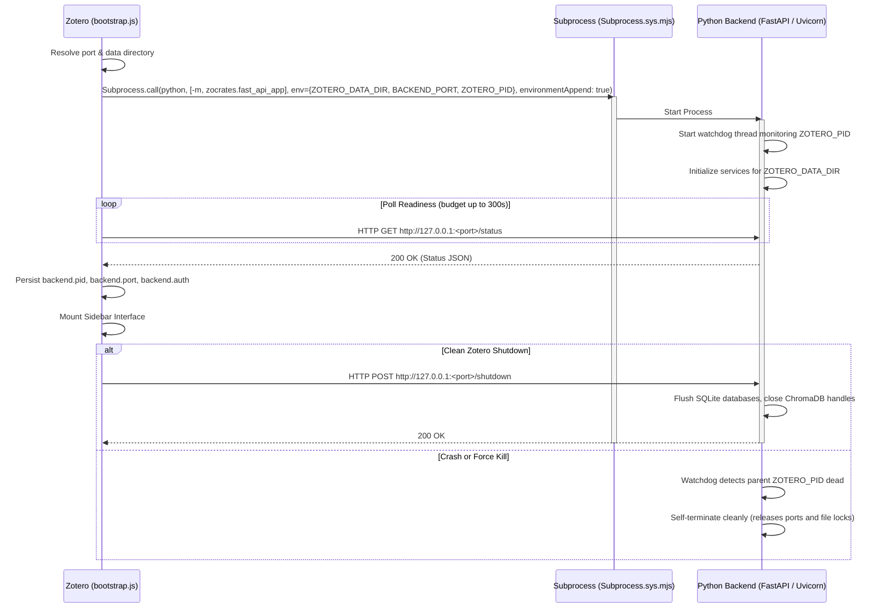

# Backend Distribution and Runtime Environment

This document details how the Zocrates extension (`zocrates.xpi`) manages the local Python backend runtime, dependency bootstrapping via `uv`, release wheel distribution, multi-account process isolation, deterministic port offset allocation, development versus production modes, and background process lifecycle supervision across user operating systems.

---

## 1. Overview and Core Guarantees

The Zocrates frontend runs as an extension inside Zotero's Firefox Gecko browser engine (`zocrates.xpi`). While the `.xpi` package delivers client assets (HTML5, JavaScript, CSS, manifests), the Python backend (`zocrates/`) runs as a dedicated, local FastAPI service on the user's workstation bound strictly to loopback (`127.0.0.1`).

Zocrates employs a **Managed Python Virtual Environment Architecture** powered by Astral's `uv`, specifying `requires-python = ">=3.12,<3.15"` in `pyproject.toml` and bootstrapping **Python 3.13** as the primary runtime. Python 3.13 provides 100% pre-compiled binary wheel availability across all supported operating systems (Linux x86_64/aarch64, macOS Apple Silicon / Intel, Windows x86_64) while remaining forward-compatible with Python 3.14. Standalone frozen binaries (PyInstaller or Nuitka) are avoided due to multi-gigabyte binary bloat, dynamic linking fragility across GPU runtimes, and incompatibility with heavy machine-learning packages (PyTorch, Transformers, Docling, and ChromaDB Rust/C++ bindings).

### Core Architectural Guarantees

1. **Zero-Configuration UX**: Users do not need Python or compilation toolchains installed on their host system. The extension automatically provisions `uv`, downloads an official standalone Python 3.13 runtime, provisions the virtual environment, and installs the packaged release wheel.
2. **Hermetic Multi-Account & Multi-Profile Isolation**: Academic users frequently run multiple Zotero profiles or accounts simultaneously (e.g., `zotero -P Personal`, `zotero -P Lab`). Each Zotero profile receives its own dedicated virtual environment (`.venv`), discrete backend process, and local database sandbox under `<zotero-data-dir>/zocrates-data/`, eliminating lock contention and in-memory singleton collisions.
3. **Opportunistic GPU Acceleration with Graceful CPU Fallback**: Embedding models and document converters automatically leverage hardware acceleration (NVIDIA CUDA on Linux/Windows, Apple Silicon Metal/MPS on macOS, ROCm, or Intel XPU) when drivers and memory allow. If GPU memory is exhausted or `force_cpu: true` is configured, execution falls back seamlessly to multi-threaded CPU inference.
4. **Deterministic Port Offset with Dynamic Conflict Fallback**: Prevents port collisions across concurrent profiles while retaining predictable ports per library.
5. **Universal Linux Support (Native, Flatpak, Snap)**: Operates uniformly across sandboxed and un-sandboxed environments by resolving paths relative to the Zotero data directory rather than relying on system `PATH`.
6. **Orphan Prevention & Crash Resilience**: Guarantees that spawned backend processes terminate cleanly when Zotero closes or crashes.
7. **Frictionless Developer Workflow**: Preserves the developer's ability to iterate on live Python repository code and deploy XPI builds via `./local_deploy.sh --restart` without packaging wheels or triggering redundant bootstrap cycles.

---

## 2. Directory Layout & Hermetic Profile Placement

All runtime components, virtual environments, configuration settings, databases, and converted documents are co-located inside the active Zotero profile's data directory (`Zotero.DataDirectory.dir`):

```
<zotero-data-dir>/
└── zocrates-data/
    ├── bin/
    │   └── uv                          # Standalone static uv binary (if not on host PATH)
    ├── .venv/                          # Dedicated Python 3.13 virtual environment
    │   ├── bin/python (or Scripts/python.exe on Windows)
    │   └── lib/python3.13/site-packages/
    ├── zocrates_config.json            # Materialized settings (Single Source of Truth)
    ├── constraints.txt                 # Pinned dependency matrix matching tested lockfile
    ├── backend.port                    # Active bound port file for this session
    ├── backend.pid                     # Active process PID for watchdog and cleanup
    ├── backend.auth                    # Cryptographic authentication token (mode 0600)
    ├── logs/
    │   └── zocrates.log                # Backend stdout, stderr, and Uvicorn log stream
    ├── chroma/                         # Vector embeddings database
    ├── fts_index.db                    # SQLite FTS5 hybrid search index
    ├── conversion_meta.db             # Conversion metadata and relation cache
    ├── sessions.db                     # SQLite chat histories and HITL checkpoints
    └── corpus/                         # Converted document bundles (OKF v0.2)
```

### Filesystem Hardlinking Optimization via `uv`

While each Zotero profile maintains its own completely isolated `<zotero-data-dir>/zocrates-data/.venv/` directory, `uv` stores downloaded wheels in a central global cache (`~/.cache/uv` on Linux, `~/Library/Caches/uv` on macOS, `%LOCALAPPDATA%\uv\cache` on Windows). On filesystems supporting hardlinks or reflinks (ext4, APFS, NTFS, Btrfs), `uv` automatically hardlinks files into each virtual environment:

* **Disk Savings**: Additional profiles share the same physical disk blocks for large dependencies like PyTorch and Transformers rather than duplicating gigabytes of data.
* **Instant Provisioning**: Creating a `.venv` for an additional profile completes in 2 to 5 seconds with zero network downloads.
* **Full Independence**: Purging one Zotero library cleans its own `.venv` without corrupting other profiles on the machine.

---

## 3. Bundled Release Wheel and Pinned Provisioning Architecture

To distribute the backend without external dependency downloads of the core application code, Zocrates packages the compiled Python wheel directly inside the extension archive:

* **Single Atomic Artifact**: When releasing, the build pipeline compiles the backend wheel with `uv build --wheel` and stages it inside the `.xpi` package at `backend/zocrates.whl`. Users download and install a single archive (`zocrates.xpi`).
* **Version-Locked Payload**: The wheel shipped inside the `.xpi` is synchronized with `manifest.json`. Frontend scripts and backend code always deploy from the exact same release version.
* **Compact Footprint**: Because third-party dependencies are fetched from PyPI by `uv`, the bundled `zocrates.whl` contains only application source files (`zocrates/`) and remains compact (~200–400 KB).
* **Pinned Provisioning via Lockfile Constraints**: `uv pip install <wheel>` resolves open dependency ranges at install time against current PyPI, which can introduce unverified transitive dependency updates. To ensure user environments match the exact tested matrix, the deploy pipeline exports a lockfile-derived constraints matrix (`backend/constraints.txt`, containing ~222 exact version pins) into the `.xpi`. During provisioning, `bootstrap.js` materializes this to `<zotero-data-dir>/zocrates-data/constraints.txt` and invokes:
  ```bash
  uv pip install --constraint <constraintsTarget> <versioned-wheel>
  ```
  This guarantees that user environments match the lockfile tested in continuous integration without drift.
* **Post-Install Wheel Payload Cleanup**: Provisioning temporarily writes the staged `zocrates.whl` and versioned `zocrates-<version>-py3-none-any.whl` files into `<zotero-data-dir>/zocrates-data/`. An asynchronous cleanup helper (`cleanupStaleWheelPayloads`) purges these intermediate wheel copies immediately after a successful install and during warm-start attach, keeping the directory clean while preserving `constraints.txt` for auditability.
* **Onboarding Chat Gate**: During first-run bootstrapping, `sidebar.js` maintains a `backendReadyForChat` gate that keeps chat submission inert (with an informational tooltip) until the backend status probe returns ready. Once the bootstrap card dissolves, the gate opens and full chat interaction is enabled.

---

## 4. First-Run Bootstrapping Lifecycle



### Bootstrap Steps in Detail

1. **Package Manager Detection (`uv`)**:
   `bootstrap.js` checks candidate locations using absolute paths:
   * First: `<zotero-data-dir>/zocrates-data/bin/uv`
   * Second: Common user bin paths (`~/.local/bin/uv`, `~/.cargo/bin/uv`) or system `PATH`
   * If absent: Downloads the platform-specific standalone static executable (~30 MB) directly into `<zotero-data-dir>/zocrates-data/bin/uv`.
2. **Python 3.13 Runtime Provisioning**:
   The extension invokes `<bin>/uv python install 3.13`. `uv` downloads and manages an official, relocatable standalone CPython 3.13 build (from `indygreg/python-build-standalone`), isolating it completely from any host-installed Python versions.
3. **Environment Creation & Constrained Wheel Installation**:
   The extension creates the virtual environment and installs the packaged wheel against the pinned constraints:
   ```bash
   <bin>/uv venv --python 3.13 <zotero-data-dir>/zocrates-data/.venv
   <bin>/uv pip install --python <zotero-data-dir>/zocrates-data/.venv --constraint <zotero-data-dir>/zocrates-data/constraints.txt <zotero-data-dir>/zocrates-data/zocrates-<version>-py3-none-any.whl
   ```
   `uv` installs Zocrates and pulls all required dependencies (`torch`, `transformers`, `fastapi`, `chromadb`, `docling`) strictly inside `<zotero-data-dir>/zocrates-data/.venv/lib/python3.13/site-packages/`.
4. **Onboarding Progress Display**:
   During initial provisioning, `sidebar.html` renders a non-blocking onboarding progress card displaying the current phase and progress rather than connection errors.

---

## 5. Development vs. Production Operating Modes

To ensure that distribution packaging does not compromise local development velocity, Zocrates supports two distinct operational modes:

| Feature | Production Mode (Default / End Users) | Development Mode (Local Repository Testing) |
| :--- | :--- | :--- |
| **Backend Source** | Pre-built release wheel (`zocrates-X.Y.Z-py3-none-any.whl`) bundled inside `zocrates.xpi` at `backend/zocrates.whl`. | Live git repository source (`zocrates/`) run via repo virtual environment or editable install. |
| **Python Environment** | `<zotero-data-dir>/zocrates-data/.venv/` (auto-bootstrapped). | Cloned repository virtual environment (`<repo>/.venv/`). |
| **Process Ownership** | Spawned and supervised by Zotero (`Subprocess.sys.mjs`); watchdog terminates child on Zotero exit. | Either pre-launched in developer terminal (`uv run python -m zocrates.fast_api_app`), or spawned by Zotero with live reload. |
| **XPI Deployment** | Installed via Zotero Add-on Manager or official update URL. | Built and deployed via `./local_deploy.sh [--restart]`. |

### Zero-Touch Developer Attachment

When developing locally:
1. The developer runs the backend in a terminal (`uv run python -m zocrates.fast_api_app`) pointing to the local repository.
2. The developer executes `./local_deploy.sh --restart` to rebuild the XPI and restart Zotero.
3. During startup, `bootstrap.js` probes the candidate port (`GET /status`). Seeing an active backend that reports a matching `zotero_data_dir`, **the plugin attaches immediately and does not spawn a child process or overwrite the environment**.
4. When Zotero closes or restarts, the plugin leaves the developer's terminal backend running without interference.

### Development Source Path Override

To run the managed `.venv` from live repository code instead of the bundled wheel, developers can set the Zotero preference `extensions.zocrates.backendSourceDir` to the repository root. When populated, `bootstrap.js` installs the backend from `<sourceDir>` instead of `backend/zocrates.whl`.

---

## 6. Multi-Instance Port Allocation and URL Resolution

### Loopback-Only Socket Binding

To maintain strict workstation security, Zocrates binds exclusively to loopback (`127.0.0.1`). Arbitrary network binding (`0.0.0.0`) is prohibited to ensure that private libraries, SQLite databases, and filesystem tools are never exposed to the local network.

### Single Source of Truth Configuration

The backend port setting is explicitly materialized in `zocrates_config.json`:

```json
{
  "backend_port": null
}
```

* **`backend_port: null` (Default)**: Dynamic deterministic offset derived from the profile data directory path.
* **`backend_port: 8765` (Explicit Integer)**: User override configured via Zotero Preferences.

### Deterministic Port Offset Algorithm

When `backend_port` is `null`, the candidate port is calculated deterministically:

$$\text{Port} = 8765 + (\text{SHA-256}(\text{canonical\_path})[0..7] \pmod{100})$$

This produces a stable candidate port between `8765` and `8864` for each distinct Zotero data directory. If that candidate port is occupied by a foreign process, the launcher steps forward (`8766`, `8767`...) until an available port is found. Both the Python backend (`zocrates/config.py::compute_deterministic_port`) and the JavaScript frontend (`zotero-plugin/addon/lib/portOffset.js`) use byte-exact identical implementations.

### Centralized Frontend URL Resolution

All frontend modules resolve the active backend URL through a centralized helper on the `Zotero.Zocrates` namespace:

```javascript
Zotero.Zocrates.getBackendUrl = function() {
  // Resolution order (tier 0 first):
  // 0. Zotero.Zocrates.activePort — handshake-confirmed port
  // 1. zocrates_config.json "backend_port"
  // 2. Zotero preference "extensions.zocrates.backendPort"
  // 3. Fallback default: 8765
  // Host is always 127.0.0.1 (loopback only)
};
```

---

## 7. Process Lifecycle Supervision and Orphan Prevention



### Environment Variable Semantics (`environmentAppend: true`)

When launching subprocesses via Mozilla Gecko's `Subprocess.sys.mjs`, passing an `environment` dictionary alone **replaces** the child process's entire environment. The launcher explicitly sets `environmentAppend: true`, which merges injected variables (`ZOTERO_DATA_DIR`, `BACKEND_PORT`, `ZOTERO_PID`, `ZOCRATES_AUTH_TOKEN`, and stored API keys) onto the existing environment. This preserves vital operating system paths (`PATH`, `HOME`, `XDG_*`), ensuring tool execution and cache directories operate normally.

### Orphan Prevention Watchdog

If Zotero crashes or is terminated by the operating system (`kill -9`), child processes could linger as orphans. Zocrates prevents orphaned processes using a dual mechanism:

1. `bootstrap.js` passes Zotero's own process ID to the backend via `ZOTERO_PID`.
2. The FastAPI backend launches a lightweight background daemon thread on boot that periodically checks the parent process:

   ```python
   def _parent_watchdog(parent_pid: int):
       while True:
           time.sleep(2.0)
           try:
               # On Unix: signal 0 checks existence without killing
               os.kill(parent_pid, 0)
           except OSError:
               logger.info("Parent Zotero process %d terminated. Exiting backend.", parent_pid)
               os._exit(0)
   ```

   On Windows platforms, the watchdog monitors the parent process handle via `ctypes.windll.kernel32.OpenProcess`.

### Graceful Termination

During normal Zotero shutdown, `bootstrap.js::shutdown()` issues a `POST /shutdown` request. The backend flushes pending SQLite transactions, closes ChromaDB handles, and exits cleanly within a 1.5-second timeout, followed by a 3-second process kill grace period.

---

## 8. Universal Linux Packaging and Sandboxing

Linux distributions package Zotero through various mechanisms: native tarballs, DEB/RPM packages, Flatpak, and Snap. Zocrates operates uniformly across all environments:

| Environment | Sandbox Boundary | Filesystem Access | PATH Inheritance | Resolution Strategy |
| :--- | :--- | :--- | :--- | :--- |
| **Native (Tarball / DEB / RPM / AUR)** | None | Full host access | Full shell `$PATH` | Checks `<zocrates-data>/bin/uv` or user `$PATH`. |
| **Flatpak (`org.zotero.Zotero`)** | Bubblewrap container | `filesystems=home` | Restricted (`/app/bin:/usr/bin`) | Uses absolute paths anchored to `Zotero.DataDirectory.dir`. Downloads standalone `uv` and pre-built Python 3.13 into `$HOME`. |
| **Snap (`snap install zotero`)** | AppArmor / snap-confine | Home plug access | Restricted snap environment | Same absolute path semantics anchored to active data directory. |

### Universal Absolute Path Rule

The Zotero extension never relies on unqualified shell commands (`"uv"` or `"python3"`) or ambient `PATH` lookups. Instead:
1. Every executable is invoked via its absolute canonical path (e.g. `<zotero-data-dir>/zocrates-data/.venv/bin/python`).
2. Tools are placed within the user's readable and executable data directory (`<zotero-data-dir>/zocrates-data/bin/`).
3. This makes execution completely agnostic to whether Zotero runs inside Flatpak, Snap, or native Linux distributions.
