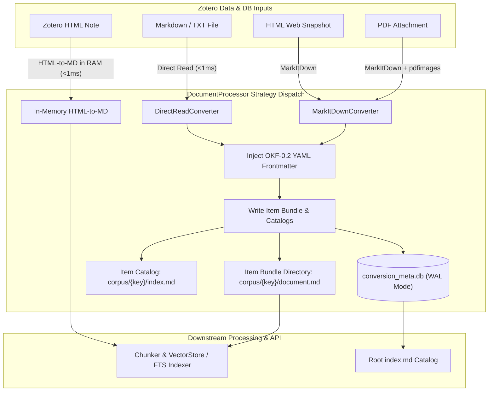

# Document Conversion & Markdown Caching Architecture

Zocrates incorporates a modular document conversion, single-version caching, and provenance pipeline (`zocrates.rag.document_processor`, `zocrates.rag.document_converters`, `zocrates.rag.bundle_catalog`, `zocrates.rag.pdf_utils`). The system transforms heterogeneous academic sources—PDF research papers, HTML web snapshots, Markdown files, plain text documents, and rich-text Zotero notes—into uniform Markdown documents packaged as Open Knowledge Format (OKF v0.2) bundles with embedded YAML frontmatter.

---

## 1. Overview & Conversion Architecture

The document processing system uses a **Strategy Pattern** to convert library attachments into uniform Markdown documents. Each converted document is stored within a dedicated directory bundle containing the primary text, extracted image assets, tabular data, and structured catalogs.



---

## 2. Pluggable Converter Identity & Strategy Interface

Every converter strategy implements `BaseDocumentConverter` (`zocrates.rag.document_converters`) and exposes explicit identity metadata (`converter_id` and `converter_version`):

```python
class BaseDocumentConverter(ABC):
    @property
    @abstractmethod
    def converter_id(self) -> str:
        """Unique identifier for the converter strategy (e.g. 'markitdown', 'direct_read')."""

    @property
    def converter_version(self) -> str:
        """Version string or configuration digest for cache invalidation (defaults to '1.0.0')."""
        return "1.0.0"

    @abstractmethod
    def supports(self, content_type: str, source_path: Path) -> bool:
        """Return True if this converter strategy can handle the document."""

    @abstractmethod
    def convert(
        self,
        item_key: str,
        source_path: Path,
        content_type: str,
        cache_dir: Path,
    ) -> str | None:
        """Convert source document to Markdown text inside the item bundle directory."""
```

### Registered Strategies

* **`DirectReadConverter` (`converter_id = "direct_read"`, `version = "1.0.0"`)**: High-speed UTF-8 disk reader for Markdown (`.md`) and plain text (`.txt`) files, providing a sub-millisecond bypass path for native text files.
* **`MarkItDownConverter` (`converter_id = "markitdown"`, version queried dynamically via `importlib.metadata.version("markitdown")`)**: Universal conversion engine utilizing Microsoft `MarkItDown` combined with page-by-page PDF image extraction via system `pdfimages`.
* **`DoclingLocalConverter` (`converter_id = "docling_local"`, version queried from `docling` / `docling-core`)**: Deep learning document parser powered by IBM Docling. Generates rich document ASTs (`docling_document.json`), performs LaTeX formula enrichment (`do_formula_enrichment=True`), extracts pictures (`images/`) and tables (`tables/` as CSV and HTML), and injects local markdown image links (`_inject_docling_images`). Configured with `use_fast=True` for RT-DETR vision models and hardware-adaptive GPU memory protection.
* **`DatalabConverter` (`converter_id = "datalab"`, version queried via `importlib.metadata.version("datalab-python-sdk")`)**: Multimodal cloud OCR engine powered by the Datalab Chandra API. Provides full LaTeX mathematical formula extraction (`$...$` and `$$...$$`), complex table reconstruction, fenced synthetic VLM image captions (`<synthetic_caption>`), binary/base64 asset extraction to `images/`, adaptive quality re-runs (`parse_quality_score < 3.0`), and checkpoint state persistence (`checkpoint_id`). Restricted strictly to PDF documents with automatic staging safeguards for extensionless PDF files.

---

## 3. Ingestion & Conversion Pipeline Details

### 3.1. Multi-Attachment Pipeline (`LibrarySyncer`)

Zotero items (`journalArticle`, `webpage`, `book`, etc.) frequently contain multiple attachments—such as a primary paper PDF, supplementary material PDFs, HTML web snapshots, and raw data files.

* **Attachment-Keyed Bundles**: Every attachment is converted into its own dedicated bundle directory named after its unique Zotero **Attachment Item Key** (`corpus/<attachment_item_key>/document.md`).
* **Multi-Attachment Coverage**: `LibrarySyncer._ingest_item()` processes all valid document attachments for a record. Main papers, supplementary PDFs, and web snapshots do not collide or overwrite each other.
* **Parent Association**: Each attachment bundle's frontmatter and `conversion_meta.db` record store both `item_key` (the attachment key) and `parent_item_key` (the parent paper key).
* **Vector Store Tagging**: Chunks ingested into ChromaDB and SQLite FTS5 are tagged with both `item_key` and `parent_item_key`. Agent searches and context retrieval automatically gather chunks from all child attachments associated with a paper.

### 3.2. PDF & HTML Conversion (`MarkItDown` + `pdfimages`)

For binary PDF documents and HTML web pages:

1. **Text Extraction**: Converts layout text, tables, and headings to Markdown.
2. **Co-located Image Extraction (`pdfimages`)**:
   * Uses system `pdfimages -list` to map embedded PDF images to page numbers.
   * Uses `pdfimages -png` to extract image files directly into the item bundle's image folder: `corpus/<item_key>/images/img-*.png`.
3. **Form-Feed Page Splitting (`\x0c`)**:
   * Splits converted Markdown text by form-feed page markers (`\x0c`).
   * Injects extracted images at their exact page location as relative links: ``.
4. **Single-Page Fallback Guard**:
   * If `MarkItDown` produces a single page of Markdown text but `pdfimages` extracts images belonging to higher page numbers, all extracted images are appended to the end of the document to prevent asset loss.

### 3.3. Direct Read Optimization

When attachment content type is `text/markdown` or `text/plain` (or has extension `.md`, `.txt`, `.markdown`):

* Reads content directly from disk in under 1ms, bypassing `MarkItDown`.
* Stamps OKF-0.2 YAML frontmatter and registers metadata in `conversion_meta.db`.

### 3.4. In-Memory Zotero Note Conversion

Zotero Notes (child notes and standalone notes) are stored as HTML strings in `zotero.sqlite`:

* Processed via `convert_note_html_to_markdown(html_content)` directly in RAM (<1ms).
* Uses BeautifulSoup (with regex fallback) to convert headings (`<h1>`–`<h6>`), paragraphs (`<p>`), lists (`<li>`), blockquotes (`<blockquote>`), code blocks (`<pre><code>`), and line breaks (`<br>`).
* Bypasses disk caching and is passed directly to the vector chunker with `"is_note": True` metadata.

### 3.5. Remote Multimodal Cloud OCR (`DatalabConverter`)

For high-accuracy mathematical formula transcription, dense two-column academic layouts, and complex tabular structures:

1. **Adaptive Execution Policy & Cross-Page Merging**:
   - Initial conversion executes in `mode="balanced"` with `fence_synthetic_captions=True`, `save_checkpoint=True`, `extras="new_block_types"`, and configurable `merge_cross_page` (default `False`, configured via `datalab_merge_cross_page` in `zocrates_config.json`).
   - When `datalab_merge_cross_page=True`, multi-page tables, cross-page split paragraphs, and continuous lists are stitched into cohesive blocks by Datalab's merge model pass.
   - If `parse_quality_score < 3.0` (out of 5.0), the engine automatically logs a diagnostic warning and retries conversion in `mode="accurate"`, preserving `merge_cross_page`.
2. **Strict PDF Scope & Extension Safeguard**:
   - Only PDF documents are processed (`application/pdf`, `.pdf`, or `%PDF-` magic header).
   - If a valid PDF lacks the `.pdf` file extension on disk, it is dynamically staged to a temporary directory with a `.pdf` suffix prior to calling `DatalabClient.convert()`, preventing SDK/API MIME rejection.
3. **Asset Unpacking & AST Persistence**:
   - Extracted figures and diagrams returned in `result.images` (both raw bytes and base64 strings) are decoded and saved directly into `corpus/<item_key>/images/<filename>`.
   - The complete JSON block DOM tree is written to `corpus/<item_key>/datalab_document.json`.
4. **AST-Driven Semantic Block Pairing & Markdown Generation (`generate_markdown_from_datalab_ast`)**:
   - The Datalab JSON DOM tree (`ast_data["children"]`) contains typed blocks (`Text`, `SectionHeader`, `Equation`, `Diagram`, `Figure`, `Caption`, `Table`, `ListGroup`).
   - On each page, the generator matches `Figure`/`Diagram` and `Table` blocks with their nearest corresponding `Caption` block (supporting both preceding and succeeding author captions).
   - **Clean Figure Containers (`<figure data-type="image">`)**: Formatted using clean Markdown image syntax `` (avoiding dumping long descriptions into `alt`), deduplicated `<synthetic_caption>` VLM descriptions, and author captions inside the container.
   - **Clean Table Containers (`<figure data-type="table">`)**: Formatted with the author caption (`**Table N.** ...`) and clean Markdown table syntax (`| Col | ... |`).
   - **LaTeX Math Preservation**: Transforms `<math>` tags into `$ ... $` (inline) and `$$ ... $$` (display block).
   - **Clean List Formatting**: Detects explicit numbering (`1. `, `7. `) to preserve original reference indexes without duplicate markers (preventing `1. 1.`), and strips bullet glyphs (`•`, `\u2022`, etc.) while safeguarding Markdown bold markers (`**bold**`).
   - **Robust Fallback**: Falls back to regex-based pairing (`_format_datalab_markdown`) if AST JSON is absent or malformed.
5. **Quality & Checkpoint Persistence**:
   - `parse_quality_score` (0.0 to 5.0) and `checkpoint_id` (UUID) are stamped into OKF-0.2 frontmatter `provenance` and persisted in `conversion_meta.db`.

---

## 4. Single-Version Bundle Layout & Catalog Generation

Zocrates enforces an **Attachment-Keyed Bundle** layout. Each attachment is converted into its own directory under `corpus/<attachment_item_key>/`. Re-converting a specific attachment replaces its bundle without affecting other attachments under the same parent paper.

### 4.1. Directory Structure

```
<zotero-data-dir>/zocrates-data/corpus/
├── index.md                                  # Root catalog (generated from DB)
├── AGENTS.md                                 # Agent navigation guide & protocol
├── conversion_meta.db                        # SQLite metadata database (WAL mode)
├── EVUB3BXD/                                 # Main Paper Attachment Bundle
│   ├── index.md                              # Item catalog (lists document.md & images/)
│   ├── document.md                           # Main Markdown document (YAML frontmatter + text)
│   ├── toc.json                              # Machine-parseable Table of Contents
│   ├── toc.md                                # Agent-readable outline & summary
│   ├── item_relations.md                     # Related paper links (0 bytes if unconnected)
│   └── images/                               # Extracted figures
│       ├── img-000.png
│       └── img-001.png
└── XYZ98765/                                 # Supplementary Material Bundle
    ├── index.md
    └── document.md
```

### 4.2. Item Catalog (`index.md`)

Generated inside each `<item_key>/` directory during conversion. It summarizes title, converter provenance, document path, table of contents references, and extracted image/table assets.

### 4.3. Root Catalog (`index.md`)

Generated inside `corpus/` by querying `SELECT * FROM conversion_meta ORDER BY converted_at DESC`. During batch operations (`full_sync`), root catalog regeneration is deferred (`update_root_index=False`) and executed once at completion for optimal I/O throughput.

---

## 5. OKF-0.2 YAML Frontmatter Specification

Every `document.md` file is stamped with YAML frontmatter at conversion time (`zocrates.rag.bundle_catalog`). Pre-existing frontmatter blocks are stripped (`strip_existing_frontmatter`) to prevent duplicate frontmatter blocks.

### Frontmatter Schema

```yaml
---
type: "journalArticle"
okf_version: "0.2"
item_key: "EVUB3BXD"
parent_item_key: "89X2ELQ6"
title: "Attention Is All You Need"
authors:
  - "Vaswani, Ashish"
  - "Shazeer, Noam"
  - "Parmar, Niki"
year: 2017
publication: "Advances in Neural Information Processing Systems"
doi: "10.48550/arXiv.1706.03762"
url: "https://arxiv.org/abs/1706.03762"
member_of_collections:
  - name: "Transformer Architecture"
    collection_key: "ABC12345"
source:
  path: "../../../storage/EVUB3BXD/paper.pdf"
  hash: "e3b0c44298fc1c149afbf4c8996fb92427ae41e4649b934ca495991b7852b855"
  content_type: "application/pdf"
provenance:
  converter_id: "markitdown"
  converter_version: "0.1.5"
  converted_at: "2026-08-11T20:31:47.989013+00:00"
---
```

Bibliographic fields (`authors`, `year`, `publication`, `doi`, `url`) use an **omit-when-empty** policy. Existing cached bundles can be refreshed in-place without reconverting using `scripts/refresh_frontmatter.py` or automatically via `sync_metadata_staleness` on startup and sync.

---

## 6. Authoritative Database Schema (`conversion_meta.db`)

`DocumentProcessor` manages a dedicated SQLite database in **WAL mode** (`PRAGMA journal_mode=WAL;`):

```sql
CREATE TABLE IF NOT EXISTS conversion_meta (
    item_key          TEXT PRIMARY KEY,  -- Attachment item key (e.g. 'EVUB3BXD')
    parent_item_key   TEXT,              -- Parent item key (e.g. '89X2ELQ6', NULL if standalone)
    converter_id      TEXT NOT NULL,     -- Engine ID ('markitdown', 'docling_local', 'datalab')
    converter_version TEXT NOT NULL,     -- Engine version ('0.1.5', '1.0.0')
    source_path       TEXT NOT NULL,     -- Storage-relative path ('storage/<key>/<file>'), note URI ('zotero://note/...'), or absolute POSIX path
    content_type      TEXT NOT NULL,     -- MIME type
    parent_item_type  TEXT,              -- Zotero parent item type ('journalArticle', 'webpage')
    converted_at      TEXT NOT NULL,     -- ISO-8601 timestamp when conversion ran
    indexed_at        TEXT,              -- ISO-8601 timestamp when vector store was indexed
    source_hash       TEXT NOT NULL,     -- SHA-256 bare hex string
    char_count        INTEGER NOT NULL,  -- Character length of full Markdown (including frontmatter)
    parse_quality_score REAL,            -- Normalized parse quality score (0.0 to 5.0)
    checkpoint_id     TEXT,              -- Cloud state checkpoint UUID (e.g. Datalab)
    title             TEXT,              -- Ingested document title
    abstract          TEXT,              -- Ingested document abstract
    abstract_source   TEXT,              -- Abstract origin ('zotero', 'openrouter', 'extractive')
    keywords          TEXT,              -- JSON list of extracted statistical keyphrases
    updated_at        TEXT               -- ISO-8601 timestamp when metadata was last synchronized
);
```

### 6.1. Self-Healing Path Normalization & Zero Ongoing Overhead

To ensure that `zocrates-data` can be copied across machines and operating systems without triggering document re-conversions:

- **`PRAGMA user_version = 1`**: When opening `conversion_meta.db`, `_open_meta_db` inspects `PRAGMA user_version`. If `< 1`, it executes `_migrate_storage_paths_to_relative`:
  1. Creates an automatic pre-normalization snapshot backup: `conversion_meta.db.bak-pre-relativization`.
  2. Runs within an atomic `BEGIN IMMEDIATE` transaction protected by `PRAGMA busy_timeout = 5000`.
  3. Scans absolute storage paths, matching `(?:^|[/\\])storage[/\\](?P<key>[A-Za-z0-9_-]+)(?:[/\\](?P<filename>.+))?$`.
  4. Enforces a **key-equality guard** (`match_key == item_key`) to prevent false-positive rewrites of external linked files.
  5. Updates matching rows to storage-relative `storage/<key>/<filename>` (or `storage/<key>`).
  6. Sets `PRAGMA user_version = 1` and commits.
  7. Calls `_sanitize_cached_bundle_image_links(cache_dir)` to convert file URIs in cached `document.md` files to bundle-relative `images/<name>` links while enforcing strict line-count invariance.
- **Zero Ongoing DB Overhead**: Successful initialization registers `cache_dir` in a module-level set `_INITIALIZED_META_DBS: set[Path]`. Subsequent connections and queries evaluate `cache_dir in _INITIALIZED_META_DBS` in Python memory (~50ns check), performing **0 disk I/O**, **0 PRAGMA queries**, and **0 query interception**.

---

## 7. Converter Selection, Dispatch & Safety

### 7.1. Auto-Dispatch (`get_or_convert`)

Used during automated library synchronization:

1. Computes `source_hash = SHA256(source_path)`.
2. **Cache Hit**: If `<item_key>/document.md` exists AND `source_hash` matches DB row, returns cached Markdown immediately (preserving the existing converter output).
3. **Cache Miss**: Prefers the global `document_converter_id` from `zocrates_config.json`. If the active converter returns `supports() == False`, falls back along the priority chain with logged notifications.

### 7.2. Targeted Conversion (`convert_with`)

Used for explicit user re-conversion requests:

1. Strictly enforces the specified `converter_id`. Raises `UnsupportedConversionError` if `supports() == False` without silent fallbacks.
2. **Atomic Staging Safety**: Converts into a temporary staging directory (`.tmp_<item_key>`) first. Normalizes any staging directory paths and temporary URIs directly into bundle-relative `images/<name>` links using `_relativize_staging_markdown_links`. Destroys the old bundle and swaps in the new directory **only after** conversion succeeds. If conversion fails, the existing working bundle remains intact and operational.
3. **Failure Lifecycle Tracking**: If conversion throws an exception or returns empty content, the staging directory is cleaned up and a structured failure record is written to `conversion_failures` in `conversion_meta.db`. Upon successful re-conversion, any existing failure record for that engine is deleted.

### 7.3. Path Traversal Prevention & Filesystem Containment Invariants

To ensure document ingestion cannot access arbitrary host files:

1. **HTML Local Image Containment & Type Allowlist (`_extract_html_images`)**:
   - Resolves all local `` paths and strictly verifies containment within the document's parent directory (`resolved_local.is_relative_to(source_path.parent.resolve())`). Relative traversal payloads (e.g. `../../../../etc/passwd`) are logged as warnings and skipped without copying.
   - Enforces an image extension allowlist (`.png`, `.jpg`, `.jpeg`, `.gif`, `.webp`, `.svg`, `.bmp`), skipping non-image assets (`.txt`, `.sh`, `.env`) located inside the HTML folder.
2. **Datalab Basename Sanitization (`DatalabConverter._convert_internal`)**:
   - Sanitizes image filenames returned by remote OCR using `safe_filename = Path(filename).name`, rejecting separators, path components (`../../evil.png`), and invalid directory markers (`.`, `..`).
   - Verifies that `(images_dir / safe_filename).resolve().is_relative_to(resolved_images_dir)` to guard against pre-existing symlinks.
3. **Zotero Storage Path Containment with Symlink Compatibility (`ZoteroDB._resolve_attachment_path`)**:
   - For `storage:<filename>`, verifies lexical basename equality (`Path(raw_filename).name == raw_filename`), preventing traversal escapes while preserving the original path to support user symlinks (e.g. ZotFile / Dropbox symlinks) without breaking.
   - For relative paths, enforces lexical containment (`os.path.normpath` must remain inside `self._storage_dir / item_key`).
4. **VLM Captioner Image Containment (`normalize_image_relative_path`)**:
   - Enforces that both `file://` URIs and relative references resolve inside `bundle_dir.resolve()`. Out-of-bundle references safely map to a non-existent sentinel (`bundle_dir / "__traversal_blocked__"`), ensuring callers safely skip the file without reading, hashing, or executing arbitrary host files.

---

## 8. PyTorch Memory Management, Hardware Safeguards & Fast Mode

For deep learning document converters (`DoclingLocalConverter`):

1. **CUDA Memory Fragmentation Protection**:
   `PYTORCH_CUDA_ALLOC_CONF=expandable_segments:True` is set at server startup (`zocrates.rag.setup_torch` and `zocrates.fast_api_app`) before PyTorch initializes the CUDA driver context, protecting all PyTorch operations across the application.
2. **Hardware Tier Assessment (`zocrates.rag.hardware`)**:
   - **Tier 1 (High-Performance GPU — $\ge$6.0 GB VRAM or Apple Silicon $\ge$16 GB Unified RAM)**: Supports full Docling with Formula LaTeX VLM (`do_formula_enrichment=True`, `CodeFormulaV2`) at ~0.5–1.5s per equation.
   - **Tier 2 (CPU or Low-VRAM GPU <6.0 GB)**: Automatically routes Docling to **Fast Mode** (`do_formula_enrichment=False`). Fast Mode performs full document layout analysis, reading order reconstruction, picture extraction, and table structure parsing in **5–15 seconds total** on CPU, avoiding the 60s/formula autoregressive VLM bottleneck.
3. **Configurable Docling Presets (`docling_mode`)**:
   - Supported values: `"auto"` (hardware-adaptive default), `"fast"` (layout & tables only), `"full"` (force formula LaTeX VLM).
   - Configurable via `zocrates_config.json`, `DOCUMENT_CONVERTER_DOCLING_MODE` env var, and the Zotero Preferences UI.
4. **Allocator Recovery Sequence**:
   If an out-of-memory error occurs during deep learning inference:
   ```python
   gc.collect()
   if torch.cuda.is_available():
       torch.cuda.empty_cache()
       torch.cuda.ipc_collect()
   ```
   Followed by an immediate CPU fallback attempt.
5. **Non-Blocking Async Event Loop Offloading & Hard Timeout**:
   - `POST /convert/{item_key}` wraps conversion in `asyncio.wait_for(asyncio.to_thread(syncer.processor.convert_with, ...), timeout=CONVERSION_TIMEOUT_SECONDS)`.
   - `LibrarySyncer` executes document conversion and vector indexing in `loop.run_in_executor(None, ...)`.
   - PyTorch CPU inference threads are bounded (`AcceleratorOptions(num_threads=min(4, max(1, os.cpu_count() // 2)))`), ensuring FastAPI's event loop stays responsive (<5ms latency for `/status` health-checks).
   - Conversions exceeding `CONVERSION_TIMEOUT_SECONDS` (180s) raise HTTP 504 with structured error guidance.
6. **Log Propagation**:
   Sub-loggers for `docling`, `docling_core`, `docling_parse`, and `transformers` propagate to the FastAPI root logger at `INFO` level so CUDA memory warnings and formula batch issues surface in the server console.

---

## 9. Universal HTML Image Extraction & AST Placeholder Mapping

To ensure parity between PDF conversions and HTML web snapshots, converters preserve media and diagram assets across formats:

### 9.1. Universal HTML Image Extraction (`_extract_html_images`, `_inject_html_images_into_markdown`)

* **Base64 Data URIs**: Inspects `` tags in web snapshots, decodes binary payloads, saves them to `corpus/<item_key>/images/img-*.png`, and normalizes links to local relative file URIs.
* **Relative Disk Assets**: Resolves relative image paths against snapshot directory structures and links them co-located inside the bundle.
* **Non-destructive Replacement**: Injects extracted image markdown references while preserving surrounding HTML article prose.

### 9.2. Docling AST Reading-Order Mapping (`_inject_docling_images`)

* **Placeholder Offset Alignment**: When Docling encounters HTML web snapshots or complex multi-column PDFs, icon elements in navigation bars or headers can cause sequential placeholder indexing to drift.
* **`iterate_items()` Traversal**: Traverses `doc.iterate_items()` to match `<!-- image -->` placeholders directly against `PictureItem` AST references (`#/pictures/<pic_idx>`), guaranteeing exact alignment between on-disk image crops and Markdown text positions.

---

## 10. Failure Tracking & Frontend Notification Architecture

### 10.1. Database Schema (`conversion_meta.db`)

In addition to `conversion_meta`, the database maintains an auxiliary `conversion_failures` table with a composite primary key:

```sql
CREATE TABLE IF NOT EXISTS conversion_failures (
    item_key       TEXT NOT NULL,
    converter_id   TEXT NOT NULL,
    error_message  TEXT NOT NULL,
    source_hash    TEXT NOT NULL,
    failed_at      TEXT NOT NULL,
    PRIMARY KEY (item_key, converter_id)
);
```

### 10.2. REST API Status Exposure

`GET /items/{item_key}/status` includes `failed_converters` for both the top-level item and its attachments:

```json
{
  "status": "success",
  "item_key": "VDKHGW8P",
  "is_cached": true,
  "converter_id": "markitdown",
  "failed_converters": {
    "docling_local": {
      "error_message": "CUDA out of memory in formula enrichment",
      "failed_at": "2026-08-17T18:30:00Z"
    }
  }
}
```

### 10.3. Frontend Notification & ItemPane Integration

1. **Decoupled Notifier (`bootstrap.js`)**: `Zotero.Zocrates.Notifier` maintains an event bus across DOM frames (ItemPane in main window, Sidebar in iframe), persisting up to 20 notifications in `localStorage`.
2. **Sidebar Drawer (`sidebar.js`)**: Listens for notifications, displays the notification count badge on the header icon, and renders notifications with timestamps.
3. **ItemPane Section (`lib/itemPane.js`)**:
   - Annotates failed engines in the dropdown: `Docling Local ⚠️ (Failed previously)`.
   - Renders a compact warning alert box explaining why the active bundle remains MarkItDown.
   - Dispatches non-blocking notifications to the drawer on re-conversion errors instead of modal popup alerts.

---

## 11. Semantic Block Wrappers (`<figure data-type="...">`) & Normalization

To prevent figure captions and table grids from fragmenting across chunk boundaries during RAG chunking, converters wrap media and structured tables into atomic `<figure>` semantic containers:

### 11.1. Figure Block Wrapping

Docling image extractions (`_inject_docling_images`) wrap each image and its accompanying caption:

```markdown
<figure data-type="image" data-id="figure-007">


**Figure 6.** Mutation classes of pre-PGCS versus trio mutations. All trio mutations were considered; then, we restricted our analysis to mutations determined to be of paternal and maternal origin.

</figure>
```

* Alt-text is strictly concise (`Figure N`, `Page N Image`), eliminating duplicate caption artifacts.
* The detailed caption is preserved in the Markdown body.

### 11.2. Table Block Wrapping & Artifact Linking

Extracted tables (`_inject_docling_tables` and `wrap_standalone_markdown_tables`) link structured disk artifacts (CSV & HTML) alongside standard GFM tables:

```markdown
<figure data-type="table" data-id="table-000" data-csv="tables/table_000.csv" data-html="tables/table_000.html">

**Table 1.** Summary of clinical parameters and mutation frequencies.

| Mutation Class | Pre-PGCS | Trio Count |
|---|---|---|
| C > T | 42 | 18 |

<!-- artifacts: tables/table_000.csv | tables/table_000.html -->
</figure>
```

### 11.3. Universal Table Normalization

`DocumentProcessor._save_to_cache()` runs `wrap_standalone_markdown_tables()` across all converters (including `MarkItDownConverter` and `DirectReadConverter`), ensuring tables produced by any engine are wrapped into atomic `<figure data-type="table">` blocks before being saved and chunked.

### 11.4. Standalone Extraction, Tag Stripping & Narrative Stitching (`zocrates.rag.chunker`)

To ensure clean vector search retrieval and eliminate narrative fragmentation in academic papers:

1. **Isolated Frontmatter Chunking**:
   - The leading YAML frontmatter block is isolated into **Chunk 0** (`chunk_type="frontmatter"`), containing only the YAML metadata with `heading_path=[]`.
   - The document body is parsed starting from Chunk 1+, preventing frontmatter text from leaking into narrative prose chunks or being truncated across chunk boundaries.
2. **Standalone Atomic Figure/Table Chunks**:
   - The chunker masks fenced code blocks first, then extracts all `<figure data-type="image|table">` blocks into dedicated standalone chunks (`chunk_type="figure"` or `chunk_type="table"`).
   - Outer container tags (`<figure ...>` and `</figure>`) are **stripped from `ChunkResult.text`**, saving LLM token context and vector embedding budget while preserving on-disk `document.md` intact for UI rendering.
   - Large tables and multi-panel figures are kept intact as single standalone chunks (up to `CHUNK_HARD_MAX = 8000` chars).
3. **Narrative Prose Stitching**:
   - Extracted figure/table positions in the text are replaced with empty strings, and consecutive newlines are normalized (`\n{3,}` $\rightarrow$ `\n\n`).
   - Paragraphs and sentences flanking figures merge seamlessly into continuous, unbroken narrative reading chunks ($\le 4,000$ chars).
4. **Anchor-Based Document Order Interleaving**:
   - Figure/table chunks are interleaved with prose chunks based on their character anchor offsets in the section, preserving natural document order without cutting prose across broken sentences.
5. **Strict 6-Part Classification Hierarchy (`determine_chunk_type`)**:
   - YAML frontmatter block: `---\n...\n---` $\rightarrow$ `"frontmatter"`.
   - Explicit wrapper metadata: `<figure data-type="table">` $\rightarrow$ `"table"`, `<figure data-type="image">` $\rightarrow$ `"figure"`.
   - Whole-block code fences: ```` ```...``` ```` $\rightarrow$ `"code"`.
   - Markdown tables: `|---|` $\rightarrow$ `"table"`.
   - Standalone images: `` $\rightarrow$ `"figure"`.
   - Display LaTeX: `$$...$$`, `\begin{equation}` $\rightarrow$ `"equation"`.
   - Default prose narrative $\rightarrow$ `"text"`.

---

## 12. Deletion, Cleanup & Metadata Updates

* **`delete_cached(item_key)`**: Removes bundle folder (`shutil.rmtree`), deletes DB rows in `conversion_meta` and `conversion_failures`, and updates root `index.md`.
* **Orphan Detection**: During `full_sync()`, compares cached keys against active Zotero keys. Any cached key absent from Zotero is removed from disk, metadata DB, and `VectorStore`.
* **Metadata-Only Updates**: `VectorStore.update_metadata(item_key, metadata)` updates ChromaDB chunk metadata and FTS5 `chunk_meta` without re-embedding text chunks.
* **`update_indexed_at(item_key)`**: Records the vector indexing completion timestamp in `conversion_meta.db`.

---

## 13. PDF Page Counting & Cost Estimation Engine (`zocrates.rag.pdf_utils`)

For paid cloud converters (e.g. Datalab Chandra):

1. **`count_pdf_pages(pdf_path)`**: Multi-tier page count pre-scan:
   - Tier 1: `pypdf.PdfReader` if installed.
   - Tier 2: `pdfimages -list` via `subprocess.run`.
   - Tier 3: Byte regex fallback (`/Count \d+`).
   - Default fallback: returns `1`.
2. **Cost Calculation**:
   $$\text{Estimated Cost USD} = \text{Total PDF Pages} \times \text{Cost Per Page}$$

---

## 14. Real-Time Auto-Conversion Serial Queue (`autoConverter.js`)

When new documents are added to Zotero during a live user session (via browser connector, DOI lookup, or PDF drag-and-drop), Zocrates ingests them automatically using a non-blocking background queue:

1. **Standardized Observer Hook**:
   - `Zotero.Notifier.registerObserver(this, ["item"], "ZocratesAutoConverter", 10)` listens for item events.
   - Restricts queueing strictly to `add` events (`event === "add"`). Downstream `modify` events caused by user annotations (highlights, underlines, area selections, notes), metadata updates, tags, or reading progress are ignored to prevent redundant queueing.
   - Pushes incoming newly added `itemKey` to `Zotero.Zocrates.AutoConverter` and returns immediately with 0ms UI delay.
2. **Asynchronous Delayed Polling for Parent Items**:
   - When a new parent regular item is imported (e.g. via Zotero Connector), child PDF attachments are often linked 1–3 seconds after the parent record is created.
   - `_scheduleItemAttachmentChecks()` registers delayed passes at **1.5s** and **3.5s** to capture asynchronously attached child files.
3. **Resilient Multi-Tier File Ready Detection**:
   - Web connectors and drag-and-drop operations create the database record before the binary file finishes writing to `storage/<key>/`.
   - `waitForAttachmentFile()` inspects `attItem.getFilePathAsync()`, `attItem.getFilePath()`, and `attItem.getFile()`, verifying disk presence via `IOUtils.exists/stat` and `OS.File.exists`.
   - Polling uses a progressive retry loop over **10 seconds** ($10 \times 1\text{s}$) to allow large PDFs or web snapshots to finish downloading over the network.
4. **3-Tier State Machine Deduplication**:
   - Maintains three disjoint tracking sets: `_inQueue`, `_activeConversions`, and `_convertedCache`.
   - An attachment key is immediately rejected by `enqueueItem()` if it is already queued, actively converting, or converted in this session.
   - Keys are transferred to `_activeConversions` synchronously before HTTP dispatch, preventing duplicate conversion requests.
5. **Serial Execution Worker (`concurrency = 1`)**:
   - Processes documents strictly one at a time to eliminate PyTorch VRAM thrashing and avoid cloud OCR API rate limits.
   - Dispatches `POST /convert/{item_key}` with the resolved target converter.
6. **Datalab Non-PDF Fallback Resolution**:
   - If the active global converter is `datalab` and the attachment is non-PDF (HTML web snapshot, text, etc.), the processor automatically routes conversion to the configured fallback (`datalab_non_pdf_fallback`: `markitdown` or `docling_local`).
7. **Live Drawer Notifications & Active Progress Card**:
   - **Start Notification**: `⚡ Converting new document/snapshot: <Title> with <Engine Name>...` (tracked by notification ID and retracted via `Notifier.delete(startNotifId)` if backend returns `status: "skipped"`).
   - **Live Progress Card**: Displays an active single-item progress card in the sidebar drawer with animated progress and document title.
   - **Completion Notification**: `✅ Converted new item: <Title> with <Engine Name>` (or fallback notice: `✅ Converted snapshot: <Title> with <Engine Name> [Datalab is PDF-only]`).
   - **Error Notification**: `⚠️ Auto-conversion failed for <Title>: <Reason>`.
   - **Auto-Dismissal**: Progress cards auto-dismiss after 4 seconds.
   - Broadcasts `"zocrates-document-converted"` XPCOM observer to refresh the ItemPane automatically.

---

## 15. Batch Document Conversion Pipeline & SSE Streaming (`batchConverter.js`)

For bulk document conversions triggered via the right-click context menu (`Zocrates -> Convert with...`) or the **Library Conversion Status Modal**:

1. **Multi-Phase SSE Progress Stream (`POST /batch-convert`)**:
   - Streams real-time Server-Sent Events per item: `batch_start`, `item_start`, `item_success`, `item_error`, and `batch_complete`.
   - Sidebar renders an active Batch Progress Card with live item title, engine badge, progress bar ($N / M$), and a **Stop** button.
2. **Effective Converter ID & Pre-Flight Cost Estimation (`GET /cost-estimate`)**:
   - Computes `effective_converter_id` per document in the selection:
     - PDF attachments route to `datalab` (counting pages for USD cost estimation).
     - Non-PDF attachments route to `datalab_non_pdf_fallback` (`markitdown` or `docling_local`) with $0 page cost.
   - Prompts user confirmation showing separate breakdowns: `• To Convert: N PDF document(s) (X pages, ~$Y USD)` and `• To Convert: M non-PDF document(s) (via Fallback Engine)`.
3. **3-Way Library Partitioning & Fast Batch Indexing (`POST /batch-index`)**:
   - `GET /library/conversion-status` partitions the library into three explicit states:
     - `indexed_count`: Documents with Markdown bundles already embedded in the active Chroma collection.
     - `pending_index_count`: Documents converted to Markdown bundles on disk but not yet embedded in the active vector collection (e.g. after switching embedding models).
     - `unconverted_count`: Raw library documents with no Markdown bundles.
   - Modal provides a direct `[ Index Y Pending Document(s) ]` action powered by `POST /batch-index` SSE stream, embedding cached documents in mini-batches ($batch\_size = 8$) without re-running OCR conversions.
4. **Library Conversion Status Modal**:
   - Accessible via the sidebar menu (`More Actions -> Library Conversion Status`).
   - Displays total converted vs. unconverted documents, an expandable list of unconverted files with search filtering, an engine selector, and direct conversion/indexing actions.
   - Fully on-demand with zero periodic polling.

---

## 16. Multimodal Figure Enrichment & VLM Image Captioning (`vlm_captioner.py`)

For extracted figures, diagrams, and plots in Markdown documents that lack descriptive author text, Zocrates enriches them with structured visual descriptions using a Vision-Language Model:

1. **Execution Seam**:
   - Runs as an **asynchronous post-conversion step** immediately after the base converter generates the bundle and Markdown.
   - Executes outside the base converter's 180s timeout window.
2. **Provider Hierarchy & Automatic Fallback**:
   - **OpenRouter (Cloud)**:
     - Primary Model: `openrouter/nvidia/nemotron-3-nano-omni-30b-a3b-reasoning:free` (Free, vision-capable).
     - Backup Model: `openrouter/qwen/qwen-flash` (Fast, high-quality fallback on rate limit or 5xx error).
   - **Ollama (Local)**: Open user-configured vision model (e.g. `llava:latest`, `minicpm-v:latest`).
3. **Filtering, SVG In-Memory Rasterization & Pre-Validation**:
   - Verifies file existence and minimum file size $\ge 4\text{ KB}$.
   - **Vector SVG Support**: Rasterizes SVG files into PNG bitmaps in-memory using `resvg-py` (zero external C dependencies) to inspect dimensions and pass bitmap pixels to the VLM.
   - Inspects headers with `PIL.Image.open` wrapped in exception guards, safely skipping unreadable files, tiny icons ($< 120\text{px}$), and extreme aspect ratios ($< 0.05$ or $> 20$).
   - Downscales large images proportionally to $\le 1024\text{px}$ using Lanczos filtering in-memory prior to base64 encoding.
   - Caps processing at the top `vlm_max_images_per_doc` (default 100) by area.
4. **Sidecar Caching (`image_captions.json`)**:
   - Caches generated captions in `corpus/<item_key>/image_captions.json` keyed by image SHA-256.
   - Re-indexing or re-chunking reuses cached captions with zero network overhead.
   - Cleanly resets on explicit engine re-conversion (`POST /convert/{key}`) to avoid cross-converter image mismatches.
5. **Standard Markdown & Section Labeling**:
   - Injects `<synthetic_caption data-source="vlm_remote|vlm_local" data-model="...">\n{caption}\n</synthetic_caption>` inside `<figure data-type="image">` blocks.
   - Wraps bare standalone Markdown images in `<figure data-type="image">` with synthetic captions.
   - Chunker formats synthetic captions cleanly as `[Visual Summary]:\n{caption}`, and populates `ChunkResult` and `SearchResult` metadata (`image_path`, `caption_source`, `vlm_model`).

---

## 17. REST API Endpoints

| Method | Endpoint | Description |
| :--- | :--- | :--- |
| `GET` | `/converters` | List all registered converter engines (id, version, mode) |
| `POST` | `/rag/converter` | Update active converter ID, mode, and `datalab_non_pdf_fallback` in config |
| `POST` | `/convert/{item_key}` | Re-convert an item with specified `converter_id`, replace bundle on success, and re-index vector store |
| `POST` | `/batch-convert` | SSE stream for serial batch document conversions across multiple items |
| `POST` | `/batch-index` | SSE stream for fast chunking and vector embedding of pending cached documents without re-conversion |
| `GET` | `/items/{item_key}/status` | Get item metadata, bundle status, and `failed_converters` mapping |
| `GET` | `/library/conversion-status` | Single-query bulk summary of indexed, pending-index, and unconverted items across the entire library |
| `GET` | `/cost-estimate` | Pre-scan targeted items' PDF page counts and calculate estimated USD cost with non-PDF fallback routing |

---

## 18. Pipeline Summary Table

| Input Type | Source | Converter Strategy | Bundle Path | Frontmatter Stamped | Downstream Indexing |
| :--- | :--- | :--- | :--- | :--- | :--- |
| **PDF Attachment** | `<storage_dir>/<att_key>/<file>.pdf` | `Datalab / Docling / MarkItDown` | `corpus/<att_key>/document.md` | Yes (OKF-0.2) | ChromaDB + SQLite FTS5 |
| **HTML Snapshot** | `<storage_dir>/<att_key>/<file>.html` | `MarkItDown / Docling` | `corpus/<att_key>/document.md` | Yes (OKF-0.2) | ChromaDB + SQLite FTS5 |
| **Markdown / TXT** | `<storage_dir>/<att_key>/<file>.md` | `DirectReadConverter` | `corpus/<att_key>/document.md` | Yes (OKF-0.2) | ChromaDB + SQLite FTS5 |
| **Zotero Note** | `zotero.sqlite` (`itemNotes`) | `convert_note_html_to_markdown` | *RAM only* | No | ChromaDB + SQLite FTS5 (`"is_note": True`) |

---

## 19. Architectural Cross-References

* **OKF Document Bundles & Invariants**: For bundle disk layout, agent navigation protocols, and mutation lifecycles, see [OKF Document Bundles & Mutation Invariants](okf-bundles-and-invariants.md).
* **Embeddings & Hybrid Search**: For vector store collections, chunking mechanics, and hybrid search, see [Embeddings & Hybrid Search](embeddings-and-search.md).
* **System Overview**: For high-level frontend-backend architecture and multi-agent roles, see [System Architecture](../index.md).
