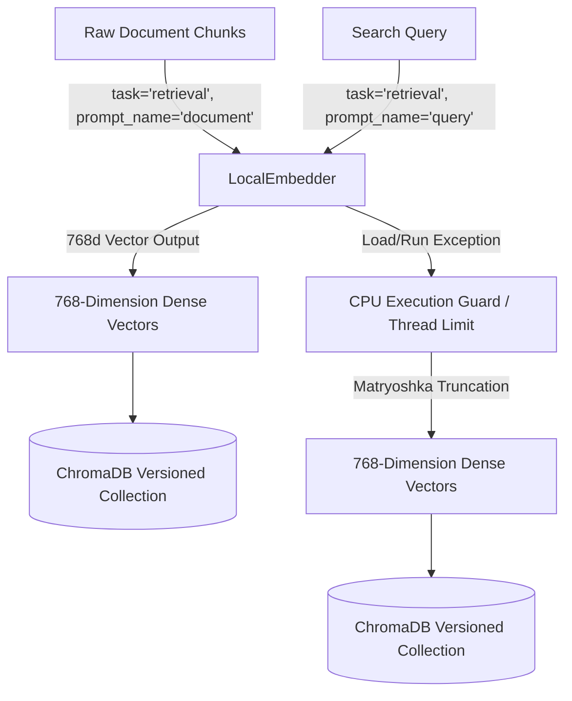
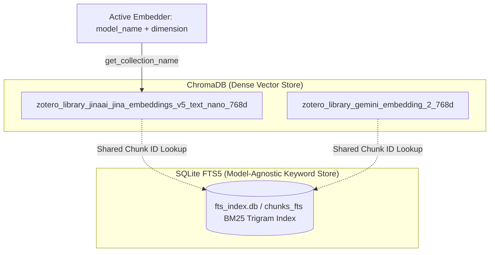

# Embeddings & Hybrid Search Architecture

Zocrates provides local and cloud vector embedding generation, multi-vendor hardware acceleration, dynamic collection versioning, and hybrid vector-keyword retrieval (`zocrates.rag.embeddings`, `zocrates.rag.vector_store`, `zocrates.rag.chunker`, `zocrates.rag.setup_torch`, `zocrates.rag.hardware`). The architecture combines dense vector embeddings with SQLite FTS5 BM25 trigram search to deliver high-recall, low-latency semantic retrieval across diverse academic libraries.

---

## 1. Overview & Supported Embedding Modes

Zocrates supports two primary embedding modes configured in `zocrates.rag.config` via the `EMBEDDING_MODE` environment variable or dynamically stored in `zocrates_config.json`:

| Mode | Model | Description | Output Dimension |
| :--- | :--- | :--- | :--- |
| **`local`** *(Default)* | `jinaai/jina-embeddings-v5-text-nano` | Runs locally via Hugging Face `transformers` & `torch`. Fully offline. | **768** |
| **`cloud`** | `nvidia/nemotron-3-embed-1b:free` (or any OpenRouter model) | Uses OpenRouter Cloud Embeddings API via `litellm.embedding`. Requires `OPENROUTER_API_KEY`. | Dynamic 4-tier offline resolution (e.g. **1024**, **1536**, **768**) |

### 1.1. Zero-Network Dimension Resolution Hierarchy

To guarantee that application startup, CLI workflows, and testing never make blocking HTTP network requests simply to probe an embedding model's dimension, `OpenRouterEmbedder` uses a deterministic 4-tier offline resolution strategy:

```
┌────────────────────────────────────────────────────────────────────────┐
│                   Zero-Network Dimension Resolution                    │
├────────────────────────────────────────────────────────────────────────┤
│ Tier 1: Explicit Configuration (zocrates_config.json)                  │
│   - Reads "embedding_dimension" from disk if configured by user or UI  │
├────────────────────────────────────────────────────────────────────────┤
│ Tier 2: Local ChromaDB Collection Inspection on Disk                   │
│   - Inspects existing local collections via syncer.store._client       │
│   - Matches zotero_library_{sanitized_model}_(\d+)d or metadata        │
├────────────────────────────────────────────────────────────────────────┤
│ Tier 3: Static Known Registry (KNOWN_EMBEDDING_DIMENSIONS)             │
│   - Fast offline mapping for common models: BGE-M3 (1024d),            │
│     Nemotron-1B (1024d), Jina v5 (768d), Gemini Embedding 2 (768d)    │
├────────────────────────────────────────────────────────────────────────┤
│ Tier 4: Bundled Model Registry (litellm.model_cost)                    │
│   - Offline dictionary of hundreds of models with "output_vector_size" │
├────────────────────────────────────────────────────────────────────────┤
│ Fallback: Defaults to 1024 without network probes                      │
└────────────────────────────────────────────────────────────────────────┘
```

#### Auto-Detection & Automated Persistence:

* When an unlisted model is used for the first time without explicit configuration, the embedder safely defaults to `1024` on boot.
* Upon receiving real embedding vectors during the first ingestion or search, `__call__` measures `actual_dim = len(embeddings[0])`.
* If `actual_dim` differs from the initial assumption, `actual_dim` is updated in memory and automatically persisted to `zocrates_config.json` (`save_zocrates_config({"embedding_dimension": actual_dim})` for `actual_dim >= 64`), ensuring all subsequent boots resolve via Tier 1 with zero network calls.

---

## 2. Jina v5 Local Embedder Architecture

The local embedder (`LocalEmbedder` in `zocrates.rag.embeddings`) uses Hugging Face's `AutoModel.from_pretrained("jinaai/jina-embeddings-v5-text-nano", trust_remote_code=True)`.



### Key Technical Characteristics:

- **768d Vector Representation**: The default nano model outputs dense embeddings of 768 dimensions.
- **Shared Singleton Model Instance (`_SHARED_LOCAL_MODEL`)**: `LocalEmbedder` instances across threads and services share a single in-memory model and tokenizer singleton, preventing multi-gigabyte memory bloat during background syncs.
- **CPU Thread Management**: PyTorch CPU thread count is restricted (`torch.set_num_threads(4)`) to prevent OpenMP core thrashing and lock contention while preserving high throughput.
- **Thread-Safe Lazy Loading**: Model loading uses `threading.Lock()` with double-checked locking (`_load()`). The model is only loaded into memory when the first embedding calculation (`__call__`) occurs, avoiding startup overhead for status checks.
- **Memory-Safe Mini-Batching (`batch_size = 8`)**: Long documents with dozens of chunks are processed in mini-batches of 8 chunks under `torch.inference_mode()`, preventing PyTorch memory allocation spikes.
- **Explicit Tensor Deallocation & GC**: Intermediate tensors are detached, cast to standard Python float lists (`.cpu().tolist()`), deleted (`del batch_tensors`), and followed by explicit garbage collection (`gc.collect()`).
- **LoRA Task Adapters & Prompt Names**: Jina v5 uses LoRA adapters tailored for specific downstream tasks:
  - Document Chunks are encoded with `task="retrieval"` and `prompt_name="document"`.
  - Search Queries are encoded with `task="retrieval"` and `prompt_name="query"`.
- **Hardware Precision**: Uses `torch.float32` on CPU. Tensor outputs are explicitly converted to NumPy lists prior to Chroma ingestion.

---

## 3. Multi-Vendor Hardware Acceleration & Setup (`setup_torch.py`)

Zocrates features multi-vendor GPU accelerator detection and automatic wheel repair across all major GPU hardware manufacturers:

| Accelerator Vendor | Supported Hardware | Execution Device | Setup & PyTorch Wheel Selection |
| :--- | :--- | :--- | :--- |
| **NVIDIA CUDA** *(Modern)* | RTX 20xx / 30xx / 40xx, A100, H100 (Compute Capability $\ge$ 7.5) | `cuda` | Installs PyTorch from `cu121`/`cu126` wheel index |
| **NVIDIA CUDA** *(Legacy)* | GeForce MX250, GTX 10xx/9xx (Compute Capability < 7.5) | `cuda` | Automatically installs `cu118` wheel index (retains `sm_61`/`sm_60`/`sm_50` kernels) |
| **Apple Silicon** | Mac M1 / M2 / M3 / M4 | `mps` *(Metal)* | Uses PyTorch built-in Metal Performance Shaders (`torch.backends.mps`) |
| **AMD Radeon** | Radeon RX 6000/7000 series, Instinct (Linux) | `cuda` *(ROCm)* | Detects `rocm-smi` and installs ROCm wheel index (`rocm6.2`) |
| **Intel Arc** | Intel Arc A-Series, Data Center GPU Flex/Max | `xpu` | Uses Intel OneAPI PyTorch XPU backend (`torch.xpu`) |
| **CPU Fallback / Forced** | Forced via Settings or any processor | `cpu` | Uses standard PyTorch CPU execution |

---

## 4. Versioned Collections & Index Synchronization Architecture

Instead of destructive wipes when switching embedding models, `VectorStore` (`zocrates.rag.vector_store`) uses **Versioned Vector Collections** paired with a **Single Shared FTS Database**:



### Key Architectural Benefits:

1. **Model Versioning (`get_collection_name`)**: Each model and dimension configuration gets its own isolated Chroma collection (e.g. `zotero_library_jinaai_jina_embeddings_v5_text_nano_768d`). Switching models leaves prior vector indices intact.
2. **Dynamic Collection Rebinding (`_ensure_collection_dimension`)**:
   If an unlisted model initially defaulted to `1024d`, but the actual embedding vectors returned during the first ingestion or query turn out to be `768d` or `1536d`, `VectorStore` automatically rebinds:
   - Holds `self._rw_lock` to ensure thread-safe atomic collection recreation.
   - Updates `self.active_collection_name` to match the actual dimension (e.g. `..._768d`).
   - Retrieves or creates the properly dimensioned Chroma collection with matching metadata (`model_name`, `dimension`).
   - Prevents Chroma `DimensionalityException` or mislabeled collection names.
3. **Metadata Preservation on Reset**: When `reset_collection` clears active or named collections, it preserves `model_name` and `dimension` metadata in the newly recreated collection rather than resetting to bare cosine space.
4. **Dimension Alignment**: Retrieval calls always target the active collection corresponding to the active embedder's output dimension, guaranteeing 100% vector dimension alignment.
5. **Shared FTS Keyword Store**: Raw text parsing and BM25 trigram indexing (`fts_index.db`) are independent of dense vector models, eliminating redundant text parsing across embedding model switches or fallbacks.

---

## 5. Document Processing, Chunking & Ingestion Pipeline

### 5.1. Chunker (`zocrates.rag.chunker`)

- **Standalone Figure/Table Chunking & Tag Stripping**: `<figure data-type="image|table">` blocks are extracted as dedicated standalone chunks, and outer `<figure>` / `</figure>` wrapper tags are stripped from `ChunkResult.text` to conserve embedding tokens.
- **Narrative Prose Stitching**: Figure positions are replaced with empty strings, and excessive blank lines are normalized (`\n{3,}` $\rightarrow$ `\n\n`), stitching interrupted sentences and paragraphs into continuous narrative prose ($\le 4,000$ chars).
- **Anchor-Based Document Order Interleaving**: Figures and stitched prose chunks are interleaved by character offset to preserve natural reading order.
- **6-Part Semantic `chunk_type` Classification**:
  Each chunk is automatically classified into one of 6 semantic types:
  1. `"frontmatter"`: Isolated YAML frontmatter header block stamped at Chunk 0 containing bibliographic metadata (`title`, `authors`, `year`, `publication`, `doi`, `url`), collections, source path/hash, and conversion provenance. Excludes any document body prose.
  2. `"figure"`: Standalone images, captions, and diagrams (`<figure data-type="image">` or ``).
  3. `"table"`: Structured tabular data (`<figure data-type="table">` or GFM tables). Tables containing image thumbnails in cells are correctly classified as `"table"`.
  4. `"equation"`: Chunks dominated by display math (`$$...$$`, `\[...\]`, `\begin{equation}`).
  5. `"code"`: Chunks containing fenced code blocks (`` ``` `` or `~~~`).
  6. `"text"`: Default narrative prose and body paragraphs.
- **Overlap Guard**: A validation check raises `ValueError` if `overlap >= max_chars`, preventing infinite loops.

### 5.2. Document Processor (`zocrates.rag.document_processor`)

- **PDF Image Guard**: When form-feed splitting produces only 1 page but extracted images reference higher page numbers, the processor falls back to appending all images at the document end instead of silently dropping them.

### 5.3. Attachment & Note Ingestion Pipeline

The ingestion pipeline handles distinct file and item types from `zotero.sqlite`:

| Document Type | Source Location | Query Method | Caching & Processing Behavior | Metadata & Ingestion |
| :--- | :--- | :--- | :--- | :--- |
| **Parent PDF/HTML Attachments** | External binary files on disk (`<data_dir>/storage/<key>/`) | `get_attachments(parent_id)` | Converted via `MarkItDown` + `pdfimages` or `Docling`/`Datalab`, cached to disk as `<data_dir>/zocrates-data/corpus/<item_key>/document.md` | Chunked & ingested into ChromaDB & SQLite FTS5 with parent item metadata |
| **Standalone PDFs & HTML Files** | External binary files added directly to library without a parent item | `get_standalone_attachments()` (`ia.parentItemID IS NULL`) | Converted via `MarkItDown` + `pdfimages` or `Docling`/`Datalab`, cached to disk as `<data_dir>/zocrates-data/corpus/<item_key>/document.md` | Chunked & ingested with `"is_standalone": True` metadata |
| **Markdown & Text Files** *(.md, .txt)* | External text files attached or added directly | `get_attachments()` / `get_standalone_attachments()` | **Direct Read Optimization**: Read directly as UTF-8 text (<1ms), bypassing format conversion. SHA-256 hash tracked in `conversion_meta.db` for disk edit detection | Passed directly into `chunk_markdown()`, ingested into ChromaDB & SQLite FTS5 |
| **Zotero Notes** *(Child & Standalone)* | HTML strings stored inside `zotero.sqlite` database | `get_standalone_notes()` & `get_notes_for_item()` | Converted via `convert_note_html_to_markdown()` directly in RAM (<1ms). No disk `.md` file created | Chunked & ingested with `"is_note": True` metadata |

#### Note & Standalone Attachment Mechanics:

* **Heading & Overlap Logic**: Every item (parent attachment, standalone file, or note) passes through the same `chunk_markdown(max_chars=4000, overlap_chars=200)` function.
* **Metadata Linkage**: Standalone files and notes are flagged with `"is_standalone": True` or `"is_note": True`, allowing hybrid RAG search tools to distinguish between parent papers, un-parented files, and personal user notes.

---

## 6. Database Storage Schema & Inspection Details

Zocrates stores indices inside the user's Zotero Data Directory under `<zotero-data-dir>/zocrates-data/`:

### 6.1. Chroma Vector Database (`chroma/`)

* **ChromaDB 1.5.x Rust Runtime**: Uses ChromaDB 1.5.x with native Rust storage and indexing (`RustBindingsAPI`). Long-running operations such as vector distance calculations, HNSW graph traversals, and compaction drop the Python GIL, enabling true multi-threaded CPU concurrency between chat turns and background library sync jobs.
* **Collection Name Format**: `zotero_library_<sanitized_model>_<dimension>d`
* **Collection Discovery & Inspection**:
  * In Chroma 1.5.x, `client.list_collections()` returns `Sequence[Collection]` instances. The vector store inspects `.name`, `.metadata`, and `.count()` directly on returned instances without redundant client lookups.
  * For pre-existing collections missing dimension metadata, dimension detection safely uses `col.get(limit=1, include=["embeddings"])` with 2D NumPy array guards (`emb is not None and len(emb) > 0`), avoiding ambiguous truth-value exceptions.
* **ID Validation & Fetch Safety**:
  * `_fetch_chunks()` guards against empty ID lists (`if not chunk_ids: return {}`), complying with Chroma 1.5+ strict ID validation (`validate_ids`) which raises `ValueError` on empty lists.
* **Resource Cleanup & Locking**:
  * `VectorStore.close()` invokes `PersistentClient.close()` to release reference-counted SQLite storage handles and file locks cleanly on shutdown or re-initialization.
  * Collection reset (`reset_collection()`) runs under `store._rw_lock` to prevent concurrent query/ingest race conditions.
* **Stored Payload per Chunk**:
  * **Embeddings**: Dense float vectors (e.g. 768d, 1024d).
  * **Document Text**: Clean Markdown content of the chunk.
  * **Metadata Dictionary**:
    * `item_key`: Zotero item key (e.g. `89X2ELQ6`).
    * `parent_item_key`: Parent item key (or `""` for standalone).
    * `item_id`: Zotero item integer ID.
    * `chunk_index`: Integer index of chunk within the document.
    * `chunk_type`: Semantic chunk type (`"frontmatter"`, `"figure"`, `"table"`, `"equation"`, `"code"`, `"text"`).
    * `heading`: Heading hierarchy string (e.g. `Section 1 > Subsection A`).
    * `document_title`: Title of the paper or note.

### 6.2. SQLite FTS5 Keyword Database (`fts_index.db`)

* **`chunks_fts` Table**: Virtual table using `fts5(chunk_id, item_key, chunk_text, tokenize = 'trigram')`.
* **`chunk_meta` Table**: Metadata table tracking:
  ```sql
  CREATE TABLE IF NOT EXISTS chunk_meta (
      chunk_id        TEXT PRIMARY KEY,
      item_key        TEXT NOT NULL,
      item_id         INTEGER NOT NULL,
      chunk_index     INTEGER NOT NULL,
      chunk_type      TEXT NOT NULL DEFAULT 'text',
      heading         TEXT,
      parent_item_key TEXT,
      image_path      TEXT,
      caption_source  TEXT,
      vlm_model       TEXT,
      line_start      INTEGER,
      line_end        INTEGER
  );
  ```

---

## 7. Fast Batch Indexing & RAG Management API Endpoints

- **`POST /batch-index`**: SSE streaming endpoint for fast batch chunking and vector embedding of pending cached Markdown documents without re-converting raw source files (e.g. after model changes).
- **`GET /rag/collections`**: Returns all stored Chroma collections, associated model name, dimension, chunk count, and active status flag.
- **`POST /rag/reset`**: Clears vector store collections (`active`, `all`, or named target), preserving collection metadata.
- **`POST /rag/model`**: Switches embedding mode (`mode: "local" | "cloud"`, `model_name: str`, optional `dimension: int`) and updates active collection atomically under `store._rw_lock`.
- **`POST /config`**: Updates LLM settings and hot-swaps active embedding models under `store._rw_lock` when embedding provider or model parameters are included.

---

## 8. Service Management & Lifecycle

### Initialization (`zocrates.rag.service_manager`)

- Thread-safe singleton initialized via `threading.Lock()`.
- Validates `zotero.sqlite` existence and `storage/` directory presence prior to startup.

### Shutdown

- FastAPI lifespan handler calls `syncer.close()` which cascades to `store.close()` (`PersistentClient.close()`) to release Chroma and SQLite connection handles and file locks cleanly.

---

## 9. Architectural Cross-References

* **Document Conversion Architecture**: For file conversion strategies, AST parsing, and OCR processing, see [Document Conversion Architecture](document-conversion.md).
* **OKF Document Bundles & Mutation Invariants**: For bundle directory structures, 5-step agent navigation, and the 12-path mutation lifecycle, see [OKF Document Bundles & Mutation Invariants](okf-bundles-and-invariants.md).
* **System Overview**: For high-level frontend-backend architecture and multi-agent roles, see [System Architecture](../index.md).
