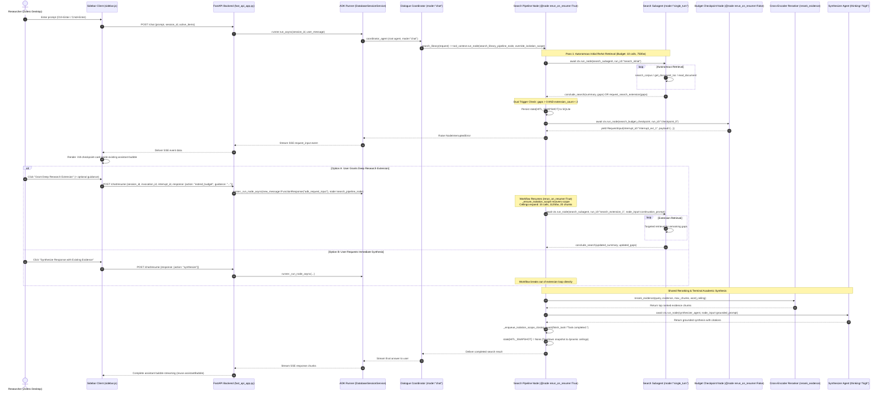

# Human-In-The-Loop (HITL) Deep Research Architecture

Autonomous agentic retrieval often balances between two competing operational risks: runaway loops that burn tokens on repetitive queries, and premature cutoffs that leave complex, multi-paper research questions incompletely answered. Zocrates resolves this tension through **Human-In-The-Loop (HITL) Deep Research Extensions**. When an autonomous search pass exhausts its resource ceiling or reports unaddressed literature gaps, the pipeline deterministically suspends execution and yields an interactive checkpoint card inside the user's chat stream. Researchers can grant up to two deep research extensions—proportionally expanding tool budgets (+5 calls), word ceilings (+3,750 words), and reranking capacity (+5 chunks) while providing optional steering guidance—or synthesize immediately using gathered evidence.

---

## 1. Executive Summary & Problem Statement

### 1.1 The Tension in Agentic Literature Retrieval

In autonomous agentic retrieval-augmented generation (RAG), orchestrators face a fundamental tension:

* **Risk of Runaway Loops & Budget Waste**: Unconstrained ReAct search loops can spiral into dozens of redundant queries, burning API tokens, triggering rate limits, and introducing irrelevant context noise into downstream prompts.
* **Risk of Premature Cutoff on Complex Literature**: Strict hard limits (such as a 10-call cap or 7,500-word ceiling) protect against runaway costs, but terminate retrieval prematurely when researchers ask complex, multi-faceted questions—such as comparative literature reviews across multiple papers, multi-methodology surveys, or granular mathematical proofs.

### 1.2 Baseline Constraints

In Zocrates Dialogue Mode, baseline retrieval operates under three conservative guardrails configured in `zocrates_config.json` (`search_harness`):

- **Retrieval Tool Budget**: 10 calls maximum per pass (`max_retrieval_tools = 10`).
- **Hard Word Ceiling**: 7,500 words maximum cumulative retrieved text (`hard_word_ceiling = 7500`, ~10,000 tokens).
- **Cross-Encoder Reranker Cap**: Top 15 chunks forwarded to synthesis (`max_rerank_chunks = 15`).

### 1.3 The HITL Philosophy: Deterministic Checkpoints & User Steering

Rather than silently truncating context or forcing researchers to manually rephrase and re-submit questions across multiple disjoint turns, Zocrates implements **Human-In-The-Loop Deep Research Extensions**.

When an initial autonomous search pass identifies remaining knowledge gaps or exhausts its retrieval ceiling, the dynamic workflow suspends execution deterministically, packages its findings, and presents an interactive checkpoint card directly inside the ongoing chat turn:

1. **"Grant Deep Research Extension"** (Primary Action): Proportionally expands all three resource ceilings simultaneously (+5 calls, +3,750 words, +5 rerank chunks) and invokes the search subagent for an additional targeted retrieval pass, optionally steering the agent via natural language guidance.
2. **"Synthesize Response with Existing Evidence"** (Secondary Action): Bypasses further retrieval and proceeds immediately to cross-encoder reranking and academic synthesis using the evidence gathered so far, practicing epistemic honesty regarding unaddressed aspects.

A hard ceiling of **2 extensions per turn** (up to 3 total passes) guarantees absolute cost predictability: 20 calls, 15,000 words, and 25 rerank chunks maximum.

### Key Implementation Modules

| Component | Source Path | Description |
| :--- | :--- | :--- |
| **Dynamic Search Pipeline** | `zocrates/agents/library_search/search_pipeline.py` | Orchestrates the ReAct retrieval loop, `search_budget_checkpoint`, and ceiling progression |
| **Composition Root & Coordinator** | `zocrates/agents/app.py` & `coordinator/agent.py` | Top-level application assembly, root coordinator, and multi-agent model coordination |
| **Retrieval Toolkit & HITL Tool** | `zocrates/agents/common/tools.py` & `toolkit.py` | Implements `request_search_extension`, tool budget tracking, and ceiling circuit breakers |
| **State Constants** | `zocrates/agents/common/state_keys.py` | Persistent state definitions including `HITL_SNAPSHOT` and dynamic ceiling keys |
| **Streaming Endpoints** | `zocrates/fast_api_app.py` | Handlers for `POST /chat`, `POST /chat/resume`, and `POST /sessions/{id}/rewind` |
| **Request Schemas** | `zocrates/schemas/chat_request.py` | Pydantic schemas for `ResumeChatRequest` and session lifecycle operations |
| **Session Persistence** | `zocrates/utils/services.py` & `session_formatting.py` | `DatabaseSessionService` SQLite persistence and UI event translation |
| **Telemetry & Observability** | `zocrates/utils/telemetry.py` | OpenTelemetry span enrichment, thought token preservation, and merged tool summarization |
| **Frontend Client UI** | `zotero-plugin/addon/sidebar.js` & `sidebar.css` | Interactive `.hitl-checkpoint-card` rendering, bubble continuity, and stream resumption |

---

## 2. System Architecture & Dynamic Workflow Lifecycle

Zocrates implements HITL using native **Google ADK 2.8+ Dynamic Workflows** (`@node`). Dynamic workflows execute Python control flow natively, supporting loop iteration, state persistence, conditional branching, and deterministic suspension via `RequestInput`.

### 2.1 Complete End-to-End Sequence Diagram



---

### 2.2 Dual Trigger Architecture

The search pipeline evaluates whether an extension is warranted using two complementary trigger paths:

1. **Trigger 1: Proactive Agent-Initiated Flag (`request_search_extension`)**:
   - The search subagent recognizes early that a query spans multiple complex domains that cannot be satisfied within its current budget.
   - It invokes the `request_search_extension` tool:
     ```python
     request_search_extension(
         justification="Paper A and Paper B require full section 4 comparisons.",
         covered_summary="Retrieved methodologies from Paper A and Paper B.",
         missing_aspects=["Section 4 benchmark tables in Paper B", "Ablation metrics"],
     )
     ```
   - The tool sets `ctx.state[TEMP_EXTENSION_REQUESTED] = True` and sets `skip_summarization = True`. When the subagent's ReAct turn finishes, the parent workflow detects the proactive flag and initiates the checkpoint.

2. **Trigger 2: Reactive Workflow-Initiated Fallback (Call or Word Exhaustion with Gaps)**:
   - If the subagent exhausts its tool call budget (`current_calls >= current_budget`) or cumulative retrieved text reaches 80% of the word ceiling (`total_words >= 0.8 * current_word_ceiling`), retrieval tools return a soft warning or circuit-breaker block notice.
   - The subagent calls `conclude_search(summary=..., gaps=[...])`.
   - If the subagent fails to call `conclude_search`, the workflow's deterministic `_auto_generate_completion_report()` safeguard synthesizes a report preserving unaddressed queries.
   - The workflow checks `len(gaps) > 0`. If literature aspects remain unaddressed, the checkpoint triggers reactively.

### 2.3 Smart Skip Invariance

If all literature questions are successfully resolved in the initial pass (`len(gaps) == 0`) or if HITL is globally disabled in configuration (`hitl_enabled = false`), the dynamic workflow **skips the checkpoint entirely**. It bypasses `search_budget_checkpoint` and proceeds immediately to cross-encoder reranking and synthesis without unnecessary user interruption.

### 2.4 Checkpoint Execution & Interruption

When `should_trigger` is true, the pipeline executes the checkpoint:

1. Serializes current turn state into `ctx.state[HITL_SNAPSHOT]`.
2. Invokes `@node(rerun_on_resume=False) search_budget_checkpoint` with:
   - `run_id = f"checkpoint_{extension_count}"`
   - `interrupt_id = f"interrupt_ext_{extension_count + 1}"`
3. The checkpoint node yields ADK's native `RequestInput`:
   ```python
   yield RequestInput(
       interrupt_id=int_id,
       message="Deep research limit reached. Extend retrieval or synthesize current findings?",
       payload=payload,
   )
   ```
4. ADK raises `NodeInterruptedError`, halting workflow execution.
5. In `search_pipeline_node`, the `except NodeInterruptedError:` block catches the interruption, sets `interrupted = True`, and re-raises the exception.
6. The `finally:` block checks `if not interrupted:` before closing the isolation scope. Because `interrupted is True`, scope closure is postponed, keeping the session ready for resumption.

---

## 3. Proportional Resource Scaling (3-Way Simultaneous Expansion)

### 3.1 Orthogonality of Literature Retrieval Bottlenecks

Literature retrieval in academic libraries encounters two distinct types of resource bottlenecks:

* **Call-Bound Breadth**: Survey queries scanning table-of-contents and frontmatter across 8–10 papers quickly consume 10 tool calls while retrieving relatively few words (~2,500 words).
* **Word-Bound Depth**: Granular methodological queries reading multi-page sections (`read_document`) across 2 papers consume only 3 tool calls but quickly exceed 7,000 words.

Scaling only one dimension fails whenever a query is bound by the other. Furthermore, increasing retrieval capacity without expanding downstream reranking causes newly retrieved evidence to be discarded before reaching the synthesizer.

### 3.2 The Multi-Extension Progression Matrix

To resolve this, Zocrates scales all three retrieval dimensions simultaneously upon each granted extension:

| Progression Stage | Retrieval Tool Calls | Hard Word Ceiling | Max Rerank Chunks | Operational Behavior |
| :--- | :--- | :--- | :--- | :--- |
| **Pass 1 (Baseline)** | 10 calls | 7,500 words (~10k tok) | 15 chunks | Baseline autonomous ReAct retrieval |
| **Extension 1 (Grant #1)** | 15 calls (+5) | 11,250 words (+3,750w) | 20 chunks (+5) | First deep research extension pass |
| **Extension 2 (Grant #2)** | 20 calls (+5) | 15,000 words (+3,750w) | 25 chunks (+5) | Second deep research extension pass |
| **Terminal Cap** | — | Trimmed to ≤ 15,000w | Top 25 chunks | **Hard Stop**: Loop terminates to synthesis |

### 3.3 Dynamic State Ceilings

Resource limits are maintained dynamically in session state:

- `TEMP_RETRIEVAL_TOOL_BUDGET` (`temp:retrieval_tool_budget`)
- `TEMP_WORD_CEILING` (`temp:word_ceiling`)
- `TEMP_MAX_RERANK_CHUNKS` (`temp:max_rerank_chunks`)
- `TEMP_EXTENSION_COUNT` (`temp:extension_count`)

Upon granting an extension, `search_pipeline_node` computes new ceilings:
```python
new_budget = current_budget + budget_increment          # +5
new_word_ceiling = current_word_ceiling + word_increment  # +3750
new_max_chunks = current_max_chunks + chunk_increment     # +5
new_extension_count = extension_count + 1
```
The subagent is invoked with a structured continuation prompt detailing the remaining gaps and user steering instructions.

---

## 4. State Persistence & Rehydration Across Restarts (`hitl_snapshot`)

### 4.1 The ADK `temp:` State Stripping Mechanism

In Google ADK, `BaseSessionService` strips all state keys prefixed with `temp:` before persisting session updates to SQLite (`sessions.db`):
```python
# ADK internal session persistence filter:
persisted_state = {k: v for k, v in state.items() if not k.startswith("temp:")}
```
If the backend server restarts, the Zotero desktop application closes, or the user switches sessions while an HITL checkpoint is paused, all transient retrieval state (`temp:retrieved_evidence`, `temp:search_report`, `temp:retrieval_tool_count`) is purged from SQLite.

### 4.2 Persistent Checkpoint Snapshot Schema

To make HITL checkpoints fully durable across process restarts, `search_pipeline_node` serializes full turn state to the non-prefixed, persistent state key `ctx.state[HITL_SNAPSHOT]` immediately prior to yielding `RequestInput`:

```python
state[HITL_SNAPSHOT] = {
    "evidence": evidence,
    "search_report": search_report,
    "extension_count": extension_count,
    "tool_count": current_calls,
    "extension_requested": extension_requested,
    "isolation_scope": active_isolation_scope,
    "completed_extensions": list(completed_extensions),
    "ceilings": {
        "budget": current_budget,
        "word_ceiling": current_word_ceiling,
        "max_chunks": current_max_chunks,
    },
    "seen_chunk_ids": list(state.get(TEMP_SEEN_CHUNK_IDS, [])),
    "seen_assets": list(state.get(TEMP_SEEN_ASSETS, [])),
}
```

### 4.3 Avoiding ADK `State._delta` Shadowing via Full-Dictionary Reassignment

ADK's `State` class tracks mutations by recording assignments to `State._delta`. In-place mutations to nested dictionaries (e.g. `state[HITL_SNAPSHOT]["ceilings"]["budget"] = 15`) do not trigger `State.__setitem__` and fail to persist to SQLite. Furthermore, if a dynamic workflow assigns to keys managed by child tools, it can shadow tool-level mutations.

Zocrates strictly enforces **full-dictionary reassignments**:
```python
state[HITL_SNAPSHOT] = {
    "evidence": evidence,
    ...
}
```
Every update produces a brand-new top-level dictionary assignment, guaranteeing detection by `State._delta` and atomic persistence to `sessions.db`.

### 4.4 In-Memory Fallback Rehydration on Re-entry

When a session resumes from disk where `temp:` keys were stripped:
```python
evidence = state.get(TEMP_RETRIEVED_EVIDENCE) or (snapshot.get("evidence") if snapshot else None) or []
search_report = state.get(TEMP_SEARCH_REPORT) or (snapshot.get("search_report") if snapshot else None)
```
The workflow reads from `snapshot` in-memory without prematurely writing back to `temp:retrieved_evidence`. This leaves child tool contexts clean to append subsequent retrieved chunks.

### 4.5 Turn-End Teardown & Cross-Turn Cleanup

Once final synthesis concludes, `search_pipeline_node` purges the snapshot and resets all dynamic ceilings:
```python
state[HITL_SNAPSHOT] = None
state[TEMP_EXTENSION_REQUESTED] = False
state[TEMP_EXTENSION_REQUEST_PASS] = None
state[TEMP_EXTENSION_COUNT] = None
state[TEMP_RETRIEVAL_TOOL_BUDGET] = None
state[TEMP_WORD_CEILING] = None
state[TEMP_MAX_RERANK_CHUNKS] = None
```
This guarantees that stale snapshot state or extended resource ceilings never contaminate subsequent user turns in the same chat session.

---

## 5. Scope Recovery & Context Boundary Enforcement

### 5.1 Root Runner Context Reset on Resumption

When an interrupted session is resumed via `runner._run_node_async()`, ADK constructs a brand-new root context for the resumption runner where `ctx.isolation_scope = None`. ADK's `_run_node_async` does not accept an `override_isolation_scope` argument.

If the search pipeline were to execute with `None`, two critical failures would occur:

1. **Event Scope Mismatch**: Pipeline child events would be emitted under `isolation_scope = None`, polluting the outer coordinator conversation history.
2. **Loss of Prior Subagent History**: Subagents configured with `include_contents="default"` would no longer match the `search_pipeline:fc_id` scope of prior turns, losing their memory of already retrieved chunks and queries.

### 5.2 Self-Sufficient Scope Recovery (`_ensure_isolation_scope`)

To guarantee scope continuity across resumptions, `search_pipeline_node` executes `_ensure_isolation_scope(ctx)` as its very first operation:

```python
def _recover_isolation_scope(ctx: Context) -> str | None:
    """Recover the search pipeline's isolation scope from snapshot or session events if unset."""
    if getattr(ctx, "isolation_scope", None):
        return ctx.isolation_scope

    state = getattr(ctx, "state", None)
    if state:
        snapshot = state.get(HITL_SNAPSHOT)
        if isinstance(snapshot, dict) and snapshot.get("isolation_scope"):
            return snapshot["isolation_scope"]

    # Fall back to scanning session events for active invocation
    curr_inv_id = getattr(ctx, "invocation_id", None) or ...
    session = ...
    if session and getattr(session, "events", None):
        for event in reversed(session.events):
            if getattr(event, "invocation_id", None) == curr_inv_id:
                scope = getattr(event, "isolation_scope", None)
                if scope and str(scope).startswith("search_pipeline:"):
                    return str(scope)
    return None
```
`_ensure_isolation_scope(ctx)` assigns the recovered scope directly onto `ctx.isolation_scope` and `ctx._invocation_context.isolation_scope`, ensuring all child nodes inherit the original isolation scope.

### 5.3 Invocation-Scoped Event Scans (`curr_inv_id`)

In multi-turn chat sessions where multiple research queries occur across turns, earlier turns also contain `search_initial` runs and checkpoint events.

To prevent historical turns from corrupting the active turn, all session event scans in `search_pipeline_node`:

- `has_initial_run` detection
- `_recover_isolation_scope`
- `_get_pipeline_interrupt_ids`

filter strictly by matching `event.invocation_id == curr_inv_id`. This guarantees that subsequent research questions in Turn 2 or Turn 3 never skip their own initial retrieval passes.

### 5.4 Root Conversation Context Isolation & `_SINGLE_TURN_NUDGE` Suppression

In ADK 2.8, agents operating in `mode="single_turn"` inspect `ctx._invocation_context.user_content`. In a resumed session, `user_content` holds the user's root conversational message (e.g. *"Can you survey the CamKII literature?"*). ADK automatically prepends this root prompt as `contents[0]` and appends `_SINGLE_TURN_NUDGE` ("Important: You will not receive any user replies or clarifications...").

This causes severe cognitive dissonance: subagents spend reasoning tokens trying to converse with the user rather than executing retrieval tools.

To eliminate this:
```python
if hasattr(ctx, "_invocation_context") and ctx._invocation_context is not None:
    ctx._invocation_context.user_content = None
```
Subagents receive exclusively their structured `node_input` without conversational banter or `_SINGLE_TURN_NUDGE` prompts.

Furthermore, when an extension checkpoint pauses and resumes, ADK records `adk_request_input` FunctionCall and FunctionResponse events in the shared pipeline scope. While ADK natively filters internal framework events from LLM context, it omits `adk_request_input`. Without filtering, ADK's `_fencing` module wraps the checkpoint events in cross-agent fencing (`<<<BEGIN_QUOTED_AGENT_CONTENT>>>`) and injects them into `search_subagent`'s prompt. 

Zocrates resolves this via `patch_adk_request_input_context_filter()` in `zocrates/agents/common/adk_compat.py`:

- Idempotently wraps `google.adk.flows.llm_flows.contents._should_include_event_in_context`.
- Filters out `adk_request_input` function calls and responses from LLM prompt construction while preserving them in SQLite session history and runner interrupt resolution.
- Subagents receive exclusively their prior tool calls and their clean, structured continuation prompt.

### 5.5 Terminal Isolation Scope Closure (`finish_task`)

ADK's `Runner._find_active_task_scope` scans `session.events` backwards to determine whether any background task agent is awaiting input. Any non-empty `isolation_scope` is treated as active unless a `finish_task` `FunctionResponse` (`"Task completed."` or `"Task failed."`) is recorded.

Without terminal closure, ADK stamps Turn 2+ user messages with the pipeline's old isolation scope, causing the coordinator (`isolation_scope = None`) to filter them out and re-execute Turn 1.

`search_pipeline_node` executes terminal scope closure in a `finally` block:
```python
finally:
    if not interrupted:
        await _enqueue_isolation_scope_closing_event(
            ctx,
            result="Task completed." if completed else "Task failed.",
        )
```
When an HITL checkpoint interrupts, `interrupted is True`, leaving the scope open. When final synthesis completes, `_enqueue_isolation_scope_closing_event` cleanly finishes the task.

---

## 6. Replay Sequence Barrier & Guarded Chronological Execution

### 6.1 ADK 2.8 Dynamic Replay Sequence Barrier (`ReplaySequenceBarrier`)

In ADK 2.8, dynamic workflows decorated with `@node(rerun_on_resume=True)` reconstruct an execution sequence barrier of all prior child node executions for that invocation. On resumption, the workflow function re-executes from line 1 in order to rebuild in-memory variables and state.

ADK verifies that child node executions occur in the **exact same chronological sequence**:

`Replay Sequence = [checkpoint_0, search_extension_1, checkpoint_1, ...]`

If the workflow attempts to skip loop iterations based on persisted state counters (e.g. starting `for extension_count in range(persisted_count, max_extensions)`), the scheduler encounters a **Replay Divergence Timeout** waiting for earlier sequence barrier events that were never scheduled.

### 6.2 Deterministic Replay Alignment & Execution Guard

To satisfy the replay sequence barrier while preventing duplicate execution of already-finished agent passes, Zocrates uses **guarded chronological replay**:

1. The extension loop always iterates chronologically starting from `extension_count = 0`:
   ```python
   extension_count = 0
   while True:
       ...
       # Checkpoint node executes deterministically to match ReplaySequenceBarrier
       decision = await ctx.run_node(
           search_budget_checkpoint,
           node_input=checkpoint_payload,
           run_id=f"checkpoint_{extension_count}",
           override_isolation_scope=active_isolation_scope,
       )
   ```
2. The workflow tracks completed extension passes in `completed_extensions: list[int]` inside `hitl_snapshot`.
3. Agent invocation is guarded:
   ```python
   if new_extension_count not in completed_extensions:
       await ctx.run_node(
           search_agent,
           node_input=continuation_prompt,
           run_id=f"search_extension_{new_extension_count}",
           override_isolation_scope=active_isolation_scope,
       )
       completed_extensions.append(new_extension_count)
   ```
On Extension 2 resumption, Pass 1 checkpoint resolves immediately from the event log, `search_extension_1` is safely skipped via the guard, Pass 2 checkpoint resolves from the new resume event, and `search_extension_2` executes cleanly.

---

## 7. Frontend Architecture, Wire Protocol & UI Components

### 7.1 Wire Contract: `POST /chat/resume`

When the user interacts with the checkpoint card in Zotero, `sidebar.js` sends an HTTP POST request to `/chat/resume`:

```http
POST /chat/resume HTTP/1.1
Content-Type: application/json

{
  "session_id": "session-1726000000",
  "invocation_id": "inv-987654",
  "interrupt_id": "interrupt_ext_1",
  "response": {
    "action": "extend_budget",
    "guidance": "Focus specifically on the ablation benchmarks in Table 3."
  }
}
```

#### Request Schema (`ResumeChatRequest`)
- `session_id` (`str`): Target chat session ID.
- `invocation_id` (`str`): Active invocation ID holding the pending interrupt.
- `interrupt_id` (`str`): Unique interrupt identifier (e.g. `"interrupt_ext_1"`).
- `response` (`dict[str, Any]`):
  - `action` (`"extend_budget" | "synthesize"`): Selected user action.
  - `guidance` (`str | None`): Optional steering guidance.

### 7.2 Idempotency & 409 Conflict Protection

To prevent race conditions, duplicate clicks, or session corruption:

- `fast_api_app.py` inspects `_get_unresolved_session_interrupts(session)`.
- If `request.interrupt_id not in pending_interrupts`, it rejects the request immediately with `409 Conflict` (`"Invalid or stale interrupt ID. The session is not waiting for this interrupt."`).
- If a user attempts to send a new prompt via `POST /chat` while an unresolved checkpoint is pending, `POST /chat` returns `409 Conflict`, instructing the user to resolve or rewind the pending checkpoint.

### 7.3 DOM Construction of `.hitl-checkpoint-card`

Inside Firefox's Gecko engine in Zotero, unescaped HTML entities or unstructured HTML strings passed to `innerHTML` fail or trigger XML parser errors. `sidebar.js` constructs the interactive checkpoint card structure using strict XML DOM methods (`document.createElementNS("http://www.w3.org/1999/xhtml", ...)`), restricting `innerHTML` usage strictly to localized button labels and icon spans:

```javascript
function renderHitlCheckpointCard(container, data) {
  const card = document.createElementNS(XHTML_NS, "div");
  card.className = "hitl-checkpoint-card";

  // Extension Badge (e.g. "Deep Research: Extension 1 of 2")
  // Covered Findings Summary section
  // Unaddressed Literature Gaps list (<ul> / <li>)
  // Optional Guidance Input (<input type="text" placeholder="Steer search...">)
  // Primary Button: "Grant Deep Research Extension (+5 Calls, +50% Words)"
  // Secondary Button: "Synthesize Response with Existing Evidence"
}
```

### 7.4 Bubble Continuity & Multi-Pass Stream Resumption

When `/chat/resume` streams SSE events, `sidebar.js` maintains complete visual continuity:

- It **does not create a new chat bubble**.
- It reconnects the SSE reader directly into the active `assistantBubble` and appends to the existing `liveSteps` array.
- Intermediate tool calls from Extension 1 and Extension 2 append cleanly into the collapsed `.intermediate-steps-bubble`.
- When synthesis arrives, it streams directly into the same assistant message body.

### 7.5 Cross-Session Restart Rehydration (`pending_hitl`)

If the user closes Zotero while an HITL checkpoint is paused and re-opens it later:

1. `sidebar.js` calls `GET /sessions/{id}`.
2. `format_session_for_ui(session)` inspects session events. If an `adk_request_input` function call is present without a corresponding `FunctionResponse`, it populates:
   ```json
   "pending_hitl": {
     "interrupt_id": "interrupt_ext_1",
     "invocation_id": "inv-987654",
     "message": "Deep research limit reached...",
     "payload": { ... }
   }
   ```
3. `loadActiveSessionMessages()` detects `pending_hitl` on the last message and automatically re-renders the interactive `.hitl-checkpoint-card`, allowing the user to resume seamlessly.

### 7.6 Session Rewind Support (`POST /sessions/{id}/rewind`)

If a researcher wishes to cancel a pending checkpoint and discard the incomplete turn, they can trigger session rewind:

- Endpoint: `POST /sessions/{session_id}/rewind` with `{"invocation_id": "..."}`.
- Invokes ADK's `runner.rewind_async()`, removing all events associated with that invocation from SQLite and returning the session to its clean prior state.

---

## 8. Observability, Telemetry & Arize Phoenix Integration

### 8.1 Phoenix Span Hierarchy

Zocrates traces dynamic workflows using OpenTelemetry exported to a local Arize Phoenix collector (`http://localhost:6006`). An HITL research turn produces a structured span tree:

```text
POST /chat
└── coordinator_agent [AGENT]
    └── search_library [TOOL]
        └── search_library_pipeline_node [WORKFLOW]
            ├── search_initial [AGENT]
            │   ├── generate_content [LLM]
            │   └── execute_tool: search_corpus [TOOL]
            ├── checkpoint_0 [WORKFLOW]
            │   └── adk_request_input [TOOL]
            └── (Pause / Resume)
            ├── search_extension_1 [AGENT]
            │   ├── generate_content [LLM]
            │   └── execute_tool: read_document [TOOL]
            ├── rerank_evidence [TASK]
            └── synthesizer_agent [AGENT]
                └── generate_content [LLM]
```

### 8.2 Preserving `thought: True` across ADK Semconv

During streaming LLM calls, reasoning models emit token chunks with `thought=True`. By default, Google ADK's `_experimental_semconv._to_part()` strips the `thought` attribute when serializing parts into `gen_ai.output.messages`.

Zocrates applies an idempotent patch in `zocrates/utils/telemetry.py` (`_patch_adk_semconv_to_part`):
```python
def patched_to_part(part: Any, idx: int, *args: Any, **kwargs: Any) -> Any:
    res = orig_to_part(part, idx, *args, **kwargs)
    if res is not None and getattr(part, "thought", False):
        res["thought"] = True
    return res
```
This ensures reasoning chunks retain their thought flag in both `gen_ai.output.messages` and `gen_ai.input.messages`, enabling Phoenix to render distinct thought process and response sections.

### 8.3 Multi-Turn `gen_ai.input.messages` & `input.value` Consolidation

When a dynamic workflow replays prior turns, hundreds of streamed token chunks are passed back into `gen_ai.input.messages`. Without consolidation, every streaming token is formatted as a separate `[assistant] ...` line, resulting in thousands of lines of clutter in Phoenix.

`PhoenixEnrichmentSpanProcessor.on_end` consolidates input messages:

- **Assistant turns**: Parsed through `_format_parts_with_labeled_thoughts`, consolidating streaming tokens into at most two clean parts (one Thought section and one Response section).
- **User turns**: Text chunks joined cleanly with `"".join(...)`.
- The span attributes `input.value` and `gen_ai.input.messages` are updated in place, rendering single, unified speech bubbles in Phoenix's Chat Viewer.

### 8.4 Suppressing Merged Tool Event Bloat

When parallel or merged tools run, ADK attaches the entire session Event JSON (including the full `temp:retrieved_evidence` array) to `gcp.vertex.agent.tool_response`. For multi-paper queries, this produces multi-megabyte JSON payloads in Phoenix.

`_summarize_merged_tool_response()` in `zocrates/utils/telemetry.py` intercepts `execute_tool (merged)` spans, extracting tool names, call IDs, and execution statuses into a compact summary (`{"merged_tools": [{"tool": "search_corpus", "id": "...", "status": "success"}]}`) while stripping `state_delta` bloat.

---

## 9. Verification & Testing Matrix

The HITL architecture is covered by comprehensive automated tests across unit, integration, and telemetry layers:

### 9.1 Unit Test Coverage (`tests/unit/test_hitl.py`)
- `test_hitl_snapshot_persistence_and_rehydration`: Simulates SQLite reload where `temp:` keys are stripped, confirming seamless rehydration from `hitl_snapshot`.
- `test_hitl_snapshot_cleared_on_completion_prevents_turn2_contamination`: Confirms turn-end teardown clears snapshot and prevents Turn 2 contamination.
- `test_proactive_request_search_extension_tool`: Verifies `request_search_extension` tool sets `TEMP_EXTENSION_REQUESTED`, `skip_summarization=True`, and populates gap metadata.
- `test_check_and_increment_tool_budget_notices_and_ceilings`: Tests tool budget tracking, soft warnings at Call 9, and dynamic ceiling enforcement.
- `test_unresolved_session_interrupts_scanner`: Verifies detection and scanning of pending `RequestInput` events in session history.
- `test_resume_chat_endpoint_validates_interrupt`: Asserts validation of active `interrupt_id` and 409 Conflict rejection for invalid or mismatched interrupt IDs.
- `test_format_session_skips_fr_only_user_events`: Confirms resume `FunctionResponse` user turns are filtered out of UI chat history to prevent blank bubbles.
- `test_format_session_rewind_prunes_pending_hitl`: Verifies session rewind prunes unresolved `RequestInput` events and resets pending status.

### 9.2 Integration Test Coverage (`tests/integration/test_hitl_integration.py`)
- `test_hitl_call_budget_exhaustion_triggers_request_input_sse`: End-to-end `POST /chat` triggering call exhaustion and verifying the SSE `request_input` payload.
- `test_hitl_proactive_request_search_extension_triggers_request_input_sse`: End-to-end verification of `request_search_extension` tool invocation.
- `test_hitl_resume_with_extend_budget_and_synthesis`: Complete multi-pass execution testing `POST /chat` -> `POST /chat/resume` with `extend_budget` -> terminal synthesis.
- `test_hitl_resume_with_synthesize_immediately`: Tests immediate synthesis flow via `POST /chat/resume`.
- `test_hitl_pending_interrupt_returns_409_on_new_chat`: Confirms 409 Conflict guard against starting new chats during pending interrupts.
- `test_hitl_sqlite_persistence_and_resume_roundtrip`: Verifies real SQLite disk persistence and resume roundtrip across session reloads.
- `test_hitl_second_extension_and_hard_stop_on_third`: Tests Extension 1 -> Extension 2 -> hard cutoff on Extension 3.
- `test_hitl_second_research_turn_in_same_session_does_not_skip_search_initial`: Confirms invocation scoping prevents Turn 1 snapshots from bypassing Turn 2 initial retrieval.

### 9.3 Observability & Telemetry Test Coverage (`tests/unit/test_telemetry.py`)
- `test_patch_adk_semconv_to_part_preserves_thoughts`: Verifies `thought: True` is preserved in ADK semconv.
- `test_phoenix_enrichment_span_processor_consolidates_input_messages`: Confirms streaming token consolidation in `gen_ai.input.messages` and `input.value`.
- `test_phoenix_enrichment_span_processor_merged_tool_span`: Verifies suppression of multi-MB `state_delta` in merged tool spans.

---

## 10. Related Architecture Documentation

* **[Dialogue Agent & Dynamic Search Pipeline](dialogue-agent.md)**: Specifications for the outer conversational coordinator, ReAct search subagent, and cross-encoder reranker.
* **[In-Text Citations, Verification & Two-Tier Sources Architecture](citations-and-verification.md)**: Specifications for the asynchronous AI decision-model verification pre-pass, flat single-ID citations, and interactive evidence popovers.
* **[System Overview](../index.md)**: High-level architectural map of the frontend plugin, backend multi-agent pipeline, and deployment configurations.
