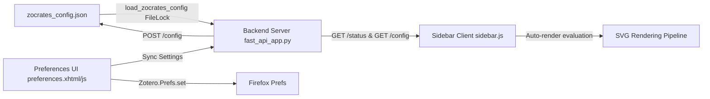

# Mermaid Diagram Rendering & Sidebar UI Architecture

This document details the architectural design, security model, rendering pipeline, and configuration synchronization for native **Mermaid Diagram Rendering** and the **HTML5 Sidebar Architecture** in Zocrates.

---

## 1. System Overview & Architectural Motivation

Conversational AI workflows analyzing dense academic literature frequently involve complex conceptual taxonomies, algorithmic workflows, multi-agent pipelines, and system architectures. Generating structured diagrams natively within the chat stream provides immediate visual clarity.

Zocrates implements an offline, toggle-first diagram rendering pipeline:

1. **Native HTML5 Sidebar Interface**: The sidebar is served as an HTML5 web interface (`chrome://zocrates/content/sidebar.html`), enabling native SVG rendering, resilient DOM parsing, and seamless integration with client-side visualization libraries while maintaining full security isolation under Mozilla Gecko.
2. **Offline, Toggle-First Rendering**: Local vendoring of `mermaid.min.js` v11.4.1 (zero external network dependencies), automatic diagram rendering by default with a non-destructive "Show code" / "Render diagram" toggle, single-source-of-truth configuration in `zocrates_config.json`, five-theme synchronization, and detached window dimension and session parity.

---

## 2. Sidebar Security & Execution Model

The sidebar interface operates inside Mozilla Gecko (Firefox ESR) with robust defense-in-depth isolation across browser security boundaries:

### 2.1 Gecko Chrome Privileges & SystemPrincipal Protection
* **Privilege Model**: In Mozilla Gecko, chrome privileges are governed by `nsIPrincipal` determined exclusively by the URI scheme (`chrome://`). Files registered under `chrome://zocrates/content/` possess `SystemPrincipal` privileges, providing direct access to Zotero's internal JavaScript APIs.
* **Security Imperative**: Because code running under `SystemPrincipal` interacts directly with the desktop environment, all rendered message content and paper metadata undergo strict sanitization to neutralize any Stored XSS risks.
* **Allowlist-Based DOM Sanitization (`DOMParser`)**:
  - The sidebar uses an inert `DOMParser` (`text/html`) DOM-tree traversal in `sidebar.js::sanitizeHTML()`.
  - Dangerous tags (`<script>`, `<iframe>`, `<object>`, `<embed>`, `<frame>`, `<frameset>`, `<meta>`, `<link>`, `<base>`) are purged along with all child nodes. Unknown benign tags are unwrapped without dropping text content.
  - All inline event handler attributes (`on*`, e.g., `onload`, `onerror`, `onclick`) are unconditionally stripped.
  - Enforces dual-tier URL scheme verification: `isSafeLinkUrl()` restricts `<a href>` strictly to `http`, `https`, `mailto`, and `#` (blocking `javascript:`, `data:`, and local file URIs), while `isSafeUrl()` permits media assets, relative paths, and safe image data URIs (`data:image/(png|jpeg|webp|gif);base64,...`).
  - Removes the `id` attribute from all generic HTML elements (permitted only inside SVG `<defs>` and `<marker>` nodes) to eliminate DOM and window clobbering risks (such as an injected element overwriting `window.mermaid`).
  - Injected Markdown image attributes (`alt` and `title`) and KaTeX error fallback text are strictly escaped via `escapeHTML()`.

### 2.2 Mermaid SVG Sanitization (`sanitizeMermaidSvg`)
Raw SVG output from `mermaid.render()` is sanitized prior to DOM insertion:

- Strips any embedded `<script>` tags.
- Eliminates SMIL animation triggers (`<animate>`, `<set>`).
- Removes unsafe CSS `@import` or `url(javascript:...)` rules.

### 2.3 Lazy-Loading Architecture
`mermaid.min.js` (~2–3 MB) is **not** loaded on initial sidebar startup. A `<script>` tag is dynamically injected into the document only the first time a message containing a ```` ```mermaid ```` fence is encountered or when the researcher explicitly renders a diagram. Standard conversational turns incur 0 ms loading overhead and 0 MB extra memory.

### 2.4 Streaming Safety & Error Boundaries
* **Streaming Safety**: During live token generation, incomplete fences remain as syntax-highlighted code blocks; diagrams only auto-render upon stream finalization (`finalizeChatStream`) or session load.
* **Error Boundaries**: `mermaid.render()` is wrapped in a `try/catch` block. If the language model generates malformed syntax, a themed error banner (`.mermaid-error-banner`) is displayed and the raw code block remains visible and copyable.
* **Strict Security Level**: Initialized with `securityLevel: "strict"` (DOMPurify sanitization enabled) to block malicious SVG or script payloads.

---

## 3. Offline Dependency Vendoring

In strict compliance with Zocrates' zero-network runtime rules, no external CDNs or remote scripts are accessed.

* **Vendored Library**: `zotero-plugin/addon/lib/mermaid.min.js` (v11.4.1).
* **Automated Downloader (`scripts/download_FE_dependencies.py`)**:
  ```python
  DEPENDENCIES = {
      "marked.min.js": "https://cdn.jsdelivr.net/npm/marked@15.0.12/marked.min.js",
      "katex.min.js": "https://cdn.jsdelivr.net/npm/katex@0.16.9/dist/katex.min.js",
      "katex.min.css": "https://cdn.jsdelivr.net/npm/katex@0.16.9/dist/katex.min.css",
      "mermaid.min.js": "https://cdn.jsdelivr.net/npm/mermaid@11.4.1/dist/mermaid.min.js",
  }
  ```
  Developer builds and CI verify dependency presence and integrity before packaging `zocrates.xpi`.

---

## 4. Single Source of Truth Configuration & Preferences

All configuration governing diagram auto-rendering is materialized in `zocrates_config.json` with multi-tier propagation:



### 4.1 Backend Configuration (`zocrates/config.py`)
* **Default Setting**: `DEFAULT_AUTO_RENDER_MERMAID_DIAGRAMS: bool = True`.
* **Seeded Configuration**: `"auto_render_mermaid_diagrams": true` seeded in `DEFAULT_CONFIG`.
* **Atomic Disk Backfill**: `load_zocrates_config()` inspects the key under `FileLock` and backfills older configuration files automatically on server startup.
* **Getter**: `get_auto_render_mermaid_diagrams(cfg: dict | None = None) -> bool`.

### 4.2 REST API Endpoints
* **`GET /status`**: Returns `auto_render_mermaid_diagrams` at top level.
* **`GET /config`**: Returns `auto_render_mermaid_diagrams` in the configuration dictionary.
* **`POST /config`**: Accepts optional `auto_render_mermaid_diagrams: bool | None = None` in `UpdateLlmConfigRequest`, persists via `save_zocrates_config`, and returns updated state.

### 4.3 Preferences UI (`preferences.xhtml` & `preferences.js`)
* **Interface Control**: Checkbox `#zocrates-auto-render-mermaid` inside the **Chat & Rendering Settings** drawer.
* **Bidirectional Sync**: Loads state from `GET /config` (falling back to `Zotero.Prefs`), saves to `POST /config`, and writes to `extensions.zocrates.autoRenderMermaid`.

---

## 5. Frontend Rendering Pipeline & UX

### 5.1 Dynamic Lazy Loader (`sidebar.js`)
Mermaid is loaded dynamically using a single-flight promise pattern:

```javascript
let _mermaidLoadingPromise = null;

function ensureMermaidLoaded() {
  if (typeof window.mermaid !== "undefined") {
    return Promise.resolve(window.mermaid);
  }
  if (_mermaidLoadingPromise) {
    return _mermaidLoadingPromise;
  }
  _mermaidLoadingPromise = new Promise((resolve, reject) => {
    const script = document.createElement("script");
    script.src = "lib/mermaid.min.js";
    script.onload = () => {
      initMermaid();
      resolve(window.mermaid);
    };
    script.onerror = (err) => {
      _mermaidLoadingPromise = null;
      reject(new Error("Failed to load local mermaid.min.js: " + err));
    };
    document.head.appendChild(script);
  });
  return _mermaidLoadingPromise;
}
```

### 5.2 Five-Theme Synchronization
Mermaid themes are mapped to Zocrates CSS themes dynamically:

| Zocrates Theme | Mermaid Theme | Visual Characteristics |
| :--- | :--- | :--- |
| `amoled` | `dark` | High-contrast pitch-black palette |
| `slate` | `dark` | Default slate dark mode |
| `sepia` | `neutral` | Warm academic parchment tones |
| `zotero-light` | `default` | Matches native Zotero light chrome |
| `zotero-dark` | `dark` | Matches native Zotero dark chrome |

`updateMermaidThemes()` re-renders any visible SVG diagrams upon theme change, while marking hidden diagrams as needing re-render upon toggle. Theme preference observers are registered on startup and unregistered on window unload.

### 5.3 Entity Masking Order
To prevent prompt text containing arrows (`-->`) from being mangled into `--&gt;` prior to token masking in `formatMessageContent()`, the masking pipeline follows a strict four-step order:

1. **Mask Code Blocks**: Replace fenced code blocks with opaque tokens (`@@ZOCRATES_CODE_MASK_0@@`).
2. **Escape User Prose**: Run `escapeHTML()` on surrounding prose.
3. **Unmask Code Blocks**: Restore original code blocks without entity mangling.
4. **Defensive Unescaping**: `decorateMermaidCodeBlocks` performs safety unescaping on residual XML entities (`&gt;` → `>`, `&lt;` → `<`, `&amp;` → `&`) prior to diagram compilation.

### 5.4 Non-Destructive Code & Diagram Toggling
* **Pristine Code Preservation**: When decorating a block, `wrapper._rawMermaidCode` stores the raw text.
* **Copy Action**: Clicking "Copy" on the code block header reads `wrapper._rawMermaidCode`, allowing researchers to copy the valid source code even while the SVG diagram is active and the `<pre>` tag is hidden.
* **Toggle Action**: The header button alternates between:
  - `"Show code"`: Collapses the SVG container and restores syntax-highlighted `<pre><code>`.
  - `"Render diagram"`: Hides `<pre><code>` and renders or reveals the SVG container.

---

## 6. Detached Window Parity Architecture

When researchers detach the sidebar into a standalone operating system window, full geometry and state continuity are maintained:

### 6.1 Sizing Parity
Rather than opening with a hardcoded geometry:

1. Before hiding `#zocrates-sidebar`, the detach handler measures its bounding box:
   ```javascript
   const doc = window.parent?.document;
   const sidebar = doc?.getElementById("zocrates-sidebar");
   let targetWidth = 450;
   let targetHeight = 750;
   if (sidebar) {
     const rect = sidebar.getBoundingClientRect();
     if (rect.width > 200) targetWidth = Math.round(rect.width);
     if (rect.height > 200) targetHeight = Math.round(rect.height);
   } else if (window.innerWidth && window.innerHeight) {
     if (window.innerWidth > 200) targetWidth = Math.round(window.innerWidth);
     if (window.innerHeight > 200) targetHeight = Math.round(window.innerHeight);
   }
   ```
2. The dimensions are interpolated into `openDialog` features:
   ```javascript
   const features = `chrome,width=${targetWidth},height=${targetHeight},resizable,centerscreen`;
   ```
3. Dimensions are propagated in `detachPayload` and enforced via `window.resizeTo(st.initialWidth, st.initialHeight)` inside the detached window startup block.

### 6.2 Session Continuity
* **Opener Resolution**: Top-level `Zotero` resolution includes `window.opener?.Zotero`, ensuring the detached window connects immediately to the host Zotero instance.
* **Active Target Priority**: Detachment uses `const activeSessionTarget = currentSessionId || resolveActiveSessionId();`, prioritizing the session currently on screen.
* **State Synchronization**: `setActiveSessionId()` synchronizes `_detachedInitialState.currentSessionId` when switching sessions.
* **Active Session Restoration**: In the detached startup block (`if (isDetached)`), `setActiveSessionId(targetSid)` is called before `loadSessions()` executes, eliminating fallback to the database's last session.
* **Reattach Cleanup**: `_detachedInitialState` is deleted upon reattachment.

---

## 7. Dialogue Agent Prompt Guidance

The system prompts for the dialogue coordinator and synthesizer agents (`zocrates/agents/coordinator/prompts.py` and `zocrates/agents/library_search/prompts.py`) include explicit guidance to leverage Mermaid diagrams when explaining concepts:

```python
"""When asked to explain processes, architectures, workflows, concept maps, or pipelines visually, you may generate standard diagrams using fenced ```mermaid blocks."""
```

This guides models to formulate structured flowchart (`graph TD`), sequence (`sequenceDiagram`), or state (`stateDiagram-v2`) diagrams directly within chat responses.
