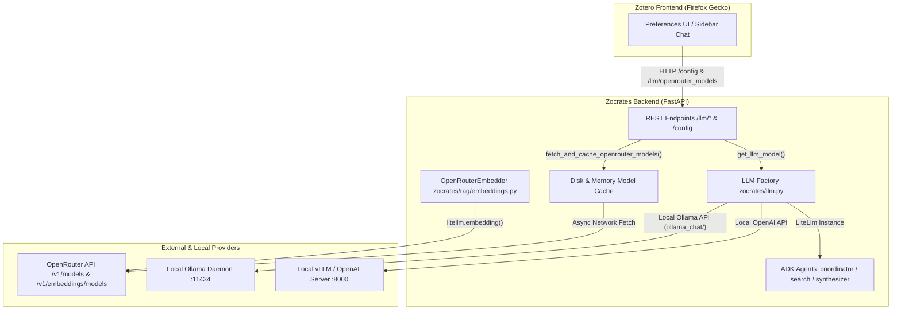
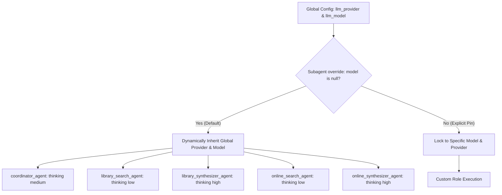
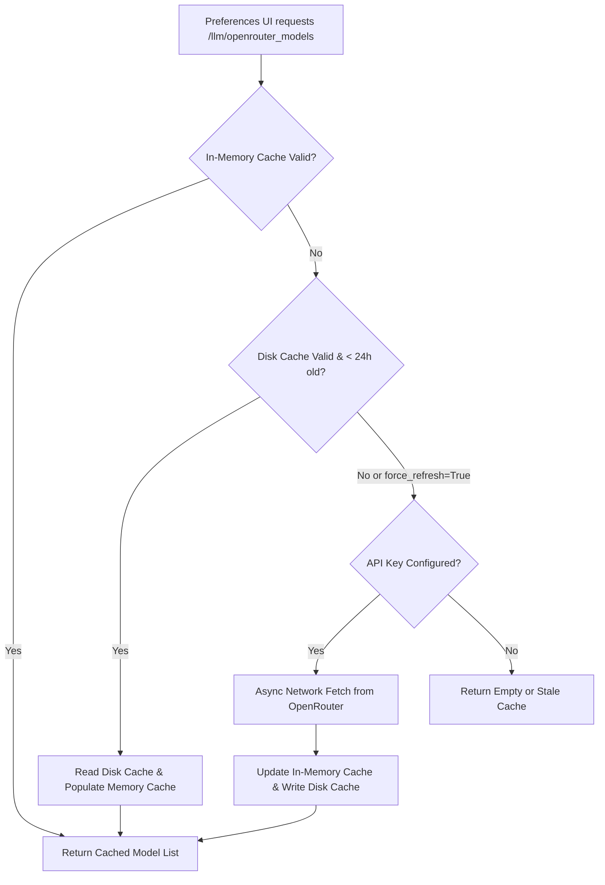
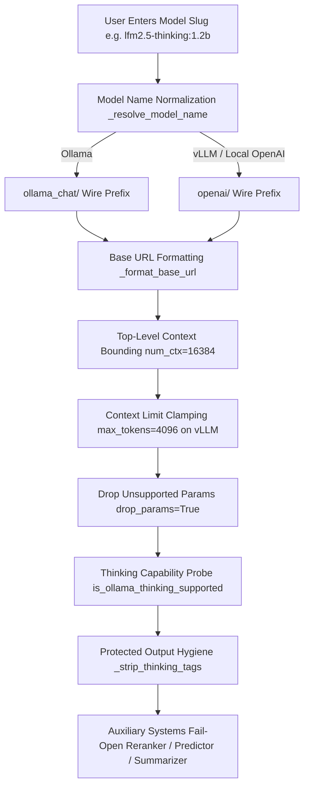

# Models and Inference Providers

This document details the model abstraction layer, provider routing, dynamic agent inheritance, OpenRouter catalog caching, and local inference hardening (Ollama, vLLM, and OpenAI-compatible endpoints) in Zocrates.

---

## 1. Overview and Architectural Goals

Zocrates uses the Google Agent Development Kit (ADK) as its multi-agent orchestrator. Remote and local language models are unified through `google.adk.models.lite_llm.LiteLlm`, backed by `litellm`. This abstraction decouples agent definitions from specific providers and enables flexible hybridization—allowing researchers to run local and cloud models simultaneously across different pipeline stages.



---

## 2. Provider Routing and Configuration Schema

### 2.1 Provider Routing Table

| Provider Category | Provider Identifier | Base URL Default | Key Required? | Example Model Identifier |
| :--- | :--- | :--- | :--- | :--- |
| **OpenRouter (Remote LLM)** | `openrouter_llm` | `https://openrouter.ai/api/v1` | Yes (`OPENROUTER_API_KEY`) | `google/gemini-flash`, `qwen/qwen`, `deepseek/deepseek-flash` |
| **OpenRouter (Cloud Embeddings)** | `cloud` | `https://openrouter.ai/api/v1` | Yes (`OPENROUTER_API_KEY`) | `openrouter/nvidia/nemotron-3-embed-1b:free`, `openrouter/openai/text-embedding-3-small` |
| **Ollama (Local LLM)** | `ollama` | `http://localhost:11434` | No | `llama3`, `mistral`, `qwen` (routed internally via `ollama_chat/`) |
| **vLLM (Local LLM)** | `vllm` | `http://localhost:8000/v1` | Optional (`"dummy"`) | `Qwen/Qwen-Coder`, `meta-llama/Llama-3` |
| **Custom OpenAI API** | `openai_compatible` | User-configured | Optional | `custom-model-id` |

### 2.2 Secure Credential and Configuration Persistence

* **Plain-Text Key Stripping**: Sensitive API keys (`OPENROUTER_API_KEY`) are stripped before persisting settings to disk. Keys are stored in Zotero's encrypted Login Manager (`Services.logins` / `Services.passwords`) and passed in-memory to the backend runtime via secure local endpoints.
* **Configuration Path**: `<zotero-data-dir>/zocrates-data/zocrates_config.json`
* **Configuration Schema**:

```json
{
  "llm_provider": "openrouter_llm",
  "llm_model": "google/gemini-flash",
  "llm_base_url": "",
  "llm_temperature": null,
  "llm_max_tokens": 16384,
  "ollama_num_ctx": 16384,
  "llm_extra_options": {
    "num_ctx": 16384
  },
  "embedding_provider": "local",
  "embedding_model": "jinaai/jina-embeddings-v5-text-nano",
  "override_agent_models": {
    "coordinator": {
      "model": null,
      "thinking_level": "medium"
    },
    "search": {
      "model": null,
      "thinking_level": "low"
    },
    "synthesizer": {
      "model": null,
      "thinking_level": "high"
    },
    "online_search": {
      "model": null,
      "thinking_level": "low"
    },
    "online_synthesizer": {
      "model": null,
      "thinking_level": "high"
    }
  }
}
```

* **Bare Model Slugs & Provider Fallback**:
  * Model names in configuration and UI are stored as bare, provider-agnostic slugs (e.g., `"google/gemini-flash"`, `"llama3"`).
  * Provider runtime prefixes (`openrouter/`, `ollama_chat/`, `openai/`) are deterministically attached by `_resolve_model_name()`.
  * For Ollama, bare slugs or slugs prefixed with `ollama/` are normalized internally to `ollama_chat/<slug>` to ensure native execution over Ollama's `/api/chat` endpoint.
  * If a user switches from OpenRouter to Ollama without selecting a local model, cross-provider mismatch detection catches the slash-containing slug and automatically falls back to `PROVIDER_DEFAULT_MODELS["ollama"]` (`llama3.1:8b`).

### 2.3 Single Source of Truth ("No Secret Config Options")

Zocrates enforces that `zocrates_config.json` is the transparent, canonical source of truth for all system configurations:
* **No Hidden Parameters**: Every configurable parameter, role template, and override block is explicitly materialized in `zocrates_config.json` on disk with its defaults.
* **Automatic Disk Backfill**: When `load_zocrates_config()` reads an existing `zocrates_config.json` that lacks new keys or subagent override blocks, it backfills them into the file under atomic `FileLock` and updates `_last_config_mtime`.
* **First-Time Service Seeding**: On initial registration via `service_manager.py`, the config written to disk contains all default structures.
* **Frontend Persistence Guarantee**: In `preferences.js`, `saveConfigJson()` defensively preserves all existing keys and initializes missing templates, preventing accidental deletion of power-user settings.

---

## 3. Dynamic Multi-Agent Model Inheritance and Overrides



### 3.1 Dynamic Model Inheritance Across All Roles

All five subagents in `override_agent_models` (`coordinator`, `search`, `synthesizer`, `online_search`, `online_synthesizer`) default to `model: null`. They dynamically inherit the active global model. When a user switches from OpenRouter to a local model (Ollama or vLLM), all subagents automatically follow the local model without any risk of 401 Unauthorized crashes on cloud endpoints.

### 3.2 Subagent Model Pinning

If a researcher specifies a model slug for a specific subagent (e.g. `{"synthesizer": {"model": "openrouter/anthropic/claude-sonnet"}}`), that subagent remains locked to its pinned model while other agents follow the global setting. This enables advanced hybrid configurations:
* **Offline Search + Cloud Synthesis**: Run the ReAct search agent locally via Ollama to query local vector and keyword indices privately without network traffic, while routing final synthesis through frontier cloud reasoning models.
* **Cost-Optimized Retrieval**: Pin lightweight, low-cost models to high-frequency retrieval loops while reserving reasoning models for synthesis.

### 3.3 Role-Tailored Thinking Effort (`ROLE_DEFAULT_THINKING`)

`set_agent_models()` automatically attaches `types.GenerateContentConfig` for each role based on `ROLE_DEFAULT_THINKING`:
* `coordinator_agent`: `"medium"` (balanced conversational dialogue)
* `search_subagent`: `"low"` (fast tool execution without wasting reasoning tokens on parent dialogue)
* `synthesizer_agent`: `"high"` (deep literature synthesis and epistemic gap evaluation)
* `online_search_agent`: `"low"` (autonomous web search across scholarly APIs)
* `online_synthesizer_agent`: `"high"` (structured novel paper recommendation and import staging)

Thinking can be explicitly tuned per agent or disabled via `"none"`, `"off"`, `"false"`, or `"disabled"`.

### 3.4 In-Memory Hot-Swapping and Pre-Flight Freshness Check

* **Zero-Restart Updates**: When updating settings via `POST /config`, `set_agent_models()` hot-swaps active agent models in memory without process restarts.
* **Silent Pre-Flight Check**: At the start of `POST /chat`, `check_config_freshness()` runs an OS `stat()` check (~3µs) against `zocrates_config.json`. If a user manually edited the config file on disk, the backend silently reloads the configuration and updates the agent tree before processing the turn.

---

## 4. OpenRouter Catalog Fetching and 24-Hour Disk Caching

### 4.1 Endpoints and Cache Storage
* **Catalog Endpoints**:
  * Chat/Completion LLMs: `GET https://openrouter.ai/api/v1/models`
  * Cloud Embeddings: `GET https://openrouter.ai/api/v1/embeddings/models`
* **Disk Cache Files**:
  * `<zotero-data-dir>/zocrates-data/openrouter_models_cache/llm_models.json`
  * `<zotero-data-dir>/zocrates-data/openrouter_models_cache/embedding_models.json`
* **Expiration (TTL)**: **24 hours (86,400 seconds)** (`CACHE_TTL_SECONDS = 86400`).

### 4.2 Three-Tier Cache Resolution Pipeline



1. **In-Memory Cache**: Checked first (`_OPENROUTER_LLM_CACHE` / `_OPENROUTER_EMBED_CACHE`) if unexpired and `force_refresh=False`.
2. **Disk Cache**: Read from `<zotero-data-dir>/zocrates-data/openrouter_models_cache/` if unexpired and `force_refresh=False`. Populates memory cache instantly without requiring API keys or network latency.
3. **Network Fetch**: Invoked via `asyncio.to_thread(_sync_fetch_openrouter_models, ...)` when cache is expired or `force_refresh=True` (requires `OPENROUTER_API_KEY`).

### 4.3 Catalog Filtering Logic
* **Free Tier Detection**: Parses pricing fields: `float(pricing.get("prompt", -1)) == 0.0` and `float(pricing.get("completion", -1)) == 0.0`.
* **Vision / VLM Model Detection**: When filtering vision-capable models (`modality="image"`), verifies that both `"text"` and `"image"` are present in `input_modalities` and `"text"` is in `output_modalities`.

---

## 5. OpenRouter Cloud Embeddings

* **`OpenRouterEmbedder`**: Wraps OpenRouter cloud embedding models via `litellm.embedding`.
* **Dynamic Dimension Auto-Probing**: OpenRouter catalog metadata does not specify vector dimensionality. `OpenRouterEmbedder` detects `dimension = len(embeddings[0])` on the first call. If `.dimension` is accessed before model execution, it auto-probes the model with a single text token (`"test"`) to detect exact dimensionality.
* **Sanitized Collection Naming**: ChromaDB vector store collections are dynamically named with the model slug and probed dimension (e.g. `zocrates_openrouter_nvidia_nemotron_3_embed_1b_free_1024d`), preventing dimension mismatch errors when users switch embedding models.

---

## 6. Local LLM Hardening Architecture

To ensure foolproof reliability for local LLM users (Ollama, vLLM, LM Studio, and `llama-server`), Zocrates implements a multi-layer hardening pipeline:



### 6.1 Wire Protocol Hardening (`ollama_chat/`)
In LiteLLM, models prefixed with `ollama/` route to Ollama's legacy `/api/generate` endpoint, which lacks native tool calling and emits raw JSON token strings for thoughts. Zocrates normalizes bare slugs and `ollama/<slug>` inputs to `ollama_chat/<slug>`, forcing LiteLLM to use Ollama's `/api/chat` endpoint with full tool-calling and native thought streaming support.

### 6.2 Base URL Normalization
* Normalizes schemes to prevent missing protocol crashes (e.g. `localhost:11434` $\rightarrow$ `http://localhost:11434`).
* Strips trailing `/v1` from Ollama URLs (`http://localhost:11434/v1` $\rightarrow$ `http://localhost:11434`) because LiteLLM's Ollama provider attaches its own path.
* Appends `/v1` to vLLM URLs (`http://localhost:8000` $\rightarrow$ `http://localhost:8000/v1`) because vLLM implements OpenAI-compatible routing.

### 6.3 Context Window Protection & Top-Level `num_ctx`
* Google ADK clobbers the `extra_body` dictionary during turn execution. To ensure context sizes are respected without VRAM thrashing, Zocrates passes `num_ctx = cfg.get("ollama_num_ctx", 16384)` as a top-level kwarg to `LiteLlm`.
* vLLM default `max_tokens` is clamped from 16,384 to 4,096 to prevent HTTP 400 context ceiling errors on standard 8k/16k context window models.

### 6.4 Thinking and Reasoning Adaptation
* Ollama rejects `think: true` with HTTP 400 if the underlying model is not a thinking model.
* `is_ollama_thinking_supported()` dynamically probes Ollama's `/api/show` endpoint to inspect model templates and capabilities (caching results in `_OLLAMA_THINKING_SUPPORT_CACHE`), safely suppressing thinking parameters for standard non-reasoning models.
* For OpenAI-compatible and vLLM servers, `"minimal"` reasoning effort is mapped to `"low"` to comply with strict schema validators.

### 6.5 Protected Output Hygiene (`_strip_thinking_tags`)
* Strips `<think>...</think>` scratchpads while strictly protecting code blocks (```) and inline backticks (`) using unique UUID masking.
* Stripping of unclosed `<think>` tags is anchored to the beginning of the text (`^\s*<think>[\s\S]*$`), preventing truncation of responses from cloud models that discuss `<think>` tags in normal prose.

### 6.6 Future-Proof Multimodal Detection
* Replaces fragile hardcoded model lists with boundary-agnostic regexes (`(?:[-_./]|\b|[0-9a-z])vl\d*(?:[-_.:]|$|\b)`) and generalized architecture families (Gemma, Qwen VL, DeepSeek, Phi, Mistral).
* In Ollama, queries `/api/tags` and `/api/show` to inspect native model capabilities.

### 6.7 Auxiliary System Fail-Open Resilience
* **Cross-Encoder Reranker (`reranker.py`)**: Fails open to raw cross-encoder / vector search rank order when no cloud API key is present.
* **Predictive Ghost Input (`predictor.py`)**: Returns `None` gracefully without throwing exceptions when running offline.
* **Document Summaries (`summary_generator.py`)**: Falls back to deterministic 3-step extractive summarization without network dependencies.
* **Cost Calculator (`cost_calculator.py`)**: Evaluates local models to `$0.000000` with zero token costs.

### 6.8 Context-Aware Preferences UX
* When a local provider (Ollama, vLLM, Custom OpenAI) is selected, OpenRouter vendor filter chips, model search bar, count badges, and metadata cards are cleanly hidden.
* The model text input displays a clean placeholder: `"Enter the model name"`.
* Switching back to OpenRouter instantly restores all catalog search controls and metadata cards.

---

## 7. REST API Endpoint Specifications

### 7.1 `GET /config`
Returns active LLM and embedding configuration details.
* **Response**:
  ```json
  {
    "status": "success",
    "llm_provider": "openrouter_llm",
    "llm_model": "google/gemini-flash",
    "llm_base_url": "",
    "llm_temperature": null,
    "llm_max_tokens": 16384,
    "llm_extra_options": {"num_ctx": 16384},
    "embedding_provider": "local",
    "embedding_model": "jinaai/jina-embeddings-v5-text-nano",
    "has_openrouter_key": true
  }
  ```

### 7.2 `POST /config`
Updates LLM and embedding parameters, persists secure keys in memory, and hot-swaps active agent models.
* **Request Body**:
  ```json
  {
    "llm_provider": "openrouter_llm",
    "llm_model": "openrouter/google/gemma-4-26b-a4b-it:free",
    "llm_base_url": "",
    "llm_temperature": 0.2,
    "openrouter_api_key": "sk-or-v1-..."
  }
  ```
* **Response**: Updated configuration dictionary.

### 7.3 `GET /llm/openrouter_models`
Retrieves filtered OpenRouter models for dropdown population in Zotero Preferences.
* **Query Parameters**:
  * `target_type`: `"llm"` (default) or `"embedding"`.
  * `force_refresh`: `true` or `false`.
  * `free_only`: `true` or `false`.
  * `min_context`: Integer (e.g. `16384`).
* **Response**:
  ```json
  {
    "status": "ok",
    "models": [
      {
        "id": "openrouter/google/gemma-4-26b-a4b-it:free",
        "name": "Google: Gemma 4 26B",
        "context_length": 200000,
        "input_modalities": ["text", "image"],
        "pricing": {"prompt": "0.0", "completion": "0.0"},
        "is_free": true
      }
    ]
  }
  ```

### 7.4 `POST /llm/test`
Performs a lightweight completion test against the configured LLM endpoint (OpenRouter or local Ollama/vLLM) to verify connectivity.
* **Request Body (Optional)**:
  ```json
  {
    "llm_provider": "openrouter_llm",
    "llm_model": "openrouter/google/gemma-4-26b-a4b-it:free",
    "openrouter_api_key": "sk-or-v1-..."
  }
  ```
* **Response**:
  ```json
  {
    "status": "ok",
    "message": "Connection test successful.",
    "response": "Hello"
  }
  ```

### 7.5 `POST /llm/test_embedding`
Performs a test embedding call against the specified embedding model and provider (Local Jina v5 or Cloud OpenRouter Embeddings) to verify connectivity and dimensionality.
* **Request Body (Optional)**:
  ```json
  {
    "embedding_provider": "cloud",
    "embedding_model": "nvidia/nemotron-3-embed-1b:free",
    "openrouter_api_key": "sk-or-v1-..."
  }
  ```
* **Response**:
  ```json
  {
    "status": "ok",
    "dimension": 1024,
    "message": "Embedding connection test successful (dimension: 1024d)."
  }
  ```
