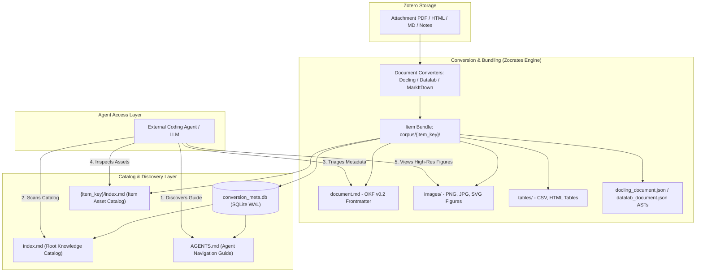
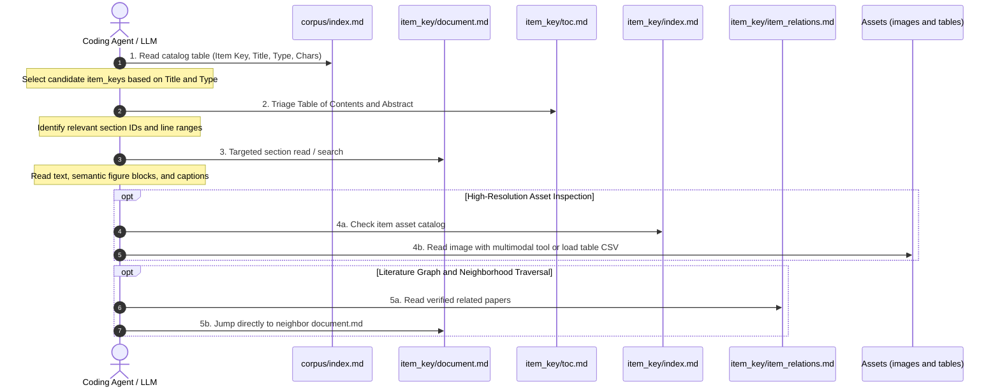
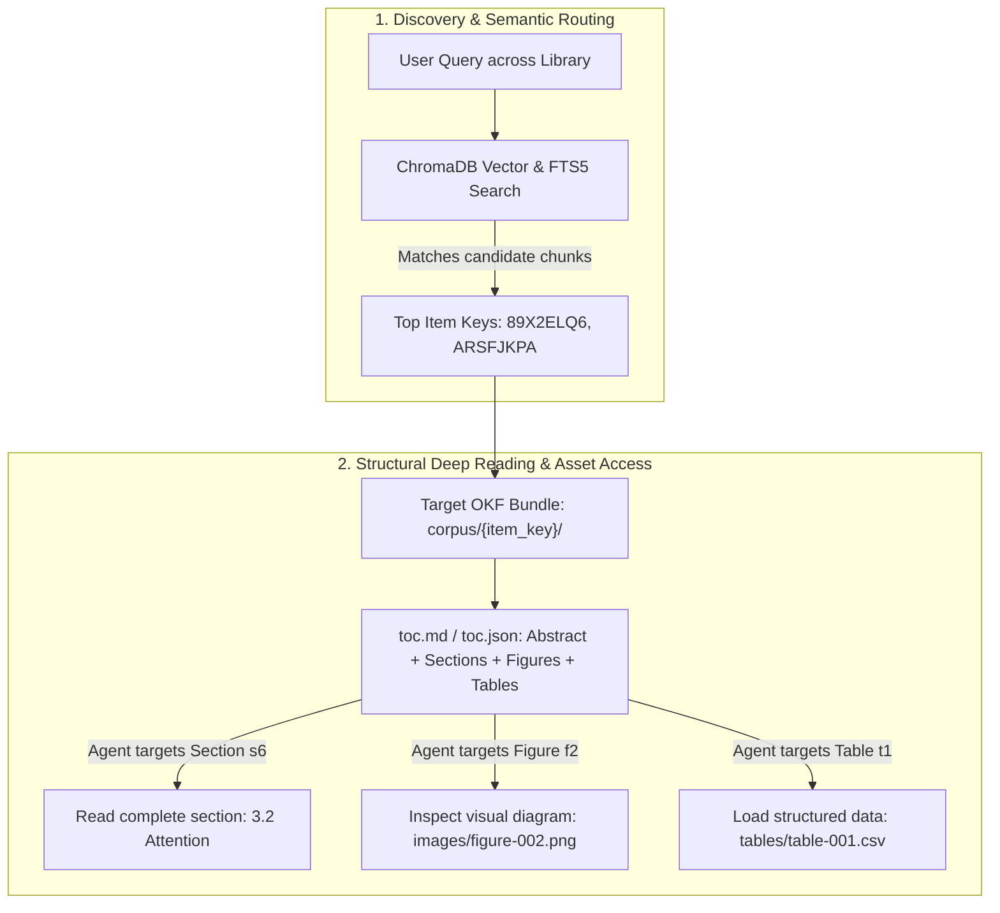

# OKF Document Bundles, Agent Navigation & Mutation Invariants

Zocrates standardizes academic knowledge on the **Open Knowledge Format (OKF v0.2)** standard. Rather than locking converted documents behind proprietary database structures or transient service APIs, documents in Zocrates exist as transparent, human- and agent-readable Markdown bundles stored directly on disk.

This specification documents the bundle directory architecture, agent navigation protocols, cross-platform path semantics, and the exhaustive 12-path mutation lifecycle with its concurrency and data-preservation invariants.

---

## 1. Core Architecture & Philosophy: Format over Service

Coding agents (Claude, Gemini, Pi, Cursor, Copilot, ADK agents) require direct, high-fidelity access to research papers, technical reports, and notes. Zocrates adheres to the core tenets of the Open Knowledge Format:

* **Just Markdown**: Clean, GitHub-Flavored Markdown indexable by standard tools and renderable across environments.
* **Just Files**: Stored directly on the filesystem, versionable with Git, and inspectable without specialized SDKs.
* **Just YAML Frontmatter**: Structured metadata and trust signals stamped at the top of every document, enabling agents and code to evaluate relevance and credibility before reading the full text body.
* **Co-Located Asset Bundles**: Extracted figures, diagrams, and structured tables reside alongside the Markdown prose in a self-contained directory.



---

## 2. OKF v0.1 vs. OKF v0.2: Agentic Decision Making

While basic descriptive metadata (`type`, `title`, `description`, `tags`) sufficed for OKF v0.1, **OKF v0.2** introduces explicit **decision and trust signals** in YAML frontmatter. Because agent context windows are valuable, frontmatter enables LLMs and tools to make rapid filtering choices without consuming tokens on full document bodies:

| Signal Category | Frontmatter Field | Purpose for Agents |
| :--- | :--- | :--- |
| **Identity & Types** | `type`, `item_key`, `parent_item_key` | Identifies document type (`journalArticle`, `webpage`, `preprint`) and parent-child Zotero linkages. |
| **Bibliographic Metadata** | `title`, `authors`, `year`, `publication`, `doi`, `url` | Core citation facts for paper identification and citation tracking. |
| **Collections** | `member_of_collections` | Zotero collection membership for topical filtering. |
| **Source Provenance** | `source: {path, hash, content_type}` | Traceability to original disk attachments and SHA-256 integrity verification. |
| **Converter Provenance** | `provenance: {converter_id, converter_version, converted_at}` | Identifies parsing engine (`docling_local`, `datalab`, `markitdown`), engine version, and conversion timestamp. |
| **Quality & Trust** | `parse_quality_score`, `checkpoint_id` | Quantifiable OCR/layout quality metrics (e.g. 0.0 to 5.0 score from Datalab). |

### Example OKF v0.2 Frontmatter Block:

```yaml
---
type: journalArticle
okf_version: '0.2'
item_key: ARSFJKPA
parent_item_key: 9N8KQEZI
title: Differences between germline genomes of monozygotic twins
authors:
  - Jonsson, Hakon
  - Magnusdottir, Erna
  - Eggertsson, Hannes P.
year: 2021
publication: Nature Genetics
doi: 10.1038/s41588-020-00755-1
url: https://www.nature.com/articles/s41588-020-00755-1
member_of_collections:
  - name: Genomics
    collection_key: CJHVF5G8
source:
  path: ../../../storage/ARSFJKPA/Jonsson et al. - 2021.pdf
  hash: 45c127e5da7132b0bf8c03674e62743d14fcf2f65aa4d7e02f4f868d260417ab
  content_type: application/pdf
provenance:
  converter_id: docling_local
  converter_version: 2.120.1-fast
  converted_at: '2026-08-18T14:42:07.263641+00:00'
  parse_quality_score: 4.85
---
```

---

## 3. Anatomy of a Zocrates Item Bundle

All converted documents reside in `<zotero-data-dir>/zocrates-data/corpus/`:

```
corpus/
├── index.md                      # Root Knowledge Base Catalog (all documents)
├── AGENTS.md                     # Agent Navigation Guide & Protocol
├── conversion_meta.db            # SQLite metadata database (authoritative, WAL mode)
└── <item_key>/                   # Item-centric bundle directory (attachment item key)
    ├── document.md               # Converted Markdown with OKF v0.2 YAML frontmatter
    ├── toc.json                  # Machine-parseable Table of Contents & asset index
    ├── toc.md                    # Agent-readable overview with Abstract and ToC
    ├── item_relations.md         # Related literature neighborhood (0 bytes if orphan)
    ├── index.md                  # Item-level catalog describing metadata, assets, and relations
    ├── images/                   # Extracted figures and rasterized diagrams (PNG, JPG, SVG)
    │   ├── picture_000.png
    │   └── picture_001.png
    ├── tables/                   # Structured table extractions (CSV, HTML)
    │   ├── table_000.csv
    │   └── table_000.html
    ├── image_captions.json       # Sidecar caching VLM synthetic figure captions
    └── docling_document.json     # Parser AST sidecar (offline debugging only)
```

### First-Class Child Note OKF Bundles

In addition to PDF, HTML, and Markdown files, user notes in Zotero (reading reflections, critiques, literature summaries) are materialized as first-class OKF bundles:

```
corpus/<note_key>/
  ├── document.md       # YAML frontmatter + converted structured Markdown
  ├── toc.json          # Line-offset boundaries and section assets
  ├── toc.md            # Human/agent readable Table of Contents
  ├── item_relations.md # Related paper links
  └── index.md          # Note asset catalog
```

* **HTML Conversion & Structural Fidelity**: Notes are converted from HTML to Markdown via BeautifulSoup, preserving headings (`<h1>`–`<h6>`), blockquotes (`<blockquote>`), clean pipe tables, code blocks (`<pre><code>`), and lists.
* **Strictly Non-LLM Summaries**: Notes follow a zero-LLM summarization policy. Notes with fewer than 100 plain-text words skip summary generation (`abstract = None`). Notes with $\ge 100$ words use a deterministic extractive lead-paragraph method (`abstract_source = "extractive"`) taking the first non-heading paragraph up to 300 characters (<5ms, zero API cost).
* **Staleness Tracking & On-Demand Materialization**: If an agent requests `get_document_toc` or `read_document` for a note that is not yet bundled, `_resolve_bundle_dir` materializes the bundle dynamically. The SHA-256 hash of raw note HTML is recorded as `source_hash` in `conversion_meta.db`. If the hash diverges, the bundle refreshes atomically.

---

## 4. Agent Navigation Protocol & Discovery

External coding agents interact with document bundles directly via standard filesystem tools (`read`, `grep`, `find`, `ls`).

| Dimension | Plain Folder Path Access | With Navigation Protocol & Hybrid Retrieval |
| :--- | :--- | :--- |
| **Integration Overhead** | Zero. Standard file tools only. | Minimal. Guided by `AGENTS.md`. |
| **Small Corpus (< 200 items)** | Efficient. Scans `index.md`, filters candidate frontmatters, reads target documents. | Rapid document resolution in 1–2 turns. |
| **Large Corpus (1,000+ items)** | High token consumption, slow recursive grepping. | Optimal. Hybrid RAG retrieves candidate keys; agent reads specific OKF bundles on disk. |
| **Figure & Multimodal Access** | Manual file discovery. | Streamlined. Relative links in `document.md` and synthetic captions make figures directly discoverable. |
| **Portability** | Fragile if paths are host-absolute. | Fully Portable. Relative links (`../../../storage/...`) preserve validity across systems and containers. |

### The 5-Step Agent Navigation Protocol



1. **Step 1: Catalog Discovery**: Read `corpus/index.md`. The catalog table contains `| Item Key | Title | Type | Converter | Converted At | Source Path | Chars |`. Candidate keys are selected without traversing subdirectories.
2. **Step 2: Frontmatter & ToC Triage**: Open `<item_key>/toc.md` (or inspect the initial 30–50 lines of `<item_key>/document.md`). Review the abstract and section structure to identify exact line ranges and section IDs before reading the full document.
3. **Step 3: Targeted Content Reading**: Read specific sections or search for terms within `<item_key>/document.md`. Documents feature ATX headers, structured `<figure data-type="table">` containers, and `<figure data-type="image">` blocks with `<synthetic_caption>` sections.
4. **Step 4: Asset Inspection**: When figures, diagrams, or tabular data require inspection, consult `<item_key>/index.md` for relative links, inspect images in `images/` via multimodal tools, or parse CSVs in `tables/`.
5. **Step 5: Relation & Literature Graph Traversal**: If adjacent prior or follow-up work is needed, open `<item_key>/item_relations.md`. It lists related papers with relative links (`[KEY - Title](../KEY/document.md)`), relation categories (`human_curated`, `hybrid_search`, `shared_tags`), and similarity scores. If the file is 0 bytes, the paper has no corroborated relations in the library (an unconnected paper).

### Strict Guardrails for Agents

1. **Context-Toxic AST Sidecars**: High-fidelity parsers (Docling, Datalab) store full JSON ASTs (`docling_document.json`, `datalab_document.json`) that routinely exceed 5MB to 15MB. Agents must **never** glob or read parser AST JSON files during routine exploration. By contrast, `toc.json`, `toc.md`, `item_relations.md`, and `image_captions.json` are lightweight, safe index files designed for agent reading.
2. **Table Cell Pipe Corruption**: Academic titles frequently contain pipe characters (`|`) or newlines. All titles serialized in `generate_root_index_md` are sanitized (`replace("|", "\\|").replace("\r", " ").replace("\n", " ")`) to prevent corrupted Markdown tables.
3. **Three-Tier Path Semantics Architecture**:
   - **Database Tier (`conversion_meta.db`)**: Source paths are normalized to storage-relative `storage/<item_key>/<filename>`. Virtual note URIs (`zotero://note/<key>`) are preserved verbatim.
   - **Root Catalog Tier (`corpus/index.md`)**: Base is `corpus/`. Relative links are derived deterministically as `"../../" + stored_path` (e.g. `[Source Document](../../storage/<key>/<file>)`).
   - **Document Provenance Tier (`document.md` YAML Frontmatter)**: Base is `<cache_dir>/<item_key>/`. Relative paths are derived as `"../../../" + stored_path` (e.g. `path: ../../../storage/<key>/<file>`).
   - **External Linked Files**: Files residing outside Zotero's internal `storage/` directory retain normalized absolute POSIX paths, avoiding fragile relative traversals across unrelated host directories.
   - **Fallback Re-anchoring**: If a foreign machine absolute path is encountered, `resolve_source_path` extracts the trailing `storage/<key>/<file>` component and re-anchors it to the local Zotero profile directory.

---

## 5. Vector Retrieval vs. Structural Document Bundles

Zocrates enforces a strict division of labor between **Vector/FTS Retrieval (ChromaDB + SQLite FTS5)** and **Structural Document Bundles (OKF)**:



### Discovery vs. Deep Reading Trade-offs

| Dimension | ChromaDB / Vector Store (Chunk Layer) | OKF Document Bundle (`toc.md` / `document.md`) |
| :--- | :--- | :--- |
| **Primary Role** | **Discovery & Semantic Search** across the entire library. | **Structural Understanding & Deep Reading** of targeted papers. |
| **Granularity** | Fragmented text chunks (~1,000–1,500 chars) with artificial overlaps. | Complete hierarchical sections, full tables, and linked high-res figures. |
| **Contextual Integrity** | Can lose narrative flow, premises, and equation definitions. | Preserves complete context, preceding equations, and narrative continuity. |
| **Structure Awareness** | Flat list of chunk matches without document outline hierarchy. | Exact heading hierarchy (`H1 -> H2 -> H3`) and sequential IDs (`s0...`, `f1...`, `t1...`). |
| **Asset Delivery** | Embedding models cannot deliver CSV files or high-resolution images. | Co-located `tables/` (CSV/HTML) and `images/` (PNG/SVG) accessible with exact relative paths. |

Vector search alone cannot reliably reconstruct entire multi-step derivations or complex methodology sections. Pre-generating `toc.json` and `toc.md` allows agents to read a compact outline (~150 tokens) and target specific section IDs (e.g. `s6`), figures (`f1`), or tables (`t1`) in a single surgical read.

---

## 6. Bundle Mutation Lifecycle & Master Inventory

All write operations inside `corpus/<key>/` are governed by **12 distinct write paths**:

| # | Writer Path | Trigger Condition & Frequency | Source Location | Files Touched | Mechanism & Lifecycle | Risk / Invariant Guardrail |
|---|-------------|-------------------------------|-----------------|---------------|-----------------------|----------------------------|
| **1** | **Initial Conversion & Cache Save** | **Trigger**: Real-time event observer or batch sync.<br>**When**: `autoConverter.js` detects new attachment (`event === 'add'`), or batch conversion runs (`POST /batch-convert`). | `zocrates.rag.document_processor` (`_save_to_cache`) | `document.md`<br>`toc.json`, `toc.md`<br>`index.md`<br>Root `index.md`, `AGENTS.md` | Writes bundle files into `corpus/<key>/`; executes `INSERT OR REPLACE INTO conversion_meta` | **Explicit Columns**: Must include `keywords` so re-saves never clear metadata.<br>**Uniform Birth**: Universal materialization of `item_relations.md` (0 bytes if orphan). |
| **2** | **Explicit Re-Conversion** | **Trigger**: User action.<br>**When**: User clicks "Re-convert with..." in item pane or calls `POST /convert/{item_key}` (`force=True`). | `zocrates.rag.document_processor` (`convert_with`) | Entire bundle directory | Staged conversion: `shutil.rmtree(item_dir)` $\to$ temp directory staging $\to$ atomic rename before calling `_save_to_cache` | **Re-Conversion Invariant**: Re-conversion wipes bundle directory; `_save_to_cache` regenerates `item_relations.md` from surviving SQLite rows so neighbor links are restored immediately. |
| **3** | **Lazy / In-Place Cache Conversion** | **Trigger**: Agent action.<br>**When**: Dialogue agent calls `read_document` or `get_document_toc` on an item not yet converted to Markdown. | `zocrates.rag.document_processor` (`get_or_convert`) | `document.md`<br>Bundle assets | Converts directly into existing `item_dir` without `rmtree`; calls `_save_to_cache` | Preserves existing auxiliary files (e.g. `image_captions.json`); calls `_save_to_cache` to finalize. |
| **4** | **Sync-Time Orphan Cleanup** | **Trigger**: Library sync scan or startup staleness sweep.<br>**When**: User clicks "Sync Library" (`POST /sync`) or startup sweep runs, detecting an item key removed or trashed in `zotero.sqlite`. | `zocrates.rag.library_syncer` (`purge_item`) | Entire bundle directory, `conversion_meta.db`, vector store, root index | Purges across all four datastores: `processor.delete_cached()` + `store.delete_document()` + `processor.regenerate_root_index()` | **Pre-Deletion Neighbor Regeneration**: Query all affected neighbors from `item_relations` before deleting edges; batch-regenerate neighbor `item_relations.md`.<br>**Store-Parity Invariant** across disk, metadata DB, and vector store. |
| **5** | **Note Bundle Materialization** | **Trigger**: Note edit or creation detected during sync scan.<br>**When**: User clicks "Sync Library" (`POST /sync`) or full sync runs, detecting a SHA-256 hash change in a note's HTML. | `zocrates.rag.document_processor` (`materialize_note_bundle`) | `document.md`<br>`toc.json`, `toc.md`<br>`index.md`<br>`item_relations.md` | Staged note generation: detects edits via SHA-256 of Zotero HTML; writes to temp staging dir $\to$ atomic rename | Generate `index.md` and `item_relations.md` inside staging dir before swap.<br>Explicit SQL column list includes `keywords`. |
| **6** | **Metadata & Frontmatter Sweeps** | **Trigger**: Startup initialization or full library sync.<br>**When**: Exclusively on startup `POST /register` sweep, manual `POST /sync` (or `/sync/stream`), or CLI utility. Never runs during chat turns. | `zocrates.rag.frontmatter_refresher` (`refresh_bundle_frontmatter`) | `document.md`<br>`toc.json`, `toc.md`<br>`index.md` | In-place frontmatter regeneration; $\Delta L$ line-shifting of `chunk_meta`; FTS5 Chunk 0 replacement; `conversion_meta` update | `build_frontmatter()` accepts and preserves `keywords`; no-op check includes keywords to prevent silent erasure.<br>Skip `content_type == 'text/note'`. |
| **7** | **VLM Multimodal Figure Enrichment** | **Trigger**: Post-conversion hook.<br>**When**: Immediately following document conversion if uncaptioned images exist and VLM is enabled. | `zocrates.rag.vlm_captioner` (`enrich_document_bundle`) | `document.md` (body only)<br>`image_captions.json` | Rewrites `document.md` body to inject `<figure>` and `<synthetic_caption>` blocks; caches descriptions in `image_captions.json` | **Body-Only Invariant**: Frontmatter is untouched. Called from 4 post-conversion sites (`library_syncer` incremental, full sync, `POST /convert/{item_key}`, batch sync). |
| **8** | **Table of Contents Generator** | **Trigger**: Conversion, line-shift, or missing ToC.<br>**When**: Inside `_save_to_cache`, after frontmatter $\Delta L$ shift, or lazy call in `toolkit.py`. | `zocrates.rag.toc_generator` (`save_toc_files`) | `toc.json`<br>`toc.md` | Extracts section hierarchy, line offsets, and asset captions; writes atomic `.tmp` files $\to$ `os.replace` | Writing `.tmp` followed by `os.replace` eliminates partial-read race conditions for concurrent agent readers. |
| **9** | **Root & Agent Catalogs** | **Trigger**: Bundle addition or deletion.<br>**When**: End of `_save_to_cache`, `delete_cached`, `POST /sync`, or batch conversion. | `zocrates.rag.bundle_catalog` (`generate_root_index_md`, `generate_agents_md`) | Root `index.md`<br>Root `AGENTS.md` | Sweeps active bundles in `corpus/` to compile unified library catalog and agent guidance | Reads `conversion_meta` and bundle paths; writes atomic full catalogs at library root. |
| **10** | **Lazy ToC Backfill** | **Trigger**: Agent ToC request on unindexed bundle.<br>**When**: Dialogue agent calls `get_document_toc()` or `search_corpus()` on an existing bundle where `toc.json` has not been generated yet. | `zocrates.rag.library_syncer`, `zocrates.agents.common.toolkit` | `toc.json`<br>`toc.md`<br>`index.md` | On-demand generation triggered when dialogue agent requests ToC of a bundle missing ToC files | Uses shared `toc_generator` and `generate_item_index_md` routines to maintain layout parity. |
| **11** | **Maintenance CLI Sweeps** | **Trigger**: Manual operator invocation.<br>**When**: Developer runs CLI scripts in terminal (`scripts/refresh_frontmatter.py`). | `scripts/refresh_frontmatter.py`, `scripts/refresh_toc.py` | `document.md`<br>`toc.json`, `toc.md`<br>`index.md` | Standalone CLI maintenance utilities | Delegate directly to paths **6** and **8**; inherit all safety guardrails. |
| **12** | **Real-Time Deletion Purge** | **Trigger**: Real-time event observer.<br>**When**: `autoConverter.js` detects `event === 'trash'` or `event === 'delete'` via `Zotero.Notifier` observer, firing `POST /items/delete`. | `zocrates.rag.library_syncer` (`purge_item`), `zocrates.fast_api_app` (`delete_items`) | Entire bundle directory, `conversion_meta.db`, vector store, root index | Immediate atomic purge across all four datastores upon item trashing or deletion in Zotero UI | Enforce 4-datastore store parity; batch-regenerate neighbor `item_relations.md`; eliminate stale point-of-use lookups. |

---

## 7. Trigger Conditions & Event-Driven Execution Model

Zocrates utilizes an **event-driven architecture** centered on Zotero's native `Zotero.Notifier` subsystem, supplemented by startup sweeps and on-demand agent invocations:

```mermaid
graph TD
    subgraph "1. Real-Time Event Observer (Zotero.Notifier)"
        A["User adds PDF/attachment in Zotero"] --> B["autoConverter.js (Notifier 'add' event)"]
        B -->|"POST /convert/{item_key}"| C["Writer 1: _save_to_cache"]
        C -->|If images present| D["Writer 7: enrich_document_bundle (VLM)"]
        A2["User trashes/deletes item in Zotero"] --> B2["autoConverter.js (Notifier 'trash'/'delete' event)"]
        B2 -->|POST /items/delete| C2["Writer 12: purge_item (4 Datastores)"]
    end

    subgraph "2. User-Triggered Sync & Re-Conversion"
        E["User clicks 'Scan Library' (#sync-btn)"] -->|POST /sync| F["library_syncer.full_sync()"]
        F -->|Deleted items detected| G["Writer 4: purge_item (Orphan Cleanup)"]
        F -->|Edited note HTML detected| H["Writer 5: materialize_note_bundle"]
        I["User clicks 'Re-convert with Docling'"] -->|"POST /convert/{item_key}" force=True| J["Writer 2: convert_with"]
    end

    subgraph "3. Startup & Registration Sweep"
        K["Zotero UI launch (autoRegister)"] -->|POST /register| L["Writer 6: refresh_bundle_frontmatter sweep"]
        K -->|POST /register| M["Writer 9: generate_root_index_md sweep"]
        K -->|POST /register| L2["Writer 4: sync_metadata_staleness orphan purge"]
    end

    subgraph "4. On-Demand / Lazy Fallback"
        N["Agent calls get_document_toc (missing)"] --> O["Writer 10: Lazy ToC Backfill"]
        P["Agent calls read_document (missing)"] --> Q["Writer 3: get_or_convert"]
    end
```



### Detailed Trigger Breakdown:

1. **Real-Time Event-Driven Ingestion & Deletion (Writers 1, 7, 12)**:
   - `autoConverter.js` registers an observer: `Zotero.Notifier.registerObserver(this, ["item"], "ZocratesAutoConverter", 10)`.
   - On `add`, it verifies file availability on disk (`waitForAttachmentFile`), queues it, and dispatches `POST /convert/{item_key}` to the backend, followed by Writer 7 VLM enrichment if images are present.
   - On `trash` or `delete`, it resolves child attachments and notes, then fires `POST /items/delete`. The backend invokes `LibrarySyncer.purge_item(key)` to execute synchronous sequential purge with store parity across all 4 datastores.
2. **User-Triggered Library Scan (Writers 4 & 5)**:
   - User clicks "Scan Zotero library" (`#sync-btn`) or runs a batch conversion dialog, triggering `POST /sync`.
   - `LibrarySyncer.full_sync()` scans `zotero.sqlite` against all known keys:
     - Deleted or trashed items trigger **Writer 4 (`purge_item`)** across all 4 datastores.
     - Notes with modified HTML hashes trigger **Writer 5 (`materialize_note_bundle`)**.
   - Zero background polling: updates occur strictly on user action or event hooks.
3. **Startup & Registration Sweep (Writers 4, 6 & 9)**:
   - On Zotero launch or sidebar mount, `autoRegister()` sends `POST /register`.
   - Writer 6 (`refresh_bundle_frontmatter`) updates frontmatter only when bibliographic values diverge.
   - Writer 4 (`sync_metadata_staleness`) detects and purges orphaned items deleted while the backend was offline.
   - Writer 9 compiles root `index.md`. Never runs during chat turns.
4. **On-Demand / Lazy Interactive Paths (Writers 2, 3, 10)**:
   - Writer 2 (`convert_with`) runs when the user explicitly re-converts via the item pane.
   - Writers 3 & 10 (`get_or_convert` / Lazy ToC) execute lazily when an agent queries an item whose Markdown or ToC files do not yet exist on disk.

---

## 8. System Invariants & Concurrency Rules

### 8.1. The Re-Conversion Invariant

`convert_with()` wipes the target bundle directory using `shutil.rmtree()`. Because `_save_to_cache()` immediately regenerates `item_relations.md` from surviving SQLite `item_relations` rows, the bundle is fully populated from creation, and `index.md` never contains a dangling reference to a missing relations file.

### 8.2. The Deletion & Neighbor Link Invalidation Invariant

When Paper $A$ is deleted or moved to trash in Zotero, deleting $A$'s directory removes $A$. However, any existing neighbor $B$ whose `item_relations.md` linked to `[A - Title](../A/document.md)` now possesses a dead link.

To prevent dangling links:
1. Enumerate all neighbors before removing edges:
   ```python
   cur.execute("""
       SELECT DISTINCT target_key FROM item_relations WHERE source_key = ?
       UNION
       SELECT DISTINCT source_key FROM item_relations WHERE target_key = ?
   """, (item_key, item_key))
   affected_neighbors = [row[0] for row in cur.fetchall()]
   ```
2. Delete edges from SQLite:
   ```python
   cur.execute("DELETE FROM item_relations WHERE source_key = ? OR target_key = ?", (item_key, item_key))
   ```
3. Batch-regenerate `item_relations.md` for all affected neighbors.

### 8.3. The Note Isolation & Staging Invariant

When a user edits a note:
1. `materialize_note_bundle()` stages the new note in a temporary directory (`<note_dir>.tmp.<pid>`).
2. Inside the staging directory, it writes `document.md`, `toc.json`, `toc.md`, `index.md`, and `item_relations.md`.
3. It atomically renames the staging directory over the existing directory using `os.replace` (on POSIX) or atomic directory swap.
4. The explicit SQL column list for `INSERT OR REPLACE INTO conversion_meta` includes `keywords` to prevent nulling existing metadata.

### 8.4. The Keyword Preservation Invariant

When bibliographic metadata changes in Zotero (e.g. title corrected, authors added), `refresh_bundle_frontmatter()` rewrites the YAML frontmatter. `build_frontmatter()` accepts `keywords: list[str] | None = None`. `refresh_bundle_frontmatter()` loads `keywords` from `conversion_meta.keywords` (or parses them from the existing YAML header). The deterministic equality comparison (`new_fm == old_fm`) includes the `keywords:` block. If metadata has not changed, zero disk writes occur.

`refresh_bundle_frontmatter()` also verifies `content_type`. If `content_type == 'text/note'`, it skips processing, preventing note frontmatter from being rewritten into an attachment schema.

### 8.5. The Four-Datastore Purge & Store-Parity Invariant

Whenever an item is purged—whether through real-time observer events (`autoConverter.js` $\to$ `POST /items/delete`), sync-time orphan detection in `full_sync()`, or startup sweeps in `sync_metadata_staleness`—`LibrarySyncer.purge_item(item_key)` executes synchronous sequential purge across all 4 datastores:

1. **Corpus Directory**: `processor.delete_cached(item_key, update_root_index=False)` removes `corpus/<key>/` via `shutil.rmtree`.
2. **Metadata & Relation DB**: `conversion_meta.db` rows in `conversion_meta`, `conversion_failures`, and `item_relations` are deleted, and affected neighbor `item_relations.md` files are regenerated.
3. **Vector & FTS Store**: `store.delete_document(item_key)` purges dense vector embeddings in ChromaDB and keyword index rows in SQLite FTS5 (`chunks_fts` and `chunk_meta`).
4. **Root Index Catalog**: `processor.regenerate_root_index()` recompiles root `index.md` to reflect the updated corpus.

No item key may exist in one datastore while missing from another. Deletion from disk without vector purge produces phantom search hits; deletion from vectors without disk purge leaves orphaned bundles on the filesystem.

### 8.6. Query-Time Liveness Invariant

Physical purges ensure long-term hygiene, but concurrent chat turns require query-time liveness gating against `zotero.sqlite` at the point of use:

1. **Hybrid Corpus Retrieval (`search_corpus_core`)**:
   - Candidate results returned by `syncer.store.search(...)` are filtered against `syncer.db.get_active_item_keys(list(cand_keys))`.
   - Items residing in Zotero's `deletedItems` table (or having a trashed parent) are discarded immediately.
2. **Bundle Directory Resolution (`_resolve_bundle_dir`)**:
   - Before resolving or materializing any note or disk bundle directory, `_resolve_bundle_dir` checks `syncer.db.is_item_active(item_key)`.
   - If the item is trashed or deleted in Zotero, it immediately returns `None`.
3. **Cached ToC Eviction (`get_document_toc`)**:
   - When resolving a Table of Contents, if a match is found in `cached_tocs` but `syncer.db.is_item_active(resolved_key)` indicates the document is no longer active, the entry is evicted from `cached_tocs` in session state, and a clear error is returned.

### 8.7. Concurrency, Atomicity & File-Replacement Standards

1. **Atomic File Writes**:
   Files that may be read concurrently by dialogue agents (`item_relations.md`, `toc.json`, `toc.md`) are never written using direct truncation (`open(..., "w")`). They follow the atomic replacement pattern:
   ```python
   tmp_path = file_path.with_suffix(f".tmp.{os.getpid()}")
   tmp_path.write_text(content, encoding="utf-8")
   os.replace(tmp_path, file_path)
   ```
2. **SQLite Database Access**:
   `conversion_meta.db` is maintained in `PRAGMA journal_mode=WAL` with `timeout=5.0s`. Readers never block concurrent writers.
3. **Dynamic ToC Count Isolation**:
   In `toolkit.py`, `**Related Items**: N` is evaluated and appended to the ToC string at call-time after retrieving the outline from `cached_tocs`. It is never stored in `cached_tocs`, preventing the outline filter from stripping it and eliminating turn-to-turn staleness.

---

## 9. Architectural Cross-References

* **Document Conversion Architecture**: For converter strategies, Datalab OCR, Docling fast mode, and image extraction pipelines, see [Document Conversion Architecture](document-conversion.md).
* **Embeddings & Hybrid Search**: For vector indexing, ChromaDB collections, and SQLite FTS5 trigram search, see [Embeddings & Hybrid Search](embeddings-and-search.md).
* **System Overview**: For high-level frontend-backend architecture and multi-agent roles, see [System Architecture](../index.md).
