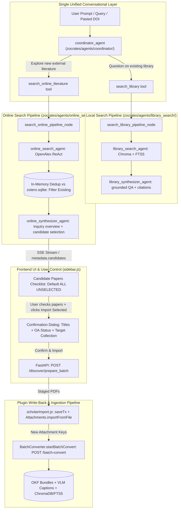
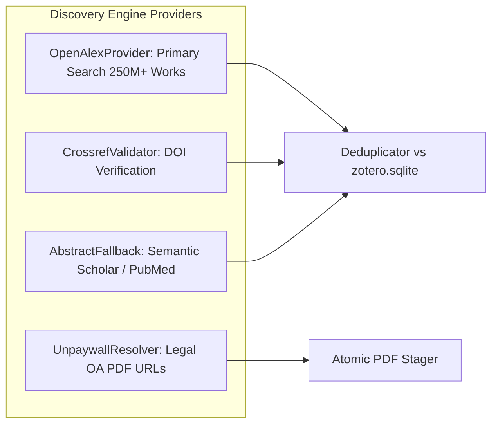
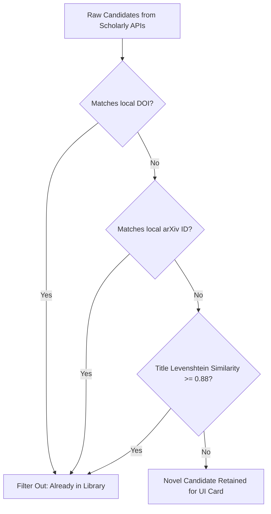
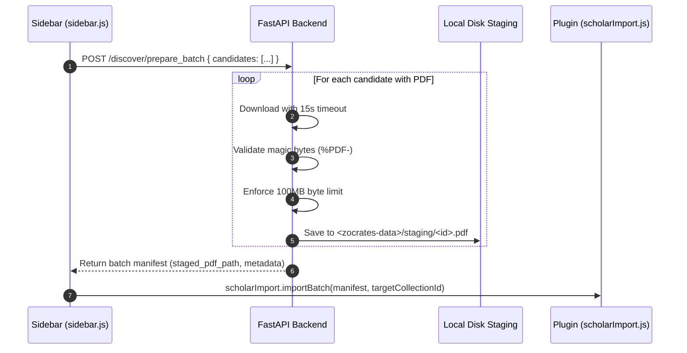

# Online Literature Discovery & User-Controlled Import

While local library retrieval allows scholars to query existing collections, comprehensive research often requires discovering literature beyond the local library. Traditional academic search tools force researchers into disjoint workflows: searching external databases, manually downloading PDFs, re-importing into reference managers, and re-triggering embedding pipelines.

Zocrates unifies literature discovery directly inside conversational dialogue through the autonomous **Online Literature Discovery and User-Controlled Import Pipeline**. This closes the complete research loop: *Query → Prospect → Explain → Select → Import → Batch Convert & Index*.

---

## 1. System Architecture & Symmetrical Multi-Agent Design

The online search system mirrors the local search architecture symmetrically, utilizing Google ADK dynamic workflows (`@node`) and exact isolation scopes to prevent event pollution:



### Symmetrical Pipeline Naming & Scopes

| Role | Local Pipeline | Online Pipeline | Scope Identifier |
| :--- | :--- | :--- | :--- |
| **Pipeline Tool** | `search_library` | `search_online_literature` | — |
| **Workflow Node** | `search_library_pipeline_node` | `search_online_pipeline_node` | `search_online_pipeline:{fc_id}` |
| **Retrieval Agent** | `library_search_agent` | `online_search_agent` | Isolated subagent |
| **Synthesis Agent** | `library_synthesizer_agent` | `online_synthesizer_agent` | Context-continuous |

* **Coordinator Agent (`coordinator_agent`)**: Analyzes the user's intent. When the user asks about literature outside their library, requests new papers, or pastes an external DOI, the coordinator delegates retrieval to `search_online_literature`.
* **Online Search Agent (`online_search_agent`)**: Operates with `"low"` thinking effort, autonomously formulating queries, inspecting candidate metadata, and retrieving candidate works via scholarly academic APIs.
* **Online Synthesizer Agent (`online_synthesizer_agent`)**: Operates with `"high"` thinking effort, providing a grounded overview of what the discovered candidate papers contribute, their core methodologies, and why they answer the user's inquiry.

---

## 2. Scholarly Discovery Engine (`zocrates/discovery/`)

The discovery engine orchestrates external academic providers, normalizes paper metadata, and validates Open Access PDF availability.



### 2.1 OpenAlex as Primary Search Backbone
OpenAlex indexes over 250 million scientific works across all academic disciplines and synchronizes arXiv preprints on a daily cadence. Zocrates uses OpenAlex as its primary discovery backbone:

* Bypasses the 3-second courtesy delays of legacy single-repository APIs.
* Employs inverted-index abstract reconstruction (`abstract_inverted_index`) to recover structured abstracts with zero publisher website scraping.
* Captures high-confidence scored concepts (`keywords` with confidence scores $\ge 0.60$) and primary research topics.

### 2.2 Unpaywall & Crossref Integration
* **Unpaywall (`UnpaywallResolver`)**: Resolves legal, author-manuscript, and publisher Open Access PDF locations for discovered papers with verified licenses (CC-BY, CC0, etc.).
* **Crossref (`CrossrefValidator`)**: Validates DOIs, normalizes publisher metadata, and backfills missing publication dates and container titles.
* **Opportunistic Abstract Backfill**: If an abstract is missing from OpenAlex, a fast 3-tier cascade queries Semantic Scholar or PubMed E-utilities with a 2.0s timeout before falling back to OpenAlex concept tags. Publisher landing pages are never scraped.

---

## 3. Strict Novelty Filtering (Local Library Deduplication)

To prevent cluttering chat with papers the user already owns, the discovery engine executes **in-memory deduplication against the user's local `zotero.sqlite` database**:



### Deduplication Tiers
1. **DOI Normalization**: Normalizes prefixes and lowercase canonical strings (`10.xxxx/...`), checking against all registered identifiers in `zotero_db`.
2. **arXiv ID Normalization**: Strips version suffixes (`v1`, `v2`) to match preprints against published versions (`arXiv:2305.12345`).
3. **Normalized Title Levenshtein Distance**: Normalizes case, removes punctuation, and evaluates normalized Levenshtein similarity. Titles with $\ge 0.88$ similarity are treated as duplicates.
4. **Re-check on Import**: Candidate IDs are re-checked at confirmation time in `POST /discover/prepare_batch`, ensuring that items imported in another tab or past turns cannot be duplicated.

---

## 4. Zero-Friction Polite Pool Etiquette

Academic APIs maintain generous rate limits for polite users who provide a valid contact email:

* **Automatic Detection**: On extension startup, `bootstrap.js` checks Zotero's sync credentials (`Zotero.Prefs.get("sync.server.username")` or `Zotero.Users.getCurrentUsername()`). If the username contains an email address (`@`), it is passed to the backend during `POST /register`.
* **Configuration Storage**: Stored as `scholar_polite_email` under `FileLock` in `zocrates_config.json`.
* **HTTP Header Injection**: All requests to OpenAlex and Unpaywall automatically append `mailto:{scholar_polite_email}` in query strings or user-agent headers.
* **Preferences UI**: Users can manually inspect or configure their academic email in **Zotero Preferences → Zocrates**.

---

## 5. Candidate Data Contract & Dual Delivery Channel

To eliminate hallucinated candidate metadata while keeping synthesis natural:

1. **Numbered Synthesizer References**:
   The `online_synthesizer_agent` discusses candidates using simple index references:
   ```markdown
   - [1] **Self-RAG: Learning to Retrieve, Generate, and Critique through Self-Reflection**:
     Introduces reflection tokens allowing LLMs to selectively invoke retrieval and verify answers.
   - [2] **Corrective Retrieval Augmented Generation (CRAG)**:
     Evaluates retrieved document quality before passing chunks to generation.
   ```
2. **Pipeline Delivery Channel**:
   The Python pipeline intercepts candidate indices, correlates them with discovered candidate metadata, and injects structured records into the final SSE event:
   ```json
   {
     "event": "done",
     "payload": {
       "metadata": {
         "candidates": [
           {
             "candidate_id": "cand_01",
             "title": "Self-RAG: Learning to Retrieve, Generate, and Critique",
             "authors": ["Akari Asai", "Zeqiu Wu", "Yizhong Wang"],
             "year": 2024,
             "doi": "10.48550/arXiv.2310.11511",
             "openalex_id": "W4387819876",
             "pdf_url": "https://arxiv.org/pdf/2310.11511.pdf",
             "oa_status": "gold",
             "keywords": ["Retrieval-Augmented Generation", "Self-Reflection"]
           }
         ]
       }
     }
   }
   ```
3. **Session Persistence**: Candidate payloads are persisted inside `sessions.db` alongside message events, allowing interactive candidate cards to re-render when switching between sessions.

---

## 6. Atomic PDF Staging & Batch Verification (`/discover/prepare_batch`)

When a user selects candidate papers and clicks **"Import Selected"**, the frontend sends a preparation request to `POST /discover/prepare_batch`:



### Staging Guardrails
* **Header Magic Byte Verification**: Validates the first 4 bytes match `%PDF-`. Files failing this check (e.g. HTML error landing pages or Cloudflare captchas) are dropped immediately.
* **File Size Ceiling**: Rejects any file exceeding `100MB` to prevent disk exhaustion.
* **Metadata-Only Fallback**: If a paper is not Open Access or the download fails, the paper is imported as a clean metadata-only record (allowing the user to resolve access through institutional proxies later).

---

## 7. In-Process Zotero Write-Back Engine (`scholarImport.js`)

Zotero 10 enforces transactional integrity for library mutations. Writing to the library must occur inside Zotero's main process with `SystemPrincipal` chrome privileges:

### 7.1 Transactional Item Creation
`scholarImport.js` uses `Zotero.DB.executeTransaction()` to ensure atomic write-back:
```javascript
await Zotero.DB.executeTransaction(async () => {
  for (const itemData of itemsToImport) {
    const item = new Zotero.Item("journalArticle");
    item.setField("title", itemData.title);
    item.setField("DOI", itemData.doi);
    item.setField("date", String(itemData.year));
    item.setField("abstractNote", itemData.abstract);
    
    // Attach Creators
    item.setCreators(itemData.creators);
    
    // Attach Tags (OpenAlex Keywords >= 0.60)
    for (const tag of itemData.keywords) {
      item.addTag(tag, 1);
    }
    
    await item.saveTx();

    // Attach PDF if staged
    if (itemData.stagedPdfPath) {
      await Zotero.Attachments.importFromFile({
        file: itemData.stagedPdfPath,
        parentItemID: item.id
      });
    }

    if (targetCollectionId) {
      targetCollection.addItem(item.id);
    }
  }
});
```

### 7.2 Race Condition Prevention (`_suppressKeys`)
When Zotero creates a new attachment, `autoConverter.js` detects the `"add"` event and automatically queues a single conversion call (`POST /convert/{key}`). 

If `scholarImport.js` simultaneously launches batch conversion, a race condition occurs. To prevent this:

1. `scholarImport.js` temporarily registers the new attachment keys in `AutoConverter._suppressKeys`.
2. `autoConverter.js` ignores the `"add"` events for suppressed keys.
3. Once item creation completes, `scholarImport.js` invokes `Zotero.Zocrates.BatchConverter.startBatchConvert(attachmentKeys, { skipConfirm: true })`.
4. Suppressed keys are cleared safely in a `finally` block.

---

## 8. Dual-Layer Keyword Preservation

Discovered literature preserves rich taxonomic metadata across both Zotero and the RAG storage layers:

```mermaid
graph LR
    OA[OpenAlex Scored Keywords >= 0.60] --> ZTAGS[1. Zotero Native Tags: item.addTag]
    OA --> FRONT[2. OKF Bundle Frontmatter: keywords: [...]]
    FRONT --> META[conversion_meta.db keywords column]
    ZTAGS --> GRAPH[Paper Relatedness Graph: sync_shared_tags]
```

1. **Zotero Native Tags**: High-confidence keywords are saved directly as Zotero item tags (`type = 1`), making them immediately filterable in the desktop tag selector.
2. **Paper Relatedness Graph**: Native tags feed directly into the offline graph visualizer, immediately connecting the newly imported paper to related items in the library via `shared_tags` edges.
3. **OKF Frontmatter Preservation**: During subsequent Markdown conversion, keywords are written into `document.md` YAML frontmatter and indexed in SQLite `conversion_meta.db`, bypassing statistical fallback routines.

---

## 9. Frontend Checkbox State Retention

In `sidebar.js`, chat message rendering is throttled to 50ms to maintain 60 FPS during fast streaming turns. If candidate checkboxes were re-rendered from scratch on every stream tick, active user clicks would be wiped.

Zocrates preserves user selection state:

* **Keyed State Tracking**: Checkbox selections are tracked in an in-memory `Set` (`selectedCandidateKeys`).
* **Non-Destructive DOM Updates**: Throttled stream renders preserve the container's `.checked` properties.
* **Default Unselected Policy**: Candidate cards default to **all unselected** to ensure users explicitly choose what to add to their library.
* **Global Selection Controls**: A header toggle (`[Select All / Deselect All]`) allows researchers to quickly grab full candidate batches.

---

## 10. Configuration & Subagent Role Pinning

Online discovery roles are configured in `<zotero-data-dir>/zocrates-data/zocrates_config.json`:

```json
{
  "scholar_polite_email": "researcher@university.edu",
  "override_agent_models": {
    "online_search": {
      "model": null,
      "thinking": "low"
    },
    "online_synthesizer": {
      "model": null,
      "thinking": "high"
    }
  }
}
```

* Both roles default to `model: null`, dynamically inheriting the globally active model.
* Researchers can surgically pin `online_search` to a fast, low-cost model while routing `online_synthesizer` to a frontier reasoning model for rigorous candidate evaluation.
