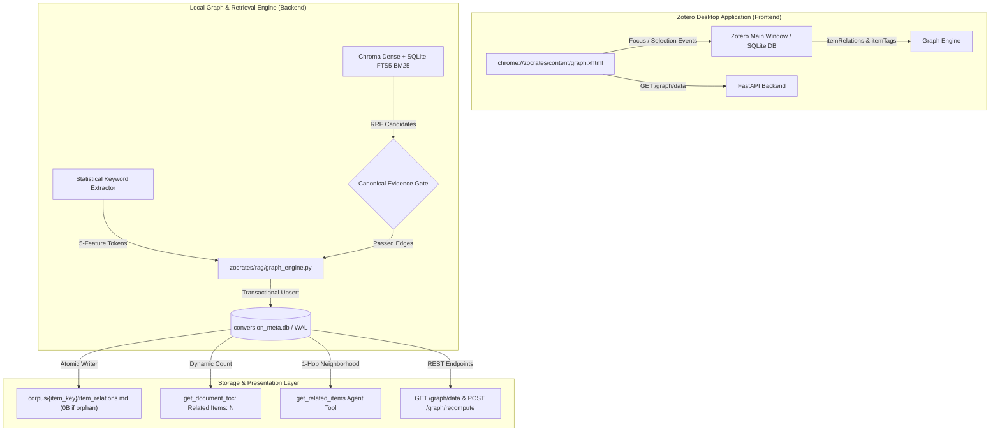

# Evidence-Gated Paper Relations Graph & Visualizer

This document details the architectural design, algorithmic foundation, storage formats, agent retrieval mechanisms, and visual layout physics of the **Evidence-Gated Paper Relations Graph** and **Native In-Zotero Network Visualizer** in Zocrates.

---

## 1. System Overview & Architectural Principles

The Zocrates paper relations network connects literature across a user's Zotero library without external graph databases, remote LLMs, or heavy cross-encoders. It discovers relationships through evidence-gated hybrid retrieval, ingests human curation from Zotero, persists edges transactionally in SQLite, serializes local neighborhoods into self-contained Markdown bundles, and exposes an offline, physics-stabilized Canvas 2D visualizer directly inside Zotero.



### Core Design Principles

1. **Zero Heavy Graph Databases**: No Neo4j, Memgraph, or Kùzu daemons. All vertices, edges, weights, and metadata reside natively in SQLite (`conversion_meta.db` in WAL mode) and local Markdown bundles.
2. **Evidence-Gated & 100% Deterministic (Zero LLMs / Zero Cloud Calls)**: Edges are formed strictly when corroborated using deterministic algorithms—statistical keyphrase extraction (<0.2 ms on CPU) and reciprocal rank fusion hybrid scoring. Building the graph consumes zero LLM tokens, incurs zero API costs, and runs entirely locally and air-gapped. In a personal research library, specialized papers frequently have no close siblings. Forcing every paper to pick $K$ nearest neighbors hallucinates spurious connections. Under Zocrates' evidence gating, isolated papers remain unconnected (`item_relations.md` is an intentional 0-byte file).
3. **Format over Service ("Just Markdown & Just Files")**: Complete local neighborhoods are serialized as relative Markdown links (`[KEY - Title](../KEY/document.md)`), allowing LLM coding agents and humans to traverse the literature network directly in the filesystem.
4. **100% Invariant `document.md`**: Frontmatter is written once at conversion with structural keywords baked in and never modified when relationships change. This guarantees zero line shifts (ΔL = 0), prevents vector chunk invalidation, and stops circular self-corroboration loops.
5. **Offline & Air-Gapped Visualizer**: The visualizer is pure HTML5 Canvas 2D and vanilla JavaScript ($0$ CDN dependencies, $0$ external web fonts) embedded natively as a Zotero tab (`chrome://zocrates/content/graph.xhtml`).
6. **Community Persistence & Macro Anchoring**: Graph layout relies on client-side Weighted Label Propagation (LPA) coupled with sector-anchored force physics, preventing the common failure mode where central gravity collapses topical clusters into an unreadable hairball.

---

## 2. Evidence-Gated Discovery Engine (`zocrates/rag/graph_engine.py`)

### 2.1 The Semantic Dilution & Homograph Trap
Pure bi-encoder document embeddings compress entire papers into a single vector, causing acute semantic dilution:

* **The Homograph Problem**: Broad academic terms (*"agent"*, *"model"*, *"network"*) dilute vector space, causing cross-domain collisions (e.g., linking economic game theory to coding assistants solely because both mention *"agents"*).
* **The Solution (Dual-Channel Consensus)**: Zocrates uses **hybrid retrieval** (ChromaDB dense vectors + SQLite FTS5 BM25 with Reciprocal Rank Fusion). When a candidate satisfies the Evidence Gate via `method="hybrid"`, both dense semantic similarity and exact lexical token collocations independently confirm the match. This dual-channel consensus eliminates the need for expensive cross-encoders during discovery.

### 2.2 5-Feature Statistical Keyword Extraction (`zocrates/rag/keyword_extractor.py`)
Rather than calling an LLM, keywords are extracted in $< 0.2\text{ ms}$ on CPU from the paper's **Structural Digest** (Title + Abstract + Section Headings):

* Scores candidate n-grams (unigrams and bigrams) across 5 statistical features:
  1. **Term Frequency ($TF$)** within digest.
  2. **Inverse Document Frequency ($IDF$) proxy** via general academic stopword filtering.
  3. **Structural Heading Boost** ($2.0\times$ multiplier if appearing in a section title).
  4. **Title Token Boost** ($3.0\times$ multiplier if appearing in paper title).
  5. **Capitalization / Acronym Boost** ($1.5\times$ multiplier for capitalized technical collocations).
* Extracted keywords are baked into `document.md` YAML frontmatter (`keywords: [...]`) on initial conversion and persisted in SQLite `conversion_meta.keywords`.

### 2.3 The Canonical Evidence Gate
For each item, a hybrid query is constructed from its deduplicated Title, statistical keywords, and Zotero tags:

$$\text{Query} = \text{DeduplicatedTokens}(\text{Title} + \text{Keywords} + \text{Tags})$$

Retrieved candidate chunks from `store.search(query, limit=10)` are evaluated against the Evidence Gate:

1. **Chunk 0 Frontmatter Exclusion**: Chunks with `chunk_type == "frontmatter"` are strictly ignored to prevent circular metadata matching.
2. **Corroboration Criteria**: A candidate paper qualifies as a related edge if and only if:
   * **Rule 1 (`hybrid`)**: At least one chunk matched via `retrieval_method == "hybrid"` (both BM25 token match and dense cosine similarity ≥ 0.50), OR
   * **Rule 2 (`single_chunk_high`)**: At least one chunk has dense semantic similarity ≥ 0.65, OR
   * **Rule 3 (`multi_chunk_cohesion`)**: At least ≥ 2 independent chunks match with dense semantic similarity ≥ 0.58.

### 2.4 Exponential Diminishing-Returns Rescaling
Raw RRF scores are rescaled to an intuitive confidence interval $[0.50, 0.99]$ using an exponential decay function:

$$\text{score} = \text{round}\left(0.50 + 0.49 \cdot \left(1.0 - e^{-\frac{\text{raw\_rrf} - \text{min\_score}}{\tau}}\right), 2\right)$$

Where $\text{min\_score} = 0.015$ and $\tau = 0.10$, clamped strictly to $[0.50, 0.99]$.

### 2.5 Ground Truth Ingestion & Precedence Coalescing
The engine extracts explicit relationships directly from Zotero's local SQLite database:

1. `human_curated`: Explicit related items defined in Zotero's `itemRelations` table (`dc:relation`, `dc:replaces`). Weight: $1.0$.
2. `shared_tags`: Distinctive tags shared across items in `itemTags`, supporting both manual user tags (`type = 0`) and automatic/imported subject tags (`type = 1`) governed by the `include_automatic_tags_in_shared_tags` setting (default `True`). Weight: normalized Jaccard similarity in $[0.50, 0.85]$.
   * **Document Frequency (DF) Noise Cap**: To prevent broad medical, biological, or domain-wide subject headings (present across large swaths of a library) from forming dense, uninformative cliques, tags exceeding a 5% Document Frequency cap ($\text{cap} = \max(5, \lfloor 0.05 \times N \rfloor)$) are automatically excluded.
   * **Parent-Paper Entity Normalization**: Tags and document frequencies are computed strictly across unique parent papers. Child notes and secondary attachments are mapped to their parent paper, preventing self-parent edges, sibling attachment loops, and artificial tag DF inflation.

When multiple relationship sources connect the same paper pair, edges are coalesced under strict display precedence:

$$\text{human\_curated\_and\_hybrid\_search (Rank 4)} > \text{human\_curated (Rank 3)} > \text{hybrid\_search (Rank 2)} > \text{shared\_tags (Rank 1)}$$

All edges are symmetrized as undirected relationships ($A \leftrightarrow B$) with canonical max score:

$$\text{score}_{AB} = \max(\text{score}_{A \to B}, \text{score}_{B \to A})$$

### 2.6 Attachment-Free & Abstract-Less Item Integration
Items lacking full-text attachments (materialized as `text/zotero-metadata` bundles) participate fully in graph construction:
* **Abstract-Bearing Metadata Items**: Items with an abstract are indexed into ChromaDB and FTS5, participating in evidence-gated hybrid retrieval, manual relations, and shared tags.
* **Abstract-Less Metadata Items**: Items lacking an abstract bypass dense/BM25 hybrid query execution (preventing spurious single-sentence or title-only vector collisions) while participating in manual relations and shared tag matching. If unconnected, they appear predictably as perimeter orphan nodes rather than being omitted from the visualization.

---

## 3. SQLite Schema & Storage Invariants

### 3.1 Schema (`conversion_meta.db`)
Edges are maintained in `conversion_meta.db` (SQLite in WAL mode with `busy_timeout = 5000`):

```sql
CREATE TABLE IF NOT EXISTS item_relations (
    source_key      TEXT NOT NULL,
    target_key      TEXT NOT NULL,
    score           REAL NOT NULL,        -- Rescaled score [0.50, 0.99] or 1.0
    relation_type   TEXT NOT NULL,        -- 'human_curated_and_hybrid_search' | 'human_curated' | 'hybrid_search' | 'shared_tags'
    match_evidence  TEXT,                 -- JSON debug summary of matching chunks
    updated_at      TEXT NOT NULL,
    PRIMARY KEY (source_key, target_key, relation_type)
);

CREATE INDEX IF NOT EXISTS idx_relations_source_score ON item_relations (source_key, score DESC);
CREATE INDEX IF NOT EXISTS idx_relations_target ON item_relations (target_key);
```

### 3.2 Bundle Serialization (`item_relations.md`)
Every document bundle in `<zotero-data-dir>/zocrates-data/corpus/<item_key>/` contains an `item_relations.md` file:

* **Connected Papers**: Materialized as a structured Markdown document linking directly to peer bundles:
  ```markdown
  # Related Literature: Attention Is All You Need

  - [3A4B5C6D - Transformer-XL: Attentive Language Models](../3A4B5C6D/document.md)
    - **Relationship**: `human_curated_and_hybrid_search` (Confidence: 0.92)
    - **Evidence**: Matches on self-attention mechanism and positional encodings.
  ```
* **Unconnected Papers**: If a paper has $0$ corroborated connections, `item_relations.md` is written as an intentional **empty file (0 bytes)**. This keeps the bundle structure uniform and predictable while preventing hallucinated connections.
* **Atomic Replacement Guarantee**: Written using a temporary sidecar file (`.tmp_item_relations.md.<pid>`) followed by `os.replace` to prevent race conditions during concurrent agent reading.

### 3.3 Immutability & Safety Guardrails
* **100% Invariant `document.md`**: Frontmatter is written once at conversion and never rewritten on relation synchronizations. Zero line shifts (ΔL = 0).
* **Dangling Link Invalidation Invariant**: When Paper A is deleted from Zotero:
  1. The engine queries all neighbors connected to A from `item_relations`.
  2. Deletes A's rows from SQLite.
  3. Immediately batch-regenerates `item_relations.md` for all affected neighbors, eliminating dangling Markdown links.

---

## 4. Agent & Retrieval Integration

### 4.1 Dynamic Table of Contents Summary (`get_document_toc`)
Rather than dumping full neighbor lists into the initial context window, `get_document_toc` queries `conversion_meta.db` and injects an unsteered count into the compact outline:

```markdown
# Table of Contents: Attention Is All You Need
**Related Items**: 5 connected papers (use get_related_items to inspect)

- Abstract
- 1. Introduction
...
```

### 4.2 On-Demand Traversal Tool (`get_related_items`)
Dialogue agents inspect the neighborhood dynamically using a dedicated 1-hop tool:

```python
def get_related_items(item_key: str, limit: int = 5) -> str:
    """Retrieve high-confidence related papers for a given item key."""
```

* **Return Payload**: Returns clean bibliographic metadata, relationship category, confidence score, and relative filesystem path without exposing raw database plumbing.
* **Cycle Suppression**: Redundant lookups are tracked in `temp:seen_toc_item_keys` strictly on `get_document_toc`, keeping substantive `read_document` calls unblocked.

---

## 5. Native In-Zotero Graph Visualizer

The visualizer is embedded natively inside Zotero via `chrome://zocrates/content/graph.xhtml` (and mirrored for browser testing at `GET /graph/view` via `zocrates/templates/graph_view.html`).

```
┌─────────────────────────────────────────────────────────────────────────────┐
│  Zocrates Network Graph                                [Theme: Dark] [✕]    │
├──────────────────────────────────────┬──────────────────────────────────────┤
│  Canvas 2D Graph View                │  Topical Cluster & Inspector Drawer  │
│                                      │                                      │
│         (Community 1)                │  TOPICAL CLUSTER                     │
│           o---o                      │  ● Multi-Agent Systems (3 papers)    │
│          /     \                     │  [Focus Cluster in Graph]            │
│         o-------o                    │  • Vaswani et al. (2017) (Current)   │
│            \                         │  • Dai et al. (2019)                 │
│             \ (Inter-cluster link)   │  • Brown et al. (2020)               │
│              \                       ├──────────────────────────────────────┤
│               o---o                  │  CONNECTED PAPERS                    │
│              /     \                 │  • Transformer-XL (0.92, hybrid)     │
│             o-------o                │  • GPT-3 (0.88, curated)             │
│         (Community 2)                ├──────────────────────────────────────┤
│                                      │  ACTIONS                             │
│         * Orphan Paper (Perimeter)   │  [Open in Zotero] [Inspect Document] │
└──────────────────────────────────────┴──────────────────────────────────────┘
```

### 5.1 Fast Client-Side Weighted LPA Clustering
To provide instant semantic grouping without server round-trips:

* Computes communities entirely on the client in vanilla JavaScript using the **Weighted Label Propagation Algorithm (LPA)** in $O(V + E)$ time.
* Edge weights are derived from relationship categories:
  * `human_curated_and_hybrid_search`: weight $1.2$
  * `human_curated`: weight $1.0$
  * `hybrid_search`: weight $\text{score} \in [0.50, 0.99]$
  * `shared_tags`: weight $0.4$
* Stabilized by sorting node IDs for deterministic tie-breaking across runs.
* Automatically derives thematic cluster titles from the most frequent statistical keywords among member papers.

### 5.2 Physics Engine & Macro-Anchoring Stabilization
Standard force-directed graph layouts suffer from the **Central Gravity Collapse Problem**: a global gravitational force pulling towards $(0, 0)$ overpowers node repulsion, dragging distinct communities into an unreadable hairball.

Zocrates resolves this with a **Sector-Anchored Hierarchical Physics Model**:

1. **Macro Ring Centroid Anchors**:
   * Each detected community $C_i$ is assigned a persistent angular sector $\theta_i$ on a macro circle of radius $R = \max(240, 75 \cdot \sqrt{|C|})$:
     $$\text{anchorX}_i = R \cdot \cos(\theta_i), \quad \text{anchorY}_i = R \cdot \sin(\theta_i)$$
   * Central gravity towards $(0,0)$ is completely disabled. Instead, nodes experience a gentle attraction force ($0.025 \times \alpha$) directed strictly toward their community's sector anchor.
2. **Perimeter Anchors for Unconnected Papers**:
   * Degree-0 unconnected papers are placed along an outer perimeter circle ($R_{\text{orphan}} = R \times 1.45$) distributed evenly by golden-ratio increments, keeping them visible and uncluttered without interfering with clusters.
3. **Differential Spring Physics**:
   * **Intra-Cluster Springs**: Stiff spring constant ($k = 0.045$, target distance $d = 65\text{px}$) tightly grouping papers within the same topic.
   * **Inter-Cluster Springs**: Extremely soft spring constant ($k = 0.005$, target distance $d = 280\text{px}$) allowing cross-topic bridges without dragging separate communities together.
4. **Inverse-Square Repulsion**:
   * All node pairs repel with $F_{\text{rep}} = \frac{4000}{\text{dist}^2 + 400}$, preventing node overlapping while maintaining cluster separation.

### 5.3 Semantic Zoom & Visual Hierarchy
* **Academic 2-Line Labels**: Nodes display `Author et al. (Year)` in bold on line 1 and truncated paper title on line 2.
* **Degree-Based Semantic Zoom Culling**:
  * Zoom < 0.8×: Labels hidden or restricted to high-degree hub papers (degree ≥ 4).
  * Zoom 0.8× - 1.5×: Moderate-degree nodes displayed (degree ≥ 2).
  * Zoom > 1.5×: All node labels rendered with full detail.
* **Node Sizing**: Scaled smoothly by connectivity: $r = 6 + 2\sqrt{\text{degree}}$.
* **Edge Styling**: Color, opacity, and line dash reflect relationship strength and type (solid bright for curated, semi-transparent for hybrid, dashed for shared tags).

### 5.4 Topical Cluster Drawer & Spotlight Focus
* **Dedicated Drawer Section**: Replacing ambiguous inline pills, the inspector drawer features a structured `#inspector-cluster-section`:
  * Cluster theme dot, title, and paper count.
  * **[Focus Cluster in Graph]** button: triggers a smooth camera animation centering the bounding box of all member papers with responsive padding.
  * Scrollable peer list with shorthand citations, `(Current Paper)` status, and click-to-inspect navigation.
  * For isolated papers: renders a clean `Isolated Paper` card (*"No connected cluster peers found in library."*).
* **Canvas Spotlight**: Focusing a cluster dims all outside nodes and edges to $12\%$ opacity, spotlighting the active community while maintaining ambient library context.

### 5.5 Five-Theme Synchronization
Theme styles synchronize in real time with Zotero's user interface:

* **Slate**: Deep slate-blue dark background with cyan accents.
* **Amoled**: Pure `#000000` pitch black with high-contrast pastel accents.
* **Light**: Clean academic white with soft gray borders and crisp typography.
* **Zotero-Dark**: Native Gecko charcoal `#1c1b22` matching Zotero dark mode.
* **Sepia**: Warm parchment tone (`#fbf0d9`) designed for long reading sessions.

### 5.6 Sidebar Header Integration
To keep the primary chat workspace minimal and uncluttered:

* The sidebar header bar contains three persistent controls: **Detach Window** (`#window-toggle-btn`), **Notifications** (`#notification-toggle-btn`), and **More Actions** (`#more-actions-btn`).
* **Network Graph** and **Settings** are located inside the 3-dots dropdown menu (`#more-actions-dropdown`). Clicking "Network Graph" opens or focuses the native in-Zotero graph tab.

---

## 6. REST API Endpoints

| Endpoint | Method | Parameters | Description |
| :--- | :--- | :--- | :--- |
| `/graph/data` | `GET` | `center_key`, `collection_key`, `depth`, `min_score`, `include_curated`, `include_tags` | Returns complete `{nodes: [...], links: [...]}` graph payload with node degrees, titles, authors, years, and coalesced link types. |
| `/graph/recompute` | `POST` | `item_keys` (optional) | Recomputes and persists paper relation edges for specified or all items, updating `item_relations.md`. |
| `/graph/view` | `GET` | None | Serves standalone web visualizer (`zocrates/templates/graph_view.html`). |
