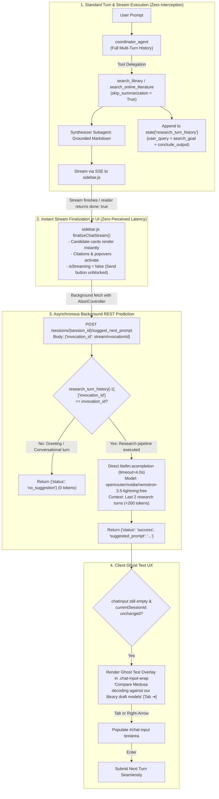
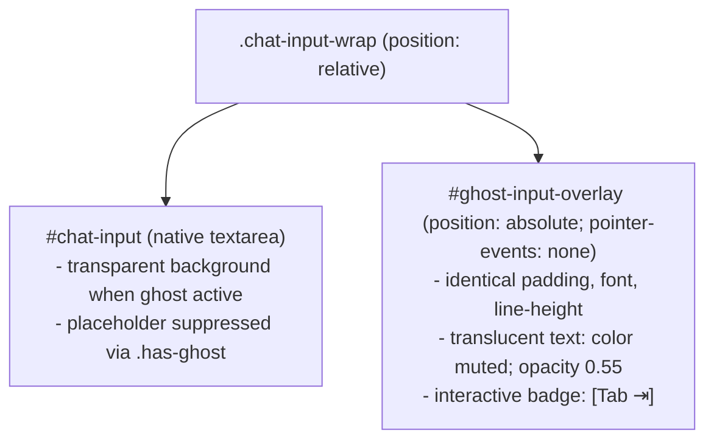

# Predictive Next-Prompt Engine & Ghost Input UX

When conducting deep literature research, formulating effective follow-up inquiries requires continuous intellectual effort: evaluating what questions remain unanswered, determining whether to expand search scopes, and structuring subsequent queries.

Zocrates introduces an autonomous **Predictive Next-Prompt Engine** paired with an interactive **Ghost Text Input UX** (inspired by autocomplete interactions in modern developer tools like Claude Code and Cursor). Following any literature search or discovery turn, the engine anticipates the scholar's next logical research step and projects it directly inside the chat textarea as an interactive, translucent suggestion with a `[Tab ⇥]` acceptance badge.

---

## 1. Decoupled Post-Turn Background REST Architecture

A common pitfall in streaming conversational interfaces is holding the main chat response stream open to append follow-up suggestions. This introduces critical failure modes: delaying UI stream finalization, freezing in-text citations and popovers, delaying candidate card rendering, and risking stream abort bugs.

Zocrates completely decouples prompt prediction from the primary chat stream using an **Asynchronous Post-Turn Background REST Architecture**:



### Key Architectural Lifecycles

1. **True Zero Latency on Research Results**: The `/chat` SSE stream terminates the instant the synthesis finishes. Citations, Evidence Peeks, and candidate cards become clickable immediately (<0.1ms).
2. **Background Dispatch**: `sidebar.js::finalizeChatStream()` dispatches `POST /sessions/{session_id}/suggest_next_prompt` asynchronously using a background `fetch` with an active `AbortController`.
3. **Sub-Second Completion**: The backend evaluates the research history and generates a prompt suggestion in **~300ms–400ms**.
4. **Non-Intrusive Ghost Rendering**: If the user's input box is still empty and the session hasn't changed, the suggestion appears as a ghost text overlay.

---

## 2. Exact Invocation Gatekeeper & Token Conservation

Not every conversational turn requires a follow-up research suggestion. For example, general greetings ("Hello"), simple clarifications ("Can you rephrase that?"), or casual remarks should not trigger external LLM completion calls.

The engine implements an **Exact Invocation Gatekeeper**:

```python
latest_history = session.state.get(RESEARCH_TURN_HISTORY, [])
if not latest_history or latest_history[-1].get("invocation_id") != request.invocation_id:
    return {"status": "no_suggestion"}
```

* **Zero Token Waste**: If the turn did not execute a research pipeline (`search_library` or `search_online_literature`), the invocation ID does not match. The endpoint returns `{"status": "no_suggestion"}` in **<1ms with 0 tokens consumed**.
* **Elimination of Stale Suggestions**: Prevents older research suggestions from resurfacing on subsequent non-research turns.

---

## 3. Durable Research Turn History (`RESEARCH_TURN_HISTORY`)

Google ADK automatically strips session keys prefixed with `temp:` (such as `temp:search_report`) during database persistence. To ensure the predictor has durable access to multi-turn research context across backend restarts, pipelines append records to the persistent session key `RESEARCH_TURN_HISTORY = "research_turn_history"` in SQLite `sessions.db`.

### Data Contract

```python
research_entry = {
    "invocation_id": invocation_id,
    "pipeline": "library_search",  # or "online_search"
    "user_query": user_query,
    "search_goal": search_query,
    "conclude_output": {
        "summary": search_report.get("summary", ""),
        "gaps": search_report.get("gaps", []),
        "notes": search_report.get("notes"),
    },
    "timestamp": time.time(),
}
```

* **Deduplication Safeguard**: If a turn is resumed or retried after a HITL interruption, the pipeline updates the existing entry for that `invocation_id` in-place rather than creating duplicate entries.
* **History Bounding**: Bounded to the last 10 research turns to prevent unbounded state growth in long sessions.

---

## 4. Ultra-Compact Prompt Context Formulation (<200 Tokens)

Predicting the next research step does not require feeding full paper texts or complete synthesizer responses to the prediction model.

The engine extracts only the **last two research pipeline turns** (`research_turn_history[-2:]`):

```text
Turn 1:
- User Question: What are the primary failure modes of solid-state lithium metal batteries?
- Search Goal: Find mechanisms of lithium dendrite penetration and void formation in solid electrolytes
- Unaddressed Gaps: Effect of stack pressure on void formation at the anode interface during high-rate stripping

Turn 2:
- User Question: Does external mechanical stack pressure mitigate void formation?
- Search Goal: Investigate critical stack pressure thresholds preventing interfacial contact loss
- Findings Summary: Pressures between 5–10 MPa significantly reduce void growth but accelerate creep in polymer-composite interlayers.
- Unaddressed Gaps: Creep deformation rates in composite interlayers under elevated temperatures (>45°C)
```

### Predictor System Prompt
```text
You are a predictive research query assistant. Based on the user's research trajectory and unaddressed literature gaps, formulate the single most logical next prompt the user would ask.

Rules:
- Write strictly in the user's first-person voice (direct question or request).
- Output between 5 and 15 words.
- Never include meta-text, quotes, prefixes, or explanations.
- Output ONLY the prompt text.
```

* **Total Token Budget**: Input context is under **180 tokens**; generation is bounded to `max_tokens = 40`.
* **Inference Model**: Bypasses heavy multi-agent loops and dispatches directly via `litellm.acompletion` to fast completion models (defaulting to `openrouter/nvidia/nemotron-3.5-lightning:free` with `reasoning: {effort: "none"}` and a strict 4.0s timeout).

---

## 5. Gecko DOM Ghost Input Overlay UX

Rendering ghost text inside Firefox's Gecko engine requires absolute DOM alignment without layout shifts or text collisions:



### Layout and Font Alignment
1. **Container Isolation (`.chat-input-wrap`)**: Wraps `#chat-input` in a relative container with `overflow: hidden`.
2. **Pixel-Perfect Overlay (`#ghost-input-overlay`)**: Positioned absolutely at `top: 0; left: 0; width: 100%; height: 100%;`. Copies exact computed typography from `#chat-input`:
   * `font-family`, `font-size`, `font-weight`, `line-height`
   * `padding-top`, `padding-left`, `padding-right`
3. **Native Placeholder Suppression (`.has-ghost`)**: When ghost text is rendered, `.has-ghost` is added to the container:
   ```css
   .chat-input-wrap.has-ghost #chat-input::placeholder {
     color: transparent !important;
     opacity: 0 !important;
   }
   ```
   This prevents the ghost suggestion from colliding with the default *"Ask a question about your library..."* placeholder.
4. **Line Clamping**: Suggestion text is clamped to 2 lines (`-webkit-line-clamp: 2`) with an ellipsis if text exceeds the container height.

---

## 6. Keyboard Interaction & Acceptance Contract

The ghost text acts as a non-destructive assistive overlay governed by standard IDE keybindings:

| Key Press | Trigger Condition | Resulting Behavior |
| :--- | :--- | :--- |
| **`Tab`** | Input is empty, ghost active | Accepts suggestion: fills `#chat-input` with suggestion text, dismisses ghost, focuses input. |
| **`Shift + Tab`** | Any | Preserved natively: allows backward keyboard focus navigation without accepting ghost text. |
| **`→` (Right Arrow)** | Caret at index 0 or input empty | Accepts suggestion and places caret at the end of the accepted text. |
| **`Escape`** | Ghost active | Dismisses suggestion: removes ghost overlay and restores native placeholder. |
| **Any Character Key** | User starts typing | Immediate dismissal: ghost text disappears the instant the first character is typed. |

---

## 7. Lifecycle Safeguards & Concurrency

Ghost text state is automatically wiped during conversational transitions:

* **Message Submission**: Cleared immediately when the user presses `Enter` or clicks `Send`.
* **New Session Creation**: Aborts pending background fetch and removes ghost DOM elements when `newChat()` is triggered.
* **Session Loading**: Dismisses suggestions when switching between sessions in the sidebar history drawer.
* **Stream Abort**: If the user clicks `Stop` during streaming, the background suggestion fetch is aborted via `AbortController.abort()`.

---

## 8. Configuration & Preferences Reference

Configured in `<zotero-data-dir>/zocrates-data/zocrates_config.json`:

```json
{
  "enable_predictive_ghost_input": true,
  "predictive_prompt_model": "openrouter/nvidia/nemotron-3.5-lightning:free"
}
```

* **`enable_predictive_ghost_input`**: Master toggle. When set to `false`, `finalizeChatStream` bypasses background suggestion requests entirely (0 network overhead).
* **`predictive_prompt_model`**: Model slug used for sub-second query prediction.
* **Preferences UI**: Live toggle control in **Zotero Preferences → Zocrates → General**.
