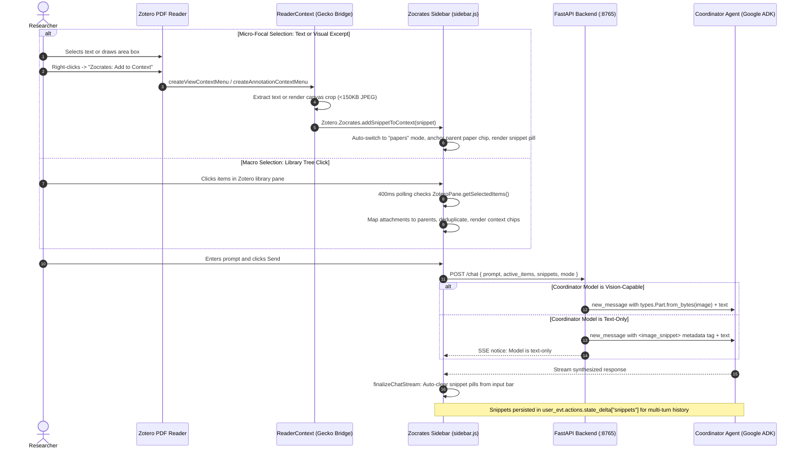

# Context Chips and Reader Excerpts Architecture

This document details the architectural design, data contracts, DOM construction, and agent integration for the context selection systems in Zocrates. The architecture unifies macro-level context selection (entire papers, collections, or whole libraries) with micro-focal excerpt selection (text quotations and visual area crops captured directly from Zotero's built-in PDF Reader).

---

## 1. System Overview & Architectural Motivation

Scholarly research workflows operate at two distinct granularities:

1. **Macro-Level Context**: Researchers converse against broad literature corpora—querying an entire Zotero library, a specific topical collection, or a curated set of multi-selected papers.
2. **Micro-Focal Context**: Researchers reading literature inside Zotero's built-in PDF Reader encounter specific mathematical formulations, algorithmic pseudocode, method paragraphs, architecture diagrams, or benchmark tables. In this mode, they require immediate analysis of the focal excerpt (e.g., *"Explain the notation in this equation"* or *"What trade-offs does this ablation curve illustrate?"*).

Zocrates bridges these two workflows by hosting both macro-level **Context Chips** and micro-focal **Attachment Context Pills** inside a unified context panel (`#chips-container`) directly above the chat input box.



---

## 2. Macro Selection: Library Context Chips

Context chips represent Zotero library items selected by the researcher to define the active retrieval boundary.

### 2.1 Focus-Safe High-Frequency Polling
The sidebar chat interface runs inside an `iframe` embedded within Zotero's main window. When a researcher clicks inside the chat textarea, focus shifts away from Zotero's main library tree, which causes native selection APIs (such as `ZoteroPane.getSelectedItems()`) to return an empty array.

To preserve selection state without relying on invasive monkey-patching of Zotero internals, selection capture is managed by a focus-aware polling engine:

* **Polling Cadence**: An internal timer polls every 400 milliseconds to query the parent window's `ZoteroPane.getSelectedItems()`.
* **Parent Item Mapping**: If a child attachment (such as an imported PDF or extracted note) is highlighted, the engine automatically walks the hierarchy to its parent bibliographic item (`item.parentItem`). Standalone top-level attachments without parents are preserved as their own context chips.
* **Deduplication**: Selected items are deduplicated by their unique database keys to prevent duplicate chips when both a parent paper and its child attachment are simultaneously selected.
* **Focus Safety via `document.hasFocus()`**: When the user clicks or types inside the chat sidebar, causing `getSelectedItems()` to report empty, the engine evaluates `document.hasFocus()`. If the sidebar has active focus, the system retains the existing chips rather than clearing them.
* **Explicit Clearing**: Chips are cleared only when the user deliberately clicks empty canvas space in Zotero's main library window, which causes `document.hasFocus()` to return `false` while the selection list is empty.

### 2.2 Sticky Mode (Pinned Context)
Researchers frequently need to assemble a working set of papers scattered across different collections. Sticky Mode allows non-contiguous accumulation of context items:

* **Toggle Action**: Activated via the thumbtack button (`#toggle-sticky-btn`) on the context panel header.
* **Accumulation & Deduplication**: Clicking different items in Zotero continuously appends them to the active chip list. Items already present in `activeItemsList` (matched by database key) are skipped.
* **Re-selecting Removed Papers**: If a chip was dismissed via its `✕` button, re-selecting that item in Zotero while in Sticky Mode removes its key from the internal `removedKeys` set and restores the chip.
* **Selection Immunity**: Deselecting items or clicking empty space in the library tree does not clear accumulated chips while Sticky Mode is active.
* **Mode Deactivation**: Toggling Sticky Mode off retains the accumulated chips until the next selection change event in Zotero, which then synchronizes the chip list to the immediate selection.

### 2.3 DOM Construction & XSS Sanitization
All chip elements are constructed dynamically using standard DOM APIs:

```javascript
const titleSpan = document.createElement("span");
titleSpan.className = "chip-text";
titleSpan.textContent = paper.title; // Safe against script and markup injection
chip.appendChild(titleSpan);
```

When rendering markdown responses from the AI backend:

1. Markdown is parsed via `marked.parse()`.
2. Raw HTML is filtered through an allowlist sanitizer (`sanitizeHTML()`) that purges dangerous tags (`<script>`, `<iframe>`, `<object>`, `<embed>`, `<form>`), inline event handlers (`on*`), and dangerous URI schemes (`javascript:`, `data:` on anchor tags).
3. The sanitized HTML is inserted into the chat bubble.

### 2.4 Chip Styling & Theming
Chips adapt dynamically to Zotero's interface themes using CSS custom properties:

* `--chip-bg`, `--chip-border`, and `--chip-hover-bg` control palette shifts across Dark, Slate, Amoled, Sepia, and Light themes.
* Font stacks inherit `system-ui` declarations to match host operating system typography.
* Individual chips feature an `✕` button that appends the target key to `removedKeys` and filters the DOM.
* A "Clear All" action appears when two or more chips are present. Clicking it purges the active set and synchronizes the baseline selection state to prevent the 400ms polling cycle from immediately re-adding the highlighted items.

### 2.5 Generation Cancellation (Stop Button)
During streaming responses:

* The send button (`#send-btn`) switches to a pulsing red stop icon via the `.stop-mode` class.
* An `AbortController` signal is bound to the active `fetch()` request.
* Clicking Stop aborts the network connection, finalizes the partial text, and appends a `[Generation stopped by user]` notice.
* While a generation is in progress, secondary submissions are locked.

---

## 3. Micro-Focal Selection: PDF Reader Bridge (`readerContext.js`)

The `readerContext.js` bridge registers declarative event hooks with Zotero's built-in PDF Reader to extract selected text and visual area crops directly into the conversational context.

```
┌────────────────────────────────────────────────────────────────────────┐
│                        Zotero 10 PDF Reader                            │
│  ┌────────────────────────┐         ┌───────────────────────────────┐  │
│  │   Text Selection       │         │   Area Annotation Box         │  │
│  │   "Attention weights"  │         │   [Architecture Diagram Crop] │  │
│  └───────────┬────────────┘         └───────────────┬───────────────┘  │
└──────────────┼──────────────────────────────────────┼──────────────────┘
               │ createViewContextMenu                │ createAnnotationContextMenu
               ▼                                      ▼
┌────────────────────────────────────────────────────────────────────────┐
│                  ReaderContext Bridge (readerContext.js)               │
│  • Resolves reader.item & parent paper bibliographic metadata          │
│  • Extracts 1-indexed page index                                       │
│  • Text: Normalizes whitespace and builds text snippet payload         │
│  • Area: Offscreen canvas extraction -> JPEG (<150KB base64)           │
│  • modifyAnnotation: Listens for resize events and updates thumbnails  │
└──────────────────────────────────────┬─────────────────────────────────┘
                                       │ Zotero.Zocrates.addSnippetToContext()
                                       ▼
┌────────────────────────────────────────────────────────────────────────┐
│                   Zocrates Sidebar (#chips-container)                  │
│  • Auto-switches active context mode to "papers"                       │
│  • Auto-anchors parent paper chip in activeItemsList                   │
│  • Renders turn-sticky snippet pill with page badge & popover          │
└────────────────────────────────────────────────────────────────────────┘
```

### 3.1 Declarative Reader Registration
Extensions register hooks with the PDF Reader declaratively using `Zotero.Reader.registerEventListener` with the extension identifier:

```javascript
const ReaderContext = {
  init() {
    // 1. Viewport context menu (text selection or canvas right-click)
    Zotero.Reader.registerEventListener(
      "createViewContextMenu",
      this._handleViewContextMenu,
      PLUGIN_ID
    );

    // 2. Annotation context menu (right-clicking existing annotations)
    Zotero.Reader.registerEventListener(
      "createAnnotationContextMenu",
      this._handleAnnotationContextMenu,
      PLUGIN_ID
    );
  }
};
```

### 3.2 Text Selection Extraction
When a researcher right-clicks highlighted text in the reader:

1. `ReaderContext.handleViewContextMenu` inspects `reader._internalReader.getSelectedText()` or the event's selection payload.
2. The bridge resolves the reader's underlying item (`reader.item`), its top-level bibliographic parent (`item.parentItem || item`), publication year, and primary author (e.g., `"Vaswani et al."`).
3. Extracts the 1-indexed page number (`reader._internalReader._state.pageIndex + 1`).
4. Generates a client identifier (`snip_${Date.now()}_${random}`) and passes the structured snippet object to the sidebar:

```javascript
Zotero.Zocrates.addSnippetToContext({
  id: `snip_${Date.now()}_${Math.random().toString(36).slice(2, 6)}`,
  type: "text",
  text: selectedText.trim(),
  page: pageNumber,
  paperTitle: paper.getField("title"),
  authors: formattedAuthors,
  parentKey: parentPaper.key,
  itemKey: attachmentItem.key
});
```

### 3.3 Visual Area Crop Extraction & Canvas Rendering
When a researcher right-clicks a drawn area box annotation:

1. `ReaderContext.handleAnnotationContextMenu` detects an area selection (`annotation.type === "image"` or `"box"`).
2. The bridge extracts the bounding box coordinates (`rects` or `position`).
3. It renders the bounding box region from the underlying PDF canvas using `reader._internalReader.renderAnnotationImage(annotation)` or offscreen canvas extraction.
4. The canvas crop is compressed to JPEG format (`image/jpeg`, quality `0.85`), targeting compact base64 data URLs (~50–150 KB) with clamped dimensions (`maxDim = 1200`) to keep SSE payloads fast and lightweight.

### 3.4 Live Area-Resize Auto-Update
If a researcher resizes or repositions an area box annotation after adding it to the context panel:

* `ReaderContext` observes annotation update events via `Zotero.Notifier.registerObserver(this, ["item"], "zocrates-area-resize-watcher")` on `"modify"` actions.
* It queries the in-memory reader state (`reader._internalReader._state.annotations`).
* A retry loop with dual ID/key matching captures the final rendered bounding rects once drag handles are released.
* The bridge re-renders the canvas crop and broadcasts via `Zotero.Zocrates.updateSnippet(updatedPayload)`, which `sidebar.js::handleSnippetUpdate` receives to update both the DOM thumbnail and the outgoing JSON payload in real time.

---

## 4. Context Mode Override & Turn Lifecycle

### 4.1 Automatic Scope Anchoring
Adding a text or area excerpt initiates an automatic scope anchoring sequence:

1. **Parent Paper Auto-Selection**: The parent bibliographic item is automatically resolved and added to `activeItemsList` if not already present.
2. **Context Mode Override**: If the sidebar was configured in `"collection"` or `"library"` context mode, it **automatically switches to `"papers"` mode**. This guarantees that coordinator instructions and retrieval tools focus specifically on the document containing the excerpt.

### 4.2 Turn-Sticky Lifecycle & Stream Cancellation Safety
Unlike macro library selections that change whenever the user clicks different items in Zotero's library pane, snippet pills follow a turn-sticky lifecycle:

* **Tree Click Immunity**: Clicking around the library does not clear active snippet pills.
* **Preservation on Stream Abort**: If a generation is cancelled by clicking Stop (`isAborted = true`), the snippet pills in `activeSnippetsList` remain in `#chips-container`. The user can adjust their prompt and re-submit without re-selecting the excerpt in the reader.
* **Auto-Clear on Completion**: When a turn completes successfully (`finalizeChatStream` with `!isAborted`), snippet pills are cleared from `#chips-container` and `activeSnippetsList` is reset.
* **Session Purge**: Creating a new session or loading a different session purges any unsubmitted snippet pills.

### 4.3 History Inspection & Rewind Restoration
* **Message Info Modal**: Clicking the info icon on any assistant or user message opens a metadata modal featuring a dedicated **Focal Snippets** panel alongside active context chips. Text snippets show the full quotation with page attribution; image snippets show a thumbnail preview and page number.
* **Turn Rewind & Inline Edit**: Triggering a rerun or inline edit on a previous turn restores that specific turn's `activeItemsList`, `activeSnippetsList`, and `contextMode`, reconstructing the exact conversational state.

---

## 5. Backend Data Contracts & Key Visibility Invariant

### 5.1 Request Schemas (`zocrates/schemas/item_request.py`)

Snippet items are transmitted in `POST /chat` payloads alongside standard active items:

```python
class SnippetItem(BaseModel):
    model_config = ConfigDict(populate_by_name=True)

    type: Literal["text", "image"] = Field(..., description="Snippet type: text quote or image area")
    id: str | None = Field(default=None, description="Unique client identifier")
    text: str | None = Field(default=None, description="Extracted text quotation")
    image_data: str | None = Field(
        default=None,
        max_length=5_000_000,
        validation_alias=AliasChoices("image_data", "imageData"),
        description="Base64 data URL for image snippet",
    )
    page: int | str | None = Field(default=None, description="Document page number")
    paper_title: str | None = Field(
        default=None,
        validation_alias=AliasChoices("paper_title", "paperTitle"),
        description="Source document title",
    )
    authors: str | None = Field(default=None, description="Author attribution string")
    parent_key: str | None = Field(
        default=None,
        validation_alias=AliasChoices("parent_key", "parentKey"),
        description="Parent top-level item key",
    )
    item_key: str | None = Field(
        default=None,
        validation_alias=AliasChoices("item_key", "itemKey"),
        description="Direct attachment item key",
    )
```

To prevent validation failures when restoring sessions where keys were serialized differently, `ActiveItem` supports multi-alias resolution:

```python
class ActiveItem(BaseModel):
    model_config = ConfigDict(populate_by_name=True)

    key: str = Field(
        ...,
        validation_alias=AliasChoices("key", "item_key", "itemKey"),
        description="Zotero item or collection key",
    )
    title: str = Field(..., description="Title of item or collection")
    item_type: str = Field(
        default="item",
        validation_alias=AliasChoices("item_type", "type"),
        description="Type: 'item' or 'collection'",
    )
```

### 5.2 Internal Key Visibility Invariant
A critical requirement of academic grounding is preventing models from hallucinating database keys or emitting raw attachment identifiers as citations. Zocrates enforces a strict visibility boundary:

* **Coordinator and Synthesizer Agents**: The helper `strip_snippet_keys(focal_snippets_str)` strips `key="..."` attributes before injecting context into the coordinator and synthesizer system prompts. These agents only see clean bibliographic metadata:
  ```xml
  <text_snippet paper="Attention Is All You Need" authors="Vaswani et al." page="4">
  The multi-head attention mechanism computes...
  </text_snippet>
  ```
* **Retrieval Subagents (`library_search_agent`)**: Retains `key="..."` attributes (`include_keys=True`) so low-level retrieval tools (`read_document`, `get_document_toc`) have exact database identifiers to target specific document bundles.
* **Canonical Storage**: The raw event stored in `sessions.db` preserves the full key metadata across all modalities.

---

## 6. Multimodal Routing & Vision Capability Detection

In `zocrates/fast_api_app.py`, incoming snippets are routed according to the capabilities of the active model:

```python
formatted_context, inline_image_parts, notices = await _process_request_snippets(
    request.snippets,
    coord_model=coord_model,
    zotero_dir=zotero_dir,
)
```

### 6.1 Vision-Capable Models
When the coordinator model supports vision (e.g., Gemini, GPT-6, Claude Sonnet, Qwen-VL):

1. The base64 JPEG data URL is decoded into raw binary bytes.
2. Google ADK `types.Part.from_bytes(data=raw_bytes, mime_type=mime_type)` objects are appended directly to the outgoing message parts.
3. A semantic XML tag is added to the text prompt:
   ```xml
   <image_snippet paper="Prot2Chat" authors="Wang et al." page="4">
   [Attached visual image of selected area]
   </image_snippet>
   ```

### 6.2 Text-Only Models (Zero-Latency Notice Tag)
Calling secondary Vision-Language Models (VLMs) during an interactive chat turn introduces latency (10–15s timeouts), temporary disk files, and failure points. When the active model does not support vision:

1. The backend immediately generates an informative untranscribed tag preserving all paper, author, and page metadata:
   ```xml
   <image_snippet paper="Prot2Chat" authors="Wang et al." page="4">
   [Attached image area: untranscribed image on page 4. The active coordinator model does not support vision/image inputs. If needed, inspect the surrounding document text or section via retrieval tools.]
   </image_snippet>
   ```
2. Emits an SSE notice event alerting the researcher:
   `"Image area attached, but active model is text-only. The agent has been notified."`
3. Returns in `<0.1ms` without blocking the chat turn.

### 6.3 Four-Tier Vision Capability Detection
To accurately determine whether a model supports vision without relying on static hardcoded lists, `is_model_vision_capable` uses a four-tier evaluation:

1. **Tier 1 (Authoritative OpenRouter Catalog Lookup)**: For OpenRouter models, inspects the cached OpenRouter model catalog (`llm_models.json`). If the model entry exists, checks `input_modalities` directly. If `"image"` is present, returns `True`. If the model is cataloged without image input support, returns `False` immediately, eliminating false positives.
2. **Tier 2 (Structural Indicators)**: Evaluates whether the model name contains explicit structural keywords (`vision`, `multimodal`, `vlm`) or `-vl` suffix patterns.
3. **Tier 3 (Multimodal Family Regex)**: Evaluates regex patterns covering vision-capable families (Gemini, Claude, GPT, OpenAI o-series excluding mini, GLM vision, Grok vision, Amazon Nova, Qwen VL/Flash, Pixtral, Omni, Molmo, InternVL, MiniCPM, CogVLM).
4. **Tier 4 (LiteLLM Fallback)**: For direct cloud providers (Azure, Bedrock, Vertex AI), delegates to `litellm.supports_vision(...)`.

---

## 7. Google ADK Active Task Scope Rewind Patch

### 7.1 The Rewind Bug Mechanism in Upstream ADK
When a conversational turn containing an in-flight subagent pipeline (`isolation_scope = "search_library_pipeline:..."`) is rewound before the subagent completes:

1. Google ADK immutably records the subagent events in SQLite and writes a rewind marker (`rewind_before_invocation_id`).
2. On the subsequent user turn, ADK's `Runner._append_user_event` calls `_find_active_task_scope(session)`.
3. In Google ADK 2.8.0, `_find_active_task_scope` iterates `session.events` directly **without applying rewind filtering** (`_apply_rewinds`).
4. Seeing the unfinished subagent event from the rewound turn, ADK mistakenly assumes the subagent is an active paused task awaiting user input, and stamps the new user event with `isolation_scope = "search_library_pipeline:..."`.
5. When the coordinator agent runs (`isolation_scope = None`), ADK's content filter drops the user event, hiding the researcher's prompt from the model.

### 7.2 Compatibility Patch (`zocrates/agents/common/adk_compat.py`)
Zocrates patches `google.adk.runners._find_active_task_scope` at application startup:

```python
def patch_adk_active_task_scope_rewind() -> None:
    global _adk_active_task_scope_rewind_patched
    if _adk_active_task_scope_rewind_patched:
        return

    import google.adk.runners as adk_runners
    from google.adk.flows.llm_flows.contents import _apply_rewinds

    orig_find_active_task_scope = adk_runners._find_active_task_scope

    class _RewoundSessionProxy:
        def __init__(self, session: Any, live_events: list[Any]) -> None:
            self._session = session
            self.events = live_events

        def __getattr__(self, name: str) -> Any:
            return getattr(self._session, name)

    def patched_find_active_task_scope(session: Any) -> tuple[str, str] | None:
        if not session or getattr(session, "events", None) is None:
            return None
        live_events = _apply_rewinds(session.events)
        proxy = _RewoundSessionProxy(session, live_events)
        return orig_find_active_task_scope(proxy)

    adk_runners._find_active_task_scope = patched_find_active_task_scope
    _adk_active_task_scope_rewind_patched = True
```

The patch applies `_apply_rewinds` before computing the active task scope. Unrewound active tasks (such as Human-In-The-Loop confirmation checkpoints) continue to operate normally, while rewound tasks return `None`, restoring normal coordinator dispatch.

---

## 8. Adaptive Retrieval Dispatch Rules

The coordinator agent's system instructions enforce an adaptive retrieval strategy when focal snippets are present:

1. **Self-Contained Excerpts**: If the researcher's query can be fully answered using the focal snippet alone (e.g., explaining notation in a specific equation, translating a sentence, or interpreting a clear chart trend), the coordinator answers directly with **zero tool overhead** and **zero numeric citation brackets** (`[1]`).
2. **Context-Dependent Inquiries**: If resolving the question requires information beyond the snippet (e.g., experimental parameters described in an earlier section, mathematical proofs in an appendix, or comparisons to other library items), the coordinator invokes `search_library` or `search_online_literature`, passing the focal excerpt and paper title into the retrieval pipeline.
