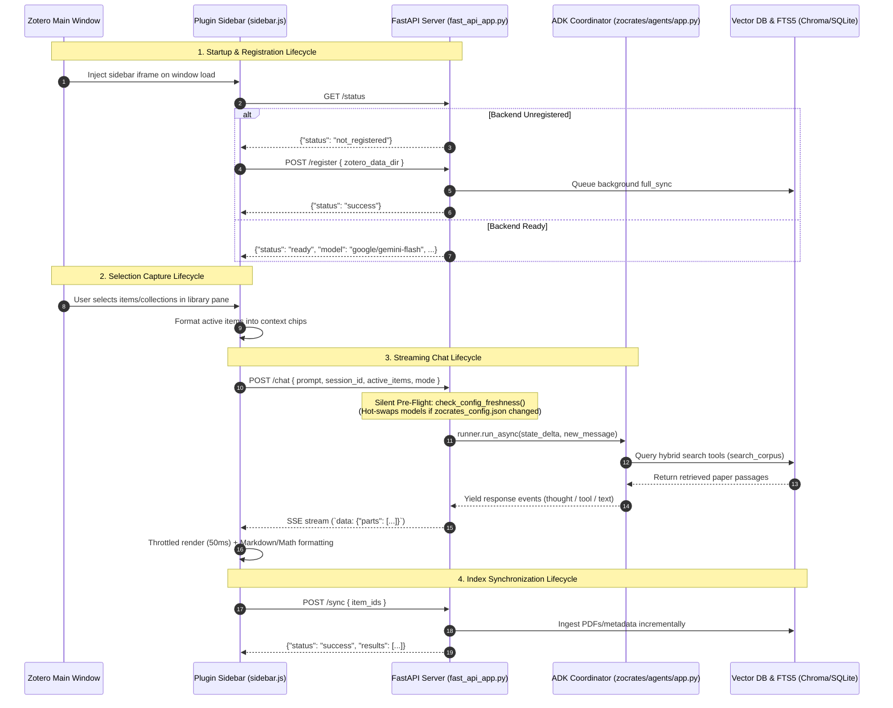
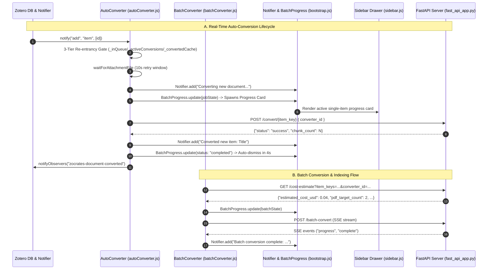
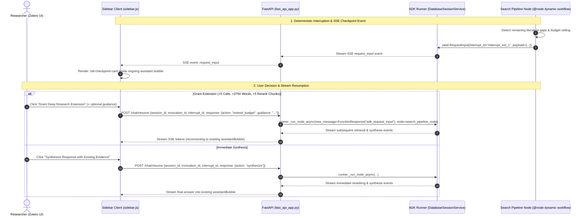

# Security and Inter-Process Communication

This document details the security architecture, communication protocols, Server-Sent Event (SSE) streaming lifecycles, and REST API surface that connect the Zotero frontend extension (`zotero-plugin/addon/`) to the local Python backend server (`zocrates/fast_api_app.py`).

---

## 1. High-Level Architecture Overview

Zocrates employs a decoupled hybrid architecture:
* **Frontend Extension**: Operates within Zotero's Mozilla Firefox Gecko browser environment (`bootstrap.js`, `sidebar.js`, `sidebar.html`, `readerContext.js`).
* **Local Python Backend**: Operates as a local FastAPI service bound strictly to loopback (`http://127.0.0.1:8765` as the default base port, subject to deterministic port offset allocation), orchestrating the Google Agent Development Kit (ADK) multi-agent runtime, SQLite FTS5 hybrid search engine, and Chroma vector database.



---

## 2. API Endpoints Reference

The FastAPI backend exposes primary REST and SSE endpoints on `http://127.0.0.1:8765` (the default base port, subject to deterministic port offset allocation):

| Endpoint | Method | Request Payload | Response / Output | Description |
| :--- | :--- | :--- | :--- | :--- |
| `/health` | `GET` | *None* | `HealthResponse` JSON | Fast zero-I/O heartbeat probe returning status, data directory, active LLM model, and provider directly from in-memory cache, bypassing SQLite session queries and disk IPC. Access logs are suppressed to prevent heap growth in Zotero stderr logs. |
| `/status` | `GET` | *None* | `StatusResponse` JSON | Comprehensive system status (`ready` vs `not_registered`), indexed document counts, active LLM model, hardware specifications, embedding configuration, session storage metrics, and rendering preferences. Used by Preferences, Batch Index, and Onboarding. |
| `/register` | `POST` | `{"zotero_data_dir": "<path>"}` | `RegisterResponse` JSON | Validates the Zotero data directory (`zotero.sqlite` & `storage/`), initializes service singletons and persistent session storage, and queues an initial background sync. |
| `/assets/{item_key}/{asset_path:path}` | `GET` | *None* | Raw image bytes (`image/png`, `image/jpeg`, `image/webp`, `image/svg+xml`) | Serves Open Knowledge Format (OKF) document bundle image assets for inline display in chat responses. Enforces traversal guards, an 8-character item key validation, and an image extension allowlist with `Cache-Control: max-age=3600`. Prompt evidence addresses figures via `zocrates-img://{item_key}/{path}` URIs, rewritten by the sidebar to this endpoint. |
| `/chat` | `POST` | `{"prompt": "<text>", "session_id": "<uuid>", "active_items": [...], "snippets": [...]}` | `Server-Sent Events` (`text/event-stream`) | Receives user prompts, active selection chips, and focal reader snippets. Expands collection keys, processes multimodal image snippets, updates agent state delta, and streams response parts. |
| `/chat/resume` | `POST` | `ResumeChatRequest` JSON (`session_id`, `invocation_id`, `interrupt_id`, `response: {action, guidance}`) | `Server-Sent Events` (`text/event-stream`) | Resumes an interrupted Human-In-The-Loop (HITL) chat turn awaiting user decision (granting extension budget or requesting immediate synthesis). |
| `/sync` | `POST` | `{"item_ids": [123, 456] \| null}` | `SyncResponse` JSON | Triggers manual incremental ingestion for specified item IDs or an entire library re-scan. |
| `/sessions` | `GET` | *None* | `{"sessions": [...]}` | Lists all active session manifests stored in `sessions.db`. |
| `/sessions` | `POST` | `{"title": "..."}` | `{"session": {...}}` | Creates a new conversation session in `sessions.db` with an optional title. |
| `/sessions/{session_id}` | `GET` | *None* | `{"session": {...}}` | Retrieves full session data and formatted message history, including any `pending_hitl` metadata. |
| `/sessions/{session_id}` | `DELETE` | *None* | `{"status": "success"}` | Deletes a session and its event history from `sessions.db`. |
| `/sessions/{session_id}/rewind` | `POST` | `RewindSessionRequest` JSON (`invocation_id`) | `{"status": "success", "session": {...}}` | Discards uncommitted turn events for an interrupted invocation and restores the session to its prior committed state. |
| `/sessions/storage_stats` | `GET` | *None* | `StorageStatsResponse` JSON | Returns live physical database size, session count, and freelist storage metrics for `sessions.db`. |
| `/sessions/maintenance` | `POST` | *None* | `MaintenanceResponse` JSON | Triggers session maintenance and vacuum space reclamation on demand, respecting in-flight chat locks. |
| `/rag/collections` | `GET` | *None* | `CollectionsList` JSON | Lists active and historical versioned vector collections, vector dimensions, and chunk counts. |
| `/rag/reset` | `POST` | `{"target": "active" \| "all" \| "<name>"}` | `ResetResult` JSON | Resets or clears vector collections. |
| `/rag/model` | `POST` | `{"mode": "local" \| "cloud", "model_name": "..."}` | `ModelConfigResponse` JSON | Switches embedding execution mode (local CPU/GPU Jina v5 vs cloud OpenRouter embeddings) and rebinds vector collections. |
| `/converters` | `GET` | *None* | `{"converters": [...]}` | Lists registered document converters (`markitdown`, `docling_local`, `datalab`), version stamps, active status, and API key availability. |
| `/rag/converter` | `POST` | `{"converter_id": "...", "mode": "local", "datalab_non_pdf_fallback": "markitdown"}` | `{"status": "success", ...}` | Updates the active document converter engine, execution mode, and Datalab fallback strategy in configuration. |
| `/convert/{item_key}` | `POST` | `{"converter_id": "..."} \| null` | `{"status": "success", "chunk_count": N}` | Re-converts a single document, rebuilds Markdown bundles on disk, and re-indexes into the vector database. |
| `/batch-convert` | `POST` | `{"item_keys": [...], "converter_id": "..."}` | `Server-Sent Events` (`text/event-stream`) | Streams serial batch conversion progress events (`progress`, `complete`) across selected documents with user abort support. |
| `/batch-index` | `POST` | `{"item_keys": [...] \| null}` | `Server-Sent Events` (`text/event-stream`) | Streams fast batch chunking and vector embedding for pending Markdown bundles without re-running document conversions. |
| `/library/conversion-status` | `GET` | *None* | `ConversionStatusResponse` JSON | Returns a 3-way partition summary of library documents (`indexed_count`, `pending_index_count`, `unconverted_count`) and pending item keys. |
| `/cost-estimate` | `GET` | `?item_keys=key1,key2&converter_id=datalab` | `CostEstimateResponse` JSON | Computes PDF page counts and estimated USD cost, automatically routing non-PDF items to fallback strategies ($0 cost). |
| `/items/{item_key}/status` | `GET` | *None* | `ItemStatusResponse` JSON | Queries item metadata, bundle status on disk, and `failed_converters` error history. |
| `/config` | `GET` | *None* | `{"status": "success", "config": {...}}` | Retrieves active LLM and embedding configurations, model names, base URLs, rendering preferences, and API key status. |
| `/config` | `POST` | `ConfigRequest` JSON | `{"status": "success", "config": {...}}` | Updates LLM/embedding settings, rendering flags, updates in-memory API keys, and hot-swaps active agent models in memory. |
| `/llm/openrouter_models` | `GET` | `?target_type=llm\|embedding&refresh=false` | `{"status": "ok", "models": [...]}` | Queries OpenRouter model catalog filtered by modalities and metadata with 24-hour disk and memory caching. |
| `/graph/data` | `GET` | `center_key`, `collection_key`, `depth`, `min_score`, `include_curated`, `include_tags` | `{"nodes": [...], "links": [...]}` JSON | Returns filtered nodes, links, degree counts, and community clusters for the in-Zotero network visualizer. |
| `/graph/recompute` | `POST` | `GraphRecomputeRequest` JSON (optional `item_keys`) | `{"status": "ok", "recomputed_count": N}` | Recomputes and persists paper relation edges for specified or all items, updating `item_relations.md` bundle files. |
| `/graph/view` | `GET` | *None* | `text/html` | Serves standalone offline HTML5 Canvas 2D graph visualizer mirroring the native Zotero tab. |
| `/llm/test` | `POST` | `LLMTestRequest` (optional) | `{"status": "ok", "message": "...", "response": "..."}` | Verifies connectivity to the configured or selected LLM endpoint (OpenRouter, Ollama, vLLM, OpenAI-compatible). |
| `/llm/test_embedding` | `POST` | `EmbeddingTestRequest` (optional) | `{"status": "ok", "dimension": 1024, "message": "..."}` | Verifies connectivity and auto-detects dimensionality for local or cloud embedding models. |

---

## 3. Detailed Lifecycle Sequences

### 3.1 Plugin Initialization & Backend Linkage

1. **Window Injection**: `bootstrap.js` listens for Zotero main window loads, injects the sidebar `vbox` and `iframe` (`chrome://zocrates/content/sidebar.html`), and dynamically calculates the initial pane width (one-third of the window width).
2. **Health Check**: Upon iframe load, `sidebar.js` sends `GET /status`.
3. **Auto-Registration**:
   * If `/status` returns `status: "not_registered"`, `sidebar.js` reads `Zotero.DataDirectory.dir` and sends `POST /register` with the profile path.
   * `fast_api_app.py` verifies `zotero.sqlite` and `storage/`, initializes Chroma, SQLite FTS5, and the persistent `DatabaseSessionService` (`sessions.db`), and spawns `syncer.full_sync` as a background task.
   * If the backend is offline (network error), the UI updates the status indicator to red ("Disconnected (Local Backend Offline)") and disables sync and chat interactions until the backend responds.

### 3.2 Selection Capture & Context Chip Assembly

1. **Focus-Safe Polling**: `sidebar.js` polls `ZoteroPane` selection state every 400ms (`readSelectedItemsNow()`) and listens for selection changes on the main library tree.
2. **Context Resolution**:
   * **Individual Items**: Resolves child attachments and notes to their parent bibliographic items, extracting title, creators, date, and Zotero item key.
   * **Collections**: Captures collection keys and names.
   * **Entire Library**: If nothing is selected, context mode defaults to `library`.
3. **Chip Rendering**: Dynamic DOM elements (`.paper-chip`) render above the chat input box with custom styling and individual removal (`✕`) handlers.

### 3.3 Dialogue & SSE Streaming Loop

1. **Dispatch**: The user enters a prompt and sends it. `sidebar.js` constructs the payload:

   ```json
   {
     "prompt": "Explain the highlighted formula",
     "session_id": "session-1722288000",
     "active_items": [
       { "key": "ABC12345", "title": "Attention Is All You Need", "type": "item" }
     ],
     "snippets": [
       {
         "type": "text",
         "text": "Attention(Q, K, V) = softmax(QK^T / sqrt(d_k)) V",
         "page": 4,
         "paper_title": "Attention Is All You Need",
         "authors": "Vaswani et al.",
         "parent_key": "ABC12345"
       }
     ]
   }
   ```

2. **Context Resolution & State Delta**:
   * FastAPI expands any collection items in `active_items` into individual member items using `syncer.db.get_item_keys_in_collection()` and `syncer.db.get_item_by_key()`.
   * **Focal Snippet Processing (`_process_request_snippets`)**:
     * *Text snippets*: Formatted as `<text_snippet paper="..." authors="..." page="...">` XML blocks in `focal_snippets_str`.
     * *Image snippets*: If the coordinator model supports vision, raw JPEG bytes are injected as native `types.Part.from_bytes` parts on `new_message`; if text-only, constructs an informative untranscribed tag `<image_snippet>` with full document metadata and emits an SSE notice event.
   * Sets `state_delta` for the ADK runner:
     * `active_context_items`: List of dicts `[{"item_key": str, "title": str}, ...]` representing the active document scope (or `None` for the entire library).
     * `active_context_items_str`: Formatted selection context header followed by active item titles.
     * `focal_snippets_str`: XML-formatted snippets string (programmatically stripped of `key="..."` for coordinator/synthesizer prompts while retained for retrieval tools).
     * `snippets`: Raw snippet dictionaries persisted on `user_evt.actions.state_delta["snippets"]` for immutable SQLite event logging and rewind restoration.

3. **Agent Workflow Execution**:
   * The ADK Runner executes `runner.run_async()` against `root_agent` (`coordinator_agent`).
   * `coordinator_agent` runs with `mode="chat"`, preserving full multi-turn conversation history across turns in SQLite `sessions.db`.
   * When literature retrieval is needed, the coordinator invokes `search_library`, running the dynamic workflow `search_library_pipeline_node` (autonomous ReAct retrieval -> substantive chunk filtering -> cross-encoder reranking -> synthesizer agent) sharing the runner's event queue and streaming grounded tokens to the client. When online discovery is requested, it invokes `search_online_literature`.

4. **SSE Event Stream Format**:

   ```http
   HTTP/1.1 200 OK
   Content-Type: text/event-stream

   data: {"id": "evt-1", "author": "coordinator_agent", "is_final": false, "parts": [{"thought": "Analyzing user prompt..."}]}
   data: {"id": "evt-2", "author": "coordinator_agent", "is_final": false, "parts": [{"function_call": {"name": "search_library", "args": {"request": "transformer architecture"}}}]}
   data: {"id": "evt-3", "author": "synthesizer_agent", "is_final": false, "parts": [{"text": "The paper introduces the Transformer architecture..."}]}
   data: {"id": "evt-4", "author": "coordinator_agent", "is_final": true, "parts": [{"text": "The paper introduces the Transformer architecture..."}]}
   ```

5. **Throttled Frontend Rendering**:
   * `sidebar.js` buffers incoming SSE chunks.
   * Uses a 50ms throttle buffer (`scheduleRender()`) to format Markdown and render LaTeX math expressions via KaTeX (`$$...$$` and `$...$`).
   * Calls `fixCodeBlockCopyButtons()` using direct DOM `createElementNS` to attach SVG copy buttons without string-based HTML parsing bugs.

6. **Stream Cancellation**:
   * Clicking the Stop button triggers `activeAbortController.abort()`, immediately terminating the HTTP connection and stream reader.

---

### 3.4 Auto-Conversion & Batch Ingestion Lifecycle



---

### 3.5 Human-In-The-Loop (HITL) Deep Research & Stream Resumption

When literature retrieval encounters broad or multifaceted research queries that exhaust the standard 10-call tool budget or 7,500-word ceiling while unaddressed gaps remain, execution pauses deterministically to consult the user:



#### Lifecycle Characteristics:
1. **SSE `request_input` Event Delivery**: When `search_budget_checkpoint` yields `RequestInput`, the backend emits an SSE event (`type: "request_input"`) containing `interrupt_id`, `invocation_id`, `current_calls`, `current_words`, `covered_summary`, and `missing_aspects`.
2. **Interactive Checkpoint Card**: `sidebar.js` renders `.hitl-checkpoint-card` dynamically inside the ongoing assistant turn. The card displays a progress badge (`Extension 1 of 2`), summary of gathered evidence, checklist of unaddressed aspects, an optional guidance input, and dual action buttons:
   * Primary: *"Grant Deep Research Extension"* (`action="extend_budget"`).
   * Secondary: *"Synthesize Response with Existing Evidence"* (`action="synthesize"`).
3. **Idempotent Handshake & Conflict Protection**: `POST /chat/resume` validates that `interrupt_id` is actively awaiting input, returning `409 Conflict` on stale or duplicate submissions. Any attempt to start a new chat via `POST /chat` while an interrupt is pending also receives `409 Conflict`.
4. **Visual Bubble Continuity**: When the stream resumes, `sidebar.js` reconnects directly to the existing `assistantBubble` and appends to the `liveSteps` array in `.intermediate-steps-bubble`, maintaining a single unified message bubble in chat history.
5. **Cross-Session Persistence (`pending_hitl`)**: If Zotero is closed while a checkpoint is awaiting decision, `GET /sessions/{id}` detects the unresolved interrupt and includes `pending_hitl` metadata so `sidebar.js` seamlessly re-renders the checkpoint card upon restart.
6. **Session Rewind Support**: The user can discard an incomplete paused turn by invoking `POST /sessions/{id}/rewind`, which clears the interrupted invocation via ADK's `runner.rewind_async()`.

---

## 4. LocalEmbedder Lazy-Loading & Auto-Sync Mechanics

### 4.1 Lazy-Loading Architecture
`LocalEmbedder` (`zocrates/rag/embeddings.py`) enforces strict deferred initialization:
* `LocalEmbedder.__init__` only assigns string metadata (`_model_name`, `_dimension = 768`) and initializes `_model = None`.
* PyTorch (`torch`) and Hugging Face `AutoModel.from_pretrained(...)` are not imported or executed during server boot or `GET /status`.
* Heavy model loading is deferred until `LocalEmbedder.__call__(texts)` is executed for the first time by an ingestion or retrieval task.

### 4.2 Auto-Registration Synchronization
1. When `sidebar.js` detects an unregistered backend, it issues `POST /register`.
2. `/register` initializes services and schedules `syncer.full_sync` in `FastAPI.BackgroundTasks`.
3. `full_sync` scans `zotero.sqlite` for unindexed items:
   * **Versioned Collections**: Chroma uses collection names based on model and dimension (e.g. `zotero_library_jinaai_jina_embeddings_v5_text_nano_768d`). If a model specification or collection name changes, Chroma creates a fresh collection where `store.is_ingested(item_key)` evaluates to `False`.
   * **New or Unindexed Items**: Any item, child note, or standalone note not present in the active Chroma collection is processed.
4. When `full_sync` encounters the first unindexed item, it invokes `store.ingest_document()`, triggering `embedder(texts)`.
5. That initial call triggers `LocalEmbedder._load()`, causing Hugging Face `huggingface_hub` to verify cache files and PyTorch to load model weights to compute embeddings.

---

## 5. Security Safeguards and Defense-in-Depth

Zocrates operates inside Zotero's privileged Gecko chrome environment (`SystemPrincipal`). To guarantee that local AI operations cannot be weaponized by malicious websites, untrusted PDFs, or rogue network processes, Zocrates enforces multi-layer defense-in-depth protections:

### 5.1 Local Cryptographic Authentication Token
* **256-Bit Token Generation**: The backend generates a 256-bit cryptographically secure token (`secrets.token_hex(32)`) or resolves it from `ZOCRATES_AUTH_TOKEN` / `<zotero-data-dir>/zocrates-data/backend.auth`.
* **Filesystem Permissions**: The sidecar file `<zotero-data-dir>/zocrates-data/backend.auth` is written with strict `0600` permissions (read/write only by the current user account).
* **Constant-Time Verification**: All mutating and sensitive API endpoints require authentication (`Authorization: Bearer <token>` or `X-Zocrates-Auth: <token>`) validated via constant-time byte comparison (`secrets.compare_digest`), eliminating timing side-channel attacks.
* **Minimal Probe Unauthenticated Surface**: Unauthenticated requests to `GET /status` return a safe probe payload (`{"status", "zotero_data_dir"}`) for port candidate discovery without leaking session history, configuration parameters, or cached keys.
* **Strict Parameter Scope**: Image assets (`GET /assets/...`) and the web graph visualizer (`GET /graph/view`) accept `?token=<token>` query parameters because `` tags and `window.open` cannot inject custom headers. Standard API routes reject query parameter authentication entirely.
* **Access Log Sanitization**: The HTTP request logging middleware (`log_requests`) applies regex redaction (`token=[REDACTED]`) to all URLs, ensuring credentials never leak into access logs or debug output.

### 5.2 CORS Policy Hardening
* **Elimination of Wildcards**: Wildcard origins (`*`) with credentials are completely prohibited.
* **Explicit Boundary Whitelist**: Access is restricted strictly to local extension origins (`chrome://zocrates`, `moz-extension://*`) via `ALLOW_ORIGINS` and regex boundary validation, preventing external browser tabs from making cross-origin requests to the loopback server.

### 5.3 Zero-I/O Background Heartbeat Polling
* **Cadence & Backoff**: The frontend monitors server connectivity via `GET /health` on a 60-second active cadence, falling back to an exponential 3s to 30s cadence when offline.
* **Zero Disk IPC**: Unlike `/status`, `/health` queries data directly from in-memory configuration singletons, bypassing SQLite session queries and filesystem walks entirely.
* **Log Suppression**: Access logs for `/health` are suppressed in Uvicorn to prevent unbounded `stderr` string accumulation in Zotero process memory.
* **Visibility Gating**: When Zotero is minimized or unfocused, heartbeat requests are halted (0 requests per hour), preventing background resource drain.

### 5.4 DOM Sanitization & Gecko SystemPrincipal Protection
* **Inert DOMParser Sanitization**: Markdown output from LLMs and external paper abstracts is parsed via `DOMParser` using `text/html`.
* **Allowlist Tag Enforcement**: Strips executable tags (`<script>`, `<iframe>`, `<object>`, `<embed>`, `<form>`), removes SMIL animations, and purges all inline `on*` event handlers.
* **ID Clobbering Neutralization**: Strips clobbering `id` attributes that could shadow global DOM properties.
* **Safe Protocol Allowlist**: Links are restricted strictly to `http`, `https`, `mailto`, and `#`.

### 5.5 Filesystem Path Traversal Containment
* **Asset Endpoint Bounds**: `GET /assets/{item_key}/{asset_path:path}` validates that the requested asset path resolves strictly within the item's OKF bundle directory using Python's `Path.is_relative_to()`.
* **Key Format Verification**: The `item_key` parameter is verified against an 8-character alphanumeric regex (`^[A-Za-z0-9]{8}$`), rejecting path traversal segments like `../` or `/etc/`.

---

## 6. Implementation Architecture Mapping

* **Extension Entry Point**: `zotero-plugin/addon/bootstrap.js`
* **Sidebar Client Logic**: `zotero-plugin/addon/sidebar.js`
* **Sidebar Layout**: `zotero-plugin/addon/sidebar.html`
* **PDF Reader Context Bridge**: `zotero-plugin/addon/lib/readerContext.js`
* **Backend Entry Point & REST API**: `zocrates/fast_api_app.py`
* **Multi-Agent Composition Root**: `zocrates/agents/app.py`
* **Library Search Dynamic Workflow**: `zocrates/agents/library_search/search_pipeline.py`
* **Online Discovery Engine**: `zocrates/discovery/engine.py`
* **Hybrid Search & Vector Store**: `zocrates/rag/service_manager.py` & `zocrates/rag/vector_store.py`
* **Database Session Persistence**: `zocrates/utils/services.py`
