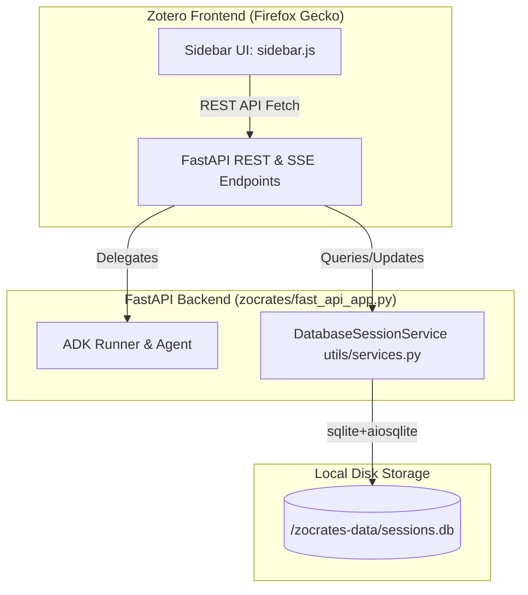
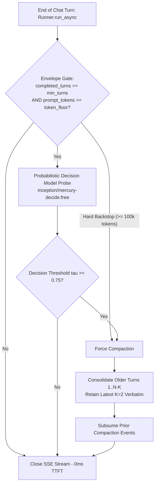
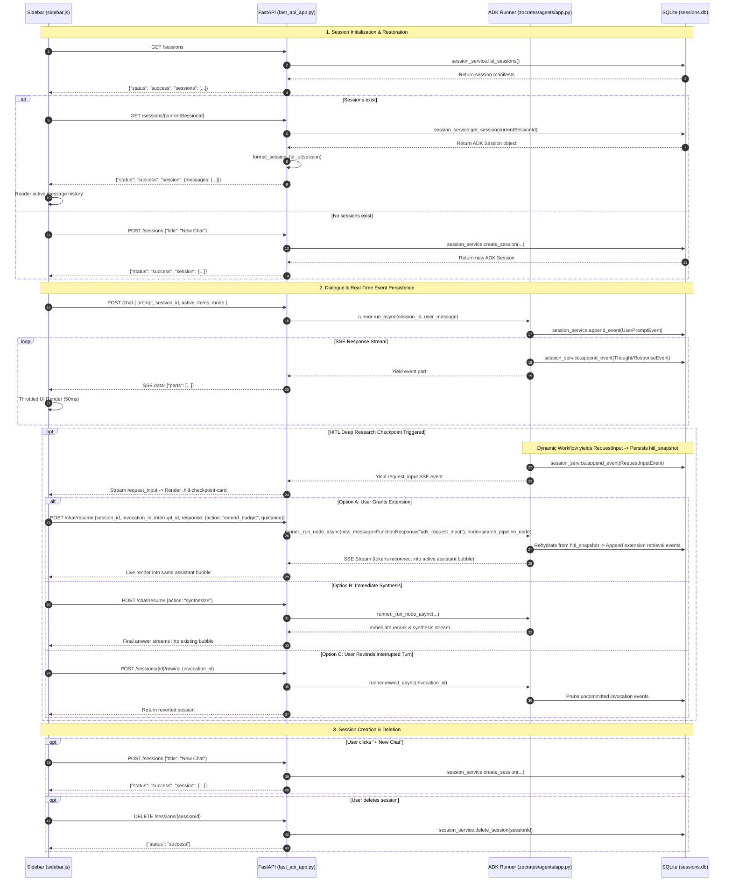
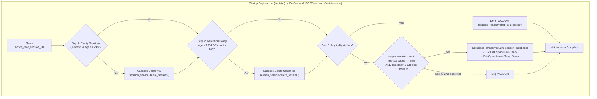

# Session Lifecycle and Persistence

This document details the architecture, storage models, REST API surface, and lifecycle workflows governing chat sessions, multi-turn history retention, adaptive context compaction, and database space reclamation in Zocrates.

---

## 1. High-Level Architectural Overview

Zocrates uses Google Agent Development Kit's (ADK) `DatabaseSessionService` backed by an asynchronous SQLite database (`sessions.db`) as the **Single Source of Truth** for all conversational interactions.

### Core Architectural Principles

1. **Single Source of Truth**: All session manifests, state variables, and turn-by-turn message events are persisted exclusively in SQLite (`sessions.db`).
2. **Turn-by-Turn Real-Time Persistence**: The ADK Runner (`runner.run_async()`) automatically appends user prompts and agent execution events (thoughts, tool invocations, text responses) to `sessions.db` in real-time during dialogue execution.
3. **Decoupled UI Schema Translation**: A backend formatting helper (`format_session_for_ui`) transforms raw ADK event streams into clean, UI-compatible message arrays (`{ id, title, created_at, messages: [...] }`) for `sidebar.js`.

---

## 2. Session Storage and Schema

### 2.1 Disk Storage and Concurrency
* **Database Path**: `<zotero-data-dir>/zocrates-data/sessions.db`
* **Driver**: `sqlite+aiosqlite:///<zotero-data-dir>/zocrates-data/sessions.db`
* **Concurrency Management**: Thread-safe asynchronous connection pool managed via `get_session_service(zotero_data_dir)`.

### 2.2 Schema Mapping: ADK Internal vs. UI Schema

| Field | ADK `Session` Model (`sessions.db`) | UI Schema (`sidebar.js`) |
| :--- | :--- | :--- |
| **Identifier** | `session.id` (e.g. `session-1722288000`) | `s.id` |
| **Title** | `session.state["title"]` (defaults to `"New Chat"`) | `s.title` |
| **Timestamps** | `session.created_at`, `session.updated_at` | `s.created_at`, `s.updated_at` |
| **Messages/Events** | `session.events` (Array of ADK `Event` objects) | `s.messages` (Formatted array of `{ role, text, thought, author, timestamp }`) |

### 2.3 Session State Keys (`session.state`)

The session state dictionary persists contextual metadata across turns:
* **`active_mode`**: Context mode key; operational context is driven by the coordinator's selection chips (papers, collection, or entire library) and autonomous tool dispatches (such as `search_library` and `search_online_literature`).
* **`active_context_items`**: List of dictionaries representing the active document scope (`[{"item_key": str, "title": str}]`) or `None` for the entire library.
* **`active_context_items_str`**: Formatted markdown header injected into the coordinator's prompt (`# Active Zotero Selection Context...`).
* **`focal_snippets_str`**: Formatted XML string of active focal excerpts (`<text_snippet...>` and `<image_snippet...>`), programmatically stripped of `key="..."` for coordinator and synthesizer prompts while retaining provenance for retrieval tools.
* **`snippets` (Per-Event)**: Stored directly on `user_evt.actions.state_delta["snippets"]` rather than a mutable session-wide state dictionary, ensuring immutable turn isolation across rewinds and clean extraction for message info modals and inline editing.
* **`retrieved_evidence`**: Persistent session audit history (bounded to `MAX_AUDIT_HISTORY_TURNS = 5`) storing per-turn queries, retrieved chunks, and citations.
* **`hitl_snapshot`**: Non-prefixed persistent checkpoint snapshot capturing complete turn state (retrieved evidence, search report, active ceilings, completed extension indices, and isolation scope) immediately prior to yielding `RequestInput`. Because ADK's `DatabaseSessionService` strips `temp:`-prefixed keys before persisting to SQLite, `hitl_snapshot` enables seamless state rehydration across process restarts. Cleared to `None` upon final turn synthesis.

---

## 3. Multi-Turn History Management and Scope Isolation

### 3.1 Coordinator Chat Mode and Scope Closure

In ADK 2.8, agents dispatched inside workflow nodes default to single-turn behavior unless explicitly configured. The Zocrates `coordinator_agent` is constructed with `mode="chat"`, guaranteeing that each turn's LLM prompt payload receives the complete unscoped conversational turn history (all prior user prompts and assistant replies).

To prevent intermediate tool executions and raw retrieval chunks from polluting the conversational context, `search_library` dispatches `search_library_pipeline_node` with an exact isolation scope (`search_library_pipeline:{fc_id}`). Upon exit, the pipeline emits a terminal `finish_task` `FunctionResponse` (`_enqueue_isolation_scope_closing_event`) in a `finally` block. This prevents ADK's `_find_active_task_scope` from treating the finished search pipeline as an active paused task, ensuring Turn 2+ user messages are stamped with `isolation_scope=None` and delivered cleanly to the coordinator.

### 3.2 ADK Active Task Scope Rewind Patch (`patch_adk_active_task_scope_rewind`)

In Google ADK 2.8.0, when a turn is rewound before an in-flight subagent pipeline completes (i.e. before `finish_task` is called), native `_find_active_task_scope` iterates `session.events` directly without calling `_apply_rewinds`. Finding an unclosed isolation scope from the rewound turn, ADK falsely treats the subagent as an active paused task waiting for user input, stamping subsequent top-level user messages with the dead subagent's `isolation_scope`. When the root coordinator runs (`isolation_scope=None`), ADK's content filter drops the user message from context.

Zocrates resolves this via `patch_adk_active_task_scope_rewind()` in `zocrates/agents/common/adk_compat.py`:
* Intercepts `adk_runners._find_active_task_scope` via a lightweight `_RewoundSessionProxy` exposing `_apply_rewinds(session.events)`.
* If an unfinished subagent pipeline was rewound, it is filtered out and returns `None`.
* Live, un-rewound active scopes (such as HITL checkpoints) continue to be recognized normally.

---

## 4. Post-Turn Adaptive Context Compaction

To maintain low latency and prevent context window exhaustion during extended research conversations, Zocrates implements **Post-Turn Decision-Model Adaptive Compaction**:

### Key Operational Characteristics

1. **Zero-Latency TTFT Execution**: Static pre-invocation compaction checks introduce latency before the first token streams. Zocrates deactivates native ADK pre-invocation triggers (`app.events_compaction_config = None`). Compaction evaluates authoritatively and sequentially at the end of `Runner.run_async` before closing the SSE stream. Turn $N+1$ receives compacted context while the user's input remains immediately typable.
2. **Envelope Gate & Invariant Clamping**: Compaction only evaluates if the conversation satisfies the strict Envelope Gate:
   $$\text{completed\_turns} \ge \text{effective\_min\_turns} \quad \text{and} \quad \text{coordinator\_prompt\_tokens} \ge \text{token\_floor}$$
   (defaults: `min_turns = 4`, `token_floor = 30000`). If misconfigured ($min\_turns \le K$), the system safely clamps `effective_min_turns = max(configured, K + 1)`. A hard token backstop at $\ge 100,000$ tokens bypasses the probe and forces immediate compaction.
3. **Decision Model Probe (`compaction_decision_probe`)**: When the envelope is satisfied, a fast probabilistic Decision Model probe (`inception/mercury-decide` at threshold $\tau = 0.75$) evaluates topic closure, progression, and anti-stuck criteria via OpenRouter Decisions API with 10.0s timeout and HTTP 429 backoff retry.
4. **Recent Context Retention ($K=2$ Verbatim)**: Retains the latest $K=2$ completed turns (Turns $N-1$ and $N$) 100% verbatim. Sets `end_timestamp` to the final event timestamp of Turn $N-K$; since retained turns have timestamps $> end\_timestamp$, Google ADK's `_process_compaction_events` leaves recent dialogue intact in the coordinator prompt.
5. **Rolling Consolidation & Subsumption**: When earlier compactions exist, `compact_session_adaptive` extracts prior summary text and slices only *new* completed turns between `prev_comp.end_timestamp` and Turn $N-K$. Slices are combined into a unified summary prompt spanning $[t_1, t_{N-K}]$, setting `start_timestamp = prev.start_timestamp` and `end_timestamp = new_slice[-1].timestamp`. Google ADK's `_is_compaction_subsumed` cleanly marks older compactions as subsumed.
6. **Pipeline Isolation Scope Filtering**: Summarization strictly ignores events with `isolation_scope` (`search_pipeline:{fc_id}`), ensuring summaries never leak raw ReAct retrieval loops while shrinking the compaction prompt by 80% to 95%.
7. **Tool Content Truncation Expansion**: Sets `_MAX_TOOL_CONTENT_CHARS = 30000` (overriding ADK's default 2,000-character ceiling) to ensure complete syntheses and `# Cited Sources` bibliographies reach the summarizer prompt without being clipped.
8. **UI & Rewind Integrity**: Compaction events are unconditionally filtered out in `format_session_for_ui`, preventing empty user bubbles (`user: ""`) in `sidebar.js`. Because ADK's SQLite event store is append-only, rewinding before a compaction boundary naturally resurrects raw events through `_apply_rewinds`.

---

## 5. Checkpoint Rehydration and Rewind Mechanics

### 5.1 Persistent Checkpoints (`pending_hitl`)
When literature retrieval hits a ceiling with unaddressed research aspects, the dynamic workflow yields `RequestInput(interrupt_id="interrupt_ext_N")`:
* **Unresolved Interrupt Tracking**: When `format_session_for_ui(session)` formats the session for the frontend, it scans `session.events` for `adk_request_input` function calls without corresponding `FunctionResponse` completions. If found, it attaches a `pending_hitl` metadata object to the session payload.
* **Frontend Restoration**: Upon reopening Zotero or switching to a paused session, `sidebar.js` detects `pending_hitl` and immediately re-renders the interactive `.hitl-checkpoint-card`.

### 5.2 Turn Rewind and Selection State Restoration
If the user cancels an interrupted turn or chooses to edit a previous prompt:
* `POST /sessions/{id}/rewind` invokes ADK's `runner.rewind_async(invocation_id=...)`, pruning uncommitted turn events from `sessions.db`.
* On rewind or inline edit, `sidebar.js` restores the target turn's original `active_context_items`, `snippets`, and `contextMode`, ensuring exact conversational replay without state drift.

---

## 6. Session REST API Reference

The FastAPI backend exposes dedicated REST endpoints for session CRUD operations on `http://127.0.0.1:8765` (the default base port, subject to deterministic port offset allocation):

| Endpoint | Method | Request Body | Response JSON | Description |
| :--- | :--- | :--- | :--- | :--- |
| `/sessions` | `GET` | *None* | `{"status": "success", "sessions": [...]}` | Lists all active session manifests (ID, title, timestamps) sorted by creation date. |
| `/sessions` | `POST` | `{"title": "..."}` | `{"status": "success", "session": {...}}` | Creates a new session in `sessions.db` and returns the UI-formatted session object. |
| `/sessions/{id}` | `GET` | *None* | `{"status": "success", "session": {...}}` | Retrieves full session data including formatted `messages` array and any active `pending_hitl` metadata. |
| `/sessions/{id}` | `DELETE` | *None* | `{"status": "success"}` | Deletes the session and its event history from `sessions.db`. |
| `/sessions/{id}/rewind` | `POST` | `RewindSessionRequest` JSON (`invocation_id`) | `{"status": "success", "session": {...}}` | Discards uncommitted turn events for an interrupted invocation via `runner.rewind_async`. |
| `/sessions/storage_stats` | `GET` | *None* | `StorageStatsResponse` JSON | Returns live physical database size, session count, and freelist storage metrics for `sessions.db`. |
| `/sessions/maintenance` | `POST` | *None* | `MaintenanceResponse` JSON | Triggers session maintenance and space reclamation on demand, respecting in-flight chat locks. |

---

## 7. End-to-End Session Lifecycle Sequences

---

## 8. Session Retention and Space Reclamation

To prevent SQLite `sessions.db` from growing without bound over months of research, Zocrates incorporates an automated **Startup and On-Demand Session Retention Engine** (`zocrates/utils/session_maintenance.py`):

### 8.1 Core Retention & Safety Invariants

1. **Pre-Traffic Execution & Zero Concurrency Contention**:
   Startup maintenance executes during `POST /register` *before* the ADK Runner is initialized and before `/chat` requests can be accepted, guaranteeing zero lock collisions on boot.
2. **24-Hour Empty Chat Immunity**:
   Empty sessions are defined strictly as having **0 events** in SQLite. Sessions younger than 24 hours are never pruned, preventing accidental deletion of newly opened chats across restarts.
3. **Dual Retention Thresholds**:
   * `session_retention_days` (default: `180`): Automatically expires sessions older than 180 days based on normalized POSIX float timestamps (`last_update_time`).
   * `max_saved_sessions` (default: `100`): Caps total sessions, pruning the oldest excess conversations in chronological order.
   * Setting either option to `0` or `null` in `zocrates_config.json` cleanly disables that pass.
4. **Active-Chat Concurrency Guard**:
   In-flight chat streams are tracked in `app.state.active_chat_session_ids` with `try...finally` cleanup. Actively streaming sessions are immune to both empty and retention pruning, and on-demand `VACUUM` calls are safely deferred if a chat is in progress.
5. **Disk-Space Guarded Fail-Open `VACUUM`**:
   Before executing `VACUUM`, available partition disk space is verified via `shutil.disk_usage()` (requiring at least $1.5\times$ DB size). If disk space is constrained or SQLite is busy, the operation safely logs and skips without interrupting system operation.
6. **Preferences UI Panel**:
   Configurable in Zotero Preferences under **"Chat Sessions & Storage"**, displaying live database size, session count, retention toggles, and an on-demand **"Clean Up Now"** button with real-time feedback.
