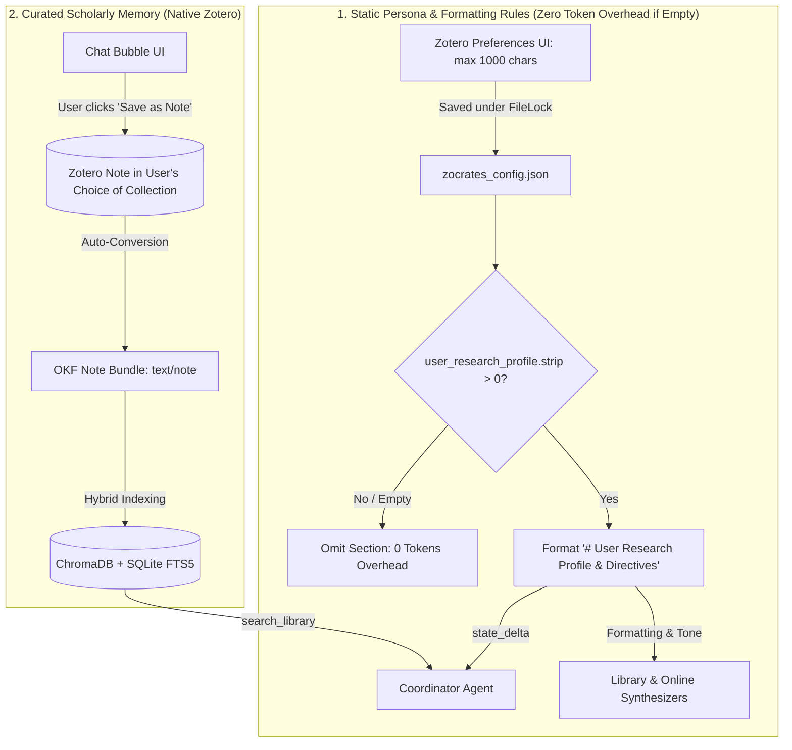
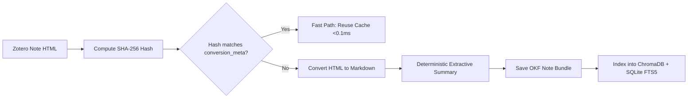
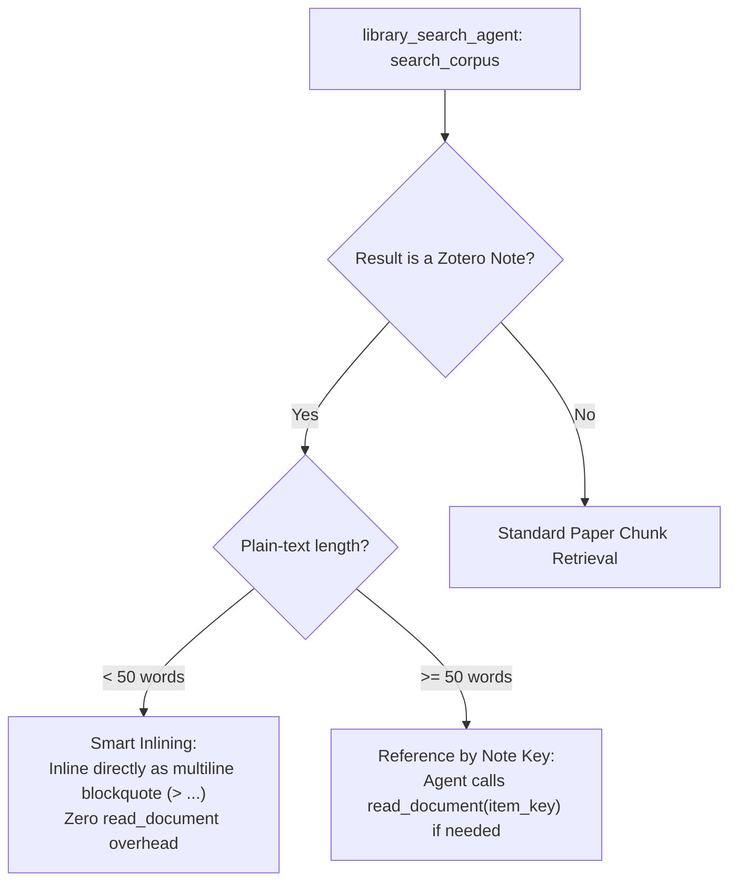
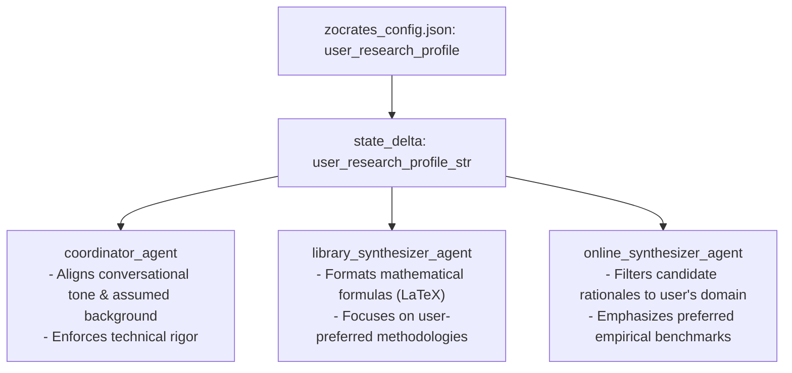

# Long-Term Memory & User-Curated Knowledge

Conversational AI systems often attempt cross-session memory by automatically scraping past chat histories into vector databases or using autonomous background agents to summarize user behavior. In academic research, this introduces severe vulnerabilities: noisy conversational tangents pollute retrieval, outdated exploratory ideas resurface as established facts, and models hallucinate false user preferences.

Zocrates rejects autonomous session scraping in favor of an authoritative, privacy-first paradigm: **User-Controlled Scholarly Note Curation** paired with a **Strictly Conditional User Research Profile**.



---

## 1. Why User-Controlled Note Curation?

The user remains the sole arbiter of what constitutes permanent knowledge:

1. **No Conversational Hallucination Loops**: Raw chat sessions are full of speculative questions, discarded hypotheses, and temporary clarifications. Indexing raw session transcripts pollutes future searches with noise.
2. **First-Class Zotero Citizens**: When a researcher clicks **"Save as Note"** on an assistant response or full session, the insight is written directly into Zotero as a native rich-text note (`text/note`). The user can edit the note, attach it to specific papers, or file it inside topic collections.
3. **Universal Searchability**: Because Zocrates' conversion pipeline treats Zotero notes as first-class document bundles, **any saved note automatically becomes part of the local RAG corpus**. In future chat turns, the literature search agent discovers and cites the researcher's own curated notes alongside peer-reviewed literature.

---

## 2. Native Note Ingestion & OKF Bundle Architecture

When a note is created or edited in Zotero, the document conversion engine materializes an Open Knowledge Format (OKF v0.2) bundle in `corpus/<note_key>/`:



### 2.1 Strictly Non-LLM Summarization Policy
To eliminate API costs and ensure deterministic execution, notes bypass LLM summarization entirely:

* **Short Notes (<100 words)**: Skip summary generation (`abstract = None`).
* **Long Notes (≥ 100 words)**: Use a deterministic, non-LLM extractive method (`abstract_source = "extractive"`) that extracts the first non-heading paragraph up to 300 characters (<5ms latency, $0 API cost).

### 2.2 SHA-256 Staleness Tracking
Edits in Zotero are tracked via SHA-256 hashes stored in `conversion_meta.db`. When an agent calls `read_document` or `get_document_toc` on a note key, `_resolve_bundle_dir` compares the current HTML hash against `source_hash`:

* If unchanged: returns the cached bundle via the fast path in **<0.1ms**.
* If edited: atomically re-materializes the bundle and updates vector/FTS indices on the fly.

---

## 3. Cross-Session Retrieval & Smart Inlining

During multi-turn research, the ReAct search agent discovers notes through standard hybrid search (`search_corpus`):



1. **Smart Note Inlining**: Notes under 50 words are inlined directly into evidence contexts as multiline blockquotes (`> ...`), saving subagent tool calls.
2. **Dual-Key Provenance Disambiguation**: Child notes attached to parent papers carry dual-key provenance headers (`[Note Key: ..., Parent Paper Key: ...]`), allowing agents to correlate notes with their parent literature.
3. **Zero Leaked Keys**: Before final response generation, `_clean_user_facing_synthesis` strips internal note keys from headings and user prose, presenting clean titles and citations.

---

## 4. User Research Profile: Static Directives & Tone

Complementing curated note memory, the **User Research Profile** establishes persistent research persona, technical depth, formatting rules, and methodology focus across all chat sessions.

### 4.1 Strict 1,000-Character Budget & Token Economics

The profile is strictly bounded in Zotero Preferences:

* **Character Ceiling**: 1,000 characters maximum (`maxlength="1000"`).
* **Word Count**: ~130 to 180 words.
* **Token Budget**: **~180 to 240 tokens** (tested across modern tokenizer models).
* **Context Impact**: Consumes less than $0.2\%$ of a standard 128k context window when populated.

### 4.2 Strict Conditional Injection (Zero Overhead When Empty)

When the profile is unconfigured, it incurs **zero token overhead**:

```python
def format_user_research_profile_context(profile_text: str | None) -> str:
    """Format user research profile for prompt injection.
    
    Returns an empty string if profile is empty or whitespace-only,
    ensuring zero prompt bloat.
    """
    if not profile_text or not profile_text.strip():
        return ""
    
    return (
        "# User Research Profile & Directives\n"
        "Adhere to the following user profile, background assumptions, "
        "and formatting preferences across your responses:\n"
        f"{profile_text.strip()}\n\n"
    )
```

If the user has not configured a profile, the section is completely omitted from LLM prompts.

---

## 5. Sample Research Profile & Disappearing Placeholder UX

The Zotero Preferences textarea features a realistic sample research profile illustrating best practices:

```text
I am a PhD researcher in Computational Biology specializing in spatial transcriptomics and single-cell RNA sequencing. My work focuses on cell-cell communication networks in tumor microenvironments.

Guidelines & Preferences:
- Always format mathematical expressions, loss functions, and statistical formulas in standard LaTeX.
- Assume advanced background in molecular biology, gene regulatory networks, and bioinformatics pipelines; skip basic explanations of genetics, PCA, or clustering.
- When discussing code, prefer Python (PyTorch, Scanpy, AnnData); ignore TensorFlow/JAX.
- Emphasize empirical rigor, benchmark datasets (e.g., Visium, MERFISH), and methodological limitations over purely theoretical proofs.
```

### Disappearing Placeholder Behavior
* **Initial State**: The sample profile is rendered in a subtle muted color (`var(--zc-text-muted)`).
* **Focus & Click**: The instant the user clicks or tabs into the input, the placeholder cleanly vanishes:
  ```css
  #zocrates-research-profile:focus::placeholder {
    color: transparent;
    opacity: 0;
  }
  ```
  This presents a clean, blank slate without requiring the user to select and delete dummy text.
* **Restoration**: If blurred while empty, the sample placeholder reappears.

---

## 6. Multi-Agent Directive Propagation

When populated, the research profile is injected into `state_delta["user_research_profile_str"]` and propagated across all relevant agent roles:



1. **`coordinator_agent`**: Adopts the user's technical background, skipping elementary introductory explanations.
2. **`library_synthesizer_agent`**: Applies formatting rules (such as rigorous LaTeX math notation and framework choices) when synthesizing library evidence.
3. **`online_synthesizer_agent`**: Tailors paper candidate rationales to the researcher's methodological focus.

---

## 7. Configuration & Storage Persistence

Configured under atomic `FileLock` in `<zotero-data-dir>/zocrates-data/zocrates_config.json`:

```json
{
  "user_research_profile": "",
  "max_research_profile_chars": 1000
}
```

* **Storage Path**: Read and written using `zocrates/config.py` under double-checked in-memory caching.
* **REST APIs**: Exposed via `GET /status` and configurable via `POST /llm/config` with server-side length validation.
* **Preferences UI**: Located in **Zotero Preferences → Zocrates → Research Profile & Directives**.
