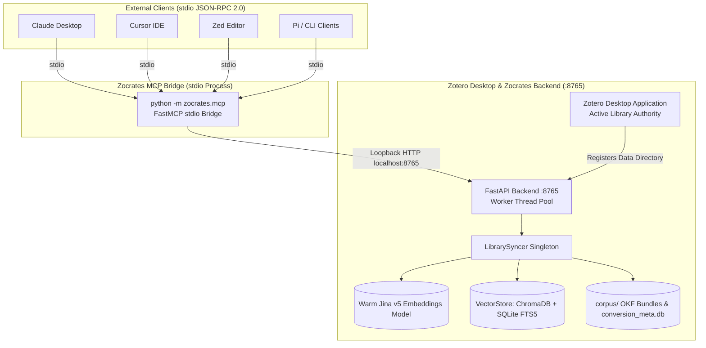

# Model Context Protocol (MCP) Server Setup

The **Zocrates Local Model Context Protocol (MCP) Server** connects your local Zotero academic library directly to external AI coding agents, IDEs, and desktop assistants—such as **Claude Desktop**, **Cursor**, **Zed**, and **Pi**—using Anthropic's open [Model Context Protocol (MCP)](https://modelcontextprotocol.io).

With Zocrates MCP enabled, external AI assistants can autonomously search your indexed literature, inspect structured tables of contents, read targeted sections, figures, and tables, explore citation networks, and conduct multi-paper literature reviews.

---

## 1. Architecture Overview



### Thin `stdio` to Loopback HTTP Bridge

Instead of spawning heavy PyTorch/CUDA instances or competing for ChromaDB SQLite file locks from separate subprocesses, Zocrates implements a **Thin Bridge Architecture**:

1. **Lightweight Bridge**: External clients spawn a lightweight bridge process (`python -m zocrates.mcp`) communicating over standard input/output (`stdio`) using standard JSON-RPC 2.0.
2. **HTTP Loopback Delegation**: The bridge dispatches all tool calls and resource requests over loopback HTTP (`http://127.0.0.1:8765`) to the running Zocrates backend.
3. **Zero ML Memory Duplication**: Reuses the backend's warm Jina v5 embedding singleton without allocating additional GPU or RAM per editor window.
4. **Zero SQLite Lock Collisions**: ChromaDB vector index queries and SQLite FTS5 searches execute through the backend's thread-safe reader-writer locks.
5. **Strict `stdout` Wire Hygiene**: The bridge guarantees that `stdout` is reserved 100% for JSON-RPC 2.0 frames. All logging, telemetry, and error traces are dynamically routed to `sys.stderr`.
6. **Harness Decoupling Guarantee**: Internal ADK coordinator restrictions (such as the 10-call search budget, 7,500 cumulative word ceilings, and HITL deep research extension prompts) apply only to the internal Zotero chat assistant. External MCP calls invoke the core retrieval toolkit directly, giving external agents full autonomy over their own research loops.
7. **Transparent Local Authentication**: To protect against browser-based loopback attacks, the backend requires authentication for all MCP routes. The bridge client (`BackendClient`) automatically resolves the local token from `ZOCRATES_AUTH_TOKEN` in `env` or directly reads the `<zotero-data-dir>/zocrates-data/backend.auth` sidecar file without manual user intervention.

---

## 2. Prerequisites

Before connecting any external MCP client:

1. **Zotero Must Be Running with Zocrates Enabled**:
   * The local backend service starts automatically with Zotero.
   * Zotero acts as the **Active Library Authority**: it authoritatively registers the user's currently active profile, custom storage path, or group library (`POST /register`). This eliminates profile ambiguity, background daemon sprawl, and multi-window spawn races.
2. **"Enable Local MCP Server" Must Be Checked**:
   * Open **Zotero Preferences** (Edit → Preferences or Zotero → Preferences on macOS).
   * Select the **Zocrates** tab.
   * Ensure the checkbox **"Enable Local MCP Server"** is enabled (enabled by default).
   * *Note*: If this setting is disabled, backend endpoints reject requests with `HTTP 403 Forbidden` and return actionable error guidance to the agent.
3. **`uv` Package Manager**:
   * Ensure `uv` is installed and available in your system `$PATH` (or use the absolute path to your `uv` executable).

> **Important: Active Backend Port & Deterministic Port Offsets**
>
> While `http://127.0.0.1:8765` is the default port, Zocrates assigns ports dynamically using **deterministic port offset allocation** (`8765 + (hash mod 100)`) based on your Zotero data directory path to avoid port collisions across profiles.
>
> The actual active port is written to `<zotero-data-dir>/zocrates-data/backend.port` and is displayed in **Zotero Preferences → Zocrates** (Status section).
>
> If an offset is assigned (e.g. `8792`), ensure `ZOCRATES_BACKEND_URL` in your client configuration is set to match that active port (e.g. `"ZOCRATES_BACKEND_URL": "http://127.0.0.1:8792"`).

---

## 3. Client Configuration Setup

### 3.1 Claude Desktop

Claude Desktop configures MCP servers via `claude_desktop_config.json`. The location of this file depends on your operating system:

| Platform | Configuration File Path |
| :--- | :--- |
| **macOS** | `~/Library/Application Support/Claude/claude_desktop_config.json` |
| **Linux** | `~/.config/Claude/claude_desktop_config.json` |
| **Windows** | `%APPDATA%\Claude\claude_desktop_config.json` |

#### Ready-to-Copy Configuration

Add the `zocrates` entry under `mcpServers`. Replace `/path/to/Zocrates` with the absolute path to your Zocrates repository:

```json
{
  "mcpServers": {
    "zocrates": {
      "command": "uv",
      "args": [
        "--directory",
        "/path/to/Zocrates",
        "run",
        "python",
        "-m",
        "zocrates.mcp"
      ],
      "env": {
        "PYTHONUNBUFFERED": "1",
        "ZOCRATES_BACKEND_URL": "http://127.0.0.1:8765",
        "ZOCRATES_AUTH_TOKEN": "<auth-token-or-auto-resolved>"
      }
    }
  }
}
```

> **Tip for macOS and Linux Users**: If `uv` is installed in `~/.local/bin/uv` or `~/.cargo/bin/uv` and not detected by GUI apps, specify the absolute path for `command`, e.g. `"/home/username/.local/bin/uv"`.
>
> **Tip for Windows Users**: Use forward slashes or double backslashes in paths, e.g. `"C:/Users/Username/Projects/Zocrates"`.

Restart Claude Desktop after editing this file. A hammer/tool icon will confirm that Zocrates retrieval tools are available.

---

### 3.2 Cursor

Cursor supports MCP servers either through the Graphical User Interface or via workspace configuration files.

#### Option A: Cursor GUI Settings
1. Open **Cursor Settings** (`Ctrl + Shift + J` or `Cmd + Shift + J`).
2. Navigate to **Features** → **MCP Servers**.
3. Click **+ Add New MCP Server**.
4. Configure the server:
   * **Name**: `zocrates`
   * **Type**: `command`
   * **Command**:
     ```bash
     uv --directory /path/to/Zocrates run python -m zocrates.mcp
     ```
5. Click **Save**.

#### Option B: Workspace `.cursor/mcp.json`
To make Zocrates MCP available for a specific project or workspace, create or edit `.cursor/mcp.json` in your workspace root:

```json
{
  "mcpServers": {
    "zocrates": {
      "command": "uv",
      "args": [
        "--directory",
        "/path/to/Zocrates",
        "run",
        "python",
        "-m",
        "zocrates.mcp"
      ],
      "env": {
        "PYTHONUNBUFFERED": "1",
        "ZOCRATES_BACKEND_URL": "http://127.0.0.1:8765",
        "ZOCRATES_AUTH_TOKEN": "<auth-token-or-auto-resolved>"
      }
    }
  }
}
```

---

### 3.3 Zed

Zed supports Model Context Protocol servers natively through context servers in its user settings.

1. Open Zed settings (`Cmd + ,` on macOS, `Ctrl + ,` on Linux/Windows), or edit `~/.config/zed/settings.json` directly.
2. Add the `zocrates` server under the `context_servers` key:

```json
{
  "context_servers": {
    "zocrates": {
      "command": {
        "path": "uv",
        "args": [
          "--directory",
          "/path/to/Zocrates",
          "run",
          "python",
          "-m",
          "zocrates.mcp"
        ],
        "env": {
          "PYTHONUNBUFFERED": "1",
          "ZOCRATES_BACKEND_URL": "http://127.0.0.1:8765",
          "ZOCRATES_AUTH_TOKEN": "<auth-token-or-auto-resolved>"
        }
      }
    }
  }
}
```

---

### 3.4 Pi and CLI MCP Clients / Developer Inspection

#### Using the Official MCP Inspector
Anthropic's official MCP Inspector allows interactive testing of tools, resources, and prompts in a browser GUI:

```bash
npx @modelcontextprotocol/inspector uv --directory /path/to/Zocrates run python -m zocrates.mcp
```

#### CLI Runners & Headless Clients
Any MCP-compliant CLI (such as `mcphost` or custom agent scripts) can spawn Zocrates using standard process execution:

```bash
PYTHONUNBUFFERED=1 ZOCRATES_BACKEND_URL=http://127.0.0.1:8765 uv --directory /path/to/Zocrates run python -m zocrates.mcp
```

---

## 4. Exposed MCP Tools

The Zocrates MCP server exposes 4 high-level academic retrieval tools:

| Tool | Purpose | Primary Arguments |
| :--- | :--- | :--- |
| `search_corpus` | Hybrid semantic + BM25 keyword search across chunks | `query` (str), `item_key` (str/list), `chunk_type` (str/list), `limit` (int, 1–20) |
| `get_document_toc` | Structural map, outline, abstract, sections, and asset catalog | `item_key` (str) |
| `read_document` | Granular reading of sections, figures, tables, or full pages | `item_key` (str), `asset_id` (str/list), `page` (int) |
| `get_related_items` | Literature graph traversal (co-citations, tags, similarity) | `item_key` (str), `ceiling` (int, 1–50) |

---

### 4.1 `search_corpus`

Executes hybrid retrieval combining Jina v5 dense semantic embeddings (cosine similarity) and SQLite FTS5 BM25 keyword matching using Reciprocal Rank Fusion (RRF).

* **Parameters**:
  * `query` (`string`, required): Natural language search query or targeted keywords.
  * `item_key` (`string` or `array of strings`, optional): Restrict search to specific Zotero item key(s) (e.g. `"ABCD1234"`). Pass `null` or omit to search the entire library.
  * `chunk_type` (`string` or `array of strings`, optional): Filter results by specific chunk types:
    * `"frontmatter"`: Bibliographic metadata, paper abstracts, authors, year, publication venue.
    * `"text"`: Body paragraphs and analytical discussion.
    * `"figure"`: Image captions and VLM synthetic visual descriptions.
    * `"table"`: Structured Markdown and CSV tables.
    * `"equation"`: Mathematical expressions.
    * `"code"`: Code listings and algorithmic blocks.
  * `limit` (`integer`, optional, default `10`): Maximum number of results to return. Clamped automatically between `1` and `20` to prevent context-window blowup.

* **Example Output**:

```json
{
  "status": "success",
  "results": [
    {
      "chunk_id": "ABCD1234:s1_c0",
      "item_key": "ABCD1234",
      "title": "Attention Is All You Need",
      "authors": ["Ashish Vaswani", "Noam Shazeer", "Niki Parmar"],
      "year": "2017",
      "chunk_type": "text",
      "heading": "1 Introduction",
      "text": "Recurrent neural networks, long short-term memory and gated recurrent neural networks...",
      "word_count": 245,
      "cosine_similarity": 0.842,
      "rrf_score": 0.033,
      "line_start": 42,
      "line_end": 75
    }
  ]
}
```

---

### 4.2 `get_document_toc`

Retrieves a structural map of a paper from its generated `toc.md`. Automatically resolves top-level parent items to converted child attachments (PDF-first priority) and materializes user notes on demand.

* **Parameters**:
  * `item_key` (`string`, required): Unique Zotero item key (e.g. `"ABCD1234"`).

* **Returns**:
  * Paper title, creators, publication year, and abstract/summary.
  * Numbered section outline (`s0`, `s1`, `s2`...) with exact line numbers and word counts.
  * Catalog of figures (`f1`, `f2`...) with 100-character caption previews.
  * Catalog of tables (`t1`, `t2`...) with row/column counts and table headers.

* **Agent Usage**: Agents should invoke `get_document_toc` before reading to identify relevant sections and asset IDs, avoiding reading entire papers end-to-end.

---

### 4.3 `read_document`

Provides granular, targeted reading of specific sections, figures, or tables from an Open Knowledge Format (OKF) bundle.

* **Parameters**:
  * `item_key` (`string`, required): Unique Zotero item key.
  * `asset_id` (`string` or `array of strings`, optional):
    * Exact section ID: `"s0"` (frontmatter), `"s1"`, `"s2"`.
    * Exact asset ID: `"f1"` (figure), `"t1"` (table).
    * Array of IDs: `["s1", "s2", "t1"]`.
    * Fuzzy heading query: `"methodology"` or `"results"`.
  * `page` (`integer`, optional): If `asset_id` is omitted, reads the document in ~3,000-word paginated windows (1-indexed).

* **Asset Enrichment**:
  * **Tables**: Return raw structured CSV text for tabular data analysis.
  * **Figures**: Return synthetic VLM captions and loopback image URLs (`http://127.0.0.1:8765/assets/{item_key}/{path}`) so multimodal LLMs can inspect underlying figures directly.

---

### 4.4 `get_related_items`

Discovers related literature and citations in the user's library using the pre-computed graph in `conversion_meta.db`.

* **Parameters**:
  * `item_key` (`string`, required): Unique Zotero item key.
  * `ceiling` (`integer`, optional, default `25`): Maximum number of related papers to return (clamped between `1` and `50`).

* **Returns**:
  * Connected papers ranked by relevance with relation categories:
    * `human_curated`: Explicit Zotero item-to-item relations created by the user.
    * `hybrid_search`: Dense embedding + BM25 content-similarity links.
    * `shared_tags`: Strong overlap in user tags and academic descriptors.

---

## 5. Exposed MCP Resources

The MCP server exposes 3 standard URI resources:

| Resource URI | MIME Type | Description |
| :--- | :--- | :--- |
| `zotero://library/index` | `text/markdown` | Root-level catalog (`index.md`) listing all converted documents, creators, publication years, and file paths. |
| `zotero://items/{item_key}/document.md` | `text/markdown` | Full Markdown content of the OKF document bundle for item `{item_key}`. |
| `zotero://items/{item_key}/relations` | `text/markdown` | Structured Markdown table of verified literature neighborhood relations. |

---

## 6. Exposed MCP Prompt Templates

### `literature_review`

Guides an external AI agent through a systematic 4-step literature review workflow:

* **Arguments**:
  * `topic` (`string`, required): The research question or topic to investigate.
  * `max_papers` (`integer`, optional, default `5`): Maximum number of core papers to deeply inspect (clamped between `1` and `20`).

* **Workflow**:
  1. **Step 1: Broad & Targeted Retrieval**: Calls `search_corpus(query=topic)` and `search_corpus(chunk_type="frontmatter")` to identify candidate literature.
  2. **Step 2: Metadata & Structure Triage**: Inspects candidates using `get_document_toc(item_key)` and `get_related_items(item_key)` to select top papers.
  3. **Step 3: Targeted Reading & Evidence Extraction**: Selectively reads key methodology, results, and figures using `read_document(item_key, asset_id=...)`.
  4. **Step 4: Grounded Academic Synthesis**: Compares findings, identifies research gaps, and attributes all claims to explicit Zotero item keys (`[ITEM_KEY]`).

---

## 7. Error Handling and Diagnostics

When a request cannot be fulfilled, Zocrates returns clear, actionable error objects:

| Condition | Response Code / Status | Returned Message / Guidance |
| :--- | :--- | :--- |
| **Zotero is Closed** | `ConnectError` → `status: "error"` | `"Zocrates backend service is offline. Please open Zotero with Zocrates enabled to access your active library."` |
| **MCP Disabled** | `HTTP 403 Forbidden` → `status: "error"` | `"MCP server access is disabled in Zocrates preferences. Please enable it in Zotero Preferences -> Zocrates to allow external AI tools to query your library."` |
| **Sync Pending** | `HTTP 503 Service Unavailable` → `status: "error"` | `"Zotero library is not yet registered or synced. Please open Zotero with Zocrates enabled."` |
| **Paper Not Found** | `HTTP 404 Not Found` → `status: "error"` | `"Document bundle for {item_key} not found or not yet converted."` |
| **Backend Busy** | `TimeoutException` → `status: "error"` | `"Zocrates backend timed out while processing retrieval. The server may be busy with a batch-indexing or conversion task. Please retry shortly."` |

---

## 8. Verification and Troubleshooting

### 1. Test Backend Readiness
Verify that the Zocrates FastAPI backend is running on loopback:
```bash
curl http://127.0.0.1:8765/status
```
Expected output includes `"status": "ready"` (or `"status": "not_registered"` if Zotero has not yet synced).

### 2. Test Stdio Bridge Execution
Run the bridge script directly from the terminal to verify process launch:
```bash
uv --directory /path/to/Zocrates run python -m zocrates.mcp
```
The process begins reading JSON-RPC requests on `stdin` and writes diagnostic logs to `stderr`. Press `Ctrl + C` to exit.

### 3. Verify Preferences Configuration
If an external agent reports that MCP access is disabled:
1. In Zotero: **Preferences** → **Zocrates** → Check **Enable Local MCP Server**.
2. Or inspect `zocrates_config.json`:
   ```bash
   grep "enable_mcp_server" <zotero-data-dir>/zocrates-data/zocrates_config.json
   ```
