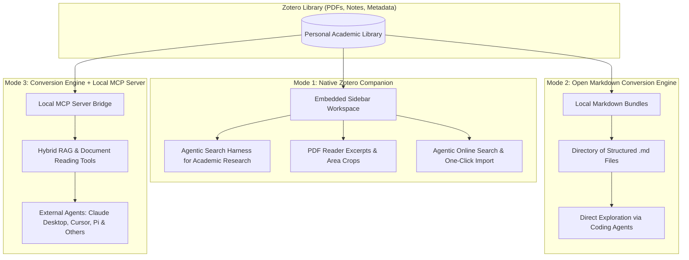
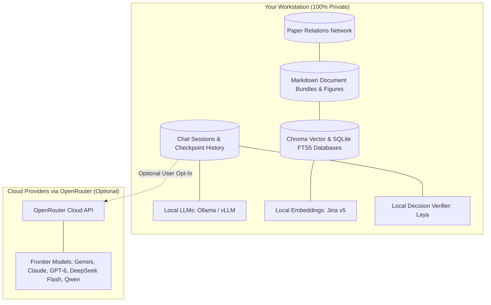
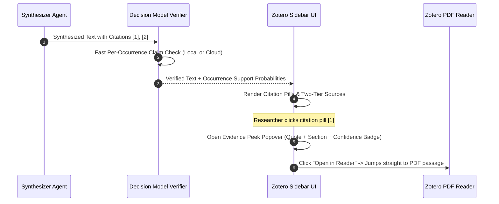
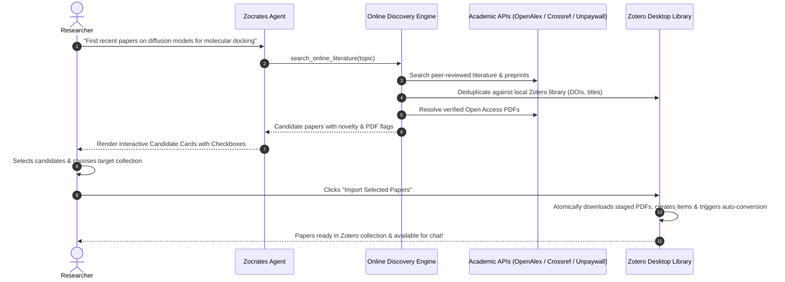
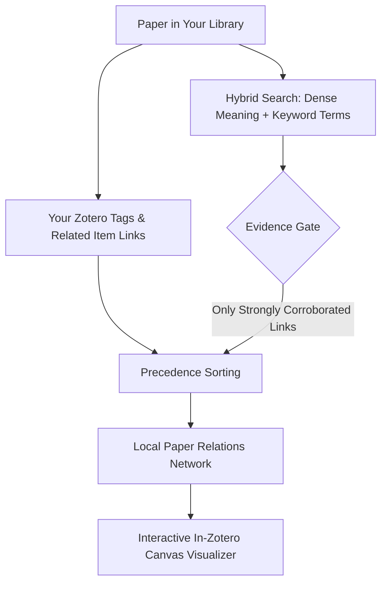

# Why Zocrates for Zotero Users

Zocrates transforms your personal Zotero library into an active, verifiable, and deeply integrated research partner. Built specifically for Zotero and running on the user's workstation, Zocrates integrates artificial intelligence directly into the desktop research workflow without compromising privacy, scholarly rigor, or user control.

Rather than locking literature behind closed commercial platforms or treating documents as opaque text dumps, Zocrates is built around four fundamental commitments:

1. **Multiple Ways to Work**: Operates as an embedded companion inside Zotero, as an open Markdown document conversion engine, or as a local Model Context Protocol (MCP) server for external coding agents and editors.
2. **Local-First, Private, and Hardened by Design**: Search databases, converted documents, chat histories, and deterministic literature graphs live entirely on your workstation. The system enforces multi-layer defense-in-depth security—cryptographic loopback authentication, strict cross-origin isolation, Gecko `SystemPrincipal` privilege guards, allowlist DOM sanitization, and filesystem traversal containment. While running completely offline with local models is supported, using cloud models via OpenRouter is available for researchers seeking maximum speed, efficiency, and reasoning quality without workstation-grade GPUs.
3. **Scholarly Rigor & Verifiable Truth**: Every synthesized assertion is anchored in exact passages, backed by automated citation verification, and designed to ensure that no considered evidence is silently omitted.
4. **End-to-End Scholarly Experience**: Includes native rendering of LaTeX mathematical expressions, inline paper figures, interactive Mermaid diagrams, and user-curated long-term memory via native Zotero notes, alongside agentic online search that discovers and imports novel literature directly into Zotero collections with one click.

---

## 1. Three Flexible Ways to Use Zocrates

Zocrates adapts to varied scholarly workflows by providing three primary operational modes:

### Mode 1: The Native Companion in Zotero

For researchers who want an integrated desktop experience without leaving Zotero:

* **Embedded Workspace**: Operates directly inside Zotero's main window as a split-pane sidebar that automatically matches the active Zotero theme.
* **Custom Academic Search Harness**: Features an autonomous retrieval pipeline engineered specifically for literature research. It autonomously navigates your library, searches hybrid indices, checks tables of contents, and reads targeted sections before synthesizing an answer.
* **Human-In-The-Loop Deep Research**: When tackling complex surveys or multi-paper comparisons, the search engine pauses and displays an interactive checkpoint card directly in the chat. It summarizes what it has discovered, highlights remaining knowledge gaps, and allows you to extend the search with custom guidance or synthesize immediately.
* **Micro-Focal PDF Reader Integration**: Right-click highlighted text or draw an area box around a figure or table in Zotero's PDF reader to add it instantly to your chat context.
* **User-Curated Long-Term Memory via Zotero Notes**: Save individual answers, syntheses, or entire research sessions directly as native Zotero rich-text notes with a single click. Because Zocrates converts and indexes Zotero notes alongside PDFs, past research and syntheses automatically inform future chat sessions across your library.
* **Online Discovery & One-Click Import**: When questions reach beyond your current collection, Zocrates can autonomously search scholarly databases online, filter out duplicates, and stage new open-access papers for immediate import into your library.

### Mode 2: The Open Markdown Conversion Engine

For researchers who prefer working with files directly or using coding agents:

* **Clean, Human-Readable Markdown**: Automatically converts academic PDFs, HTML snapshots, and rich-text Zotero notes into organized Open Knowledge Format (OKF) document bundles.
* **Structured Knowledge Bundles**: Each paper receives its own directory containing clean Markdown text, bibliographic metadata (authors, year, publication, DOI), extracted high-resolution figures, structured tables, and a hierarchical Table of Contents (`toc.md`).
* **Direct Agent Exploration**: You can open your preferred coding agent (such as Cursor, Claude, or Pi) directly in the converted Markdown folder. The agent can search, read, and cross-reference files using standard filesystem tools.

### Mode 3: Conversion Engine + Local MCP Server

For researchers who want external coding agents and desktop assistants to access their entire library with high precision:

* **Model Context Protocol (MCP) Integration**: Exposes your Zotero library over the open Model Context Protocol standard to tools like **Claude Desktop**, **Cursor**, **Zed**, **Pi**, and any other agentic application that supports MCP.
* **Dual-Channel Retrieval Tools**: External agents are equipped with specialized academic tools that allow them to:
  1. *Perform Hybrid RAG Search*: Search across the entire library using combined semantic and keyword search.
  2. *Read Converted Documents Individually*: Inspect structural tables of contents and read targeted sections or complete papers.
  3. *Traverse Literature Relationships*: Query 1-hop connected papers discovered in your local literature graph.
* **Lightweight Local Bridge**: Connects external assistants to the running Zocrates backend with zero duplicate memory overhead, reusing warm local models and keeping database access fast and safe.

---

## 2. Local-First, Private, and User-Controlled

Academic literature frequently involves unpublished manuscripts, proprietary datasets, and sensitive research topics. Zocrates prioritizes data privacy and local ownership:

### Complete Local Storage

* **Local Search Databases**: Both the dense vector database (ChromaDB) and the full-text keyword search index (SQLite FTS5) reside locally on your disk.
* **Local Converted Documents**: Converted Markdown files, extracted figures, and structured tables remain on your local filesystem under your direct ownership.
* **Local Deterministic Literature Graph**: The network of connections and relationships between papers is calculated and stored strictly locally on your machine using deterministic algorithms (statistical keyphrases and hybrid retrieval) requiring **zero LLM calls and zero cloud requests**.
* **Local Curated Note Memory**: Saved research notes and synthesis summaries live directly in your Zotero database as native rich-text notes, automatically converted and indexed into your local vector and full-text databases for future search.
* **Local Chat Histories**: Every conversation, user note, and deep research checkpoint is saved securely in a local database (`sessions.db`).

### Freedom of Compute: Local or Cloud

* **Fully Offline & Air-Gapped**: Run completely disconnected from the internet. Use local models via Ollama or vLLM, local Jina embeddings on your CPU or GPU, and local decision models for citation verification.
* **Multi-Vendor Hardware Acceleration**: Zocrates automatically detects and accelerates local models across NVIDIA GPUs (CUDA), Apple Silicon (Metal), AMD GPUs (ROCm), and Intel GPUs (XPU), with an efficient multi-threaded CPU fallback.
* **Flexible Cloud Access via OpenRouter**: When you want the reasoning capabilities of frontier models, Zocrates connects seamlessly to OpenRouter, giving you the freedom to choose any commercial or open model you prefer.
* **Secure Key Storage**: API keys are never stored in plain-text configuration files; they are protected inside Mozilla's encrypted Login Manager (`Services.passwords`).
* **Transparent Configuration**: Every setting, budget limit, and model selection is stored transparently on disk in `zocrates_config.json`. There are no hidden configuration flags.

### Mix-and-Match Hybrid Orchestration

Zocrates supports **hybrid flexibility**, allowing you to mix and match providers and models across different layers of the system:

* **Per-Agent Multi-Model Pinning (`override_agent_models`)**: Assign different models and providers to individual agent roles in `zocrates_config.json`:
  * *Coordinator*: Fast local model (e.g. `ollama/llama3`, `ollama/mistral`) for conversational dialogue.
  * *Library Search Subagent*: High-speed local model (Ollama or vLLM) to execute the autonomous ReAct retrieval loop, querying local vector and full-text indices without sending raw library queries over the internet.
  * *Scientific Synthesizer*: Frontier remote reasoning model (e.g., Claude Sonnet, DeepSeek Flash, Gemini Pro via OpenRouter) for deep inductive synthesis, cross-paper comparison, and rigorous attribution.
* **Privacy-Gated Library Crawling**: By running the retrieval agent locally and the synthesizer on a cloud model, raw library queries, full-text indexes, and un-retrieved files never leave your computer—only the final, distilled evidence excerpts are forwarded to the synthesis model.
* **Component-Level Decoupling**:
  * *Vector Embeddings*: Run 100% offline in-process via hardware-accelerated `jina-embeddings-v5-text-nano` (zero cloud token costs, zero API rate limits) while freely using cloud reasoning models for conversation.
  * *Decision-Model Verification*: Run per-occurrence citation verification through local Laya (`http://127.0.0.1:8005`) or remote Mercury Decide independently of your main chat LLM.
  * *VLM Figure Captioning*: Connect to local vision models or cloud vision models independently of your text dialogue configuration.

### Defense-in-Depth Security Architecture

Because Zotero extensions operate with elevated privileges (`SystemPrincipal`), Zocrates implements comprehensive security protections:

* **Cryptographic Loopback Authentication & Origin Isolation**: The backend binds exclusively to loopback (`127.0.0.1`) and requires a cryptographically random 256-bit bearer token. CORS headers explicitly restrict access to internal extension protocols (`chrome://zocrates`, `moz-extension://*`), preventing cross-origin attacks from browser tabs.
* **Gecko `SystemPrincipal` Privilege Protection & Stored XSS Neutralization**: Untrusted content (paper abstracts, candidate titles, LLM-generated Markdown) is filtered through inert, allowlist-based DOM sanitization (`DOMParser` with `text/html`) that strips dangerous tags (`<script>`, `<iframe>`, `<object>`), eliminates SMIL animations, neutralizes all inline `on*` event handlers, sanitizes SVG Mermaid diagrams, and removes DOM/window-clobbering `id` attributes. Link schemes are strictly restricted to `http`, `https`, `mailto`, and `#`.
* **Path Traversal & Filesystem Containment**: During document conversion and asset unpacking, all relative references and file unpack paths are subjected to strict boundary checks (`is_relative_to`), preventing crafted PDFs or HTML documents from escaping the bundle directory to read, copy, or overwrite arbitrary files on your host machine.
* **Native Encrypted Credential Vault**: Sensitive API keys are stored exclusively in Mozilla Firefox/Zotero's encrypted Login Manager (`Services.passwords` / `Services.logins`).

### Pragmatic Transparency: Why Cloud Models Are Recommended

While Zocrates fully supports running completely offline, executing high-parameter reasoning models locally requires substantial dedicated hardware—specifically modern GPUs with generous VRAM buffers.

For the vast majority of researchers, **connecting to cloud models via OpenRouter is the recommended option for optimal speed, efficiency, and depth of reasoning**:

* **Fast Frontier Reasoning**: Instant access to top-tier reasoning and synthesis models with rapid response generation.
* **Zero Heavy Hardware Overhead**: Operates smoothly on standard laptops and office desktops without thermal throttling, multi-gigabyte memory bloat, or complex local model setups.
* **Local Data with Ephemeral Queries**: Even when using OpenRouter for synthesis, your core knowledge assets—converted Markdown files, vector indices, full-text keyword databases, paper relation graphs, and chat histories—remain stored 100% locally on your computer. Only the specific context needed for your immediate question is dispatched to the chosen model.
* **Zero Data Retention (ZDR) Options**: For researchers concerned about confidentiality when using cloud providers, OpenRouter features endpoints and models that support strict **Zero Data Retention**—guaranteeing that prompts and retrieved literature excerpts are not logged, persisted, or used for model training.
* **Total Provider and Cost Control**: You select the exact model tier that fits your budget, without being locked into any single vendor.

---

## 3. Scholarly Rigor: Citations You Can Truly Trust

A major risk of conversational AI in academic work is the appearance of plausible but fabricated assertions, subtle numerical errors, and omitted counter-evidence. Zocrates treats attribution as an absolute priority.

### In-Text Citations & Interactive Evidence Peeks

* **Clean Citations**: References appear as standard bracketed numbers (`[1]`, `[2]`, `[1, 2]`) following relevance order—never exposing internal database IDs.
* **Interactive Evidence Popovers**: Clicking any citation opens an anchored popover showing:
  * Exact bibliographic details (authors, year, venue).
  * Exact section breadcrumbs (`§ Section Name`).
  * An extractive quote from the source paper.
  * A visual confidence badge indicating empirical support strength (`High`, `Moderate`, `Low`).
* **One-Click Reader Navigation**: Jump instantly from a citation popover directly to the corresponding passage in Zotero's built-in PDF Reader, or locate the paper in your library tree.

### 100% Evidence Recall: Two-Tier Sources

Standard AI search tools often silently discard papers they retrieved if they did not cite them directly in the final text. Zocrates guarantees that no analyzed literature is hidden:

* **Tier 1 (`# Cited Sources`)**: Papers that directly back specific claims in the synthesized answer.
* **Tier 2 (`## Other Considered Sources`)**: Papers that were gathered and evaluated during the search process but not explicitly cited.
* **Total Transparency**: You always see the complete picture of what the system evaluated, including potential alternative perspectives or related findings.

### Automated Per-Occurrence Citation Verification

To catch subtle misattributions and over-claiming:

* Fast, calibrated decision models evaluate claims on a **per-occurrence** basis, ensuring that each individual sentence is backed by its cited passage.
* If a compound citation like `[1, 2]` contains one claim that is supported and one that is not, the failing citation is pruned while the valid one is kept.
* If verification cannot confirm an assertion, the document is moved to Considered Sources rather than falsely presented as confirmed evidence.
* Can run using zero-cost cloud decision models or entirely offline using a local verification daemon.

### Distraction-Free Reading & Clean Manuscript Export

* **Citation Toggle**: A quick switch lets you hide citation pills when you want to read uninterrupted prose.
* **Clean Text Copying**: When citations are hidden, copying text produces clean prose; when visible, copying automatically formats proper academic citations (e.g. `(Vaswani et al., 2017)`) with a complete Markdown bibliography ready to paste into your draft.

---

## 4. Fluid In-Zotero Workflow & Rich Scholarly Presentation

Zocrates fits naturally into the way scholars actually read, organize, and interpret literature, providing rich visual formatting that respects academic conventions.

### Flexible Selection with Context Chips

* **Seamless Scoping**: Select individual papers to focus on specific methodologies, select a collection folder to restrict search to a research topic, or select nothing to explore your entire library.
* **Sticky Mode for Multi-Paper Curation**: Enable the thumbtack button to browse across different collections and folders, clicking items to assemble a temporary research bundle without losing your selections when clicking blank space.

### PDF Reader Integration: Text Excerpts & Area Crops

* **Add to Context from PDF**: When reading a paper in Zotero's PDF reader, simply right-click a highlighted passage or draw an area annotation box around a diagram, chart, or equation, and select **"Zocrates: Add to Context"**.
* **Automatic Paper Scoping**: Adding an excerpt automatically links the parent paper into your chat context so you can immediately ask targeted questions.
* **Multimodal Figure Understanding**: Visual area crops (diagrams, architecture sketches, curves) are passed directly to vision-capable models for instant visual analysis.
* **Live Update on Annotation Resize**: If you adjust the bounding box of an area annotation in the PDF reader, Zocrates updates the preview and payload automatically.
* **Reliable Turn History**: Excerpts stay attached while you compose your prompt, are preserved if you stop generation, and are faithfully restored if you rewind or edit a prior question.

### Rich Scholarly Presentation: Math, Figures, Diagrams, and Code

Scholarly communication relies on precise notation, visual evidence, and executable logic. Zocrates renders all four natively within the chat:

* **LaTeX Mathematical Expressions**: Equations and mathematical notation are rendered natively using KaTeX. Both inline expressions (`$E = mc^2$`) and display blocks (`$$\int_{-\infty}^{\infty} e^{-x^2} dx = \sqrt{\pi}$$`) appear cleanly formatted.
* **Figures Directly from Papers**: When discussing experimental results, model architectures, or diagrams, Zocrates surfaces and displays high-resolution figures extracted directly from your papers inline within chat responses.
* **Visual Mermaid Diagrams**: Generates and renders interactive workflows, taxonomies, and system architectures directly in chat. Every diagram includes a non-destructive toggle between the rendered visual graphic and raw code, making it simple to copy diagrams into manuscripts.
* **Syntax-Highlighted Code Blocks**: Computational methods, algorithms, and data analysis pipelines are presented in formatted code blocks with language indicators and one-click copy buttons.

### 1-Click Save as Zotero Notes: User-Curated Long-Term Memory

* **Native Zotero Note Creation**: Save any individual assistant response, comparative analysis, or entire research session directly into Zotero as a native rich-text note (attached as a child note to a specific paper or placed into any collection).
* **Automatic Local Re-indexing**: Because Zocrates converts and indexes Zotero notes alongside PDFs, your saved notes immediately become part of your local vector and full-text databases.
* **Searchable Cross-Session Memory**: In future chat sessions, past conclusions, literature summaries, and personalized notes are automatically retrieved and synthesized alongside raw paper text—creating an evolving, user-curated long-term memory that stays 100% private on your workstation.

---

## 5. Agentic Online Literature Discovery & One-Click Import

A researcher's questions frequently extend beyond the papers already in their library. Discovering relevant external literature usually means jumping to external web search engines, filtering through irrelevancies, manually checking if a paper is already in Zotero, downloading PDFs, and importing them one by one.

Zocrates integrates this entire discovery-to-library workflow directly into the conversational interface:

### Autonomous Multi-Source Academic Discovery

* When prompted to find new literature, Zocrates conducts an agentic online search querying major scholarly indices (OpenAlex, Crossref, and Unpaywall).
* Synthesizes findings across sources to identify high-impact papers, preprints, and recent breakthroughs related to your research questions.

### Smart Local Deduplication

* Before presenting any candidate, Zocrates automatically checks DOIs, arXiv identifiers, and normalized titles against your local Zotero database.
* It guarantees that you are never recommended papers you already have in your library, keeping your focus strictly on genuinely novel literature.

### Interactive Candidate Cards in Chat

* Discovered papers are rendered as interactive cards inside the chat bubble, complete with title, authors, publication year, journal or conference venue, abstract summaries, and Open Access availability indicators.
* Checkboxes allow you to curate precisely which candidates you want to keep.

### One-Click Import & Open Access PDF Staging

* **Direct Library Write-Back**: Select your desired target collection in Zotero and click import.
* **Automatic PDF Retrieval**: For Open Access papers, Zocrates automatically stages and downloads verified PDF attachments and links them directly to the new Zotero item.
* **Instant Ingestion**: Newly imported papers are immediately handed off to the conversion engine, making them instantly searchable and readable in your next chat turn.

---

## 6. Deep Document Ingestion & Multimodal Understanding

Academic literature contains dense layouts, mathematical notation, multi-panel figures, and personal annotations. Zocrates standardizes this rich material into clean, accessible formats:

* **Multi-Engine Document Conversion**: Automatically parses PDFs using modern layout engines that reconstruct two-column flows, extract mathematical formulas into LaTeX, and isolate figures and data tables.
* **First-Class Zotero Notes**: Rich-text notes authored in Zotero are converted in memory and indexed alongside published papers, allowing the assistant to cross-reference your personal thoughts with the literature.
* **Multimodal Figure Captioning**: Charts, graphs, and diagrams without explicit captions are automatically analyzed by Vision-Language Models. The generated descriptions are indexed, making visual figures searchable by their actual contents.
* **Structural Tables of Contents**: Pre-generates hierarchical outlines with section boundaries, enabling both human readers and AI agents to survey long monographs and skip straight to relevant sections.
* **Real-Time Automatic Sync**: As soon as you add a new paper or delete an old one in Zotero, Zocrates updates its indices in the background without requiring manual re-indexing.

---

## 7. Exploring Literature Relationships Without Hallucinations

Discovering how papers relate to one another across your library is essential for literature reviews, understanding academic debates, and identifying research lineages:

### Evidence-Gated Connections: Strictly Local & Deterministic

Standard graph tools often force every paper to connect to a set number of neighbors, creating misleading links between unrelated topics. Zocrates generates its literature graph **strictly locally using deterministic algorithms** (statistical keyphrase extraction and reciprocal rank fusion hybrid scoring) requiring **zero LLM calls and zero cloud requests**:

* **100% Deterministic & Air-Gapped**: Generates relationships entirely on your local CPU (<0.2 ms per paper) with zero token costs, zero cloud API dependencies, and zero AI hallucinations.
* **Dual-Channel Verification**: Edges are formed only when both dense semantic meaning and specific academic terminology corroborate each other mathematically.
* **Unconnected Papers**: If a paper in your library has no true siblings, it remains unconnected. Zocrates will never invent spurious links just to make a graph look full.
* **Honoring Human Curation**: Incorporates relationships you have already established in Zotero, including manual "Related" links and distinctive tags.

### Native In-Zotero Canvas Visualizer

* **100% Offline & Fast**: Opens as a dedicated visualizer tab directly inside Zotero without relying on external web services.
* **Clustering Physics**: Employs layout physics that prevent clusters from collapsing into an unreadable tangle, keeping distinct research topics visually distinct.
* **Interactive Navigation**: Click any paper node in the graph to immediately select it in your Zotero library tree or open its PDF in the reader.

---

## 8. Responsive Long-Running Research Conversations

Deep scholarly inquiries often take dozens of turns—exploring alternative theories, testing counter-arguments, and refining summaries. Zocrates ensures that extended dialogues remain fast, focused, and responsive:

* **Fast Multi-Turn Dialogues**: Automatically consolidates earlier conversational turns in the background without delaying new messages, ensuring your chat never slows down or runs out of memory.
* **Verbatim Recent History**: Your most recent conversational turns are always preserved word-for-word, ensuring immediate context and nuance are never lost.
* **Zero Cognitive Noise**: Intermediate retrieval loops and raw text chunks are cleanly isolated from the main conversation, keeping the chat history clean and focused on your questions and answers.
* **Turn Rewind & In-Place Editing**: If you want to change direction or refine a question, you can rewind or edit previous turns; Zocrates cleanly restores your original selection context and active excerpts.
* **Automatic Background Management**: Provisions its own lightweight local environment automatically, keeps data completely isolated per Zotero profile, and shuts down cleanly whenever Zotero exits.

---

## 9. Summary: The Zocrates Value Matrix

| Dimension | Native Zotero Experience | With Zocrates Enabled |
| :--- | :--- | :--- |
| **Ways to Work** | Manual reading across tabs and static collection folders. | **Three flexible modes**: Native Zotero companion, open Markdown conversion engine, and local MCP server for external agents. |
| **Data Privacy & Security** | Local reference database on your computer. Plaintext preference storage. | **100% local-first data with defense-in-depth runtime security**: Search databases, converted Markdown, relation graphs, and chat histories stored locally on your machine. Fortified with **cryptographic loopback auth**, **strict CORS isolation**, **DOM allowlist sanitization** protecting Gecko SystemPrincipal privileges, **filesystem path containment**, and **encrypted Login Manager key storage**. Fully supports offline local models, with OpenRouter recommended for speed and efficiency (including **Zero Data Retention** options). |
| **PDF Reading & Excerpts** | Highlighting and annotating text stored as static marks in PDFs. | **Interactive context excerpts**: Right-click text or area boxes in the PDF reader to analyze passages, charts, and formulas with AI. |
| **Scholarly Presentation** | Plain unformatted text in notes or chat extensions. | **Native LaTeX math**, **inline figures from papers**, **interactive Mermaid diagrams**, and **syntax-highlighted code blocks**. |
| **Online Literature Discovery** | Manual searching on external websites, downloading PDFs, and dragging into Zotero. | **Agentic online search & one-click import**: Queries academic APIs, deduplicates against your library, stages Open Access PDFs, and imports directly into Zotero collections. |
| **Evidence & Attribution** | Manually searching open PDFs to verify assertions. | **Verified citations & evidence popovers**: Exact section breadcrumbs, extractive quotes, confidence badges, and one-click reader navigation. |
| **Attribution Completeness** | External AI search tools often silently drop unmentioned sources. | **Two-Tier Sources guarantee**: 100% of evaluated evidence is transparently reported in Cited Sources or Considered Sources. |
| **Literature Retrieval** | Basic keyword search in metadata or PDF text. | **Autonomous academic search harness**: Multi-step hybrid search, structural ToC browsing, section reading, and substantive content filtering. |
| **Deep Research Control** | Fixed limits that stop prematurely or run up unpredictable costs. | **Human-In-The-Loop checkpoints**: Interactive in-chat cards to review progress, inspect knowledge gaps, and steer deeper retrieval. |
| **Document Understanding** | Unindexed diagrams and dense formulas locked in PDFs. | **Multi-strategy conversion**: Layout-aware parsing, synthetic figure captioning, structured ToCs, and first-class Zotero notes. |
| **Literature Relationships** | Manually linking items one by one in metadata. | **Strictly local deterministic relation graph**: Generated 100% locally using deterministic algorithms (statistical keyphrases + hybrid retrieval, 0 LLM calls). Honest connections without spurious links, paired with a native, offline Canvas visualizer. |
| **Cross-Tool Extensibility** | Data accessible only within Zotero. | **Local Model Context Protocol (MCP)**: Lets Claude Desktop, Cursor, Pi & others search and read your library while you code or write. |
| **Conversational Stamina** | N/A (Stateless reference manager). | **Responsive long-running chat**: Intelligent background context management keeps marathon dialogues fast and coherent. |
| **Long-Term Memory & Research Continuity** | Chat insights lost upon closing the window; notes disconnected from AI tools. | **User-curated long-term memory via native Zotero notes**: Save individual answers or full research sessions as rich Zotero notes. Notes are automatically indexed alongside PDFs, ensuring past findings and syntheses inform future chat sessions. |

---

## 10. Conclusion: A Companion on Your Own Terms

Zocrates does not replace Zotero; it unlocks the full intellectual potential of what you have already built. By honoring the curation in your library and providing verifiable attribution, complete data privacy, and flexible ways to work, Zocrates transforms a static archive into an active intellectual workspace.

Whether you use it as an in-depth conversational companion inside Zotero, explore your converted papers directly with coding agents, discover and import novel literature from online academic databases, or connect your library to your favorite external editor via MCP, Zocrates adapts to your workflow while ensuring your research remains private, verifiable, and entirely under your control.
