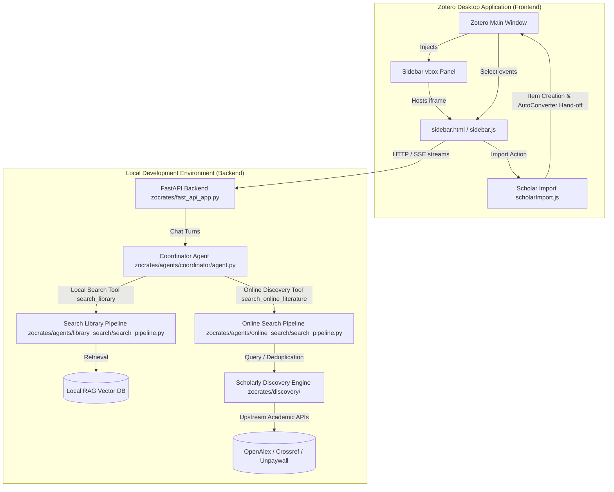

# Zocrates

Zocrates is an LLM-powered assistant copilot and scholarly research agent embedded directly within the [Zotero](https://www.zotero.org/) desktop environment. It connects your local academic library to multi-agent retrieval workflows, hybrid vector/keyword search, AI decision-model citation verification, and online literature discovery.

> **Why "Zocrates"?**  
> The name **Zocrates** is a portmanteau of **Zotero** and **Socrates**, honoring the classical philosopher renowned for dialectical inquiry and intellectual honesty. Rather than acting as an ungrounded oracle, Zocrates embodies the Socratic method by actively questioning literature, probing research gaps, and demanding verifiable evidence for every claim. It transforms your personal Zotero collection from a passive repository into an inquisitive, rigorous dialogue partner.

---

## System Architecture

Zocrates consists of two primary layers: a **Frontend Extension** embedded inside Zotero and a **Local Backend Server** running an AI agent orchestrator.

---

## Core Components

### 1. Zotero Plugin (`zotero-plugin/addon/`)

Runs natively inside Zotero using Firefox's Gecko browser environment:

* **`bootstrap.js`**: Extension entry point that dynamically injects the sidebar split panel (`vbox` + `iframe`) into Zotero's main window layout, supervises backend process lifecycles via `Subprocess.sys.mjs`, and manages authentication sidecars.
* **`sidebar.html` / `sidebar.js`**: HTML5 chat client interface supporting context chips, streaming LLM completions, predictive ghost-text suggestions, and interactive citation popovers.
* **`readerContext.js`**: Zotero PDF reader bridge capturing text excerpts and canvas area crops, tracking live annotation updates, and injecting focal snippets into the chat context.
* **`scholarImport.js`**: In-process Zotero write-back engine for atomic collection import of discovered literature and staged Open Access PDFs.

### 2. Python Backend & Multi-Agent Architecture (`zocrates/`)

Runs locally as an autonomous web service and agent harness:

* **FastAPI Server (`zocrates.fast_api_app`)**: Exposes REST and Server-Sent Event (SSE) endpoints for status probes, library registration, document synchronization, session lifecycle, and conversational streaming.
* **Root Coordinator (`zocrates.agents.coordinator`)**: Root conversational orchestrator (`coordinator_agent`) managing dialogue turns, dynamic tool dispatch, and the predictive next-prompt engine (`predictor.py`).
* **Library Search Pipeline (`zocrates.agents.library_search`)**: Autonomous ReAct search subagent, substantive chunk filtering, cross-encoder reranking, asynchronous AI decision-model citation verification, and grounded academic synthesis.
* **Dual-Channel Retrieval Paradigm (Combined Semantic & Structural Vectorless RAG)**: Replaces naive "chunk salad" vector search with a flexible dual-channel retrieval engine. Uses hybrid dense (Jina v5) + sparse (SQLite FTS5 BM25) search for broad exploratory queries across the entire library, and switches immediately to surgical, vectorless Table of Contents reading (`read_document(asset_id='sX')`) for targeted investigations—preserving complete arguments, unbroken mathematical derivations, and tables with maximum token efficiency.
* **Online Literature Discovery (`zocrates.agents.online_search` & `zocrates.discovery`)**: External scholarly discovery pipeline searching across OpenAlex, Unpaywall, and Crossref with local Zotero deduplication and PDF staging.
* **Retrieval & RAG Engine (`zocrates.rag`)**: Local vector indexing via ChromaDB, SQLite FTS5 hybrid search, Jina v5 embeddings, document conversion (PDF/Markdown/HTML/Notes), OKF document bundles, and graph-theoretic paper relation mapping.
* **Model Context Protocol (`zocrates.mcp`)**: High-performance loopback MCP server over `stdio` JSON-RPC exposing library search, ToC navigation, document reading, and relations to external coding assistants.
* **Mix-and-Match Multi-Model Flexibility**: Full provider hybridization allowing researchers to mix and match local (Ollama / vLLM) and cloud (OpenRouter) models across the multi-agent pipeline. Power users can pin specific models to individual subagent roles (e.g., fast local models for ReAct retrieval loops to keep raw library search queries strictly offline, combined with frontier cloud reasoning models for final grounded synthesis) or decouple components (hardware-accelerated offline Jina embeddings paired with cloud reasoning).

---

## API Reference

Explore the full module documentation and code reference in the [API Reference](reference/index.md).
